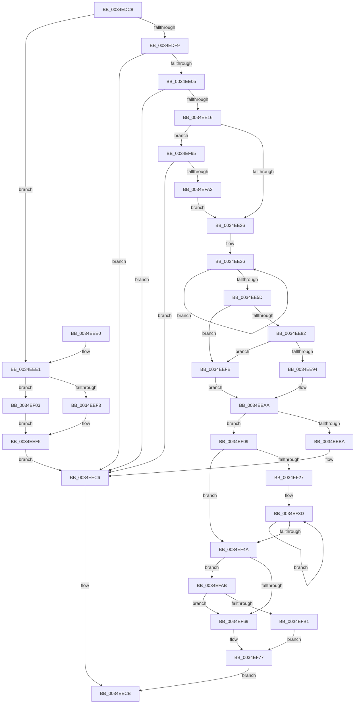

# MiCheckSystemTrimEndCriteria

- RVA: `0x0034EDC8`–`0x0034EFB7` (길이 `495` bytes)
- VA: `0x000000014034EDC8`
- 실행 섹션: `.text`
- PDB 이름 있음: `예`; PDB Function 태그: `아니요`
- unwind 정보 RVA: `0x00078BB0`
- 디코드: `129`개 명령, `495/495` bytes 표시
- 미해석 바이트: `0` (있으면 어셈블리에 `.byte`로 보존)

> 이 문서는 커널 이미지의 기계어와 PDB 기호를 분석해 생성했습니다. 4번과 5번은 함수 원형과 자료형을 바이너리 사용 방식에서 추정한 C 해석이며 원본 소스 복구 결과는 아닙니다.

## 1. Dependencies

- 직접 호출 지점: **6**; 고유 호출 대상: **5**
- 직접 호출자로 확인된 함수: **1**
- RIP 상대 이미지 참조: **3**

### Outgoing calls
- `0x0034EE6E` → [MiReleaseSpinLockExclusive](../24/MiReleaseSpinLockExclusive_function_002482C0.md) (function, `0x002482C0`)
- `0x0034EE8B` → [MiCanFlushMakeProgress](../3B/MiCanFlushMakeProgress_function_003BC9D0.md) (function, `0x003BC9D0`)
- `0x0034EEA5` → [KeDelayExecutionThread](../20/KeDelayExecutionThread_function_00209550.md) (function, `0x00209550`)
- `0x0034EEC1` → [ExAcquireSpinLockExclusive](../24/ExAcquireSpinLockExclusive_function_00248690.md) (function, `0x00248690`)
- `0x0034EF7D` → [MiLogContinueTrim](../4C/MiLogContinueTrim_function_004C3D34.md) (function, `0x004C3D34`)
- `0x0034EF89` → [ExAcquireSpinLockExclusive](../24/ExAcquireSpinLockExclusive_function_00248690.md) (function, `0x00248690`)

### Direct callers
- [MiProcessWorkingSets](MiProcessWorkingSets_function_0034E710.md) at `0x0034E998`

### Static image references
- `0x0034EE67` → RVA `0x00E374C0` (`.data`; read)
- `0x0034EE9A` → RVA `0x00010780` (`.rdata`; read)
- `0x0034EF0C` → RVA `0x000110F0` (`.rdata`; read)

## 2. Other-region calls and transfers

- 다른 실행 섹션으로 향하는 call: **0**
- 별도 외부 분기/꼬리 이동을 확인하지 못했습니다.

## 3. Assembly (complete function range)

```asm
0034EDC8  48 89 5C 24 08                  mov qword ptr [rsp + 8], rbx
0034EDCD  48 89 6C 24 10                  mov qword ptr [rsp + 0x10], rbp
0034EDD2  48 89 74 24 18                  mov qword ptr [rsp + 0x18], rsi
0034EDD7  57                              push rdi
0034EDD8  48 83 EC 20                     sub rsp, 0x20
0034EDDC  8A 42 02                        mov al, byte ptr [rdx + 2]
0034EDDF  45 8A D8                        mov r11b, r8b
0034EDE2  48 8B B1 C0 44 00 00            mov rsi, qword ptr [rcx + 0x44c0]
0034EDE9  2C 02                           sub al, 2
0034EDEB  48 8B DA                        mov rbx, rdx
0034EDEE  48 8B E9                        mov rbp, rcx
0034EDF1  3C 01                           cmp al, 1
0034EDF3  0F 86 E8 00 00 00               jbe 0x14034eee1
0034EDF9  8A 02                           mov al, byte ptr [rdx]
0034EDFB  24 7F                           and al, 0x7f
0034EDFD  3C 04                           cmp al, 4
0034EDFF  0F 83 C1 00 00 00               jae 0x14034eec6
0034EE05  48 8B 89 00 49 00 00            mov rcx, qword ptr [rcx + 0x4900]
0034EE0C  48 3B 4A 48                     cmp rcx, qword ptr [rdx + 0x48]
0034EE10  0F 83 B0 00 00 00               jae 0x14034eec6
0034EE16  48 8B 42 50                     mov rax, qword ptr [rdx + 0x50]
0034EE1A  33 FF                           xor edi, edi
0034EE1C  48 39 42 60                     cmp qword ptr [rdx + 0x60], rax
0034EE20  0F 83 6F 01 00 00               jae 0x14034ef95
0034EE26  4C 8B C7                        mov r8, rdi
0034EE29  4C 8D 96 58 01 00 00            lea r10, [rsi + 0x158]
0034EE30  44 8B CF                        mov r9d, edi
0034EE33  48 2B D6                        sub rdx, rsi
0034EE36  4A 8B 84 12 B0 FE FF FF         mov rax, qword ptr [rdx + r10 - 0x150]
0034EE3E  41 83 F9 06                     cmp r9d, 6
0034EE42  49 89 02                        mov qword ptr [r10], rax
0034EE45  4D 8D 52 08                     lea r10, [r10 + 8]
0034EE49  4A 8D 0C 00                     lea rcx, [rax + r8]
0034EE4D  49 0F 42 C8                     cmovb rcx, r8
0034EE51  41 FF C1                        inc r9d
0034EE54  4C 8B C1                        mov r8, rcx
0034EE57  41 83 F9 08                     cmp r9d, 8
0034EE5B  72 D9                           jb 0x14034ee36
0034EE5D  48 89 8E 50 01 00 00            mov qword ptr [rsi + 0x150], rcx
0034EE64  41 8A D3                        mov dl, r11b
0034EE67  48 8D 0D 52 86 AE 00            lea rcx, [rip + 0xae8652]
0034EE6E  E8 4D 94 EF FF                  call 0x1402482c0
0034EE73  48 8B 85 C0 4B 00 00            mov rax, qword ptr [rbp + 0x4bc0]
0034EE7A  48 3D 20 04 00 00               cmp rax, 0x420
0034EE80  72 79                           jb 0x14034eefb
0034EE82  33 D2                           xor edx, edx
0034EE84  48 8B CD                        mov rcx, rbp
0034EE87  44 8D 42 22                     lea r8d, [rdx + 0x22]
0034EE8B  E8 40 DB 06 00                  call 0x1403bc9d0
0034EE90  85 C0                           test eax, eax
0034EE92  74 67                           je 0x14034eefb
0034EE94  FF 86 E8 01 00 00               inc dword ptr [rsi + 0x1e8]
0034EE9A  4C 8D 05 DF 18 CC FF            lea r8, [rip - 0x33e721]
0034EEA1  33 D2                           xor edx, edx
0034EEA3  33 C9                           xor ecx, ecx
0034EEA5  E8 A6 A6 EB FF                  call 0x140209550
0034EEAA  4C 8B 85 00 49 00 00            mov r8, qword ptr [rbp + 0x4900]
0034EEB1  48 8B 53 48                     mov rdx, qword ptr [rbx + 0x48]
0034EEB5  4C 3B C2                        cmp r8, rdx
0034EEB8  72 4F                           jb 0x14034ef09
0034EEBA  48 8D 0D FF 85 AE 00            lea rcx, [rip + 0xae85ff]
0034EEC1  E8 CA 97 EF FF                  call 0x140248690
0034EEC6  B8 01 00 00 00                  mov eax, 1
0034EECB  48 8B 5C 24 30                  mov rbx, qword ptr [rsp + 0x30]
0034EED0  48 8B 6C 24 38                  mov rbp, qword ptr [rsp + 0x38]
0034EED5  48 8B 74 24 40                  mov rsi, qword ptr [rsp + 0x40]
0034EEDA  48 83 C4 20                     add rsp, 0x20
0034EEDE  5F                              pop rdi
0034EEDF  C3                              ret
0034EEE0  CC                              int3
0034EEE1  48 8B BE 20 01 00 00            mov rdi, qword ptr [rsi + 0x120]
0034EEE8  B8 20 01 00 00                  mov eax, 0x120
0034EEED  48 39 7A 60                     cmp qword ptr [rdx + 0x60], rdi
0034EEF1  72 10                           jb 0x14034ef03
0034EEF3  33 FF                           xor edi, edi
0034EEF5  48 89 3C 30                     mov qword ptr [rax + rsi], rdi
0034EEF9  EB CB                           jmp 0x14034eec6
0034EEFB  FF 86 EC 01 00 00               inc dword ptr [rsi + 0x1ec]
0034EF01  EB A7                           jmp 0x14034eeaa
0034EF03  48 2B 7A 50                     sub rdi, qword ptr [rdx + 0x50]
0034EF07  EB EC                           jmp 0x14034eef5
0034EF09  0F B6 03                        movzx eax, byte ptr [rbx]
0034EF0C  48 8D 0D DD 21 CC FF            lea rcx, [rip - 0x33de23]
0034EF13  83 E0 7F                        and eax, 0x7f
0034EF16  49 2B D0                        sub rdx, r8
0034EF19  4C 8B C7                        mov r8, rdi
0034EF1C  44 0F B6 0C 08                  movzx r9d, byte ptr [rax + rcx]
0034EF21  41 83 F9 08                     cmp r9d, 8
0034EF25  73 23                           jae 0x14034ef4a
0034EF27  B8 08 00 00 00                  mov eax, 8
0034EF2C  48 8D 8E 58 01 00 00            lea rcx, [rsi + 0x158]
0034EF33  41 2B C1                        sub eax, r9d
0034EF36  4A 8D 0C C9                     lea rcx, [rcx + r9*8]
0034EF3A  44 8B C8                        mov r9d, eax
0034EF3D  4C 03 01                        add r8, qword ptr [rcx]
0034EF40  48 8D 49 08                     lea rcx, [rcx + 8]
0034EF44  49 83 E9 01                     sub r9, 1
0034EF48  75 F3                           jne 0x14034ef3d
0034EF4A  0F 57 C0                        xorps xmm0, xmm0
0034EF4D  48 8D 82 00 01 00 00            lea rax, [rdx + 0x100]
0034EF54  0F 11 43 08                     movups xmmword ptr [rbx + 8], xmm0
0034EF58  0F 11 43 18                     movups xmmword ptr [rbx + 0x18], xmm0
0034EF5C  0F 11 43 28                     movups xmmword ptr [rbx + 0x28], xmm0
0034EF60  0F 11 43 38                     movups xmmword ptr [rbx + 0x38], xmm0
0034EF64  4C 3B C0                        cmp r8, rax
0034EF67  73 42                           jae 0x14034efab
0034EF69  8A 03                           mov al, byte ptr [rbx]
0034EF6B  8D 48 01                        lea ecx, [rax + 1]
0034EF6E  32 C8                           xor cl, al
0034EF70  80 E1 7F                        and cl, 0x7f
0034EF73  32 C8                           xor cl, al
0034EF75  88 0B                           mov byte ptr [rbx], cl
0034EF77  48 8B D3                        mov rdx, rbx
0034EF7A  48 8B CD                        mov rcx, rbp
0034EF7D  E8 B2 4D 17 00                  call 0x1404c3d34
0034EF82  48 8D 0D 37 85 AE 00            lea rcx, [rip + 0xae8537]
0034EF89  E8 02 97 EF FF                  call 0x140248690
0034EF8E  33 C0                           xor eax, eax
0034EF90  E9 36 FF FF FF                  jmp 0x14034eecb
0034EF95  48 81 F9 20 04 00 00            cmp rcx, 0x420
0034EF9C  0F 83 24 FF FF FF               jae 0x14034eec6
0034EFA2  48 89 7A 60                     mov qword ptr [rdx + 0x60], rdi
0034EFA6  E9 7B FE FF FF                  jmp 0x14034ee26
0034EFAB  8A 03                           mov al, byte ptr [rbx]
0034EFAD  84 C0                           test al, al
0034EFAF  78 B8                           js 0x14034ef69
0034EFB1  0C 80                           or al, 0x80
0034EFB3  88 03                           mov byte ptr [rbx], al
0034EFB5  EB C0                           jmp 0x14034ef77
```

## 4. C-style interpretation (structured pseudocode)

```c
__int64 __fastcall MiCheckSystemTrimEndCriteria(__int64 a1, __int64 a2, unsigned __int8 a3)
{
    __int64 result;
    __int64 v_rdi;
    __int64 v_rsp;
    unsigned __int64 v_stack_p10;
    unsigned __int64 v_stack_p18;
    unsigned __int64 v_stack_p8;

    v_stack_p8 = v_rbx;
    v_stack_p10 = v_rbp;
    v_stack_p18 = v_rsi;
    v_rsp = (v_rsp) - (32);
    result = (unsigned __int8)((*(unsigned __int8 *)(a2 + 2)) - (2));
    if (((unsigned __int8)(result)) <= 1) goto loc_0034EEE1;
    result = (unsigned __int8)((*(unsigned __int8 *)(a2)) & (127));
    if (((unsigned __int8)(result)) >= 4) goto loc_0034EEC6;
    if ((*(unsigned __int64 *)(a1 + 18688)) >= (*(unsigned __int64 *)(a2 + 72))) goto loc_0034EEC6;
    v_rdi = 0;
    if ((*(unsigned __int64 *)(a2 + 96)) >= (*(unsigned __int64 *)(a2 + 80))) goto loc_0034EF95;
loc_0034EE26:
    a2 = (a2) - (*(unsigned __int64 *)(a1 + 17600));
loc_0034EE36:
    *(unsigned __int64 *)(*(unsigned __int64 *)(a1 + 17600) + 344) = *(unsigned __int64 *)(a2 + *(unsigned __int64 *)(a1 + 17600) + 344 * 1 - 336);
    a1 = *(unsigned __int64 *)(a2 + *(unsigned __int64 *)(a1 + 17600) + 344 * 1 - 336) + 0 * 1;
    if (0 < 6) { a1 = 0; }
    a4 = (unsigned int)((0) + 1);
    if (((unsigned int)(a4)) < 8) goto loc_0034EE36;
    *(unsigned __int64 *)(*(unsigned __int64 *)(a1 + 17600) + 336) = a1;
    result = MiReleaseSpinLockExclusive(v_rip + 11437650, a3, a1, a4);
    if ((*(unsigned __int64 *)(a1 + 19392)) < 0x420ULL) goto loc_0034EEFB;
    a2 = 0;
    result = MiCanFlushMakeProgress(a1, a2, a2 + 34, a4);
    if ((unsigned int)(result) == 0) goto loc_0034EEFB;
    a2 = 0;
    a1 = 0;
    result = KeDelayExecutionThread(a1, a2, v_rip - 3401505, a4);
loc_0034EEAA:
    if ((*(unsigned __int64 *)(a1 + 18688)) < (*(unsigned __int64 *)(a2 + 72))) goto loc_0034EF09;
    result = ExAcquireSpinLockExclusive(v_rip + 11437567, *(unsigned __int64 *)(a2 + 72), *(unsigned __int64 *)(a1 + 18688), a4);
loc_0034EEC6:
loc_0034EECB:
    v_rsp = (v_rsp) + (32);
    return 1;
loc_0034EEE1:
    if ((*(unsigned __int64 *)(*(unsigned __int64 *)(a2 + 72) + 96)) < (*(unsigned __int64 *)(v_stack_p18 + 288))) goto loc_0034EF03;
    v_rdi = 0;
loc_0034EEF5:
    *(unsigned __int64 *)(288 + v_stack_p18 * 1) = 0;
    goto loc_0034EEC6;
loc_0034EEFB:
    goto loc_0034EEAA;
loc_0034EF03:
    v_rdi = (v_rdi) - (*(unsigned __int64 *)(*(unsigned __int64 *)(a2 + 72) + 80));
    goto loc_0034EEF5;
loc_0034EF09:
    result = (unsigned int)((*(unsigned __int8 *)(v_stack_p8)) & (127));
    a2 = (*(unsigned __int64 *)(a2 + 72)) - (*(unsigned __int64 *)(a1 + 18688));
    if (((unsigned int)(*(unsigned __int8 *)(result + v_rip - 3399203 * 1))) >= 8) goto loc_0034EF4A;
    result = (unsigned int)((8) - ((unsigned int)(*(unsigned __int8 *)(result + v_rip - 3399203 * 1))));
loc_0034EF3D:
    a3 = (v_rdi) + (*(unsigned __int64 *)(v_stack_p18 + 344 + *(unsigned __int8 *)(result + v_rip - 3399203 * 1) * 8));
    a4 = ((unsigned int)((unsigned int)(result))) - (1);
    if (condition_is_not_equal) goto loc_0034EF3D;
loc_0034EF4A:
    *(unsigned __int64 *)(v_stack_p8 + 8) = v_xmm0;
    *(unsigned __int64 *)(v_stack_p8 + 24) = v_xmm0;
    *(unsigned __int64 *)(v_stack_p8 + 40) = v_xmm0;
    *(unsigned __int64 *)(v_stack_p8 + 56) = v_xmm0;
    if (a3 >= (a2 + 256)) goto loc_0034EFAB;
loc_0034EF69:
    a1 = (unsigned __int8)((*(unsigned __int8 *)(v_stack_p8) + 1) ^ ((unsigned __int8)(*(unsigned __int8 *)(v_stack_p8))));
    a1 = (unsigned __int8)((a1) & (127));
    a1 = (unsigned __int8)((a1) ^ ((unsigned __int8)(*(unsigned __int8 *)(v_stack_p8))));
    *(unsigned __int8 *)(v_stack_p8) = (unsigned __int8)(a1);
loc_0034EF77:
    result = MiLogContinueTrim(v_stack_p10, v_stack_p8, a3, a4);
    result = ExAcquireSpinLockExclusive(v_rip + 11437367, v_stack_p8, a3, a4);
    result = 0;
    goto loc_0034EECB;
loc_0034EF95:
    if ((v_rip + 11437367) >= 0x420ULL) goto loc_0034EEC6;
    *(unsigned __int64 *)(v_stack_p8 + 96) = v_rdi;
    goto loc_0034EE26;
loc_0034EFAB:
    if (sign_flag) goto loc_0034EF69;
    result = (unsigned __int8)((*(unsigned __int8 *)(v_stack_p8)) | (128));
    *(unsigned __int8 *)(v_stack_p8) = (unsigned __int8)(result);
    goto loc_0034EF77;
}
```

## 5. (Beta) C Style

```c
int64_t MiCheckSystemTrimEndCriteria(void *Arg1, void *Arg2, uint8_t Arg3)
{
    uint8_t *arg1 = (uint8_t *)Arg1;
    uint8_t *arg2 = (uint8_t *)Arg2;

    int64_t result;
    int64_t local_rdi;
    int64_t local_rsp;
    uint64_t v_stack_p10;
    uint64_t v_stack_p18;
    uint64_t v_stack_p8;

    v_stack_p8 = local_rbx;
    v_stack_p10 = local_rbp;
    v_stack_p18 = local_rsi;
    local_rsp = (local_rsp) - (32);
    result = (uint8_t)((*(uint8_t *)(arg2 + 0x2)) - (2));
    if (((uint8_t)(result)) <= 1) goto loc_0034EEE1;
    result = (uint8_t)((*(uint8_t *)(arg2)) & (127));
    if (((uint8_t)(result)) >= 4) goto loc_0034EEC6;
    if ((*(uint64_t *)(arg1 + 0x4900)) >= (*(uint64_t *)(arg2 + 0x48))) goto loc_0034EEC6;
    local_rdi = 0;
    if ((*(uint64_t *)(arg2 + 0x60)) >= (*(uint64_t *)(arg2 + 0x50))) goto loc_0034EF95;
loc_0034EE26:
    Arg2 = (Arg2) - (*(uint64_t *)(arg1 + 0x44C0));
loc_0034EE36:
    *(uint64_t *)(*(uint64_t *)(arg1 + 0x44C0) + 0x158) = *(uint64_t *)(arg2 + *(uint64_t *)(arg1 + 0x44C0) + 0x158 * 1 - 0x150);
    Arg1 = *(uint64_t *)(arg2 + *(uint64_t *)(arg1 + 0x44C0) + 0x158 * 1 - 0x150) + 0 * 1;
    if (0 < 6) { Arg1 = 0; }
    a4 = (uint32_t)((0) + 1);
    if (((uint32_t)(a4)) < 8) goto loc_0034EE36;
    *(void **)(*(uint64_t *)(arg1 + 0x44C0) + 0x150) = Arg1;
    result = MiReleaseSpinLockExclusive(v_rip + 11437650, Arg3, Arg1, a4);
    if ((*(uint64_t *)(arg1 + 0x4BC0)) < 0x420ULL) goto loc_0034EEFB;
    Arg2 = 0;
    result = MiCanFlushMakeProgress(Arg1, Arg2, Arg2 + 34, a4);
    if ((uint32_t)(result) == 0) goto loc_0034EEFB;
    Arg2 = 0;
    Arg1 = 0;
    result = KeDelayExecutionThread(Arg1, Arg2, v_rip - 3401505, a4);
loc_0034EEAA:
    if ((*(uint64_t *)(arg1 + 0x4900)) < (*(uint64_t *)(arg2 + 0x48))) goto loc_0034EF09;
    result = ExAcquireSpinLockExclusive(v_rip + 11437567, *(uint64_t *)(arg2 + 0x48), *(uint64_t *)(arg1 + 0x4900), a4);
loc_0034EEC6:
loc_0034EECB:
    local_rsp = (local_rsp) + (32);
    return 1;
loc_0034EEE1:
    if ((*(uint64_t *)(*(uint64_t *)(arg2 + 0x48) + 0x60)) < (*(uint64_t *)(v_stack_p18 + 0x120))) goto loc_0034EF03;
    local_rdi = 0;
loc_0034EEF5:
    *(uint64_t *)(288 + v_stack_p18 * 1) = 0;
    goto loc_0034EEC6;
loc_0034EEFB:
    goto loc_0034EEAA;
loc_0034EF03:
    local_rdi = (local_rdi) - (*(uint64_t *)(*(uint64_t *)(arg2 + 0x48) + 0x50));
    goto loc_0034EEF5;
loc_0034EF09:
    result = (uint32_t)((*(uint8_t *)(v_stack_p8)) & (127));
    Arg2 = (*(uint64_t *)(arg2 + 0x48)) - (*(uint64_t *)(arg1 + 0x4900));
    if (((uint32_t)(*(uint8_t *)(result + v_rip - 0x33DE23 * 1))) >= 8) goto loc_0034EF4A;
    result = (uint32_t)((8) - ((uint32_t)(*(uint8_t *)(result + v_rip - 0x33DE23 * 1))));
loc_0034EF3D:
    Arg3 = (local_rdi) + (*(uint64_t *)(v_stack_p18 + 0x158 + *(uint8_t *)(result + v_rip - 0x33DE23 * 1) * 8));
    a4 = ((uint32_t)((uint32_t)(result))) - (1);
    if (condition_is_not_equal) goto loc_0034EF3D;
loc_0034EF4A:
    *(uint64_t *)(v_stack_p8 + 0x8) = v_xmm0;
    *(uint64_t *)(v_stack_p8 + 0x18) = v_xmm0;
    *(uint64_t *)(v_stack_p8 + 0x28) = v_xmm0;
    *(uint64_t *)(v_stack_p8 + 0x38) = v_xmm0;
    if (Arg3 >= (Arg2 + 256)) goto loc_0034EFAB;
loc_0034EF69:
    Arg1 = (uint8_t)((*(uint8_t *)(v_stack_p8) + 1) ^ ((uint8_t)(*(uint8_t *)(v_stack_p8))));
    Arg1 = (uint8_t)((Arg1) & (127));
    Arg1 = (uint8_t)((Arg1) ^ ((uint8_t)(*(uint8_t *)(v_stack_p8))));
    *(uint8_t *)(v_stack_p8) = (uint8_t)(Arg1);
loc_0034EF77:
    result = MiLogContinueTrim(v_stack_p10, v_stack_p8, Arg3, a4);
    result = ExAcquireSpinLockExclusive(v_rip + 11437367, v_stack_p8, Arg3, a4);
    result = 0;
    goto loc_0034EECB;
loc_0034EF95:
    if ((v_rip + 11437367) >= 0x420ULL) goto loc_0034EEC6;
    *(uint64_t *)(v_stack_p8 + 0x60) = local_rdi;
    goto loc_0034EE26;
loc_0034EFAB:
    if (sign_flag) goto loc_0034EF69;
    result = (uint8_t)((*(uint8_t *)(v_stack_p8)) | (128));
    *(uint8_t *)(v_stack_p8) = (uint8_t)(result);
    goto loc_0034EF77;
}
```

### 관측된 메모리 오프셋

구조체 형식이 확인되지 않은 접근은 인자 기준의 오프셋으로만 기록했습니다.

| 기준 인자 | 오프셋 표현 | 폭 (bit) | 접근 |
|---|---:|---:|---|
| `Arg1` | `+ 0x44C0` | `64` | `R` |
| `Arg1` | `+ 0x4900` | `64` | `R` |
| `Arg1` | `+ 0x4BC0` | `64` | `R` |
| `Arg2` | `- 0x150 + r10*1` | `64` | `R` |
| `Arg2` | `+ 0x0` | `8` | `R` |
| `Arg2` | `+ 0x0` | `8` | `W` |
| `Arg2` | `+ 0x2` | `8` | `R` |
| `Arg2` | `+ 0x8` | `128` | `R` |
| `Arg2` | `+ 0x18` | `128` | `R` |
| `Arg2` | `+ 0x28` | `128` | `R` |
| `Arg2` | `+ 0x38` | `128` | `R` |
| `Arg2` | `+ 0x48` | `64` | `R` |
| `Arg2` | `+ 0x50` | `64` | `R` |
| `Arg2` | `+ 0x60` | `64` | `R` |
| `Arg2` | `+ 0x60` | `64` | `W` |

## 6. Execution-region graph

[열기: 2D/3D 그래프와 함수 탐색 컨트롤 패널](../../../control-panel.html?section=text&rva=0x0034EDC8&view=graph)

- 2D 그래프는 위에서 아래로 흐르고, 3D 그래프는 빈 공간을 드래그해 회전합니다. Shift+드래그는 이동, 휠은 확대·축소, 함수 노드 선택은 대상 보고서 이동입니다.

### Static fallback


