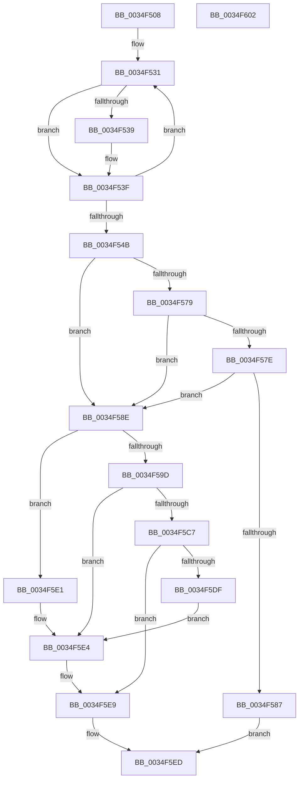

# MiComputeAgingPercent

- RVA: `0x0034F508`–`0x0034F603` (길이 `251` bytes)
- VA: `0x000000014034F508`
- 실행 섹션: `.text`
- PDB 이름 있음: `예`; PDB Function 태그: `아니요`
- unwind 정보 RVA: `0x0005CF00`
- 디코드: `70`개 명령, `251/251` bytes 표시
- 미해석 바이트: `0` (있으면 어셈블리에 `.byte`로 보존)

> 이 문서는 커널 이미지의 기계어와 PDB 기호를 분석해 생성했습니다. 4번과 5번은 함수 원형과 자료형을 바이너리 사용 방식에서 추정한 C 해석이며 원본 소스 복구 결과는 아닙니다.

## 1. Dependencies

- 직접 호출 지점: **1**; 고유 호출 대상: **1**
- 직접 호출자로 확인된 함수: **1**
- RIP 상대 이미지 참조: **0**

### Outgoing calls
- `0x0034F515` → [MiGetAvailablePagesForTrimPass](MiGetAvailablePagesForTrimPass_function_0034D324.md) (function, `0x0034D324`)

### Direct callers
- [MiProcessWorkingSets](MiProcessWorkingSets_function_0034E710.md) at `0x0034E767`

### Static image references
- 디코드된 RIP-relative 메모리 참조가 없습니다.

## 2. Other-region calls and transfers

- 다른 실행 섹션으로 향하는 call: **0**
- 별도 외부 분기/꼬리 이동을 확인하지 못했습니다.

## 3. Assembly (complete function range)

```asm
0034F508  40 53                           push rbx
0034F50A  48 83 EC 20                     sub rsp, 0x20
0034F50E  4C 8B 91 C0 44 00 00            mov r10, qword ptr [rcx + 0x44c0]
0034F515  E8 0A DE FF FF                  call 0x14034d324
0034F51A  45 33 C0                        xor r8d, r8d
0034F51D  4C 8B C8                        mov r9, rax
0034F520  41 8B C8                        mov ecx, r8d
0034F523  49 8D 82 C8 00 00 00            lea rax, [r10 + 0xc8]
0034F52A  41 8D 58 08                     lea ebx, [r8 + 8]
0034F52E  44 8B DB                        mov r11d, ebx
0034F531  48 8B 10                        mov rdx, qword ptr [rax]
0034F534  49 3B D1                        cmp rdx, r9
0034F537  73 06                           jae 0x14034f53f
0034F539  49 8B D1                        mov rdx, r9
0034F53C  4C 89 08                        mov qword ptr [rax], r9
0034F53F  48 03 CA                        add rcx, rdx
0034F542  48 03 C3                        add rax, rbx
0034F545  49 83 EB 01                     sub r11, 1
0034F549  75 E6                           jne 0x14034f531
0034F54B  48 C1 E9 03                     shr rcx, 3
0034F54F  48 6B C1 07                     imul rax, rcx, 7
0034F553  49 03 C1                        add rax, r9
0034F556  48 C1 E8 03                     shr rax, 3
0034F55A  49 89 82 08 01 00 00            mov qword ptr [r10 + 0x108], rax
0034F561  41 8B 42 78                     mov eax, dword ptr [r10 + 0x78]
0034F565  83 E0 07                        and eax, 7
0034F568  4D 89 8C C2 C8 00 00 00         mov qword ptr [r10 + rax*8 + 0xc8], r9
0034F570  41 FF 42 78                     inc dword ptr [r10 + 0x78]
0034F574  4D 85 C9                        test r9, r9
0034F577  74 15                           je 0x14034f58e
0034F579  4C 3B C9                        cmp r9, rcx
0034F57C  72 10                           jb 0x14034f58e
0034F57E  4D 3B 8A 48 01 00 00            cmp r9, qword ptr [r10 + 0x148]
0034F585  72 07                           jb 0x14034f58e
0034F587  B8 10 0E 00 00                  mov eax, 0xe10
0034F58C  EB 5F                           jmp 0x14034f5ed
0034F58E  49 8B 82 48 01 00 00            mov rax, qword ptr [r10 + 0x148]
0034F595  49 2B C9                        sub rcx, r9
0034F598  4C 3B C8                        cmp r9, rax
0034F59B  76 44                           jbe 0x14034f5e1
0034F59D  4C 2B C8                        sub r9, rax
0034F5A0  48 3B CB                        cmp rcx, rbx
0034F5A3  49 8B C1                        mov rax, r9
0034F5A6  48 0F 42 CB                     cmovb rcx, rbx
0034F5AA  33 D2                           xor edx, edx
0034F5AC  48 C1 E9 03                     shr rcx, 3
0034F5B0  48 F7 F1                        div rcx
0034F5B3  48 83 F8 02                     cmp rax, 2
0034F5B7  4C 8D 48 FE                     lea r9, [rax - 2]
0034F5BB  4C 0F 42 C8                     cmovb r9, rax
0034F5BF  49 8B C1                        mov rax, r9
0034F5C2  4D 85 C9                        test r9, r9
0034F5C5  74 1D                           je 0x14034f5e4
0034F5C7  33 D2                           xor edx, edx
0034F5C9  B8 58 1B 00 00                  mov eax, 0x1b58
0034F5CE  49 F7 F1                        div r9
0034F5D1  48 8B C8                        mov rcx, rax
0034F5D4  49 8B C1                        mov rax, r9
0034F5D7  81 F9 E8 03 00 00               cmp ecx, 0x3e8
0034F5DD  76 0A                           jbe 0x14034f5e9
0034F5DF  EB 03                           jmp 0x14034f5e4
0034F5E1  49 8B C0                        mov rax, r8
0034F5E4  B9 E8 03 00 00                  mov ecx, 0x3e8
0034F5E9  44 0F B7 C1                     movzx r8d, cx
0034F5ED  49 89 82 18 01 00 00            mov qword ptr [r10 + 0x118], rax
0034F5F4  66 45 89 82 12 01 00 00         mov word ptr [r10 + 0x112], r8w
0034F5FC  48 83 C4 20                     add rsp, 0x20
0034F600  5B                              pop rbx
0034F601  C3                              ret
0034F602  CC                              int3
```

## 4. C-style interpretation (structured pseudocode)

```c
__int64 __fastcall MiComputeAgingPercent(__int64 a1, __int64 a2, int a3)
{
    __int64 result;
    __int64 v_r11;
    __int64 v_rsp;

    v_rsp = (v_rsp) - (32);
    result = MiGetAvailablePagesForTrimPass(a1, a2, a3, a4);
    a3 = 0;
loc_0034F531:
    if ((*(unsigned __int64 *)(*(unsigned __int64 *)(a1 + 17600) + 200)) < result) {
        a2 = result;
        *(unsigned __int64 *)(*(unsigned __int64 *)(a1 + 17600) + 200) = result;
    }
    a1 = (0) + (a2);
    result = (*(unsigned __int64 *)(a1 + 17600) + 200) + (a3 + 8);
    v_r11 = ((unsigned int)((unsigned int)(a3 + 8))) - (1);
    if (condition_is_not_equal) goto loc_0034F531;
    a1 = (a1) >> (3);
    result = (result) * (a1);
    result = (result) + (result);
    result = (result) >> (3);
    *(unsigned __int64 *)(*(unsigned __int64 *)(a1 + 17600) + 264) = result;
    result = (unsigned int)(((unsigned int)(*(unsigned int *)(*(unsigned __int64 *)(a1 + 17600) + 120))) & (7));
    *(unsigned __int64 *)(*(unsigned __int64 *)(a1 + 17600) + result * 8 + 200) = result;
    if (result == 0) goto loc_0034F58E;
    if (result < a1) goto loc_0034F58E;
    if (result < (*(unsigned __int64 *)(*(unsigned __int64 *)(a1 + 17600) + 328))) goto loc_0034F58E;
    goto loc_0034F5ED;
loc_0034F58E:
    a1 = (a1) - (result);
    if (result <= (*(unsigned __int64 *)(*(unsigned __int64 *)(a1 + 17600) + 328))) goto loc_0034F5E1;
    a4 = (result) - (*(unsigned __int64 *)(*(unsigned __int64 *)(a1 + 17600) + 328));
    if (a1 < (a3 + 8)) { a1 = a3 + 8; }
    a2 = 0;
    a1 = (a1) >> (3);
    a4 = a4 - 2;
    if (a4 < 2) { a4 = a4; }
    if (a4 == 0) goto loc_0034F5E4;
    a2 = 0;
    if (((unsigned int)((unsigned int)(0x1B58ULL))) <= 1000) goto loc_0034F5E9;
    goto loc_0034F5E4;
loc_0034F5E1:
loc_0034F5E4:
loc_0034F5E9:
loc_0034F5ED:
    *(unsigned __int64 *)(*(unsigned __int64 *)(a1 + 17600) + 280) = 0;
    *(unsigned __int16 *)(*(unsigned __int64 *)(a1 + 17600) + 274) = 1000;
    v_rsp = (v_rsp) + (32);
    return 0;
}
```

## 5. (Beta) C Style

```c
int64_t MiComputeAgingPercent(void *Arg1, int64_t Arg2, int32_t Arg3)
{
    uint8_t *arg1 = (uint8_t *)Arg1;

    int64_t result;
    int64_t local_r11;
    int64_t local_rsp;

    local_rsp = (local_rsp) - (32);
    result = MiGetAvailablePagesForTrimPass(Arg1, Arg2, Arg3, a4);
    Arg3 = 0;
loc_0034F531:
    if ((*(uint64_t *)(*(uint64_t *)(arg1 + 0x44C0) + 0xC8)) < result) {
        Arg2 = result;
        *(uint64_t *)(*(uint64_t *)(arg1 + 0x44C0) + 0xC8) = result;
    }
    Arg1 = (0) + (Arg2);
    result = (*(uint64_t *)(arg1 + 0x44C0) + 200) + (Arg3 + 8);
    local_r11 = ((uint32_t)((uint32_t)(Arg3 + 8))) - (1);
    if (condition_is_not_equal) goto loc_0034F531;
    Arg1 = (Arg1) >> (3);
    result = (result) * (Arg1);
    result = (result) + (result);
    result = (result) >> (3);
    *(uint64_t *)(*(uint64_t *)(arg1 + 0x44C0) + 0x108) = result;
    result = (uint32_t)(((uint32_t)(*(uint32_t *)(*(uint64_t *)(arg1 + 0x44C0) + 0x78))) & (7));
    *(uint64_t *)(*(uint64_t *)(arg1 + 0x44C0) + result * 8 + 0xC8) = result;
    if (result == 0) goto loc_0034F58E;
    if (result < Arg1) goto loc_0034F58E;
    if (result < (*(uint64_t *)(*(uint64_t *)(arg1 + 0x44C0) + 0x148))) goto loc_0034F58E;
    goto loc_0034F5ED;
loc_0034F58E:
    Arg1 = (Arg1) - (result);
    if (result <= (*(uint64_t *)(*(uint64_t *)(arg1 + 0x44C0) + 0x148))) goto loc_0034F5E1;
    a4 = (result) - (*(uint64_t *)(*(uint64_t *)(arg1 + 0x44C0) + 0x148));
    if (Arg1 < (Arg3 + 8)) { Arg1 = Arg3 + 8; }
    Arg2 = 0;
    Arg1 = (Arg1) >> (3);
    a4 = a4 - 2;
    if (a4 < 2) { a4 = a4; }
    if (a4 == 0) goto loc_0034F5E4;
    Arg2 = 0;
    if (((uint32_t)((uint32_t)(0x1B58ULL))) <= 1000) goto loc_0034F5E9;
    goto loc_0034F5E4;
loc_0034F5E1:
loc_0034F5E4:
loc_0034F5E9:
loc_0034F5ED:
    *(uint64_t *)(*(uint64_t *)(arg1 + 0x44C0) + 0x118) = 0;
    *(uint16_t *)(*(uint64_t *)(arg1 + 0x44C0) + 0x112) = 1000;
    local_rsp = (local_rsp) + (32);
    return 0;
}
```

### 관측된 메모리 오프셋

구조체 형식이 확인되지 않은 접근은 인자 기준의 오프셋으로만 기록했습니다.

| 기준 인자 | 오프셋 표현 | 폭 (bit) | 접근 |
|---|---:|---:|---|
| `Arg1` | `+ 0x44C0` | `64` | `R` |

## 6. Execution-region graph

[열기: 2D/3D 그래프와 함수 탐색 컨트롤 패널](../../../control-panel.html?section=text&rva=0x0034F508&view=graph)

- 2D 그래프는 위에서 아래로 흐르고, 3D 그래프는 빈 공간을 드래그해 회전합니다. Shift+드래그는 이동, 휠은 확대·축소, 함수 노드 선택은 대상 보고서 이동입니다.

### Static fallback


