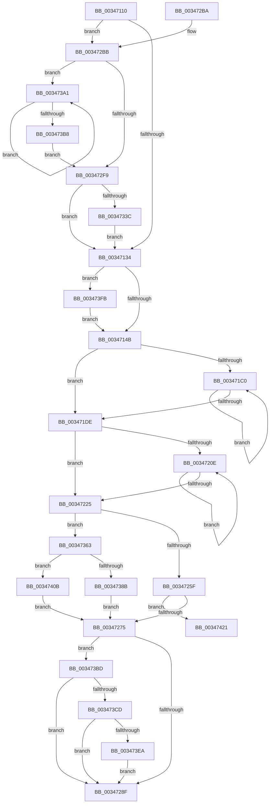

# MiConvertLockedSmallPageToLarge

- RVA: `0x00347110`–`0x0034742E` (길이 `798` bytes)
- VA: `0x0000000140347110`
- 실행 섹션: `.text`
- PDB 이름 있음: `예`; PDB Function 태그: `예`
- unwind 정보 RVA: `0x00078020`
- 디코드: `186`개 명령, `798/798` bytes 표시
- 미해석 바이트: `0` (있으면 어셈블리에 `.byte`로 보존)

> 이 문서는 커널 이미지의 기계어와 PDB 기호를 분석해 생성했습니다. 4번과 5번은 함수 원형과 자료형을 바이너리 사용 방식에서 추정한 C 해석이며 원본 소스 복구 결과는 아닙니다.

## 1. Dependencies

- 직접 호출 지점: **1**; 고유 호출 대상: **1**
- 직접 호출자로 확인된 함수: **2**
- RIP 상대 이미지 참조: **0**

### Outgoing calls
- `0x003473C0` → [MiCanPfnOriginalPteBeLost](../37/MiCanPfnOriginalPteBeLost_function_00373D3C.md) (function, `0x00373D3C`)

### Direct callers
- [MiDeleteClusterPage](MiDeleteClusterPage_function_00346CB0.md) at `0x00346F4B`
- [MiConvertSmallPageRangeToLarge](MiConvertSmallPageRangeToLarge_function_003484DC.md) at `0x0034857B`

### Static image references
- 디코드된 RIP-relative 메모리 참조가 없습니다.

## 2. Other-region calls and transfers

- 다른 실행 섹션으로 향하는 call: **0**
- call이 아닌 외부 분기/꼬리 이동: **1**
  - `0x00347429` → [sub_006E20B8](../6E/Unknown_function_006E20B8.md) (`tail-transfer`)

## 3. Assembly (complete function range)

```asm
00347110  48 89 5C 24 10                  mov qword ptr [rsp + 0x10], rbx
00347115  48 89 74 24 18                  mov qword ptr [rsp + 0x18], rsi
0034711A  57                              push rdi
0034711B  48 81 EC 80 00 00 00            sub rsp, 0x80
00347122  45 8B D0                        mov r10d, r8d
00347125  48 8B FA                        mov rdi, rdx
00347128  48 8B D9                        mov rbx, rcx
0034712B  45 85 C9                        test r9d, r9d
0034712E  0F 85 87 01 00 00               jne 0x1403472bb
00347134  48 8B 43 28                     mov rax, qword ptr [rbx + 0x28]
00347138  48 BE FF FF FF FF FF FF FF 7F   movabs rsi, 0x7fffffffffffffff
00347142  48 85 C0                        test rax, rax
00347145  0F 88 B0 02 00 00               js 0x1403473fb
0034714B  8B 43 20                        mov eax, dword ptr [rbx + 0x20]
0034714E  0F 57 C0                        xorps xmm0, xmm0
00347151  89 84 24 A8 00 00 00            mov dword ptr [rsp + 0xa8], eax
00347158  45 33 C9                        xor r9d, r9d
0034715B  C1 E8 18                        shr eax, 0x18
0034715E  0F 57 C9                        xorps xmm1, xmm1
00347161  24 F8                           and al, 0xf8
00347163  4C 89 4C 24 20                  mov qword ptr [rsp + 0x20], r9
00347168  88 84 24 AB 00 00 00            mov byte ptr [rsp + 0xab], al
0034716F  49 B8 FF FF FF FF FF FF FF 8F   movabs r8, 0x8fffffffffffffff
00347179  8B 84 24 A8 00 00 00            mov eax, dword ptr [rsp + 0xa8]
00347180  89 43 20                        mov dword ptr [rbx + 0x20], eax
00347183  48 8B 53 28                     mov rdx, qword ptr [rbx + 0x28]
00347187  48 8B CA                        mov rcx, rdx
0034718A  48 89 54 24 48                  mov qword ptr [rsp + 0x48], rdx
0034718F  49 23 C8                        and rcx, r8
00347192  48 8B C2                        mov rax, rdx
00347195  F3 0F 7F 44 24 28               movdqu xmmword ptr [rsp + 0x28], xmm0
0034719B  F3 0F 7F 4C 24 38               movdqu xmmword ptr [rsp + 0x38], xmm1
003471A1  0F 11 44 24 50                  movups xmmword ptr [rsp + 0x50], xmm0
003471A6  0F 11 44 24 60                  movups xmmword ptr [rsp + 0x60], xmm0
003471AB  0F 11 44 24 70                  movups xmmword ptr [rsp + 0x70], xmm0
003471B0  F0 48 0F B1 4B 28               lock cmpxchg qword ptr [rbx + 0x28], rcx
003471B6  48 89 44 24 78                  mov qword ptr [rsp + 0x78], rax
003471BB  48 3B D0                        cmp rdx, rax
003471BE  74 1E                           je 0x1403471de
003471C0  48 8B C8                        mov rcx, rax
003471C3  48 89 44 24 48                  mov qword ptr [rsp + 0x48], rax
003471C8  49 23 C8                        and rcx, r8
003471CB  48 8B D0                        mov rdx, rax
003471CE  F0 48 0F B1 4B 28               lock cmpxchg qword ptr [rbx + 0x28], rcx
003471D4  48 89 44 24 78                  mov qword ptr [rsp + 0x78], rax
003471D9  48 3B D0                        cmp rdx, rax
003471DC  75 E2                           jne 0x1403471c0
003471DE  4C 89 0B                        mov qword ptr [rbx], r9
003471E1  49 BB 00 00 00 00 00 FF FF FF   movabs r11, 0xffffff0000000000
003471EB  4C 89 4B 08                     mov qword ptr [rbx + 8], r9
003471EF  4C 89 4B 10                     mov qword ptr [rbx + 0x10], r9
003471F3  48 8B 53 28                     mov rdx, qword ptr [rbx + 0x28]
003471F7  48 8B CA                        mov rcx, rdx
003471FA  48 8B C2                        mov rax, rdx
003471FD  49 23 CB                        and rcx, r11
00347200  F0 48 0F B1 4B 28               lock cmpxchg qword ptr [rbx + 0x28], rcx
00347206  4C 8B C0                        mov r8, rax
00347209  48 3B D0                        cmp rdx, rax
0034720C  74 17                           je 0x140347225
0034720E  49 8B C8                        mov rcx, r8
00347211  4D 23 C3                        and r8, r11
00347214  48 8B C1                        mov rax, rcx
00347217  F0 4C 0F B1 43 28               lock cmpxchg qword ptr [rbx + 0x28], r8
0034721D  4C 8B C0                        mov r8, rax
00347220  48 3B C8                        cmp rcx, rax
00347223  75 E9                           jne 0x14034720e
00347225  4C 89 4B 08                     mov qword ptr [rbx + 8], r9
00347229  48 B9 FF FF FF FF FF FF FF BF   movabs rcx, 0xbfffffffffffffff
00347233  48 8B 43 18                     mov rax, qword ptr [rbx + 0x18]
00347237  48 23 C1                        and rax, rcx
0034723A  48 B9 00 00 00 00 00 01 00 00   movabs rcx, 0x10000000000
00347244  48 89 43 18                     mov qword ptr [rbx + 0x18], rax
00347248  48 8B 43 28                     mov rax, qword ptr [rbx + 0x28]
0034724C  48 0B C1                        or rax, rcx
0034724F  48 89 43 28                     mov qword ptr [rbx + 0x28], rax
00347253  8B 43 24                        mov eax, dword ptr [rbx + 0x24]
00347256  48 3B DF                        cmp rbx, rdi
00347259  0F 84 04 01 00 00               je 0x140347363
0034725F  25 FF FF FF E7                  and eax, 0xe7ffffff
00347264  89 43 24                        mov dword ptr [rbx + 0x24], eax
00347267  8B 43 20                        mov eax, dword ptr [rbx + 0x20]
0034726A  C1 E8 18                        shr eax, 0x18
0034726D  A8 40                           test al, 0x40
0034726F  0F 85 AC 01 00 00               jne 0x140347421
00347275  44 8B 5B 20                     mov r11d, dword ptr [rbx + 0x20]
00347279  44 89 9C 24 A8 00 00 00         mov dword ptr [rsp + 0xa8], r11d
00347281  41 C1 EB 10                     shr r11d, 0x10
00347285  41 F6 C3 08                     test r11b, 8
00347289  0F 85 2E 01 00 00               jne 0x1403473bd
0034728F  41 80 E3 EF                     and r11b, 0xef
00347293  44 88 9C 24 AA 00 00 00         mov byte ptr [rsp + 0xaa], r11b
0034729B  4C 8D 9C 24 80 00 00 00         lea r11, [rsp + 0x80]
003472A3  8B 84 24 A8 00 00 00            mov eax, dword ptr [rsp + 0xa8]
003472AA  49 8B 73 20                     mov rsi, qword ptr [r11 + 0x20]
003472AE  89 43 20                        mov dword ptr [rbx + 0x20], eax
003472B1  49 8B 5B 18                     mov rbx, qword ptr [r11 + 0x18]
003472B5  49 8B E3                        mov rsp, r11
003472B8  5F                              pop rdi
003472B9  C3                              ret
003472BA  CC                              int3
003472BB  48 8B 41 18                     mov rax, qword ptr [rcx + 0x18]
003472BF  49 B9 FF FF FF FF FF 00 00 F8   movabs r9, 0xf80000ffffffffff
003472C9  48 B9 FF FF FF FF FF FF FF C7   movabs rcx, 0xc7ffffffffffffff
003472D3  48 23 C1                        and rax, rcx
003472D6  48 89 43 18                     mov qword ptr [rbx + 0x18], rax
003472DA  48 8B 53 18                     mov rdx, qword ptr [rbx + 0x18]
003472DE  48 8B CA                        mov rcx, rdx
003472E1  48 8B C2                        mov rax, rdx
003472E4  49 23 C9                        and rcx, r9
003472E7  F0 48 0F B1 4B 18               lock cmpxchg qword ptr [rbx + 0x18], rcx
003472ED  4C 8B C0                        mov r8, rax
003472F0  48 3B D0                        cmp rdx, rax
003472F3  0F 85 A8 00 00 00               jne 0x1403473a1
003472F9  48 8B 43 18                     mov rax, qword ptr [rbx + 0x18]
003472FD  48 B9 01 00 00 00 00 00 00 C0   movabs rcx, 0xc000000000000001
00347307  48 23 C1                        and rax, rcx
0034730A  48 83 C8 01                     or rax, 1
0034730E  48 89 43 18                     mov qword ptr [rbx + 0x18], rax
00347312  8B 43 20                        mov eax, dword ptr [rbx + 0x20]
00347315  89 84 24 A8 00 00 00            mov dword ptr [rsp + 0xa8], eax
0034731C  B8 02 00 00 00                  mov eax, 2
00347321  66 89 84 24 A8 00 00 00         mov word ptr [rsp + 0xa8], ax
00347329  8B 84 24 A8 00 00 00            mov eax, dword ptr [rsp + 0xa8]
00347330  89 43 20                        mov dword ptr [rbx + 0x20], eax
00347333  48 3B DF                        cmp rbx, rdi
00347336  0F 84 F8 FD FF FF               je 0x140347134
0034733C  8B 43 20                        mov eax, dword ptr [rbx + 0x20]
0034733F  89 84 24 A8 00 00 00            mov dword ptr [rsp + 0xa8], eax
00347346  C1 E8 10                        shr eax, 0x10
00347349  24 FE                           and al, 0xfe
0034734B  0C 06                           or al, 6
0034734D  88 84 24 AA 00 00 00            mov byte ptr [rsp + 0xaa], al
00347354  8B 84 24 A8 00 00 00            mov eax, dword ptr [rsp + 0xa8]
0034735B  89 43 20                        mov dword ptr [rbx + 0x20], eax
0034735E  E9 D1 FD FF FF                  jmp 0x140347134
00347363  41 F6 D2                        not r10b
00347366  41 0F B6 CA                     movzx ecx, r10b
0034736A  C1 E1 1B                        shl ecx, 0x1b
0034736D  33 C1                           xor eax, ecx
0034736F  25 FF FF FF E7                  and eax, 0xe7ffffff
00347374  33 C1                           xor eax, ecx
00347376  89 43 24                        mov dword ptr [rbx + 0x24], eax
00347379  8B 43 20                        mov eax, dword ptr [rbx + 0x20]
0034737C  C1 E8 18                        shr eax, 0x18
0034737F  A8 40                           test al, 0x40
00347381  48 8B 47 28                     mov rax, qword ptr [rdi + 0x28]
00347385  0F 85 80 00 00 00               jne 0x14034740b
0034738B  48 B9 FF FF FF FF FF FD FF FF   movabs rcx, 0xfffffdffffffffff
00347395  48 23 C1                        and rax, rcx
00347398  48 89 47 28                     mov qword ptr [rdi + 0x28], rax
0034739C  E9 D4 FE FF FF                  jmp 0x140347275
003473A1  49 8B C8                        mov rcx, r8
003473A4  4D 23 C1                        and r8, r9
003473A7  48 8B C1                        mov rax, rcx
003473AA  F0 4C 0F B1 43 18               lock cmpxchg qword ptr [rbx + 0x18], r8
003473B0  4C 8B C0                        mov r8, rax
003473B3  48 3B C8                        cmp rcx, rax
003473B6  75 E9                           jne 0x1403473a1
003473B8  E9 3C FF FF FF                  jmp 0x1403472f9
003473BD  48 8B CB                        mov rcx, rbx
003473C0  E8 77 C9 02 00                  call 0x140373d3c
003473C5  85 C0                           test eax, eax
003473C7  0F 84 C2 FE FF FF               je 0x14034728f
003473CD  48 8B 43 10                     mov rax, qword ptr [rbx + 0x10]
003473D1  0F B6 4B 22                     movzx ecx, byte ptr [rbx + 0x22]
003473D5  C0 E9 04                        shr cl, 4
003473D8  A8 04                           test al, 4
003473DA  F6 D1                           not cl
003473DC  0F 95 C0                        setne al
003473DF  22 C8                           and cl, al
003473E1  F6 C1 01                        test cl, 1
003473E4  0F 84 A5 FE FF FF               je 0x14034728f
003473EA  48 8B 43 10                     mov rax, qword ptr [rbx + 0x10]
003473EE  48 83 E0 FB                     and rax, 0xfffffffffffffffb
003473F2  48 89 43 10                     mov qword ptr [rbx + 0x10], rax
003473F6  E9 94 FE FF FF                  jmp 0x14034728f
003473FB  48 8B 43 28                     mov rax, qword ptr [rbx + 0x28]
003473FF  48 23 C6                        and rax, rsi
00347402  48 89 43 28                     mov qword ptr [rbx + 0x28], rax
00347406  E9 40 FD FF FF                  jmp 0x14034714b
0034740B  48 B9 00 00 00 00 00 02 00 00   movabs rcx, 0x20000000000
00347415  48 0B C1                        or rax, rcx
00347418  48 89 47 28                     mov qword ptr [rdi + 0x28], rax
0034741C  E9 54 FE FF FF                  jmp 0x140347275
00347421  44 89 8C 24 90 00 00 00         mov dword ptr [rsp + 0x90], r9d
00347429  E9 8A AC 39 00                  jmp 0x1406e20b8
```

## 4. C-style interpretation (structured pseudocode)

```c
__int64 __fastcall MiConvertLockedSmallPageToLarge(__int64 a1, __int64 a2, int a3, int a4)
{
    __int64 result;
    __int64 v_r10;
    __int64 v_r11;
    __int64 v_rsp;
    unsigned __int64 v_stack_m10;
    unsigned __int64 v_stack_m18;
    unsigned __int64 v_stack_m28;
    unsigned __int64 v_stack_m38;
    unsigned __int64 v_stack_m40;
    unsigned __int64 v_stack_m50;
    unsigned __int64 v_stack_m60;
    unsigned __int64 v_stack_m68;
    unsigned __int64 v_stack_m8;
    unsigned __int64 v_stack_p10;
    unsigned __int64 v_stack_p18;
    unsigned int v_stack_p20;
    unsigned __int8 v_stack_p22;
    unsigned __int8 v_stack_p23;
    unsigned int v_stack_p28;
    unsigned __int8 v_stack_p2A;

    v_stack_p10 = v_rbx;
    v_stack_p18 = v_rsi;
    v_rsp = (v_rsp) - (128);
    if (a4 != 0) goto loc_003472BB;
loc_00347134:
    if (sign_flag) goto loc_003473FB;
loc_0034714B:
    v_stack_p20 = (unsigned int)((unsigned int)(*(unsigned int *)(a1 + 32)));
    a4 = 0;
    result = (unsigned int)(((unsigned int)(*(unsigned int *)(a1 + 32))) >> (24));
    result = (unsigned __int8)((result) & (248));
    v_stack_m68 = 0;
    v_stack_p23 = (unsigned __int8)(result);
    *(unsigned int *)(a1 + 32) = (unsigned int)((unsigned int)(v_stack_p20));
    v_stack_m40 = *(unsigned __int64 *)(a1 + 40);
    a1 = (*(unsigned __int64 *)(a1 + 40)) & (a3);
    v_stack_m60 = v_xmm0;
    v_stack_m50 = v_xmm1;
    v_stack_m38 = v_xmm0;
    v_stack_m28 = v_xmm0;
    v_stack_m18 = v_xmm0;
    v_stack_m10 = *(unsigned __int64 *)(a1 + 40);
    if ((*(unsigned __int64 *)(a1 + 40)) == (*(unsigned __int64 *)(a1 + 40))) goto loc_003471DE;
loc_003471C0:
    v_stack_m40 = *(unsigned __int64 *)(a1 + 40);
    a1 = (*(unsigned __int64 *)(a1 + 40)) & (a3);
    v_stack_m10 = *(unsigned __int64 *)(a1 + 40);
    if ((*(unsigned __int64 *)(a1 + 40)) != (*(unsigned __int64 *)(a1 + 40))) goto loc_003471C0;
loc_003471DE:
    *(unsigned __int64 *)(a1) = 0;
    *(unsigned __int64 *)(a1 + 8) = 0;
    *(unsigned __int64 *)(a1 + 16) = 0;
    a1 = (*(unsigned __int64 *)(a1 + 40)) & (v_r11);
    if ((*(unsigned __int64 *)(a1 + 40)) == (*(unsigned __int64 *)(a1 + 40))) goto loc_00347225;
loc_0034720E:
    a3 = (*(unsigned __int64 *)(a1 + 40)) & (v_r11);
    if ((*(unsigned __int64 *)(a1 + 40)) != (*(unsigned __int64 *)(a1 + 40))) goto loc_0034720E;
loc_00347225:
    *(unsigned __int64 *)(a1 + 8) = 0;
    result = (*(unsigned __int64 *)(a1 + 24)) & (*(unsigned __int64 *)(a1 + 40));
    *(unsigned __int64 *)(a1 + 24) = result;
    result = (*(unsigned __int64 *)(a1 + 40)) | (*(unsigned __int64 *)(a1 + 40));
    *(unsigned __int64 *)(a1 + 40) = result;
    if (a1 == a2) goto loc_00347363;
    result = (unsigned int)(((unsigned int)(*(unsigned int *)(a1 + 36))) & (0xE7FFFFFFULL));
    *(unsigned int *)(a1 + 36) = (unsigned int)(result);
    result = (unsigned int)(((unsigned int)(*(unsigned int *)(a1 + 32))) >> (24));
    if ((((unsigned __int8)(result)) & (64)) != 0) goto loc_00347421;
loc_00347275:
    v_stack_p20 = (unsigned int)((unsigned int)(*(unsigned int *)(a1 + 32)));
    v_r11 = (unsigned int)(((unsigned int)(*(unsigned int *)(a1 + 32))) >> (16));
    if ((((unsigned __int8)(v_r11)) & (8)) != 0) goto loc_003473BD;
loc_0034728F:
    v_r11 = (unsigned __int8)((v_r11) & (239));
    v_stack_p22 = (unsigned __int8)(v_r11);
    *(unsigned int *)(a1 + 32) = (unsigned int)((unsigned int)(v_stack_p20));
    return (unsigned int)(v_stack_p20);
loc_003472BB:
    result = (*(unsigned __int64 *)(*(unsigned __int64 *)(a1 + 40) + 24)) & (*(unsigned __int64 *)(a1 + 40));
    *(unsigned __int64 *)(*(unsigned __int64 *)(v_stack_m8 + 24) + 24) = result;
    a1 = (*(unsigned __int64 *)(*(unsigned __int64 *)(v_stack_m8 + 24) + 24)) & (0);
    if ((*(unsigned __int64 *)(*(unsigned __int64 *)(v_stack_m8 + 24) + 24)) != (*(unsigned __int64 *)(*(unsigned __int64 *)(v_stack_m8 + 24) + 24))) goto loc_003473A1;
loc_003472F9:
    result = (*(unsigned __int64 *)(*(unsigned __int64 *)(v_stack_m8 + 24) + 24)) & (a1);
    result = (result) | (1);
    *(unsigned __int64 *)(*(unsigned __int64 *)(v_stack_m8 + 24) + 24) = result;
    v_stack_p28 = (unsigned int)((unsigned int)(*(unsigned int *)(*(unsigned __int64 *)(v_stack_m8 + 24) + 32)));
    v_stack_p28 = 2;
    *(unsigned int *)(*(unsigned __int64 *)(v_stack_m8 + 24) + 32) = (unsigned int)((unsigned int)(v_stack_p28));
    if ((*(unsigned __int64 *)(v_stack_m8 + 24)) == a2) goto loc_00347134;
    v_stack_p28 = (unsigned int)((unsigned int)(*(unsigned int *)(*(unsigned __int64 *)(v_stack_m8 + 24) + 32)));
    result = (unsigned int)(((unsigned int)(*(unsigned int *)(*(unsigned __int64 *)(v_stack_m8 + 24) + 32))) >> (16));
    result = (unsigned __int8)((result) & (254));
    result = (unsigned __int8)((result) | (6));
    v_stack_p2A = (unsigned __int8)(result);
    *(unsigned int *)(*(unsigned __int64 *)(v_stack_m8 + 24) + 32) = (unsigned int)((unsigned int)(v_stack_p28));
    goto loc_00347134;
loc_00347363:
    v_r10 = (unsigned __int8)(~((unsigned int)(a3)));
    a1 = (unsigned int)(((unsigned __int8)(v_r10)) << (27));
    result = (unsigned int)(((unsigned int)(v_stack_p28)) ^ ((unsigned int)(a1)));
    result = (unsigned int)((result) & (0xE7FFFFFFULL));
    result = (unsigned int)((result) ^ ((unsigned int)(a1)));
    *(unsigned int *)(*(unsigned __int64 *)(v_stack_m8 + 24) + 36) = (unsigned int)(result);
    result = (unsigned int)(((unsigned int)(*(unsigned int *)(*(unsigned __int64 *)(v_stack_m8 + 24) + 32))) >> (24));
    if ((((unsigned __int8)(result)) & (64)) != 0) goto loc_0034740B;
    result = (*(unsigned __int64 *)(a2 + 40)) & (a1);
    *(unsigned __int64 *)(a2 + 40) = result;
    goto loc_00347275;
loc_003473A1:
    a3 = (*(unsigned __int64 *)(*(unsigned __int64 *)(v_stack_m8 + 24) + 24)) & (0);
    if ((*(unsigned __int64 *)(*(unsigned __int64 *)(v_stack_m8 + 24) + 24)) != (*(unsigned __int64 *)(*(unsigned __int64 *)(v_stack_m8 + 24) + 24))) goto loc_003473A1;
    goto loc_003472F9;
loc_003473BD:
    result = MiCanPfnOriginalPteBeLost(*(unsigned __int64 *)(v_stack_m8 + 24), *(unsigned __int64 *)(*(unsigned __int64 *)(v_stack_m8 + 24) + 24), *(unsigned __int64 *)(*(unsigned __int64 *)(v_stack_m8 + 24) + 24), a4);
    if ((unsigned int)(result) == 0) goto loc_0034728F;
    a1 = (unsigned __int8)((*(unsigned __int8 *)(*(unsigned __int64 *)(v_stack_m8 + 24) + 34)) >> (4));
    a1 = (unsigned __int8)(~(a1));
    result = ((((unsigned __int8)(*(unsigned __int64 *)(*(unsigned __int64 *)(v_stack_m8 + 24) + 16))) & (4)) != 0) ? 1 : 0;
    a1 = (unsigned __int8)((a1) & ((unsigned __int8)(result)));
    if ((((unsigned __int8)(a1)) & (1)) == 0) goto loc_0034728F;
    result = (*(unsigned __int64 *)(*(unsigned __int64 *)(v_stack_m8 + 24) + 16)) & (-5);
    *(unsigned __int64 *)(*(unsigned __int64 *)(v_stack_m8 + 24) + 16) = result;
    goto loc_0034728F;
loc_003473FB:
    result = (*(unsigned __int64 *)(*(unsigned __int64 *)(v_stack_m8 + 24) + 40)) & (*(unsigned __int64 *)(v_stack_m8 + 32));
    *(unsigned __int64 *)(*(unsigned __int64 *)(v_stack_m8 + 24) + 40) = result;
    goto loc_0034714B;
loc_0034740B:
    result = (result) | (a1);
    *(unsigned __int64 *)(a2 + 40) = result;
    goto loc_00347275;
loc_00347421:
    v_stack_p10 = 0;
}
```

## 5. (Beta) C Style

```c
int64_t MiConvertLockedSmallPageToLarge(void *Arg1, void *Arg2, int32_t Arg3, int32_t Arg4)
{
    uint8_t *arg1 = (uint8_t *)Arg1;
    uint8_t *arg2 = (uint8_t *)Arg2;

    int64_t result;
    int64_t local_r10;
    int64_t local_r11;
    int64_t local_rsp;
    uint64_t v_stack_m10;
    uint64_t v_stack_m18;
    uint64_t v_stack_m28;
    uint64_t v_stack_m38;
    uint64_t v_stack_m40;
    uint64_t v_stack_m50;
    uint64_t v_stack_m60;
    uint64_t v_stack_m68;
    uint64_t v_stack_m8;
    uint64_t v_stack_p10;
    uint64_t v_stack_p18;
    uint32_t v_stack_p20;
    uint8_t v_stack_p22;
    uint8_t v_stack_p23;
    uint32_t v_stack_p28;
    uint8_t v_stack_p2A;

    v_stack_p10 = local_rbx;
    v_stack_p18 = local_rsi;
    local_rsp = (local_rsp) - (128);
    if (Arg4 != 0) goto loc_003472BB;
loc_00347134:
    if (sign_flag) goto loc_003473FB;
loc_0034714B:
    v_stack_p20 = (uint32_t)((uint32_t)(*(uint32_t *)(arg1 + 0x20)));
    Arg4 = 0;
    result = (uint32_t)(((uint32_t)(*(uint32_t *)(arg1 + 0x20))) >> (24));
    result = (uint8_t)((result) & (248));
    v_stack_m68 = 0;
    v_stack_p23 = (uint8_t)(result);
    *(uint32_t *)(arg1 + 0x20) = (uint32_t)((uint32_t)(v_stack_p20));
    v_stack_m40 = *(uint64_t *)(arg1 + 0x28);
    Arg1 = (*(uint64_t *)(arg1 + 0x28)) & (Arg3);
    v_stack_m60 = v_xmm0;
    v_stack_m50 = v_xmm1;
    v_stack_m38 = v_xmm0;
    v_stack_m28 = v_xmm0;
    v_stack_m18 = v_xmm0;
    v_stack_m10 = *(uint64_t *)(arg1 + 0x28);
    if ((*(uint64_t *)(arg1 + 0x28)) == (*(uint64_t *)(arg1 + 0x28))) goto loc_003471DE;
loc_003471C0:
    v_stack_m40 = *(uint64_t *)(arg1 + 0x28);
    Arg1 = (*(uint64_t *)(arg1 + 0x28)) & (Arg3);
    v_stack_m10 = *(uint64_t *)(arg1 + 0x28);
    if ((*(uint64_t *)(arg1 + 0x28)) != (*(uint64_t *)(arg1 + 0x28))) goto loc_003471C0;
loc_003471DE:
    *(uint64_t *)(arg1) = 0;
    *(uint64_t *)(arg1 + 0x8) = 0;
    *(uint64_t *)(arg1 + 0x10) = 0;
    Arg1 = (*(uint64_t *)(arg1 + 0x28)) & (local_r11);
    if ((*(uint64_t *)(arg1 + 0x28)) == (*(uint64_t *)(arg1 + 0x28))) goto loc_00347225;
loc_0034720E:
    Arg3 = (*(uint64_t *)(arg1 + 0x28)) & (local_r11);
    if ((*(uint64_t *)(arg1 + 0x28)) != (*(uint64_t *)(arg1 + 0x28))) goto loc_0034720E;
loc_00347225:
    *(uint64_t *)(arg1 + 0x8) = 0;
    result = (*(uint64_t *)(arg1 + 0x18)) & (*(uint64_t *)(arg1 + 0x28));
    *(uint64_t *)(arg1 + 0x18) = result;
    result = (*(uint64_t *)(arg1 + 0x28)) | (*(uint64_t *)(arg1 + 0x28));
    *(uint64_t *)(arg1 + 0x28) = result;
    if (Arg1 == Arg2) goto loc_00347363;
    result = (uint32_t)(((uint32_t)(*(uint32_t *)(arg1 + 0x24))) & (0xE7FFFFFFULL));
    *(uint32_t *)(arg1 + 0x24) = (uint32_t)(result);
    result = (uint32_t)(((uint32_t)(*(uint32_t *)(arg1 + 0x20))) >> (24));
    if ((((uint8_t)(result)) & (64)) != 0) goto loc_00347421;
loc_00347275:
    v_stack_p20 = (uint32_t)((uint32_t)(*(uint32_t *)(arg1 + 0x20)));
    local_r11 = (uint32_t)(((uint32_t)(*(uint32_t *)(arg1 + 0x20))) >> (16));
    if ((((uint8_t)(local_r11)) & (8)) != 0) goto loc_003473BD;
loc_0034728F:
    local_r11 = (uint8_t)((local_r11) & (239));
    v_stack_p22 = (uint8_t)(local_r11);
    *(uint32_t *)(arg1 + 0x20) = (uint32_t)((uint32_t)(v_stack_p20));
    return (uint32_t)(v_stack_p20);
loc_003472BB:
    result = (*(uint64_t *)(*(uint64_t *)(arg1 + 0x28) + 0x18)) & (*(uint64_t *)(arg1 + 0x28));
    *(uint64_t *)(*(uint64_t *)(v_stack_m8 + 0x18) + 0x18) = result;
    Arg1 = (*(uint64_t *)(*(uint64_t *)(v_stack_m8 + 0x18) + 0x18)) & (0);
    if ((*(uint64_t *)(*(uint64_t *)(v_stack_m8 + 0x18) + 0x18)) != (*(uint64_t *)(*(uint64_t *)(v_stack_m8 + 0x18) + 0x18))) goto loc_003473A1;
loc_003472F9:
    result = (*(uint64_t *)(*(uint64_t *)(v_stack_m8 + 0x18) + 0x18)) & (Arg1);
    result = (result) | (1);
    *(uint64_t *)(*(uint64_t *)(v_stack_m8 + 0x18) + 0x18) = result;
    v_stack_p28 = (uint32_t)((uint32_t)(*(uint32_t *)(*(uint64_t *)(v_stack_m8 + 0x18) + 0x20)));
    v_stack_p28 = 2;
    *(uint32_t *)(*(uint64_t *)(v_stack_m8 + 0x18) + 0x20) = (uint32_t)((uint32_t)(v_stack_p28));
    if ((*(uint64_t *)(v_stack_m8 + 0x18)) == Arg2) goto loc_00347134;
    v_stack_p28 = (uint32_t)((uint32_t)(*(uint32_t *)(*(uint64_t *)(v_stack_m8 + 0x18) + 0x20)));
    result = (uint32_t)(((uint32_t)(*(uint32_t *)(*(uint64_t *)(v_stack_m8 + 0x18) + 0x20))) >> (16));
    result = (uint8_t)((result) & (254));
    result = (uint8_t)((result) | (6));
    v_stack_p2A = (uint8_t)(result);
    *(uint32_t *)(*(uint64_t *)(v_stack_m8 + 0x18) + 0x20) = (uint32_t)((uint32_t)(v_stack_p28));
    goto loc_00347134;
loc_00347363:
    local_r10 = (uint8_t)(~((uint32_t)(Arg3)));
    Arg1 = (uint32_t)(((uint8_t)(local_r10)) << (27));
    result = (uint32_t)(((uint32_t)(v_stack_p28)) ^ ((uint32_t)(Arg1)));
    result = (uint32_t)((result) & (0xE7FFFFFFULL));
    result = (uint32_t)((result) ^ ((uint32_t)(Arg1)));
    *(uint32_t *)(*(uint64_t *)(v_stack_m8 + 0x18) + 0x24) = (uint32_t)(result);
    result = (uint32_t)(((uint32_t)(*(uint32_t *)(*(uint64_t *)(v_stack_m8 + 0x18) + 0x20))) >> (24));
    if ((((uint8_t)(result)) & (64)) != 0) goto loc_0034740B;
    result = (*(uint64_t *)(arg2 + 0x28)) & (Arg1);
    *(uint64_t *)(arg2 + 0x28) = result;
    goto loc_00347275;
loc_003473A1:
    Arg3 = (*(uint64_t *)(*(uint64_t *)(v_stack_m8 + 0x18) + 0x18)) & (0);
    if ((*(uint64_t *)(*(uint64_t *)(v_stack_m8 + 0x18) + 0x18)) != (*(uint64_t *)(*(uint64_t *)(v_stack_m8 + 0x18) + 0x18))) goto loc_003473A1;
    goto loc_003472F9;
loc_003473BD:
    result = MiCanPfnOriginalPteBeLost(*(uint64_t *)(v_stack_m8 + 0x18), *(uint64_t *)(*(uint64_t *)(v_stack_m8 + 0x18) + 0x18), *(uint64_t *)(*(uint64_t *)(v_stack_m8 + 0x18) + 0x18), Arg4);
    if ((uint32_t)(result) == 0) goto loc_0034728F;
    Arg1 = (uint8_t)((*(uint8_t *)(*(uint64_t *)(v_stack_m8 + 0x18) + 0x22)) >> (4));
    Arg1 = (uint8_t)(~(Arg1));
    result = ((((uint8_t)(*(uint64_t *)(*(uint64_t *)(v_stack_m8 + 0x18) + 0x10))) & (4)) != 0) ? 1 : 0;
    Arg1 = (uint8_t)((Arg1) & ((uint8_t)(result)));
    if ((((uint8_t)(Arg1)) & (1)) == 0) goto loc_0034728F;
    result = (*(uint64_t *)(*(uint64_t *)(v_stack_m8 + 0x18) + 0x10)) & (-5);
    *(uint64_t *)(*(uint64_t *)(v_stack_m8 + 0x18) + 0x10) = result;
    goto loc_0034728F;
loc_003473FB:
    result = (*(uint64_t *)(*(uint64_t *)(v_stack_m8 + 0x18) + 0x28)) & (*(uint64_t *)(v_stack_m8 + 0x20));
    *(uint64_t *)(*(uint64_t *)(v_stack_m8 + 0x18) + 0x28) = result;
    goto loc_0034714B;
loc_0034740B:
    result = (result) | (Arg1);
    *(uint64_t *)(arg2 + 0x28) = result;
    goto loc_00347275;
loc_00347421:
    v_stack_p10 = 0;
}
```

### 관측된 메모리 오프셋

구조체 형식이 확인되지 않은 접근은 인자 기준의 오프셋으로만 기록했습니다.

| 기준 인자 | 오프셋 표현 | 폭 (bit) | 접근 |
|---|---:|---:|---|
| `Arg1` | `+ 0x18` | `64` | `R` |
| `Arg1` | `+ 0x18` | `64` | `W` |
| `Arg1` | `+ 0x20` | `32` | `R` |
| `Arg1` | `+ 0x20` | `32` | `W` |
| `Arg2` | `+ 0x28` | `64` | `R` |
| `Arg2` | `+ 0x28` | `64` | `W` |

## 6. Execution-region graph

[열기: 2D/3D 그래프와 함수 탐색 컨트롤 패널](../../../control-panel.html?section=text&rva=0x00347110&view=graph)

- 2D 그래프는 위에서 아래로 흐르고, 3D 그래프는 빈 공간을 드래그해 회전합니다. Shift+드래그는 이동, 휠은 확대·축소, 함수 노드 선택은 대상 보고서 이동입니다.

### Static fallback


