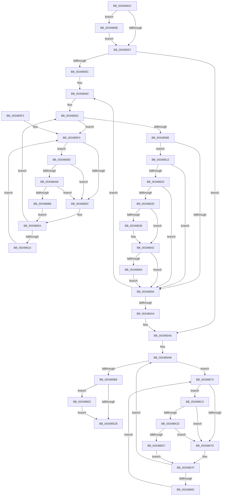

# MiConvertSmallPageRangeToLarge

- RVA: `0x003484DC`–`0x003486FA` (길이 `542` bytes)
- VA: `0x00000001403484DC`
- 실행 섹션: `.text`
- PDB 이름 있음: `예`; PDB Function 태그: `아니요`
- unwind 정보 RVA: `0x00078204`
- 디코드: `141`개 명령, `542/542` bytes 표시
- 미해석 바이트: `0` (있으면 어셈블리에 `.byte`로 보존)

> 이 문서는 커널 이미지의 기계어와 PDB 기호를 분석해 생성했습니다. 4번과 5번은 함수 원형과 자료형을 바이너리 사용 방식에서 추정한 C 해석이며 원본 소스 복구 결과는 아닙니다.

## 1. Dependencies

- 직접 호출 지점: **11**; 고유 호출 대상: **8**
- 직접 호출자로 확인된 함수: **6**
- RIP 상대 이미지 참조: **4**

### Outgoing calls
- `0x0034857B` → [MiConvertLockedSmallPageToLarge](MiConvertLockedSmallPageToLarge_function_00347110.md) (function, `0x00347110`)
- `0x003485BE` → [MiAnyPagesRemovalPending](../47/MiAnyPagesRemovalPending_function_0047CDB8.md) (function, `0x0047CDB8`)
- `0x003485D1` → [MiUnlockPage](../31/MiUnlockPage_function_0031A3E0.md) (function, `0x0031A3E0`)
- `0x00348620` → [KeShouldYieldProcessor](../27/KeShouldYieldProcessor_function_002773E0.md) (function, `0x002773E0`)
- `0x0034863D` → [KiLowerIrqlProcessIrqlFlags](../4F/KiLowerIrqlProcessIrqlFlags_function_004F5698.md) (function, `0x004F5698`)
- `0x00348669` → [KiRaiseIrqlProcessIrqlFlags](../4F/KiRaiseIrqlProcessIrqlFlags_function_004F56FC.md) (function, `0x004F56FC`)
- `0x00348693` → [KiRaiseIrqlProcessIrqlFlags](../4F/KiRaiseIrqlProcessIrqlFlags_function_004F56FC.md) (function, `0x004F56FC`)
- `0x003486AB` → [KiCheckVpBackingLongSpinWaitHypercall](../30/KiCheckVpBackingLongSpinWaitHypercall_function_0030F490.md) (function, `0x0030F490`)
- `0x003486BA` → [HvlNotifyLongSpinWait](../30/HvlNotifyLongSpinWait_function_0030F460.md) (function, `0x0030F460`)
- `0x003486CE` → [KiCheckVpBackingLongSpinWaitHypercall](../30/KiCheckVpBackingLongSpinWaitHypercall_function_0030F490.md) (function, `0x0030F490`)
- `0x003486D9` → [HvlNotifyLongSpinWait](../30/HvlNotifyLongSpinWait_function_0030F460.md) (function, `0x0030F460`)

### Direct callers
- [MiFreeMdlPageRun](../37/MiFreeMdlPageRun_function_00375A4C.md) at `0x00375C4E`
- [MiFreeLargePageMemory](../37/MiFreeLargePageMemory_function_00377938.md) at `0x00377964`
- [MiRebuildLargePage](../3B/MiRebuildLargePage_function_003BBAEC.md) at `0x003BBD56`
- [MiDeleteSubsectionLargePages](../4D/MiDeleteSubsectionLargePages_function_004D51E0.md) at `0x004D5269`
- [sub_006DCBFA](../6D/Unknown_function_006DCBFA.md) at `0x006DCC1F`
- [MiFindLargePageMemory](../../page/AA/MiFindLargePageMemory_function_00AA8334.md) at `0x00AA86C4`

### Static image references
- `0x00348517` → RVA `0x00011C60` (`.rdata`; read)
- `0x0034854A` → RVA `0x00FC6D20` (`ALMOSTRO`; read)
- `0x003485F6` → RVA `0x00FC52AC` (`ALMOSTRO`; reference)
- `0x0034869D` → RVA `0x00FC6AB8` (`ALMOSTRO`; read)

## 2. Other-region calls and transfers

- 다른 실행 섹션으로 향하는 call: **0**
- 별도 외부 분기/꼬리 이동을 확인하지 못했습니다.

## 3. Assembly (complete function range)

```asm
003484DC  48 8B C4                        mov rax, rsp
003484DF  48 89 58 10                     mov qword ptr [rax + 0x10], rbx
003484E3  48 89 68 18                     mov qword ptr [rax + 0x18], rbp
003484E7  48 89 70 20                     mov qword ptr [rax + 0x20], rsi
003484EB  48 89 48 08                     mov qword ptr [rax + 8], rcx
003484EF  57                              push rdi
003484F0  41 54                           push r12
003484F2  41 55                           push r13
003484F4  41 56                           push r14
003484F6  41 57                           push r15
003484F8  48 83 EC 20                     sub rsp, 0x20
003484FC  48 8D 1C 49                     lea rbx, [rcx + rcx*2]
00348500  44 8B E2                        mov r12d, edx
00348503  48 C1 E3 04                     shl rbx, 4
00348507  48 8B F1                        mov rsi, rcx
0034850A  48 B8 00 00 00 00 00 DE FF FF   movabs rax, 0xffffde0000000000
00348514  48 03 D8                        add rbx, rax
00348517  48 8D 0D 42 97 CC FF            lea rcx, [rip - 0x3368be]
0034851E  45 33 ED                        xor r13d, r13d
00348521  8A 43 22                        mov al, byte ptr [rbx + 0x22]
00348524  24 07                           and al, 7
00348526  3C 06                           cmp al, 6
00348528  4A 8B 04 E1                     mov rax, qword ptr [rcx + r12*8]
0034852C  41 0F 95 C5                     setne r13b
00348530  4C 8D 34 40                     lea r14, [rax + rax*2]
00348534  49 C1 E6 04                     shl r14, 4
00348538  4C 03 F3                        add r14, rbx
0034853B  45 33 FF                        xor r15d, r15d
0034853E  44 0F 20 C5                     mov rbp, cr8
00348542  41 8D 4F 02                     lea ecx, [r15 + 2]
00348546  44 0F 22 C1                     mov cr8, rcx
0034854A  44 39 3D CF E7 C7 00            cmp dword ptr [rip + 0xc7e7cf], r15d
00348551  0F 85 37 01 00 00               jne 0x14034868e
00348557  49 3B DE                        cmp rbx, r14
0034855A  73 4D                           jae 0x1403485a9
0034855C  48 8D 7B 18                     lea rdi, [rbx + 0x18]
00348560  33 F6                           xor esi, esi
00348562  F0 48 0F BA 2F 3F               lock bts qword ptr [rdi], 0x3f
00348568  0F 82 86 00 00 00               jb 0x1403485f4
0034856E  48 8D 4F E8                     lea rcx, [rdi - 0x18]
00348572  45 8B CD                        mov r9d, r13d
00348575  45 8B C4                        mov r8d, r12d
00348578  48 8B D3                        mov rdx, rbx
0034857B  E8 90 EB FF FF                  call 0x140347110
00348580  48 B8 FF FF FF FF FF FF FF 7F   movabs rax, 0x7fffffffffffffff
0034858A  F0 48 21 07                     lock and qword ptr [rdi], rax
0034858E  41 F6 C7 0F                     test r15b, 0xf
00348592  74 7E                           je 0x140348612
00348594  48 83 C7 30                     add rdi, 0x30
00348598  49 FF C7                        inc r15
0034859B  48 8D 47 E8                     lea rax, [rdi - 0x18]
0034859F  49 3B C6                        cmp rax, r14
003485A2  72 BC                           jb 0x140348560
003485A4  48 8B 74 24 50                  mov rsi, qword ptr [rsp + 0x50]
003485A9  33 FF                           xor edi, edi
003485AB  F0 48 0F BA 6B 18 3F            lock bts qword ptr [rbx + 0x18], 0x3f
003485B2  0F 82 BB 00 00 00               jb 0x140348673
003485B8  41 8B D4                        mov edx, r12d
003485BB  48 8B CE                        mov rcx, rsi
003485BE  E8 F5 47 13 00                  call 0x14047cdb8
003485C3  85 C0                           test eax, eax
003485C5  0F 85 15 01 00 00               jne 0x1403486e0
003485CB  40 8A D5                        mov dl, bpl
003485CE  48 8B CB                        mov rcx, rbx
003485D1  E8 0A 1E FD FF                  call 0x14031a3e0
003485D6  48 8B 5C 24 58                  mov rbx, qword ptr [rsp + 0x58]
003485DB  48 8B 6C 24 60                  mov rbp, qword ptr [rsp + 0x60]
003485E0  48 8B 74 24 68                  mov rsi, qword ptr [rsp + 0x68]
003485E5  48 83 C4 20                     add rsp, 0x20
003485E9  41 5F                           pop r15
003485EB  41 5E                           pop r14
003485ED  41 5D                           pop r13
003485EF  41 5C                           pop r12
003485F1  5F                              pop rdi
003485F2  C3                              ret
003485F3  CC                              int3
003485F4  FF C6                           inc esi
003485F6  85 35 B0 CC C7 00               test dword ptr [rip + 0xc7ccb0], esi
003485FC  0F 84 9B 00 00 00               je 0x14034869d
00348602  F3 90                           pause
00348604  48 8B 07                        mov rax, qword ptr [rdi]
00348607  48 85 C0                        test rax, rax
0034860A  0F 89 52 FF FF FF               jns 0x140348562
00348610  EB E2                           jmp 0x1403485f4
00348612  B8 02 00 00 00                  mov eax, 2
00348617  40 3A E8                        cmp bpl, al
0034861A  0F 83 74 FF FF FF               jae 0x140348594
00348620  E8 BB ED F2 FF                  call 0x1402773e0
00348625  85 C0                           test eax, eax
00348627  0F 84 67 FF FF FF               je 0x140348594
0034862D  83 3D EC E6 C7 00 00            cmp dword ptr [rip + 0xc7e6ec], 0
00348634  74 0C                           je 0x140348642
00348636  44 0F 20 C1                     mov rcx, cr8
0034863A  40 8A D5                        mov dl, bpl
0034863D  E8 56 D0 1A 00                  call 0x1404f5698
00348642  40 0F B6 C5                     movzx eax, bpl
00348646  44 0F 22 C0                     mov cr8, rax
0034864A  44 0F 20 C5                     mov rbp, cr8
0034864E  B9 02 00 00 00                  mov ecx, 2
00348653  44 0F 22 C1                     mov cr8, rcx
00348657  83 3D C2 E6 C7 00 00            cmp dword ptr [rip + 0xc7e6c2], 0
0034865E  0F 84 30 FF FF FF               je 0x140348594
00348664  8A D1                           mov dl, cl
00348666  40 8A CD                        mov cl, bpl
00348669  E8 8E D0 1A 00                  call 0x1404f56fc
0034866E  E9 21 FF FF FF                  jmp 0x140348594
00348673  FF C7                           inc edi
00348675  85 3D 31 CC C7 00               test dword ptr [rip + 0xc7cc31], edi
0034867B  74 47                           je 0x1403486c4
0034867D  F3 90                           pause
0034867F  48 8B 43 18                     mov rax, qword ptr [rbx + 0x18]
00348683  48 85 C0                        test rax, rax
00348686  0F 89 1F FF FF FF               jns 0x1403485ab
0034868C  EB E5                           jmp 0x140348673
0034868E  8A D1                           mov dl, cl
00348690  40 8A CD                        mov cl, bpl
00348693  E8 64 D0 1A 00                  call 0x1404f56fc
00348698  E9 BA FE FF FF                  jmp 0x140348557
0034869D  8B 05 15 E4 C7 00               mov eax, dword ptr [rip + 0xc7e415]
003486A3  A8 40                           test al, 0x40
003486A5  0F 84 57 FF FF FF               je 0x140348602
003486AB  E8 E0 6D FC FF                  call 0x14030f490
003486B0  84 C0                           test al, al
003486B2  0F 84 4A FF FF FF               je 0x140348602
003486B8  8B CE                           mov ecx, esi
003486BA  E8 A1 6D FC FF                  call 0x14030f460
003486BF  E9 40 FF FF FF                  jmp 0x140348604
003486C4  8B 05 EE E3 C7 00               mov eax, dword ptr [rip + 0xc7e3ee]
003486CA  A8 40                           test al, 0x40
003486CC  74 AF                           je 0x14034867d
003486CE  E8 BD 6D FC FF                  call 0x14030f490
003486D3  84 C0                           test al, al
003486D5  74 A6                           je 0x14034867d
003486D7  8B CF                           mov ecx, edi
003486D9  E8 82 6D FC FF                  call 0x14030f460
003486DE  EB 9F                           jmp 0x14034867f
003486E0  48 8B 43 28                     mov rax, qword ptr [rbx + 0x28]
003486E4  48 B9 00 00 00 00 00 02 00 00   movabs rcx, 0x20000000000
003486EE  48 0B C1                        or rax, rcx
003486F1  48 89 43 28                     mov qword ptr [rbx + 0x28], rax
003486F5  E9 D1 FE FF FF                  jmp 0x1403485cb
```

## 4. C-style interpretation (structured pseudocode)

```c
__int64 __fastcall MiConvertSmallPageRangeToLarge(__int64 a1, int a2)
{
    __int64 result;
    __int64 v_r13;
    __int64 v_r14;
    __int64 v_r15;
    __int64 v_rbx;
    __int64 v_rdi;
    __int64 v_rsi;
    __int64 v_rsp;
    unsigned __int64 v_stack_p10;
    unsigned __int64 v_stack_p18;
    unsigned __int64 v_stack_p20;
    unsigned __int64 v_stack_p8;

    *(unsigned __int64 *)(v_rsp + 16) = v_rbx;
    *(unsigned __int64 *)(v_rsp + 24) = v_rbp;
    *(unsigned __int64 *)(v_rsp + 32) = v_rsi;
    *(unsigned __int64 *)(v_rsp + 8) = a1;
    v_rsp = (v_rsp) - (32);
    v_rbx = (a1 + a1 * 2) << (4);
    v_rbx = (v_rbx) + (v_rsp);
    v_r13 = 0;
    result = (unsigned __int8)((*(unsigned __int8 *)(v_rbx + 34)) & (7));
    v_r13 = (((unsigned __int8)(result)) != 6) ? 1 : 0;
    v_r14 = (*(unsigned __int64 *)(v_rip - 3369150 + (unsigned int)(a2) * 8) + *(unsigned __int64 *)(v_rip - 3369150 + (unsigned int)(a2) * 8) * 2) << (4);
    v_r14 = (v_r14) + (v_rbx);
    v_r15 = 0;
    if ((*(unsigned int *)(v_rip + 13101007)) != 0) goto loc_0034868E;
loc_00348557:
    if (v_rbx >= v_r14) goto loc_003485A9;
loc_00348560:
    v_rsi = 0;
loc_00348562:
    if (condition_is_below) goto loc_003485F4;
    result = MiConvertLockedSmallPageToLarge(v_rbx + 24 - 24, v_rbx, (unsigned int)((unsigned int)((unsigned int)(a2))), (unsigned int)((unsigned int)(v_r13)));
    if (((0) & (15)) == 0) goto loc_00348612;
loc_00348594:
    v_rdi = (v_rbx + 24) + (48);
    v_r15 = (v_r15) + 1;
    if ((v_rdi - 24) < v_r14) goto loc_00348560;
loc_003485A9:
    v_rdi = 0;
loc_003485AB:
    if (condition_is_below) goto loc_00348673;
    result = MiAnyPagesRemovalPending(v_stack_p8, (unsigned int)((unsigned int)((unsigned int)(a2))), (unsigned int)((unsigned int)((unsigned int)(a2))), (unsigned int)((unsigned int)(v_r13)));
    if ((unsigned int)(result) != 0) goto loc_003486E0;
loc_003485CB:
    result = MiUnlockPage(v_rbx, (unsigned __int8)(v_cr8), (unsigned int)((unsigned int)((unsigned int)(a2))), (unsigned int)((unsigned int)(v_r13)));
    v_rsp = (v_rsp) + (32);
    return result;
loc_003485F4:
    v_rsi = (unsigned int)((v_stack_p20) + 1);
    if (((*(unsigned int *)(v_rip + 13094064)) & ((unsigned int)(v_rsi))) == 0) goto loc_0034869D;
loc_00348602:
loc_00348604:
    if (!sign_flag) goto loc_00348562;
    goto loc_003485F4;
loc_00348612:
    if (((unsigned __int8)(v_stack_p18)) >= 2) goto loc_00348594;
    result = KeShouldYieldProcessor(v_rbx, (unsigned __int8)(v_cr8), (unsigned int)((unsigned int)((unsigned int)(a2))), (unsigned int)((unsigned int)(v_r13)));
    if ((unsigned int)(result) == 0) goto loc_00348594;
    if ((*(unsigned int *)(v_rip + 13100780)) != 0) {
        a1 = v_r15 + 2;
        a2 = (unsigned __int8)(v_stack_p18);
        result = KiLowerIrqlProcessIrqlFlags(a1, a2, (unsigned int)((unsigned int)((unsigned int)(a2))), (unsigned int)((unsigned int)(v_r13)));
    }
    if ((*(unsigned int *)(v_rip + 13100738)) == 0) goto loc_00348594;
    result = KiRaiseIrqlProcessIrqlFlags((unsigned __int8)((unsigned __int8)(v_stack_p18)), 2, (unsigned int)((unsigned int)((unsigned int)(a2))), (unsigned int)((unsigned int)(v_r13)));
    goto loc_00348594;
loc_00348673:
    v_rdi = (unsigned int)((v_rdi) + 1);
    if (((*(unsigned int *)(v_rip + 13093937)) & ((unsigned int)(v_rdi))) == 0) goto loc_003486C4;
loc_0034867D:
loc_0034867F:
    if (!sign_flag) goto loc_003485AB;
    goto loc_00348673;
loc_0034868E:
    result = KiRaiseIrqlProcessIrqlFlags((unsigned __int8)((unsigned __int8)(v_stack_p18)), (unsigned __int8)((unsigned __int8)((unsigned __int8)(v_stack_p18))), (unsigned int)((unsigned int)((unsigned int)(a2))), (unsigned int)((unsigned int)(v_r13)));
    goto loc_00348557;
loc_0034869D:
    if ((((unsigned __int8)((unsigned int)(*(unsigned int *)(v_rip + 13100053)))) & (64)) == 0) goto loc_00348602;
    result = KiCheckVpBackingLongSpinWaitHypercall((unsigned __int8)((unsigned __int8)(v_stack_p18)), (unsigned __int8)((unsigned __int8)((unsigned __int8)(v_stack_p18))), (unsigned int)((unsigned int)((unsigned int)(a2))), (unsigned int)((unsigned int)(v_r13)));
    if ((unsigned __int8)(result) == 0) goto loc_00348602;
    result = HvlNotifyLongSpinWait((unsigned int)((unsigned int)(v_rsi)), (unsigned __int8)((unsigned __int8)((unsigned __int8)(v_stack_p18))), (unsigned int)((unsigned int)((unsigned int)(a2))), (unsigned int)((unsigned int)(v_r13)));
    goto loc_00348604;
loc_003486C4:
    if ((((unsigned __int8)((unsigned int)(*(unsigned int *)(v_rip + 13100014)))) & (64)) == 0) goto loc_0034867D;
    result = KiCheckVpBackingLongSpinWaitHypercall((unsigned int)((unsigned int)(v_rsi)), (unsigned __int8)((unsigned __int8)((unsigned __int8)(v_stack_p18))), (unsigned int)((unsigned int)((unsigned int)(a2))), (unsigned int)((unsigned int)(v_r13)));
    if ((unsigned __int8)(result) == 0) goto loc_0034867D;
    result = HvlNotifyLongSpinWait((unsigned int)((unsigned int)(v_rdi)), (unsigned __int8)((unsigned __int8)((unsigned __int8)(v_stack_p18))), (unsigned int)((unsigned int)((unsigned int)(a2))), (unsigned int)((unsigned int)(v_r13)));
    goto loc_0034867F;
loc_003486E0:
    result = (*(unsigned __int64 *)(v_stack_p10 + 40)) | ((unsigned int)((unsigned int)(v_rdi)));
    *(unsigned __int64 *)(v_stack_p10 + 40) = result;
    goto loc_003485CB;
}
```

## 5. (Beta) C Style

```c
int64_t MiConvertSmallPageRangeToLarge(void *Arg1, int32_t Arg2)
{
    uint8_t *arg1 = (uint8_t *)Arg1;

    int64_t result;
    int64_t local_r13;
    int64_t local_r14;
    int64_t local_r15;
    int64_t local_rbx;
    int64_t local_rdi;
    int64_t local_rsi;
    int64_t local_rsp;
    uint64_t v_stack_p10;
    uint64_t v_stack_p18;
    uint64_t v_stack_p20;
    uint64_t v_stack_p8;

    *(uint64_t *)(local_rsp + 0x10) = local_rbx;
    *(uint64_t *)(local_rsp + 0x18) = local_rbp;
    *(uint64_t *)(local_rsp + 0x20) = local_rsi;
    *(void **)(local_rsp + 0x8) = Arg1;
    local_rsp = (local_rsp) - (32);
    local_rbx = (Arg1 + Arg1 * 2) << (4);
    local_rbx = (local_rbx) + (local_rsp);
    local_r13 = 0;
    result = (uint8_t)((*(uint8_t *)(local_rbx + 0x22)) & (7));
    local_r13 = (((uint8_t)(result)) != 6) ? 1 : 0;
    local_r14 = (*(uint64_t *)(v_rip - 0x3368BE + (uint32_t)(Arg2) * 8) + *(uint64_t *)(v_rip - 0x3368BE + (uint32_t)(Arg2) * 8) * 2) << (4);
    local_r14 = (local_r14) + (local_rbx);
    local_r15 = 0;
    if ((*(uint32_t *)(v_rip + 0xC7E7CF)) != 0) goto loc_0034868E;
loc_00348557:
    if (local_rbx >= local_r14) goto loc_003485A9;
loc_00348560:
    local_rsi = 0;
loc_00348562:
    if (condition_is_below) goto loc_003485F4;
    result = MiConvertLockedSmallPageToLarge(local_rbx + 24 - 24, local_rbx, (uint32_t)((uint32_t)((uint32_t)(Arg2))), (uint32_t)((uint32_t)(local_r13)));
    if (((0) & (15)) == 0) goto loc_00348612;
loc_00348594:
    local_rdi = (local_rbx + 24) + (48);
    local_r15 = (local_r15) + 1;
    if ((local_rdi - 24) < local_r14) goto loc_00348560;
loc_003485A9:
    local_rdi = 0;
loc_003485AB:
    if (condition_is_below) goto loc_00348673;
    result = MiAnyPagesRemovalPending(v_stack_p8, (uint32_t)((uint32_t)((uint32_t)(Arg2))), (uint32_t)((uint32_t)((uint32_t)(Arg2))), (uint32_t)((uint32_t)(local_r13)));
    if ((uint32_t)(result) != 0) goto loc_003486E0;
loc_003485CB:
    result = MiUnlockPage(local_rbx, (uint8_t)(v_cr8), (uint32_t)((uint32_t)((uint32_t)(Arg2))), (uint32_t)((uint32_t)(local_r13)));
    local_rsp = (local_rsp) + (32);
    return result;
loc_003485F4:
    local_rsi = (uint32_t)((v_stack_p20) + 1);
    if (((*(uint32_t *)(v_rip + 0xC7CCB0)) & ((uint32_t)(local_rsi))) == 0) goto loc_0034869D;
loc_00348602:
loc_00348604:
    if (!sign_flag) goto loc_00348562;
    goto loc_003485F4;
loc_00348612:
    if (((uint8_t)(v_stack_p18)) >= 2) goto loc_00348594;
    result = KeShouldYieldProcessor(local_rbx, (uint8_t)(v_cr8), (uint32_t)((uint32_t)((uint32_t)(Arg2))), (uint32_t)((uint32_t)(local_r13)));
    if ((uint32_t)(result) == 0) goto loc_00348594;
    if ((*(uint32_t *)(v_rip + 0xC7E6EC)) != 0) {
        Arg1 = local_r15 + 2;
        Arg2 = (uint8_t)(v_stack_p18);
        result = KiLowerIrqlProcessIrqlFlags(Arg1, Arg2, (uint32_t)((uint32_t)((uint32_t)(Arg2))), (uint32_t)((uint32_t)(local_r13)));
    }
    if ((*(uint32_t *)(v_rip + 0xC7E6C2)) == 0) goto loc_00348594;
    result = KiRaiseIrqlProcessIrqlFlags((uint8_t)((uint8_t)(v_stack_p18)), 2, (uint32_t)((uint32_t)((uint32_t)(Arg2))), (uint32_t)((uint32_t)(local_r13)));
    goto loc_00348594;
loc_00348673:
    local_rdi = (uint32_t)((local_rdi) + 1);
    if (((*(uint32_t *)(v_rip + 0xC7CC31)) & ((uint32_t)(local_rdi))) == 0) goto loc_003486C4;
loc_0034867D:
loc_0034867F:
    if (!sign_flag) goto loc_003485AB;
    goto loc_00348673;
loc_0034868E:
    result = KiRaiseIrqlProcessIrqlFlags((uint8_t)((uint8_t)(v_stack_p18)), (uint8_t)((uint8_t)((uint8_t)(v_stack_p18))), (uint32_t)((uint32_t)((uint32_t)(Arg2))), (uint32_t)((uint32_t)(local_r13)));
    goto loc_00348557;
loc_0034869D:
    if ((((uint8_t)((uint32_t)(*(uint32_t *)(v_rip + 0xC7E415)))) & (64)) == 0) goto loc_00348602;
    result = KiCheckVpBackingLongSpinWaitHypercall((uint8_t)((uint8_t)(v_stack_p18)), (uint8_t)((uint8_t)((uint8_t)(v_stack_p18))), (uint32_t)((uint32_t)((uint32_t)(Arg2))), (uint32_t)((uint32_t)(local_r13)));
    if ((uint8_t)(result) == 0) goto loc_00348602;
    result = HvlNotifyLongSpinWait((uint32_t)((uint32_t)(local_rsi)), (uint8_t)((uint8_t)((uint8_t)(v_stack_p18))), (uint32_t)((uint32_t)((uint32_t)(Arg2))), (uint32_t)((uint32_t)(local_r13)));
    goto loc_00348604;
loc_003486C4:
    if ((((uint8_t)((uint32_t)(*(uint32_t *)(v_rip + 0xC7E3EE)))) & (64)) == 0) goto loc_0034867D;
    result = KiCheckVpBackingLongSpinWaitHypercall((uint32_t)((uint32_t)(local_rsi)), (uint8_t)((uint8_t)((uint8_t)(v_stack_p18))), (uint32_t)((uint32_t)((uint32_t)(Arg2))), (uint32_t)((uint32_t)(local_r13)));
    if ((uint8_t)(result) == 0) goto loc_0034867D;
    result = HvlNotifyLongSpinWait((uint32_t)((uint32_t)(local_rdi)), (uint8_t)((uint8_t)((uint8_t)(v_stack_p18))), (uint32_t)((uint32_t)((uint32_t)(Arg2))), (uint32_t)((uint32_t)(local_r13)));
    goto loc_0034867F;
loc_003486E0:
    result = (*(uint64_t *)(v_stack_p10 + 0x28)) | ((uint32_t)((uint32_t)(local_rdi)));
    *(uint64_t *)(v_stack_p10 + 0x28) = result;
    goto loc_003485CB;
}
```

### 관측된 메모리 오프셋

구조체 형식이 확인되지 않은 접근은 인자 기준의 오프셋으로만 기록했습니다.

| 기준 인자 | 오프셋 표현 | 폭 (bit) | 접근 |
|---|---:|---:|---|
| `Arg1` | `+ 0x0 + rcx*2` | `64` | `R` |

## 6. Execution-region graph

[열기: 2D/3D 그래프와 함수 탐색 컨트롤 패널](../../../control-panel.html?section=text&rva=0x003484DC&view=graph)

- 2D 그래프는 위에서 아래로 흐르고, 3D 그래프는 빈 공간을 드래그해 회전합니다. Shift+드래그는 이동, 휠은 확대·축소, 함수 노드 선택은 대상 보고서 이동입니다.

### Static fallback


