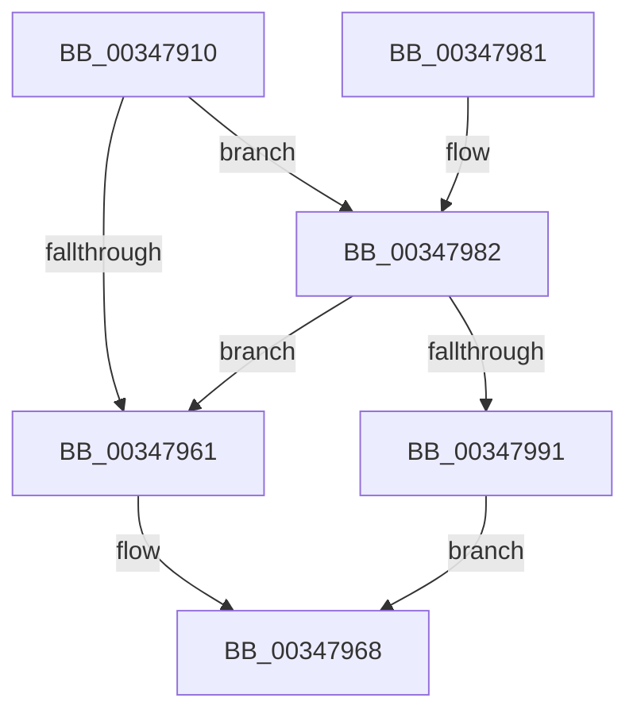

# MiEmptyDeferredWorkingSetEntries

- RVA: `0x00347910`–`0x003479A7` (길이 `151` bytes)
- VA: `0x0000000140347910`
- 실행 섹션: `.text`
- PDB 이름 있음: `예`; PDB Function 태그: `아니요`
- unwind 정보 RVA: `0x0007811C`
- 디코드: `42`개 명령, `151/151` bytes 표시
- 미해석 바이트: `0` (있으면 어셈블리에 `.byte`로 보존)

> 이 문서는 커널 이미지의 기계어와 PDB 기호를 분석해 생성했습니다. 4번과 5번은 함수 원형과 자료형을 바이너리 사용 방식에서 추정한 C 해석이며 원본 소스 복구 결과는 아닙니다.

## 1. Dependencies

- 직접 호출 지점: **1**; 고유 호출 대상: **1**
- 직접 호출자로 확인된 함수: **6**
- RIP 상대 이미지 참조: **0**

### Outgoing calls
- `0x00347970` → [MiAddWorkingSetEntries](../27/MiAddWorkingSetEntries_function_0027DC00.md) (function, `0x0027DC00`)

### Direct callers
- [sub_0027EC31](../27/Unknown_function_0027EC31.md) at `0x0027EC34`
- [MiResolveTransitionFault](../28/MiResolveTransitionFault_function_00282940.md) at `0x002830FD`
- [MiCompleteRestrictedImageFault](../2C/MiCompleteRestrictedImageFault_function_002C60D4.md) at `0x002C6314`
- [MiCompletePrivateZeroFault](../33/MiCompletePrivateZeroFault_function_00330CC0.md) at `0x003316D7`
- [MiCompletePrivateZeroFault](../33/MiCompletePrivateZeroFault_function_00330CC0.md) at `0x003319FE`
- [MiCompleteProtoPteFault](MiCompleteProtoPteFault_function_00345710.md) at `0x00345B4B`
- [MiCompleteProtoPteFault](MiCompleteProtoPteFault_function_00345710.md) at `0x003465EC`
- [sub_003475D9](Unknown_function_003475D9.md) at `0x003476AF`

### Static image references
- 디코드된 RIP-relative 메모리 참조가 없습니다.

## 2. Other-region calls and transfers

- 다른 실행 섹션으로 향하는 call: **0**
- 별도 외부 분기/꼬리 이동을 확인하지 못했습니다.

## 3. Assembly (complete function range)

```asm
00347910  40 53                           push rbx
00347912  48 83 EC 20                     sub rsp, 0x20
00347916  48 8B D9                        mov rbx, rcx
00347919  49 B8 00 00 00 00 80 F6 FF FF   movabs r8, 0xfffff68000000000
00347923  49 8B C0                        mov rax, r8
00347926  48 8B 51 10                     mov rdx, qword ptr [rcx + 0x10]
0034792A  4C 8B 13                        mov r10, qword ptr [rbx]
0034792D  48 C1 E2 19                     shl rdx, 0x19
00347931  48 C1 E0 19                     shl rax, 0x19
00347935  48 2B D0                        sub rdx, rax
00347938  48 C1 FA 10                     sar rdx, 0x10
0034793C  48 C1 E2 19                     shl rdx, 0x19
00347940  48 2B D0                        sub rdx, rax
00347943  0F B7 41 08                     movzx eax, word ptr [rcx + 8]
00347947  0F B6 49 0D                     movzx ecx, byte ptr [rcx + 0xd]
0034794B  48 C1 E0 0C                     shl rax, 0xc
0034794F  83 E1 02                        and ecx, 2
00347952  48 C1 FA 10                     sar rdx, 0x10
00347956  48 03 D0                        add rdx, rax
00347959  49 8B C0                        mov rax, r8
0034795C  48 3B D0                        cmp rdx, rax
0034795F  73 21                           jae 0x140347982
00347961  44 8B C9                        mov r9d, ecx
00347964  41 83 C9 05                     or r9d, 5
00347968  44 0F B7 43 0A                  movzx r8d, word ptr [rbx + 0xa]
0034796D  49 8B CA                        mov rcx, r10
00347970  E8 8B 62 F3 FF                  call 0x14027dc00
00347975  33 C0                           xor eax, eax
00347977  66 89 43 0A                     mov word ptr [rbx + 0xa], ax
0034797B  48 83 C4 20                     add rsp, 0x20
0034797F  5B                              pop rbx
00347980  C3                              ret
00347981  CC                              int3
00347982  48 B8 FF FF FF FF FF F6 FF FF   movabs rax, 0xfffff6ffffffffff
0034798C  48 3B D0                        cmp rdx, rax
0034798F  77 D0                           ja 0x140347961
00347991  41 8B 82 B8 00 00 00            mov eax, dword ptr [r10 + 0xb8]
00347998  44 8B C9                        mov r9d, ecx
0034799B  41 83 C9 04                     or r9d, 4
0034799F  A8 0F                           test al, 0xf
003479A1  44 0F 45 C9                     cmovne r9d, ecx
003479A5  EB C1                           jmp 0x140347968
```

## 4. C-style interpretation (structured pseudocode)

```c
__int64 __fastcall MiEmptyDeferredWorkingSetEntries(__int64 a1)
{
    __int64 result;
    __int64 v_rsp;

    v_rsp = (v_rsp) - (32);
    a2 = (*(unsigned __int64 *)(a1 + 16)) << (25);
    result = (a3) << (25);
    a2 = (a2) - (result);
    a2 = (a2) >> (16);
    a2 = (a2) << (25);
    a2 = (a2) - (result);
    result = (*(unsigned __int16 *)(a1 + 8)) << (12);
    a1 = (unsigned int)((*(unsigned __int8 *)(a1 + 13)) & (2));
    a2 = (a2) >> (16);
    a2 = (a2) + (result);
    if (a2 >= a3) goto loc_00347982;
loc_00347961:
    a4 = (unsigned int)(((unsigned int)((unsigned int)(a1))) | (5));
loc_00347968:
    result = MiAddWorkingSetEntries(*(unsigned __int64 *)(a1), a2, *(unsigned __int16 *)(a1 + 10), a4);
    result = 0;
    *(unsigned __int16 *)(a1 + 10) = 0;
    v_rsp = (v_rsp) + (32);
    return result;
loc_00347982:
    if (a2 > 0) goto loc_00347961;
    a4 = (unsigned int)(((unsigned int)((unsigned int)(*(unsigned __int64 *)(a1)))) | (4));
    if ((((unsigned __int8)((unsigned int)(*(unsigned int *)(*(unsigned __int64 *)(a1) + 184)))) & (15)) != 0) { a4 = (unsigned int)(*(unsigned __int64 *)(a1)); }
    goto loc_00347968;
}
```

## 5. (Beta) C Style

```c
int64_t MiEmptyDeferredWorkingSetEntries(void *Arg1)
{
    uint8_t *arg1 = (uint8_t *)Arg1;

    int64_t result;
    int64_t local_rsp;

    local_rsp = (local_rsp) - (32);
    a2 = (*(uint64_t *)(arg1 + 0x10)) << (25);
    result = (a3) << (25);
    a2 = (a2) - (result);
    a2 = (a2) >> (16);
    a2 = (a2) << (25);
    a2 = (a2) - (result);
    result = (*(uint16_t *)(arg1 + 0x8)) << (12);
    Arg1 = (uint32_t)((*(uint8_t *)(arg1 + 0xD)) & (2));
    a2 = (a2) >> (16);
    a2 = (a2) + (result);
    if (a2 >= a3) goto loc_00347982;
loc_00347961:
    a4 = (uint32_t)(((uint32_t)((uint32_t)(Arg1))) | (5));
loc_00347968:
    result = MiAddWorkingSetEntries(*(uint64_t *)(arg1), a2, *(uint16_t *)(arg1 + 0xA), a4);
    result = 0;
    *(uint16_t *)(arg1 + 0xA) = 0;
    local_rsp = (local_rsp) + (32);
    return result;
loc_00347982:
    if (a2 > 0) goto loc_00347961;
    a4 = (uint32_t)(((uint32_t)((uint32_t)(*(uint64_t *)(arg1)))) | (4));
    if ((((uint8_t)((uint32_t)(*(uint32_t *)(*(uint64_t *)(arg1) + 0xB8)))) & (15)) != 0) { a4 = (uint32_t)(*(uint64_t *)(arg1)); }
    goto loc_00347968;
}
```

### 관측된 메모리 오프셋

구조체 형식이 확인되지 않은 접근은 인자 기준의 오프셋으로만 기록했습니다.

| 기준 인자 | 오프셋 표현 | 폭 (bit) | 접근 |
|---|---:|---:|---|
| `Arg1` | `+ 0x0` | `64` | `R` |
| `Arg1` | `+ 0x8` | `16` | `R` |
| `Arg1` | `+ 0xA` | `16` | `R` |
| `Arg1` | `+ 0xA` | `16` | `W` |
| `Arg1` | `+ 0xD` | `8` | `R` |
| `Arg1` | `+ 0x10` | `64` | `R` |

## 6. Execution-region graph

[열기: 2D/3D 그래프와 함수 탐색 컨트롤 패널](../../../control-panel.html?section=text&rva=0x00347910&view=graph)

- 2D 그래프는 위에서 아래로 흐르고, 3D 그래프는 빈 공간을 드래그해 회전합니다. Shift+드래그는 이동, 휠은 확대·축소, 함수 노드 선택은 대상 보고서 이동입니다.

### Static fallback


