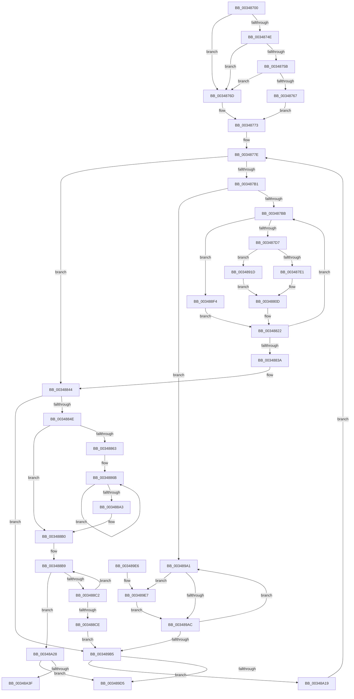

# MiEmptyPageAccessLog

- RVA: `0x00348700`–`0x00348A44` (길이 `836` bytes)
- VA: `0x0000000140348700`
- 실행 섹션: `.text`
- PDB 이름 있음: `예`; PDB Function 태그: `예`
- unwind 정보 RVA: `0x00078224`
- 디코드: `217`개 명령, `836/836` bytes 표시
- 미해석 바이트: `0` (있으면 어셈블리에 `.byte`로 보존)

> 이 문서는 커널 이미지의 기계어와 PDB 기호를 분석해 생성했습니다. 4번과 5번은 함수 원형과 자료형을 바이너리 사용 방식에서 추정한 C 해석이며 원본 소스 복구 결과는 아닙니다.

## 1. Dependencies

- 직접 호출 지점: **6**; 고유 호출 대상: **6**
- 직접 호출자로 확인된 함수: **5**
- RIP 상대 이미지 참조: **0**

### Outgoing calls
- `0x0034887C` → [MiReferenceControlAreaFileWithTag](MiReferenceControlAreaFileWithTag_function_00348390.md) (function, `0x00348390`)
- `0x00348892` → [ObFastDereferenceObjectDeferDelete](../23/ObFastDereferenceObjectDeferDelete_function_002378C0.md) (function, `0x002378C0`)
- `0x003488DD` → [ObpTraceObjectReferenceIfActive](../21/ObpTraceObjectReferenceIfActive_function_00210780.md) (function, `0x00210780`)
- `0x0034894B` → [MiStartingOffset](MiStartingOffset_function_003482E0.md) (function, `0x003482E0`)
- `0x003489C0` → [MiQueuePageAccessLog](MiQueuePageAccessLog_function_00348EB0.md) (function, `0x00348EB0`)
- `0x00348A2D` → [ExFreePoolWithTag](../../poolcode/B8/ExFreePoolWithTag_function_00B82870.md) (function, `0x00B82870`)

### Direct callers
- [MiDrainOldAccessBuffers](../2C/MiDrainOldAccessBuffers_function_002C0C30.md) at `0x002C0CD1`
- [MiAllocateAccessLog](../36/MiAllocateAccessLog_function_0036B04C.md) at `0x0036B1A9`
- [MiAllocateAccessLog](../36/MiAllocateAccessLog_function_0036B04C.md) at `0x0036B1D6`
- [MiDrainSystemAccessLog](../47/MiDrainSystemAccessLog_function_00474144.md) at `0x004741CB`
- [sub_006E82CE](../6E/Unknown_function_006E82CE.md) at `0x006E8378`
- [MmDeleteProcessAddressSpace](../../page/AC/MmDeleteProcessAddressSpace_function_00AC804C.md) at `0x00AC81B4`

### Static image references
- 디코드된 RIP-relative 메모리 참조가 없습니다.

## 2. Other-region calls and transfers

- 다른 실행 섹션으로 향하는 call: **1**
  - `0x00348A2D` → [ExFreePoolWithTag](../../poolcode/B8/ExFreePoolWithTag_function_00B82870.md) (`.text` → `POOLCODE`)
- call이 아닌 외부 분기/꼬리 이동: **1**
  - `0x00348A3F` → [sub_006E2110](../6E/Unknown_function_006E2110.md) (`tail-transfer`)

## 3. Assembly (complete function range)

```asm
00348700  48 89 54 24 10                  mov qword ptr [rsp + 0x10], rdx
00348705  48 89 4C 24 08                  mov qword ptr [rsp + 8], rcx
0034870A  53                              push rbx
0034870B  55                              push rbp
0034870C  56                              push rsi
0034870D  57                              push rdi
0034870E  41 54                           push r12
00348710  41 55                           push r13
00348712  41 56                           push r14
00348714  41 57                           push r15
00348716  48 83 EC 48                     sub rsp, 0x48
0034871A  33 C9                           xor ecx, ecx
0034871C  C7 44 24 2C 03 00 00 00         mov dword ptr [rsp + 0x2c], 3
00348724  8B F9                           mov edi, ecx
00348726  89 4C 24 28                     mov dword ptr [rsp + 0x28], ecx
0034872A  4C 8B D2                        mov r10, rdx
0034872D  44 0F 20 C0                     mov rax, cr8
00348731  4D 8B 6A 38                     mov r13, qword ptr [r10 + 0x38]
00348735  3C 02                           cmp al, 2
00348737  8B D1                           mov edx, ecx
00348739  4C 89 6C 24 38                  mov qword ptr [rsp + 0x38], r13
0034873E  0F 94 C2                        sete dl
00348741  89 94 24 A8 00 00 00            mov dword ptr [rsp + 0xa8], edx
00348748  49 83 FD 01                     cmp r13, 1
0034874C  76 1F                           jbe 0x14034876d
0034874E  41 F7 85 FC 05 00 00 00 10 00 00  test dword ptr [r13 + 0x5fc], 0x1000
00348759  75 12                           jne 0x14034876d
0034875B  49 8B 85 E8 02 00 00            mov rax, qword ptr [r13 + 0x2e8]
00348762  48 85 C0                        test rax, rax
00348765  74 06                           je 0x14034876d
00348767  44 8B 48 08                     mov r9d, dword ptr [rax + 8]
0034876B  EB 06                           jmp 0x140348773
0034876D  41 B9 FF FF FF FF               mov r9d, 0xffffffff
00348773  44 89 8C 24 A0 00 00 00         mov dword ptr [rsp + 0xa0], r9d
0034877B  48 8B D9                        mov rbx, rcx
0034877E  49 8B 72 20                     mov rsi, qword ptr [r10 + 0x20]
00348782  4D 8D 62 40                     lea r12, [r10 + 0x40]
00348786  4D 8B 32                        mov r14, qword ptr [r10]
00348789  48 83 EE 08                     sub rsi, 8
0034878D  49 BB 00 00 00 00 80 F6 FF FF   movabs r11, 0xfffff68000000000
00348797  B8 FF 01 00 00                  mov eax, 0x1ff
0034879C  4C 89 74 24 30                  mov qword ptr [rsp + 0x30], r14
003487A1  48 8B D1                        mov rdx, rcx
003487A4  44 0F B7 C1                     movzx r8d, cx
003487A8  49 3B F4                        cmp rsi, r12
003487AB  0F 82 93 00 00 00               jb 0x140348844
003487B1  49 83 FD 01                     cmp r13, 1
003487B5  0F 86 E6 01 00 00               jbe 0x1403489a1
003487BB  4C 8B 36                        mov r14, qword ptr [rsi]
003487BE  49 8B EE                        mov rbp, r14
003487C1  45 0F B7 FE                     movzx r15d, r14w
003487C5  48 C1 ED 09                     shr rbp, 9
003487C9  49 C1 FE 10                     sar r14, 0x10
003487CD  66 44 23 F8                     and r15w, ax
003487D1  0F 84 1D 01 00 00               je 0x1403488f4
003487D7  66 45 3B F8                     cmp r15w, r8w
003487DB  0F 85 3C 01 00 00               jne 0x14034891d
003487E1  48 8B CB                        mov rcx, rbx
003487E4  49 8B C6                        mov rax, r14
003487E7  48 2B C2                        sub rax, rdx
003487EA  48 C1 E9 0A                     shr rcx, 0xa
003487EE  48 C1 F8 03                     sar rax, 3
003487F2  83 E1 01                        and ecx, 1
003487F5  48 C1 E0 0C                     shl rax, 0xc
003487F9  8B 4C 8C 28                     mov ecx, dword ptr [rsp + rcx*4 + 0x28]
003487FD  48 D3 E0                        shl rax, cl
00348800  48 03 D8                        add rbx, rax
00348803  48 89 5C 24 20                  mov qword ptr [rsp + 0x20], rbx
00348808  44 8B 6C 24 20                  mov r13d, dword ptr [rsp + 0x20]
0034880D  C1 E5 09                        shl ebp, 9
00348810  49 8B D6                        mov rdx, r14
00348813  41 33 ED                        xor ebp, r13d
00348816  48 89 1E                        mov qword ptr [rsi], rbx
00348819  81 E5 00 02 00 00               and ebp, 0x200
0034881F  41 33 ED                        xor ebp, r13d
00348822  44 8B 8C 24 A0 00 00 00         mov r9d, dword ptr [rsp + 0xa0]
0034882A  B8 FF 01 00 00                  mov eax, 0x1ff
0034882F  89 2E                           mov dword ptr [rsi], ebp
00348831  48 83 EE 08                     sub rsi, 8
00348835  49 3B F4                        cmp rsi, r12
00348838  73 81                           jae 0x1403487bb
0034883A  4C 8B 6C 24 38                  mov r13, qword ptr [rsp + 0x38]
0034883F  4C 8B 74 24 30                  mov r14, qword ptr [rsp + 0x30]
00348844  49 83 FD 01                     cmp r13, 1
00348848  0F 86 67 01 00 00               jbe 0x1403489b5
0034884E  4D 8B 7A 30                     mov r15, qword ptr [r10 + 0x30]
00348852  4D 8B 72 28                     mov r14, qword ptr [r10 + 0x28]
00348856  49 83 EF 08                     sub r15, 8
0034885A  49 83 C6 08                     add r14, 8
0034885E  4D 3B F7                        cmp r14, r15
00348861  77 4D                           ja 0x1403488b0
00348863  44 8B AC 24 A8 00 00 00         mov r13d, dword ptr [rsp + 0xa8]
0034886B  49 8B 06                        mov rax, qword ptr [r14]
0034886E  45 8B C5                        mov r8d, r13d
00348871  BA 4D 6D 53 63                  mov edx, 0x63536d4d
00348876  48 8B 28                        mov rbp, qword ptr [rax]
00348879  48 8B CD                        mov rcx, rbp
0034887C  E8 0F FB FF FF                  call 0x140348390
00348881  48 8D 4D 40                     lea rcx, [rbp + 0x40]
00348885  41 B8 4D 6D 53 63               mov r8d, 0x63536d4d
0034888B  48 8B D0                        mov rdx, rax
0034888E  48 8B 70 18                     mov rsi, qword ptr [rax + 0x18]
00348892  E8 29 F0 EE FF                  call 0x1402378c0
00348897  49 89 36                        mov qword ptr [r14], rsi
0034889A  49 83 C6 08                     add r14, 8
0034889E  4D 3B F7                        cmp r14, r15
003488A1  76 C8                           jbe 0x14034886b
003488A3  4C 8B 6C 24 38                  mov r13, qword ptr [rsp + 0x38]
003488A8  4C 8B 94 24 98 00 00 00         mov r10, qword ptr [rsp + 0x98]
003488B0  41 0F 0D 4D D0                  prefetchw byte ptr [r13 - 0x30]
003488B5  49 8B 45 D0                     mov rax, qword ptr [r13 - 0x30]
003488B9  48 85 C0                        test rax, rax
003488BC  0F 84 66 01 00 00               je 0x140348a28
003488C2  48 8D 48 01                     lea rcx, [rax + 1]
003488C6  F0 49 0F B1 4D D0               lock cmpxchg qword ptr [r13 - 0x30], rcx
003488CC  75 EB                           jne 0x1403488b9
003488CE  BA 01 00 00 00                  mov edx, 1
003488D3  49 8D 4D D0                     lea rcx, [r13 - 0x30]
003488D7  41 B8 4D 6D 41 4C               mov r8d, 0x4c416d4d
003488DD  E8 9E 7E EC FF                  call 0x140210780
003488E2  4C 8B 94 24 98 00 00 00         mov r10, qword ptr [rsp + 0x98]
003488EA  4C 8B 74 24 30                  mov r14, qword ptr [rsp + 0x30]
003488EF  E9 C1 00 00 00                  jmp 0x1403489b5
003488F4  49 C1 E6 19                     shl r14, 0x19
003488F8  49 8B C3                        mov rax, r11
003488FB  C1 E5 09                        shl ebp, 9
003488FE  48 C1 E0 19                     shl rax, 0x19
00348902  4C 2B F0                        sub r14, rax
00348905  49 C1 FE 10                     sar r14, 0x10
00348909  41 33 EE                        xor ebp, r14d
0034890C  4C 89 36                        mov qword ptr [rsi], r14
0034890F  81 E5 00 02 00 00               and ebp, 0x200
00348915  41 33 EE                        xor ebp, r14d
00348918  E9 05 FF FF FF                  jmp 0x140348822
0034891D  49 8B 42 30                     mov rax, qword ptr [r10 + 0x30]
00348921  45 8B C1                        mov r8d, r9d
00348924  41 0F B7 CF                     movzx ecx, r15w
00348928  49 8B D6                        mov rdx, r14
0034892B  48 C1 E1 03                     shl rcx, 3
0034892F  48 2B C1                        sub rax, rcx
00348932  48 8B 08                        mov rcx, qword ptr [rax]
00348935  48 8B 01                        mov rax, qword ptr [rcx]
00348938  44 8B 68 38                     mov r13d, dword ptr [rax + 0x38]
0034893C  41 8B C5                        mov eax, r13d
0034893F  C1 E0 05                        shl eax, 5
00348942  33 C7                           xor eax, edi
00348944  25 00 04 00 00                  and eax, 0x400
00348949  33 F8                           xor edi, eax
0034894B  E8 90 F9 FF FF                  call 0x1403482e0
00348950  4C 8B 94 24 98 00 00 00         mov r10, qword ptr [rsp + 0x98]
00348958  41 83 E5 20                     and r13d, 0x20
0034895C  41 C1 E5 05                     shl r13d, 5
00348960  8B CF                           mov ecx, edi
00348962  48 C1 E9 0A                     shr rcx, 0xa
00348966  45 0F B7 C7                     movzx r8d, r15w
0034896A  83 E1 01                        and ecx, 1
0034896D  49 BB 00 00 00 00 80 F6 FF FF   movabs r11, 0xfffff68000000000
00348977  8B 4C 8C 28                     mov ecx, dword ptr [rsp + rcx*4 + 0x28]
0034897B  48 D3 E0                        shl rax, cl
0034897E  48 89 44 24 20                  mov qword ptr [rsp + 0x20], rax
00348983  25 00 FA FF FF                  and eax, 0xfffffa00
00348988  44 0B E8                        or r13d, eax
0034898B  41 0F B7 C7                     movzx eax, r15w
0034898F  44 0B E8                        or r13d, eax
00348992  44 89 6C 24 20                  mov dword ptr [rsp + 0x20], r13d
00348997  48 8B 5C 24 20                  mov rbx, qword ptr [rsp + 0x20]
0034899C  E9 6C FE FF FF                  jmp 0x14034880d
003489A1  48 8B 0E                        mov rcx, qword ptr [rsi]
003489A4  48 8B D1                        mov rdx, rcx
003489A7  66 85 C8                        test ax, cx
003489AA  74 3B                           je 0x1403489e7
003489AC  48 83 EE 08                     sub rsi, 8
003489B0  49 3B F4                        cmp rsi, r12
003489B3  73 EC                           jae 0x1403489a1
003489B5  48 8B 8C 24 90 00 00 00         mov rcx, qword ptr [rsp + 0x90]
003489BD  49 8B D2                        mov rdx, r10
003489C0  E8 EB 04 00 00                  call 0x140348eb0
003489C5  4C 89 B4 24 98 00 00 00         mov qword ptr [rsp + 0x98], r14
003489CD  4D 8B D6                        mov r10, r14
003489D0  4D 85 F6                        test r14, r14
003489D3  75 44                           jne 0x140348a19
003489D5  48 83 C4 48                     add rsp, 0x48
003489D9  41 5F                           pop r15
003489DB  41 5E                           pop r14
003489DD  41 5D                           pop r13
003489DF  41 5C                           pop r12
003489E1  5F                              pop rdi
003489E2  5E                              pop rsi
003489E3  5D                              pop rbp
003489E4  5B                              pop rbx
003489E5  C3                              ret
003489E6  CC                              int3
003489E7  48 C1 F9 10                     sar rcx, 0x10
003489EB  48 C1 E1 19                     shl rcx, 0x19
003489EF  49 8B C3                        mov rax, r11
003489F2  48 C1 E0 19                     shl rax, 0x19
003489F6  81 E2 00 FE FF FF               and edx, 0xfffffe00
003489FC  48 2B C8                        sub rcx, rax
003489FF  B8 FF 01 00 00                  mov eax, 0x1ff
00348A04  48 C1 F9 10                     sar rcx, 0x10
00348A08  33 D1                           xor edx, ecx
00348A0A  48 89 0E                        mov qword ptr [rsi], rcx
00348A0D  81 E2 00 02 00 00               and edx, 0x200
00348A13  33 D1                           xor edx, ecx
00348A15  89 16                           mov dword ptr [rsi], edx
00348A17  EB 93                           jmp 0x1403489ac
00348A19  44 8B 8C 24 A0 00 00 00         mov r9d, dword ptr [rsp + 0xa0]
00348A21  33 C9                           xor ecx, ecx
00348A23  E9 56 FD FF FF                  jmp 0x14034877e
00348A28  33 D2                           xor edx, edx
00348A2A  49 8B CA                        mov rcx, r10
00348A2D  E8 3E 9E 83 00                  call 0x140b82870
00348A32  48 8B 5C 24 30                  mov rbx, qword ptr [rsp + 0x30]
00348A37  48 8B CB                        mov rcx, rbx
00348A3A  48 85 DB                        test rbx, rbx
00348A3D  74 96                           je 0x1403489d5
00348A3F  E9 CC 96 39 00                  jmp 0x1406e2110
```

## 4. C-style interpretation (structured pseudocode)

```c
__int64 __fastcall MiEmptyPageAccessLog(__int64 a1, __int64 a2)
{
    __int64 result;
    __int64 v_r13;
    __int64 v_r14;
    __int64 v_r15;
    __int64 v_rbp;
    __int64 v_rbx;
    __int64 v_rdi;
    __int64 v_rsi;
    __int64 v_rsp;
    unsigned __int64 v_stack_m50;
    unsigned __int64 v_stack_m58;
    unsigned int v_stack_m5C;
    unsigned int v_stack_m60;
    unsigned __int64 v_stack_m68;
    unsigned __int64 v_stack_p10;
    unsigned int v_stack_p18;
    unsigned int v_stack_p20;
    unsigned __int64 v_stack_p30;
    unsigned __int64 v_stack_p8;
    unsigned int v_stack_pA0;

    v_stack_p10 = a2;
    v_stack_p8 = a1;
    v_rsp = (v_rsp) - (72);
    a1 = 0;
    v_stack_m5C = 3;
    v_stack_m60 = 0;
    v_stack_m50 = *(unsigned __int64 *)(a2 + 56);
    a2 = (((unsigned __int8)(v_cr8)) == 2) ? 1 : 0;
    v_stack_p20 = (unsigned int)(a2);
    if ((*(unsigned __int64 *)(a2 + 56)) <= 1) goto loc_0034876D;
    if (((*(unsigned int *)(*(unsigned __int64 *)(a2 + 56) + 1532)) & (0x1000ULL)) != 0) goto loc_0034876D;
    if (*(unsigned __int64 *)(*(unsigned __int64 *)(a2 + 56) + 744) == 0) goto loc_0034876D;
    goto loc_00348773;
loc_0034876D:
loc_00348773:
    v_stack_p18 = (unsigned int)((unsigned int)(0xFFFFFFFFULL));
loc_0034877E:
    v_rsi = (*(unsigned __int64 *)(a2 + 32)) - (8);
    v_stack_m58 = *(unsigned __int64 *)(a2);
    if (v_rsi < (a2 + 64)) goto loc_00348844;
    if ((*(unsigned __int64 *)(a2 + 56)) <= 1) goto loc_003489A1;
loc_003487BB:
    v_rbp = (*(unsigned __int64 *)(v_rsi)) >> (9);
    v_r14 = (*(unsigned __int64 *)(v_rsi)) >> (16);
    v_r15 = (unsigned __int16)(((unsigned __int16)(*(unsigned __int64 *)(v_rsi))) & (511));
    if (condition_is_equal) goto loc_003488F4;
    if (((unsigned __int16)(v_r15)) != 0) goto loc_0034891D;
    result = (v_r14) - (0);
    a1 = (0) >> (10);
    result = (result) >> (3);
    a1 = (unsigned int)((a1) & (1));
    result = (result) << (12);
    result = (result) << ((unsigned __int8)((unsigned int)(*(unsigned int *)(v_rsp + a1 * 4 + 40))));
    v_rbx = (0) + (result);
    v_stack_m68 = v_rbx;
loc_0034880D:
    v_rbp = (unsigned int)((v_rbp) << (9));
    v_rbp = (unsigned int)((v_rbp) ^ ((unsigned int)((unsigned int)(v_stack_m68))));
    *(unsigned __int64 *)(v_rsi) = v_rbx;
    v_rbp = (unsigned int)((v_rbp) & (512));
    v_rbp = (unsigned int)((v_rbp) ^ ((unsigned int)((unsigned int)(v_stack_m68))));
loc_00348822:
    *(unsigned int *)(v_rsi) = (unsigned int)(v_rbp);
    v_rsi = (v_rsi) - (8);
    if (v_rsi >= (a2 + 64)) goto loc_003487BB;
loc_00348844:
    if (v_stack_m50 <= 1) goto loc_003489B5;
    v_r15 = (*(unsigned __int64 *)(a2 + 48)) - (8);
    v_r14 = (*(unsigned __int64 *)(a2 + 40)) + (8);
    if (v_r14 > v_r15) goto loc_003488B0;
loc_0034886B:
    result = MiReferenceControlAreaFileWithTag(*(unsigned __int64 *)(*(unsigned __int64 *)(v_r14)), (unsigned int)(0x63536D4DULL), (unsigned int)((unsigned int)((unsigned int)(v_stack_p20))), (unsigned int)(v_stack_p18));
    result = ObFastDereferenceObjectDeferDelete(*(unsigned __int64 *)(*(unsigned __int64 *)(v_r14)) + 64, result, (unsigned int)(0x63536D4DULL), (unsigned int)(v_stack_p18));
    *(unsigned __int64 *)(v_r14) = *(unsigned __int64 *)(result + 24);
    v_r14 = (v_r14) + (8);
    if (v_r14 <= v_r15) goto loc_0034886B;
loc_003488B0:
loc_003488B9:
    if (*(unsigned __int64 *)(v_stack_m50 - 48) == 0) goto loc_00348A28;
    if (*(unsigned __int64 *)(v_stack_m50 - 48) != 0) goto loc_003488B9;
    result = ObpTraceObjectReferenceIfActive(v_stack_m50 - 48, 1, (unsigned int)(0x4C416D4DULL), (unsigned int)(v_stack_p18));
    goto loc_003489B5;
loc_003488F4:
    v_r14 = (v_stack_m58) << (25);
    v_rbp = (unsigned int)((*(unsigned __int64 *)(*(unsigned __int64 *)(v_r14))) << (9));
    result = (v_r11) << (25);
    v_r14 = (v_r14) - (result);
    v_r14 = (v_r14) >> (16);
    v_rbp = (unsigned int)((v_rbp) ^ ((unsigned int)(v_r14)));
    *(unsigned __int64 *)(*(unsigned __int64 *)(result + 24)) = v_r14;
    v_rbp = (unsigned int)((v_rbp) & (512));
    v_rbp = (unsigned int)((v_rbp) ^ ((unsigned int)(v_r14)));
    goto loc_00348822;
loc_0034891D:
    a1 = ((unsigned __int16)(v_r15)) << (3);
    result = (*(unsigned __int64 *)(v_stack_p10 + 48)) - (a1);
    result = (unsigned int)(((unsigned int)((unsigned int)((unsigned int)(*(unsigned int *)(*(unsigned __int64 *)(*(unsigned __int64 *)(result)) + 56))))) << (5));
    result = (unsigned int)((result) ^ (0));
    result = (unsigned int)((result) & (0x400ULL));
    v_rdi = (unsigned int)((0) ^ ((unsigned int)(result)));
    result = MiStartingOffset(*(unsigned __int64 *)(result), v_r14, (unsigned int)((unsigned int)((unsigned int)(v_stack_p18))), (unsigned int)(v_stack_p18));
    v_r13 = (unsigned int)(((unsigned int)(*(unsigned int *)(*(unsigned __int64 *)(*(unsigned __int64 *)(result)) + 56))) & (32));
    v_r13 = (unsigned int)((v_r13) << (5));
    a1 = ((unsigned int)((unsigned int)(v_rdi))) >> (10);
    a1 = (unsigned int)((a1) & (1));
    result = (result) << ((unsigned __int8)((unsigned int)(*(unsigned int *)(v_rsp + a1 * 4 + 40))));
    v_stack_m68 = result;
    result = (unsigned int)((result) & (0xFFFFFA00ULL));
    v_r13 = (unsigned int)((v_r13) | ((unsigned int)(result)));
    v_r13 = (unsigned int)((v_r13) | ((unsigned int)((unsigned __int16)(v_r15))));
    v_stack_m68 = (unsigned int)(v_r13);
    goto loc_0034880D;
loc_003489A1:
    if ((((unsigned __int16)((unsigned __int16)(v_r15))) & ((unsigned __int16)(*(unsigned __int64 *)(*(unsigned __int64 *)(result + 24))))) == 0) goto loc_003489E7;
loc_003489AC:
    v_rsi = (*(unsigned __int64 *)(result + 24)) - (8);
    if (v_rsi >= (a2 + 64)) goto loc_003489A1;
loc_003489B5:
    result = MiQueuePageAccessLog(v_stack_p8, v_stack_p10, (unsigned __int16)(v_r15), (unsigned int)(v_stack_p18));
    v_stack_p10 = v_r14;
    if (v_r14 != 0) goto loc_00348A19;
loc_003489D5:
    v_rsp = (v_rsp) + (72);
    return result;
loc_003489E7:
    a1 = (v_stack_p8) >> (16);
    a1 = (a1) << (25);
    result = (v_r11) << (25);
    a2 = (unsigned int)((v_stack_p10) & (0xFFFFFE00ULL));
    a1 = (a1) - (result);
    a1 = (a1) >> (16);
    a2 = (unsigned int)((a2) ^ ((unsigned int)(a1)));
    *(unsigned __int64 *)(v_rsi) = a1;
    a2 = (unsigned int)((a2) & (512));
    a2 = (unsigned int)((a2) ^ ((unsigned int)(a1)));
    *(unsigned int *)(v_rsi) = (unsigned int)(a2);
    goto loc_003489AC;
loc_00348A19:
    a1 = 0;
    goto loc_0034877E;
loc_00348A28:
    a2 = 0;
    result = ExFreePoolWithTag(v_r14, a2, (unsigned __int16)(v_r15), (unsigned int)(v_stack_pA0));
    if (v_stack_p30 == 0) goto loc_003489D5;
}
```

## 5. (Beta) C Style

```c
int64_t MiEmptyPageAccessLog(int64_t Arg1, void *Arg2)
{
    uint8_t *arg2 = (uint8_t *)Arg2;

    int64_t result;
    int64_t local_r13;
    int64_t local_r14;
    int64_t local_r15;
    int64_t local_rbp;
    int64_t local_rbx;
    int64_t local_rdi;
    int64_t local_rsi;
    int64_t local_rsp;
    uint64_t v_stack_m50;
    uint64_t v_stack_m58;
    uint32_t v_stack_m5C;
    uint32_t v_stack_m60;
    uint64_t v_stack_m68;
    uint64_t v_stack_p10;
    uint32_t v_stack_p18;
    uint32_t v_stack_p20;
    uint64_t v_stack_p30;
    uint64_t v_stack_p8;
    uint32_t v_stack_pA0;

    v_stack_p10 = Arg2;
    v_stack_p8 = Arg1;
    local_rsp = (local_rsp) - (72);
    Arg1 = 0;
    v_stack_m5C = 3;
    v_stack_m60 = 0;
    v_stack_m50 = *(uint64_t *)(arg2 + 0x38);
    Arg2 = (((uint8_t)(v_cr8)) == 2) ? 1 : 0;
    v_stack_p20 = (uint32_t)(Arg2);
    if ((*(uint64_t *)(arg2 + 0x38)) <= 1) goto loc_0034876D;
    if (((*(uint32_t *)(*(uint64_t *)(arg2 + 0x38) + 0x5FC)) & (0x1000ULL)) != 0) goto loc_0034876D;
    if (*(uint64_t *)(*(uint64_t *)(arg2 + 0x38) + 0x2E8) == 0) goto loc_0034876D;
    goto loc_00348773;
loc_0034876D:
loc_00348773:
    v_stack_p18 = (uint32_t)((uint32_t)(0xFFFFFFFFULL));
loc_0034877E:
    local_rsi = (*(uint64_t *)(arg2 + 0x20)) - (8);
    v_stack_m58 = *(uint64_t *)(arg2);
    if (local_rsi < (Arg2 + 64)) goto loc_00348844;
    if ((*(uint64_t *)(arg2 + 0x38)) <= 1) goto loc_003489A1;
loc_003487BB:
    local_rbp = (*(uint64_t *)(local_rsi)) >> (9);
    local_r14 = (*(uint64_t *)(local_rsi)) >> (16);
    local_r15 = (uint16_t)(((uint16_t)(*(uint64_t *)(local_rsi))) & (511));
    if (condition_is_equal) goto loc_003488F4;
    if (((uint16_t)(local_r15)) != 0) goto loc_0034891D;
    result = (local_r14) - (0);
    Arg1 = (0) >> (10);
    result = (result) >> (3);
    Arg1 = (uint32_t)((Arg1) & (1));
    result = (result) << (12);
    result = (result) << ((uint8_t)((uint32_t)(*(uint32_t *)(local_rsp + Arg1 * 4 + 0x28))));
    local_rbx = (0) + (result);
    v_stack_m68 = local_rbx;
loc_0034880D:
    local_rbp = (uint32_t)((local_rbp) << (9));
    local_rbp = (uint32_t)((local_rbp) ^ ((uint32_t)((uint32_t)(v_stack_m68))));
    *(uint64_t *)(local_rsi) = local_rbx;
    local_rbp = (uint32_t)((local_rbp) & (512));
    local_rbp = (uint32_t)((local_rbp) ^ ((uint32_t)((uint32_t)(v_stack_m68))));
loc_00348822:
    *(uint32_t *)(local_rsi) = (uint32_t)(local_rbp);
    local_rsi = (local_rsi) - (8);
    if (local_rsi >= (Arg2 + 64)) goto loc_003487BB;
loc_00348844:
    if (v_stack_m50 <= 1) goto loc_003489B5;
    local_r15 = (*(uint64_t *)(arg2 + 0x30)) - (8);
    local_r14 = (*(uint64_t *)(arg2 + 0x28)) + (8);
    if (local_r14 > local_r15) goto loc_003488B0;
loc_0034886B:
    result = MiReferenceControlAreaFileWithTag(*(uint64_t *)(*(uint64_t *)(local_r14)), (uint32_t)(0x63536D4DULL), (uint32_t)((uint32_t)((uint32_t)(v_stack_p20))), (uint32_t)(v_stack_p18));
    result = ObFastDereferenceObjectDeferDelete(*(uint64_t *)(*(uint64_t *)(local_r14)) + 64, result, (uint32_t)(0x63536D4DULL), (uint32_t)(v_stack_p18));
    *(uint64_t *)(local_r14) = *(uint64_t *)(result + 0x18);
    local_r14 = (local_r14) + (8);
    if (local_r14 <= local_r15) goto loc_0034886B;
loc_003488B0:
loc_003488B9:
    if (*(uint64_t *)(v_stack_m50 - 0x30) == 0) goto loc_00348A28;
    if (*(uint64_t *)(v_stack_m50 - 0x30) != 0) goto loc_003488B9;
    result = ObpTraceObjectReferenceIfActive(v_stack_m50 - 48, 1, (uint32_t)(0x4C416D4DULL), (uint32_t)(v_stack_p18));
    goto loc_003489B5;
loc_003488F4:
    local_r14 = (v_stack_m58) << (25);
    local_rbp = (uint32_t)((*(uint64_t *)(*(uint64_t *)(local_r14))) << (9));
    result = (local_r11) << (25);
    local_r14 = (local_r14) - (result);
    local_r14 = (local_r14) >> (16);
    local_rbp = (uint32_t)((local_rbp) ^ ((uint32_t)(local_r14)));
    *(uint64_t *)(*(uint64_t *)(result + 0x18)) = local_r14;
    local_rbp = (uint32_t)((local_rbp) & (512));
    local_rbp = (uint32_t)((local_rbp) ^ ((uint32_t)(local_r14)));
    goto loc_00348822;
loc_0034891D:
    Arg1 = ((uint16_t)(local_r15)) << (3);
    result = (*(uint64_t *)(v_stack_p10 + 0x30)) - (Arg1);
    result = (uint32_t)(((uint32_t)((uint32_t)((uint32_t)(*(uint32_t *)(*(uint64_t *)(*(uint64_t *)(result)) + 0x38))))) << (5));
    result = (uint32_t)((result) ^ (0));
    result = (uint32_t)((result) & (0x400ULL));
    local_rdi = (uint32_t)((0) ^ ((uint32_t)(result)));
    result = MiStartingOffset(*(uint64_t *)(result), local_r14, (uint32_t)((uint32_t)((uint32_t)(v_stack_p18))), (uint32_t)(v_stack_p18));
    local_r13 = (uint32_t)(((uint32_t)(*(uint32_t *)(*(uint64_t *)(*(uint64_t *)(result)) + 0x38))) & (32));
    local_r13 = (uint32_t)((local_r13) << (5));
    Arg1 = ((uint32_t)((uint32_t)(local_rdi))) >> (10);
    Arg1 = (uint32_t)((Arg1) & (1));
    result = (result) << ((uint8_t)((uint32_t)(*(uint32_t *)(local_rsp + Arg1 * 4 + 0x28))));
    v_stack_m68 = result;
    result = (uint32_t)((result) & (0xFFFFFA00ULL));
    local_r13 = (uint32_t)((local_r13) | ((uint32_t)(result)));
    local_r13 = (uint32_t)((local_r13) | ((uint32_t)((uint16_t)(local_r15))));
    v_stack_m68 = (uint32_t)(local_r13);
    goto loc_0034880D;
loc_003489A1:
    if ((((uint16_t)((uint16_t)(local_r15))) & ((uint16_t)(*(uint64_t *)(*(uint64_t *)(result + 0x18))))) == 0) goto loc_003489E7;
loc_003489AC:
    local_rsi = (*(uint64_t *)(result + 0x18)) - (8);
    if (local_rsi >= (Arg2 + 64)) goto loc_003489A1;
loc_003489B5:
    result = MiQueuePageAccessLog(v_stack_p8, v_stack_p10, (uint16_t)(local_r15), (uint32_t)(v_stack_p18));
    v_stack_p10 = local_r14;
    if (local_r14 != 0) goto loc_00348A19;
loc_003489D5:
    local_rsp = (local_rsp) + (72);
    return result;
loc_003489E7:
    Arg1 = (v_stack_p8) >> (16);
    Arg1 = (Arg1) << (25);
    result = (local_r11) << (25);
    Arg2 = (uint32_t)((v_stack_p10) & (0xFFFFFE00ULL));
    Arg1 = (Arg1) - (result);
    Arg1 = (Arg1) >> (16);
    Arg2 = (uint32_t)((Arg2) ^ ((uint32_t)(Arg1)));
    *(uint64_t *)(local_rsi) = Arg1;
    Arg2 = (uint32_t)((Arg2) & (512));
    Arg2 = (uint32_t)((Arg2) ^ ((uint32_t)(Arg1)));
    *(uint32_t *)(local_rsi) = (uint32_t)(Arg2);
    goto loc_003489AC;
loc_00348A19:
    Arg1 = 0;
    goto loc_0034877E;
loc_00348A28:
    Arg2 = 0;
    result = ExFreePoolWithTag(local_r14, Arg2, (uint16_t)(local_r15), (uint32_t)(v_stack_pA0));
    if (v_stack_p30 == 0) goto loc_003489D5;
}
```

### 관측된 메모리 오프셋

구조체 형식이 확인되지 않은 접근은 인자 기준의 오프셋으로만 기록했습니다.

| 기준 인자 | 오프셋 표현 | 폭 (bit) | 접근 |
|---|---:|---:|---|
| `Arg2` | `+ 0x38` | `64` | `R` |

## 6. Execution-region graph

[열기: 2D/3D 그래프와 함수 탐색 컨트롤 패널](../../../control-panel.html?section=text&rva=0x00348700&view=graph)

- 2D 그래프는 위에서 아래로 흐르고, 3D 그래프는 빈 공간을 드래그해 회전합니다. Shift+드래그는 이동, 휠은 확대·축소, 함수 노드 선택은 대상 보고서 이동입니다.

### Static fallback


