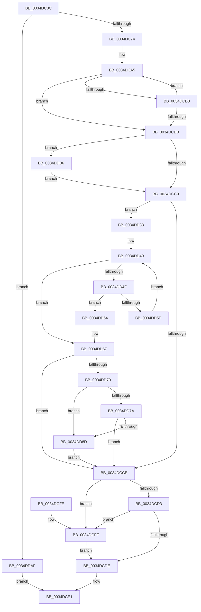

# MiForcedTrim

- RVA: `0x0034DC0C`–`0x0034DE22` (길이 `534` bytes)
- VA: `0x000000014034DC0C`
- 실행 섹션: `.text`
- PDB 이름 있음: `예`; PDB Function 태그: `아니요`
- unwind 정보 RVA: `0x00078B20`
- 디코드: `139`개 명령, `534/534` bytes 표시
- 미해석 바이트: `0` (있으면 어셈블리에 `.byte`로 보존)

> 이 문서는 커널 이미지의 기계어와 PDB 기호를 분석해 생성했습니다. 4번과 5번은 함수 원형과 자료형을 바이너리 사용 방식에서 추정한 C 해석이며 원본 소스 복구 결과는 아닙니다.

## 1. Dependencies

- 직접 호출 지점: **3**; 고유 호출 대상: **3**
- 직접 호출자로 확인된 함수: **1**
- RIP 상대 이미지 참조: **1**

### Outgoing calls
- `0x0034DC4D` → [MiGetAvailablePagesForTrimPass](MiGetAvailablePagesForTrimPass_function_0034D324.md) (function, `0x0034D324`)
- `0x0034DD2C` → [MiAgeWorkingSet](../2C/MiAgeWorkingSet_function_002C21E0.md) (function, `0x002C21E0`)
- `0x0034DD9B` → [MiTrimWorkingSet](../2A/MiTrimWorkingSet_function_002AD134.md) (function, `0x002AD134`)

### Direct callers
- [MiSelfTrim](../27/MiSelfTrim_function_0027E870.md) at `0x0027E8BA`

### Static image references
- `0x0034DC33` → RVA `0x00E30088` (`.data`; read)

## 2. Other-region calls and transfers

- 다른 실행 섹션으로 향하는 call: **0**
- 별도 외부 분기/꼬리 이동을 확인하지 못했습니다.

## 3. Assembly (complete function range)

```asm
0034DC0C  48 89 5C 24 08                  mov qword ptr [rsp + 8], rbx
0034DC11  48 89 6C 24 10                  mov qword ptr [rsp + 0x10], rbp
0034DC16  48 89 74 24 18                  mov qword ptr [rsp + 0x18], rsi
0034DC1B  57                              push rdi
0034DC1C  41 54                           push r12
0034DC1E  41 55                           push r13
0034DC20  41 56                           push r14
0034DC22  41 57                           push r15
0034DC24  48 83 EC 30                     sub rsp, 0x30
0034DC28  44 0F B7 81 AE 00 00 00         movzx r8d, word ptr [rcx + 0xae]
0034DC30  48 8B D9                        mov rbx, rcx
0034DC33  48 8B 05 4E 24 AE 00            mov rax, qword ptr [rip + 0xae244e]
0034DC3A  44 8A FA                        mov r15b, dl
0034DC3D  33 F6                           xor esi, esi
0034DC3F  4E 8B 14 C0                     mov r10, qword ptr [rax + r8*8]
0034DC43  49 8B CA                        mov rcx, r10
0034DC46  4D 8B B2 C0 44 00 00            mov r14, qword ptr [r10 + 0x44c0]
0034DC4D  E8 D2 F6 FF FF                  call 0x14034d324
0034DC52  4C 8B 8B 90 00 00 00            mov r9, qword ptr [rbx + 0x90]
0034DC59  4C 8B D8                        mov r11, rax
0034DC5C  48 8B 43 10                     mov rax, qword ptr [rbx + 0x10]
0034DC60  4D 8B 86 48 01 00 00            mov r8, qword ptr [r14 + 0x148]
0034DC67  48 8B 48 20                     mov rcx, qword ptr [rax + 0x20]
0034DC6B  4C 3B C9                        cmp r9, rcx
0034DC6E  0F 86 3B 01 00 00               jbe 0x14034ddaf
0034DC74  4D 8B A2 50 48 00 00            mov r12, qword ptr [r10 + 0x4850]
0034DC7B  4C 2B C9                        sub r9, rcx
0034DC7E  49 6B F9 0F                     imul rdi, r9, 0xf
0034DC82  48 B8 15 AE 47 E1 7A 14 AE 47   movabs rax, 0x47ae147ae147ae15
0034DC8C  48 8D 4B 30                     lea rcx, [rbx + 0x30]
0034DC90  48 F7 E7                        mul rdi
0034DC93  8B EE                           mov ebp, esi
0034DC95  48 2B FA                        sub rdi, rdx
0034DC98  48 D1 EF                        shr rdi, 1
0034DC9B  48 03 FA                        add rdi, rdx
0034DC9E  8D 56 01                        lea edx, [rsi + 1]
0034DCA1  48 C1 EF 06                     shr rdi, 6
0034DCA5  48 8B 01                        mov rax, qword ptr [rcx]
0034DCA8  48 03 E8                        add rbp, rax
0034DCAB  48 3B EF                        cmp rbp, rdi
0034DCAE  73 0B                           jae 0x14034dcbb
0034DCB0  FF C2                           inc edx
0034DCB2  48 83 C1 08                     add rcx, 8
0034DCB6  83 FA 08                        cmp edx, 8
0034DCB9  72 EA                           jb 0x14034dca5
0034DCBB  8B 83 B8 00 00 00               mov eax, dword ptr [rbx + 0xb8]
0034DCC1  A8 0F                           test al, 0xf
0034DCC3  0F 85 ED 00 00 00               jne 0x14034ddb6
0034DCC9  4D 3B D8                        cmp r11, r8
0034DCCC  72 65                           jb 0x14034dd33
0034DCCE  48 3B EF                        cmp rbp, rdi
0034DCD1  72 2C                           jb 0x14034dcff
0034DCD3  8B 4B 04                        mov ecx, dword ptr [rbx + 4]
0034DCD6  F7 C1 FF 3F 00 00               test ecx, 0x3fff
0034DCDC  74 21                           je 0x14034dcff
0034DCDE  48 8B C6                        mov rax, rsi
0034DCE1  48 8B 5C 24 60                  mov rbx, qword ptr [rsp + 0x60]
0034DCE6  48 8B 6C 24 68                  mov rbp, qword ptr [rsp + 0x68]
0034DCEB  48 8B 74 24 70                  mov rsi, qword ptr [rsp + 0x70]
0034DCF0  48 83 C4 30                     add rsp, 0x30
0034DCF4  41 5F                           pop r15
0034DCF6  41 5E                           pop r14
0034DCF8  41 5D                           pop r13
0034DCFA  41 5C                           pop r12
0034DCFC  5F                              pop rdi
0034DCFD  C3                              ret
0034DCFE  CC                              int3
0034DCFF  48 8B 05 82 23 AE 00            mov rax, qword ptr [rip + 0xae2382]
0034DD06  41 B8 01 00 00 00               mov r8d, 1
0034DD0C  0F B7 8B AE 00 00 00            movzx ecx, word ptr [rbx + 0xae]
0034DD13  41 8A D7                        mov dl, r15b
0034DD16  48 8B 0C C8                     mov rcx, qword ptr [rax + rcx*8]
0034DD1A  48 8B 81 C0 44 00 00            mov rax, qword ptr [rcx + 0x44c0]
0034DD21  48 8B CB                        mov rcx, rbx
0034DD24  44 0F B7 88 12 01 00 00         movzx r9d, word ptr [rax + 0x112]
0034DD2C  E8 AF 44 F7 FF                  call 0x1402c21e0
0034DD31  EB AB                           jmp 0x14034dcde
0034DD33  B8 10 00 00 00                  mov eax, 0x10
0034DD38  4D 2B C3                        sub r8, r11
0034DD3B  4C 3B C0                        cmp r8, rax
0034DD3E  48 8B D6                        mov rdx, rsi
0034DD41  4C 0F 42 C0                     cmovb r8, rax
0034DD45  44 8D 48 F7                     lea r9d, [rax - 9]
0034DD49  41 83 F9 01                     cmp r9d, 1
0034DD4D  74 18                           je 0x14034dd67
0034DD4F  41 8B C1                        mov eax, r9d
0034DD52  48 8B 4C C3 28                  mov rcx, qword ptr [rbx + rax*8 + 0x28]
0034DD57  48 03 D1                        add rdx, rcx
0034DD5A  49 3B D0                        cmp rdx, r8
0034DD5D  73 05                           jae 0x14034dd64
0034DD5F  41 FF C9                        dec r9d
0034DD62  EB E5                           jmp 0x14034dd49
0034DD64  49 8B D0                        mov rdx, r8
0034DD67  48 85 D2                        test rdx, rdx
0034DD6A  0F 84 5E FF FF FF               je 0x14034dcce
0034DD70  8B 83 B8 00 00 00               mov eax, dword ptr [rbx + 0xb8]
0034DD76  A8 0F                           test al, 0xf
0034DD78  75 13                           jne 0x14034dd8d
0034DD7A  49 8B 82 00 41 00 00            mov rax, qword ptr [r10 + 0x4100]
0034DD81  48 D1 E8                        shr rax, 1
0034DD84  4C 3B D8                        cmp r11, rax
0034DD87  0F 83 41 FF FF FF               jae 0x14034dcce
0034DD8D  45 8A C7                        mov r8b, r15b
0034DD90  C7 44 24 20 39 00 00 00         mov dword ptr [rsp + 0x20], 0x39
0034DD98  48 8B CB                        mov rcx, rbx
0034DD9B  E8 94 F3 F5 FF                  call 0x1402ad134
0034DDA0  49 01 86 98 01 00 00            add qword ptr [r14 + 0x198], rax
0034DDA7  48 8B F0                        mov rsi, rax
0034DDAA  E9 1F FF FF FF                  jmp 0x14034dcce
0034DDAF  33 C0                           xor eax, eax
0034DDB1  E9 2B FF FF FF                  jmp 0x14034dce1
0034DDB6  49 C1 E0 04                     shl r8, 4
0034DDBA  49 BD CD CC CC CC CC CC CC CC   movabs r13, 0xcccccccccccccccd
0034DDC4  49 8B C5                        mov rax, r13
0034DDC7  49 F7 E4                        mul r12
0034DDCA  49 8B C1                        mov rax, r9
0034DDCD  48 8B CA                        mov rcx, rdx
0034DDD0  48 C1 E9 03                     shr rcx, 3
0034DDD4  4C 3B C1                        cmp r8, rcx
0034DDD7  49 0F 46 C8                     cmovbe rcx, r8
0034DDDB  4D 3B CC                        cmp r9, r12
0034DDDE  49 0F 43 C4                     cmovae rax, r12
0034DDE2  33 D2                           xor edx, edx
0034DDE4  48 6B C0 64                     imul rax, rax, 0x64
0034DDE8  49 F7 F4                        div r12
0034DDEB  4C 8B C0                        mov r8, rax
0034DDEE  48 B8 15 AE 47 E1 7A 14 AE 47   movabs rax, 0x47ae147ae147ae15
0034DDF8  4C 0F AF C1                     imul r8, rcx
0034DDFC  49 F7 E0                        mul r8
0034DDFF  49 8B C5                        mov rax, r13
0034DE02  4C 2B C2                        sub r8, rdx
0034DE05  49 D1 E8                        shr r8, 1
0034DE08  4C 03 C2                        add r8, rdx
0034DE0B  49 F7 E1                        mul r9
0034DE0E  49 C1 E8 06                     shr r8, 6
0034DE12  48 C1 EA 03                     shr rdx, 3
0034DE16  4C 3B C2                        cmp r8, rdx
0034DE19  4C 0F 47 C2                     cmova r8, rdx
0034DE1D  E9 A7 FE FF FF                  jmp 0x14034dcc9
```

## 4. C-style interpretation (structured pseudocode)

```c
__int64 __fastcall MiForcedTrim(__int64 a1, __int64 a2)
{
    __int64 result;
    __int64 v_rbp;
    __int64 v_rdi;
    __int64 v_rsi;
    __int64 v_rsp;
    unsigned __int64 v_stack_p10;
    unsigned __int64 v_stack_p18;
    unsigned int v_stack_p20;
    unsigned __int64 v_stack_p8;

    v_stack_p8 = v_rbx;
    v_stack_p10 = v_rbp;
    v_stack_p18 = v_rsi;
    v_rsp = (v_rsp) - (48);
    v_rsi = 0;
    result = MiGetAvailablePagesForTrimPass(*(unsigned __int64 *)(*(unsigned __int64 *)(v_rip + 11412558) + *(unsigned __int16 *)(a1 + 174) * 8), a2, *(unsigned __int16 *)(a1 + 174), a4);
    if ((*(unsigned __int64 *)(a1 + 144)) <= (*(unsigned __int64 *)(*(unsigned __int64 *)(a1 + 16) + 32))) goto loc_0034DDAF;
    a4 = (*(unsigned __int64 *)(a1 + 144)) - (*(unsigned __int64 *)(*(unsigned __int64 *)(a1 + 16) + 32));
    v_rdi = (v_rdi) * (a4);
    v_rdi = (v_rdi) - (a2);
    v_rdi = (v_rdi) >> (1);
    v_rdi = (v_rdi) + (a2);
    v_rdi = (v_rdi) >> (6);
loc_0034DCA5:
    v_rbp = (0) + (*(unsigned __int64 *)(a1 + 48));
    if (v_rbp >= v_rdi) goto loc_0034DCBB;
    a2 = (unsigned int)((v_rsi + 1) + 1);
    a1 = (a1 + 48) + (8);
    if (((unsigned int)(a2)) < 8) goto loc_0034DCA5;
loc_0034DCBB:
    if ((((unsigned __int8)((unsigned int)(*(unsigned int *)(a1 + 184)))) & (15)) != 0) goto loc_0034DDB6;
loc_0034DCC9:
    if (result < (*(unsigned __int64 *)(*(unsigned __int64 *)(*(unsigned __int64 *)(*(unsigned __int64 *)(v_rip + 11412558) + *(unsigned __int16 *)(a1 + 174) * 8) + 17600) + 328))) goto loc_0034DD33;
loc_0034DCCE:
    if (v_rbp < v_rdi) goto loc_0034DCFF;
    if ((((unsigned int)((unsigned int)(*(unsigned int *)(a1 + 4)))) & (0x3FFFULL)) == 0) goto loc_0034DCFF;
loc_0034DCDE:
loc_0034DCE1:
    v_rsp = (v_rsp) + (48);
    return 0;
loc_0034DCFF:
    result = MiAgeWorkingSet(v_stack_p8, (unsigned __int8)((unsigned __int8)(a2)), 1, *(unsigned __int16 *)(*(unsigned __int64 *)(*(unsigned __int64 *)(*(unsigned __int64 *)(v_rip + 11412354) + *(unsigned __int16 *)(v_stack_p8 + 174) * 8) + 17600) + 274));
    goto loc_0034DCDE;
loc_0034DD33:
    a3 = (1) - (result);
    if (a3 < 16) { a3 = 16; }
loc_0034DD49:
    if (((unsigned int)(16 - 9)) == 1) goto loc_0034DD67;
    a2 = (v_stack_p18) + (*(unsigned __int64 *)(v_stack_p8 + (unsigned int)((unsigned int)(16 - 9)) * 8 + 40));
    if (a2 >= a3) goto loc_0034DD64;
    a4 = (unsigned int)((16 - 9) - 1);
    goto loc_0034DD49;
loc_0034DD64:
loc_0034DD67:
    if (a3 == 0) goto loc_0034DCCE;
    if ((((unsigned __int8)((unsigned int)(*(unsigned int *)(v_stack_p8 + 184)))) & (15)) != 0) goto loc_0034DD8D;
    result = (*(unsigned __int64 *)(*(unsigned __int64 *)(*(unsigned __int64 *)(v_rip + 11412558) + *(unsigned __int16 *)(a1 + 174) * 8) + 16640)) >> (1);
    if (result >= result) goto loc_0034DCCE;
loc_0034DD8D:
    v_stack_p20 = 57;
    result = MiTrimWorkingSet(v_stack_p8, a3, (unsigned __int8)((unsigned __int8)(a2)), a4);
    goto loc_0034DCCE;
loc_0034DDAF:
    result = 0;
    goto loc_0034DCE1;
loc_0034DDB6:
    a3 = ((unsigned __int8)((unsigned __int8)(a2))) << (4);
    a1 = (a3) >> (3);
    if (a3 <= a1) { a1 = a3; }
    if (a4 >= (*(unsigned __int64 *)(*(unsigned __int64 *)(*(unsigned __int64 *)(v_rip + 11412558) + *(unsigned __int16 *)(a1 + 174) * 8) + 18512))) { a4 = *(unsigned __int64 *)(*(unsigned __int64 *)(*(unsigned __int64 *)(v_rip + 11412558) + *(unsigned __int16 *)(a1 + 174) * 8) + 18512); }
    a2 = 0;
    result = (a4) * (a4);
    a3 = (result) * (a1);
    a3 = (a3) - (0);
    a3 = (a3) >> (1);
    a3 = (a3) + (0);
    a3 = (a3) >> (6);
    a2 = (a2) >> (3);
    if (a3 > a2) { a3 = a2; }
    goto loc_0034DCC9;
}
```

## 5. (Beta) C Style

```c
int64_t MiForcedTrim(void *Arg1, int64_t Arg2)
{
    uint8_t *arg1 = (uint8_t *)Arg1;

    int64_t result;
    int64_t local_rbp;
    int64_t local_rdi;
    int64_t local_rsi;
    int64_t local_rsp;
    uint64_t v_stack_p10;
    uint64_t v_stack_p18;
    uint32_t v_stack_p20;
    uint64_t v_stack_p8;

    v_stack_p8 = local_rbx;
    v_stack_p10 = local_rbp;
    v_stack_p18 = local_rsi;
    local_rsp = (local_rsp) - (48);
    local_rsi = 0;
    result = MiGetAvailablePagesForTrimPass(*(uint64_t *)(*(uint64_t *)(v_rip + 0xAE244E) + *(uint16_t *)(arg1 + 0xAE) * 8), Arg2, *(uint16_t *)(arg1 + 0xAE), a4);
    if ((*(uint64_t *)(arg1 + 0x90)) <= (*(uint64_t *)(*(uint64_t *)(arg1 + 0x10) + 0x20))) goto loc_0034DDAF;
    a4 = (*(uint64_t *)(arg1 + 0x90)) - (*(uint64_t *)(*(uint64_t *)(arg1 + 0x10) + 0x20));
    local_rdi = (local_rdi) * (a4);
    local_rdi = (local_rdi) - (Arg2);
    local_rdi = (local_rdi) >> (1);
    local_rdi = (local_rdi) + (Arg2);
    local_rdi = (local_rdi) >> (6);
loc_0034DCA5:
    local_rbp = (0) + (*(uint64_t *)(arg1 + 0x30));
    if (local_rbp >= local_rdi) goto loc_0034DCBB;
    Arg2 = (uint32_t)((local_rsi + 1) + 1);
    Arg1 = (Arg1 + 48) + (8);
    if (((uint32_t)(Arg2)) < 8) goto loc_0034DCA5;
loc_0034DCBB:
    if ((((uint8_t)((uint32_t)(*(uint32_t *)(arg1 + 0xB8)))) & (15)) != 0) goto loc_0034DDB6;
loc_0034DCC9:
    if (result < (*(uint64_t *)(*(uint64_t *)(*(uint64_t *)(*(uint64_t *)(v_rip + 0xAE244E) + *(uint16_t *)(arg1 + 0xAE) * 8) + 0x44C0) + 0x148))) goto loc_0034DD33;
loc_0034DCCE:
    if (local_rbp < local_rdi) goto loc_0034DCFF;
    if ((((uint32_t)((uint32_t)(*(uint32_t *)(arg1 + 0x4)))) & (0x3FFFULL)) == 0) goto loc_0034DCFF;
loc_0034DCDE:
loc_0034DCE1:
    local_rsp = (local_rsp) + (48);
    return 0;
loc_0034DCFF:
    result = MiAgeWorkingSet(v_stack_p8, (uint8_t)((uint8_t)(Arg2)), 1, *(uint16_t *)(*(uint64_t *)(*(uint64_t *)(*(uint64_t *)(v_rip + 0xAE2382) + *(uint16_t *)(v_stack_p8 + 0xAE) * 8) + 0x44C0) + 0x112));
    goto loc_0034DCDE;
loc_0034DD33:
    a3 = (1) - (result);
    if (a3 < 16) { a3 = 16; }
loc_0034DD49:
    if (((uint32_t)(16 - 9)) == 1) goto loc_0034DD67;
    Arg2 = (v_stack_p18) + (*(uint64_t *)(v_stack_p8 + (uint32_t)((uint32_t)(16 - 0x9)) * 8 + 0x28));
    if (Arg2 >= a3) goto loc_0034DD64;
    a4 = (uint32_t)((16 - 9) - 1);
    goto loc_0034DD49;
loc_0034DD64:
loc_0034DD67:
    if (a3 == 0) goto loc_0034DCCE;
    if ((((uint8_t)((uint32_t)(*(uint32_t *)(v_stack_p8 + 0xB8)))) & (15)) != 0) goto loc_0034DD8D;
    result = (*(uint64_t *)(*(uint64_t *)(*(uint64_t *)(v_rip + 0xAE244E) + *(uint16_t *)(arg1 + 0xAE) * 8) + 0x4100)) >> (1);
    if (result >= result) goto loc_0034DCCE;
loc_0034DD8D:
    v_stack_p20 = 57;
    result = MiTrimWorkingSet(v_stack_p8, a3, (uint8_t)((uint8_t)(Arg2)), a4);
    goto loc_0034DCCE;
loc_0034DDAF:
    result = 0;
    goto loc_0034DCE1;
loc_0034DDB6:
    a3 = ((uint8_t)((uint8_t)(Arg2))) << (4);
    Arg1 = (a3) >> (3);
    if (a3 <= Arg1) { Arg1 = a3; }
    if (a4 >= (*(uint64_t *)(*(uint64_t *)(*(uint64_t *)(v_rip + 0xAE244E) + *(uint16_t *)(arg1 + 0xAE) * 8) + 0x4850))) { a4 = *(uint64_t *)(*(uint64_t *)(*(uint64_t *)(v_rip + 0xAE244E) + *(uint16_t *)(arg1 + 0xAE) * 8) + 0x4850); }
    Arg2 = 0;
    result = (a4) * (a4);
    a3 = (result) * (Arg1);
    a3 = (a3) - (0);
    a3 = (a3) >> (1);
    a3 = (a3) + (0);
    a3 = (a3) >> (6);
    Arg2 = (Arg2) >> (3);
    if (a3 > Arg2) { a3 = Arg2; }
    goto loc_0034DCC9;
}
```

### 관측된 메모리 오프셋

구조체 형식이 확인되지 않은 접근은 인자 기준의 오프셋으로만 기록했습니다.

| 기준 인자 | 오프셋 표현 | 폭 (bit) | 접근 |
|---|---:|---:|---|
| `Arg1` | `+ 0x0` | `64` | `R` |
| `Arg1` | `+ 0x4` | `32` | `R` |
| `Arg1` | `+ 0x10` | `64` | `R` |
| `Arg1` | `+ 0x28 + rax*8` | `64` | `R` |
| `Arg1` | `+ 0x30` | `64` | `R` |
| `Arg1` | `+ 0x90` | `64` | `R` |
| `Arg1` | `+ 0xAE` | `16` | `R` |
| `Arg1` | `+ 0xB8` | `32` | `R` |

## 6. Execution-region graph

[열기: 2D/3D 그래프와 함수 탐색 컨트롤 패널](../../../control-panel.html?section=text&rva=0x0034DC0C&view=graph)

- 2D 그래프는 위에서 아래로 흐르고, 3D 그래프는 빈 공간을 드래그해 회전합니다. Shift+드래그는 이동, 휠은 확대·축소, 함수 노드 선택은 대상 보고서 이동입니다.

### Static fallback


