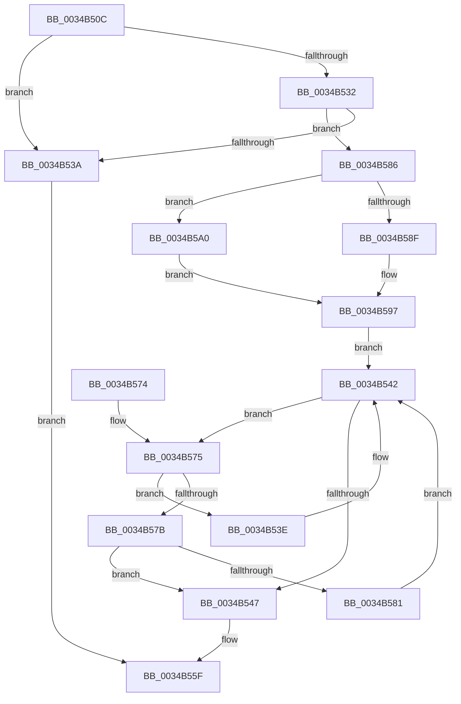

# MiGenerateAccessViolation

- RVA: `0x0034B50C`–`0x0034B5AA` (길이 `158` bytes)
- VA: `0x000000014034B50C`
- 실행 섹션: `.text`
- PDB 이름 있음: `예`; PDB Function 태그: `아니요`
- unwind 정보 RVA: `0x000785AC`
- 디코드: `47`개 명령, `158/158` bytes 표시
- 미해석 바이트: `0` (있으면 어셈블리에 `.byte`로 보존)

> 이 문서는 커널 이미지의 기계어와 PDB 기호를 분석해 생성했습니다. 4번과 5번은 함수 원형과 자료형을 바이너리 사용 방식에서 추정한 C 해석이며 원본 소스 복구 결과는 아닙니다.

## 1. Dependencies

- 직접 호출 지점: **4**; 고유 호출 대상: **4**
- 직접 호출자로 확인된 함수: **4**
- RIP 상대 이미지 참조: **2**

### Outgoing calls
- `0x0034B526` → [MiDeterminePoolType](../2C/MiDeterminePoolType_function_002C1750.md) (function, `0x002C1750`)
- `0x0034B551` → [MiReleaseSpinLockShared](MiReleaseSpinLockShared_function_00348BF0.md) (function, `0x00348BF0`)
- `0x0034B592` → [ExAcquireSpinLockSharedAtDpcLevel](../24/ExAcquireSpinLockSharedAtDpcLevel_function_00248E30.md) (function, `0x00248E30`)
- `0x0034B5A0` → [ExAcquireSpinLockShared](../24/ExAcquireSpinLockShared_function_0024DCE0.md) (function, `0x0024DCE0`)

### Direct callers
- [MiRaisedIrqlFault](MiRaisedIrqlFault_function_0034A6C8.md) at `0x0034A833`
- [MiSystemFault](MiSystemFault_function_0034AA64.md) at `0x0034B0A0`
- [MiSystemFault](MiSystemFault_function_0034AA64.md) at `0x0034B11E`
- [MiSystemFault](MiSystemFault_function_0034AA64.md) at `0x0034B152`
- [sub_0034B2F9](Unknown_function_0034B2F9.md) at `0x0034B35F`
- [sub_006E218A](../6E/Unknown_function_006E218A.md) at `0x006E218D`
- [sub_006E218A](../6E/Unknown_function_006E218A.md) at `0x006E21C9`

### Static image references
- `0x0034B54A` → RVA `0x00E2CB70` (`.data`; read)
- `0x0034B597` → RVA `0x00E2CB78` (`.data`; read)

## 2. Other-region calls and transfers

- 다른 실행 섹션으로 향하는 call: **0**
- 별도 외부 분기/꼬리 이동을 확인하지 못했습니다.

## 3. Assembly (complete function range)

```asm
0034B50C  48 89 5C 24 08                  mov qword ptr [rsp + 8], rbx
0034B511  48 89 6C 24 10                  mov qword ptr [rsp + 0x10], rbp
0034B516  48 89 74 24 18                  mov qword ptr [rsp + 0x18], rsi
0034B51B  57                              push rdi
0034B51C  48 83 EC 20                     sub rsp, 0x20
0034B520  48 8B 31                        mov rsi, qword ptr [rcx]
0034B523  48 8B CE                        mov rcx, rsi
0034B526  E8 25 62 F7 FF                  call 0x1402c1750
0034B52B  33 FF                           xor edi, edi
0034B52D  48 85 C0                        test rax, rax
0034B530  74 08                           je 0x14034b53a
0034B532  44 0F 20 C0                     mov rax, cr8
0034B536  3C 02                           cmp al, 2
0034B538  76 4C                           jbe 0x14034b586
0034B53A  33 C0                           xor eax, eax
0034B53C  EB 21                           jmp 0x14034b55f
0034B53E  48 8B 5B 08                     mov rbx, qword ptr [rbx + 8]
0034B542  48 85 DB                        test rbx, rbx
0034B545  75 2E                           jne 0x14034b575
0034B547  40 8A D5                        mov dl, bpl
0034B54A  48 8D 0D 1F 16 AE 00            lea rcx, [rip + 0xae161f]
0034B551  E8 9A D6 FF FF                  call 0x140348bf0
0034B556  48 85 DB                        test rbx, rbx
0034B559  40 0F 95 C7                     setne dil
0034B55D  8B C7                           mov eax, edi
0034B55F  48 8B 5C 24 30                  mov rbx, qword ptr [rsp + 0x30]
0034B564  48 8B 6C 24 38                  mov rbp, qword ptr [rsp + 0x38]
0034B569  48 8B 74 24 40                  mov rsi, qword ptr [rsp + 0x40]
0034B56E  48 83 C4 20                     add rsp, 0x20
0034B572  5F                              pop rdi
0034B573  C3                              ret
0034B574  CC                              int3
0034B575  48 3B 73 20                     cmp rsi, qword ptr [rbx + 0x20]
0034B579  77 C3                           ja 0x14034b53e
0034B57B  48 3B 73 18                     cmp rsi, qword ptr [rbx + 0x18]
0034B57F  73 C6                           jae 0x14034b547
0034B581  48 8B 1B                        mov rbx, qword ptr [rbx]
0034B584  EB BC                           jmp 0x14034b542
0034B586  48 8D 0D E3 15 AE 00            lea rcx, [rip + 0xae15e3]
0034B58D  75 11                           jne 0x14034b5a0
0034B58F  40 B5 11                        mov bpl, 0x11
0034B592  E8 99 D8 EF FF                  call 0x140248e30
0034B597  48 8B 1D DA 15 AE 00            mov rbx, qword ptr [rip + 0xae15da]
0034B59E  EB A2                           jmp 0x14034b542
0034B5A0  E8 3B 27 F0 FF                  call 0x14024dce0
0034B5A5  40 8A E8                        mov bpl, al
0034B5A8  EB ED                           jmp 0x14034b597
```

## 4. C-style interpretation (structured pseudocode)

```c
__int64 __fastcall MiGenerateAccessViolation(__int64 a1)
{
    __int64 result;
    __int64 v_rdi;
    __int64 v_rsp;
    unsigned __int64 v_stack_p10;
    unsigned __int64 v_stack_p18;
    unsigned __int64 v_stack_p8;

    v_stack_p8 = v_rbx;
    v_stack_p10 = v_rbp;
    v_stack_p18 = v_rsi;
    v_rsp = (v_rsp) - (32);
    result = MiDeterminePoolType(*(unsigned __int64 *)(a1), a2, a3, a4);
    v_rdi = 0;
    if (result == 0) goto loc_0034B53A;
    if (((unsigned __int8)(v_cr8)) <= 2) goto loc_0034B586;
loc_0034B53A:
    result = 0;
    goto loc_0034B55F;
loc_0034B53E:
loc_0034B542:
    if (*(unsigned __int64 *)(v_rbx + 8) != 0) goto loc_0034B575;
loc_0034B547:
    result = MiReleaseSpinLockShared(v_rip + 11408927, (unsigned __int8)(v_rbp), a3, a4);
    v_rdi = (*(unsigned __int64 *)(v_rbx + 8) != 0) ? 1 : 0;
loc_0034B55F:
    v_rsp = (v_rsp) + (32);
    return (unsigned int)((unsigned int)(v_rdi));
loc_0034B575:
    if (v_stack_p18 > (*(unsigned __int64 *)(v_stack_p8 + 32))) goto loc_0034B53E;
    if (v_stack_p18 >= (*(unsigned __int64 *)(v_stack_p8 + 24))) goto loc_0034B547;
    goto loc_0034B542;
loc_0034B586:
    if (v_stack_p18 != (*(unsigned __int64 *)(v_stack_p8 + 24))) goto loc_0034B5A0;
    result = ExAcquireSpinLockSharedAtDpcLevel(v_rip + 11408867, (unsigned __int8)(v_rbp), a3, a4);
loc_0034B597:
    goto loc_0034B542;
loc_0034B5A0:
    result = ExAcquireSpinLockShared(v_rip + 11408867, (unsigned __int8)(v_rbp), a3, a4);
    goto loc_0034B597;
}
```

## 5. (Beta) C Style

```c
int64_t MiGenerateAccessViolation(void *Arg1)
{
    uint8_t *arg1 = (uint8_t *)Arg1;

    int64_t result;
    int64_t local_rdi;
    int64_t local_rsp;
    uint64_t v_stack_p10;
    uint64_t v_stack_p18;
    uint64_t v_stack_p8;

    v_stack_p8 = local_rbx;
    v_stack_p10 = local_rbp;
    v_stack_p18 = local_rsi;
    local_rsp = (local_rsp) - (32);
    result = MiDeterminePoolType(*(uint64_t *)(arg1), a2, a3, a4);
    local_rdi = 0;
    if (result == 0) goto loc_0034B53A;
    if (((uint8_t)(v_cr8)) <= 2) goto loc_0034B586;
loc_0034B53A:
    result = 0;
    goto loc_0034B55F;
loc_0034B53E:
loc_0034B542:
    if (*(uint64_t *)(local_rbx + 0x8) != 0) goto loc_0034B575;
loc_0034B547:
    result = MiReleaseSpinLockShared(v_rip + 11408927, (uint8_t)(local_rbp), a3, a4);
    local_rdi = (*(uint64_t *)(local_rbx + 0x8) != 0) ? 1 : 0;
loc_0034B55F:
    local_rsp = (local_rsp) + (32);
    return (uint32_t)((uint32_t)(local_rdi));
loc_0034B575:
    if (v_stack_p18 > (*(uint64_t *)(v_stack_p8 + 0x20))) goto loc_0034B53E;
    if (v_stack_p18 >= (*(uint64_t *)(v_stack_p8 + 0x18))) goto loc_0034B547;
    goto loc_0034B542;
loc_0034B586:
    if (v_stack_p18 != (*(uint64_t *)(v_stack_p8 + 0x18))) goto loc_0034B5A0;
    result = ExAcquireSpinLockSharedAtDpcLevel(v_rip + 11408867, (uint8_t)(local_rbp), a3, a4);
loc_0034B597:
    goto loc_0034B542;
loc_0034B5A0:
    result = ExAcquireSpinLockShared(v_rip + 11408867, (uint8_t)(local_rbp), a3, a4);
    goto loc_0034B597;
}
```

### 관측된 메모리 오프셋

구조체 형식이 확인되지 않은 접근은 인자 기준의 오프셋으로만 기록했습니다.

| 기준 인자 | 오프셋 표현 | 폭 (bit) | 접근 |
|---|---:|---:|---|
| `Arg1` | `+ 0x0` | `64` | `R` |

## 6. Execution-region graph

[열기: 2D/3D 그래프와 함수 탐색 컨트롤 패널](../../../control-panel.html?section=text&rva=0x0034B50C&view=graph)

- 2D 그래프는 위에서 아래로 흐르고, 3D 그래프는 빈 공간을 드래그해 회전합니다. Shift+드래그는 이동, 휠은 확대·축소, 함수 노드 선택은 대상 보고서 이동입니다.

### Static fallback


