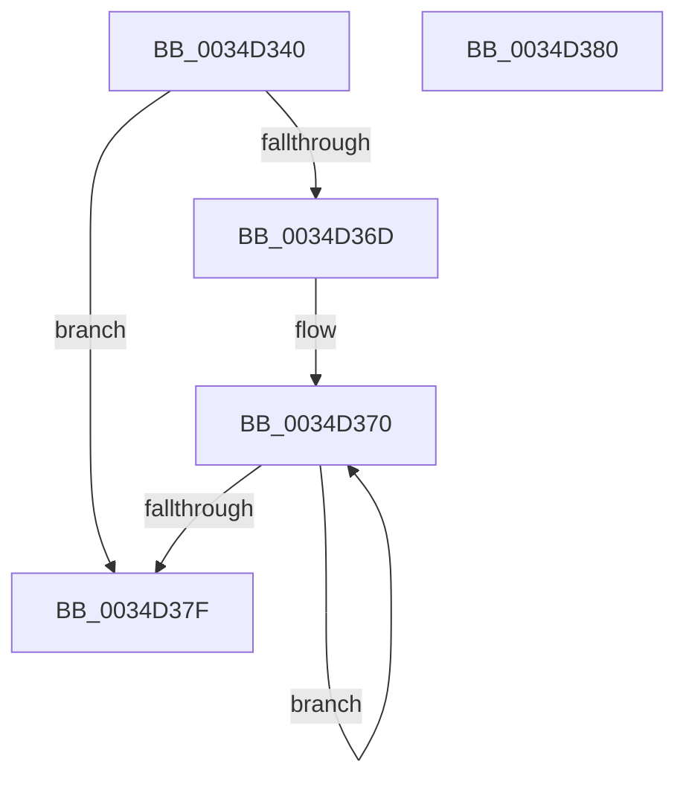

# MiGetAvailablePagesBelowPriority

- RVA: `0x0034D340`–`0x0034D381` (길이 `65` bytes)
- VA: `0x000000014034D340`
- 실행 섹션: `.text`
- PDB 이름 있음: `예`; PDB Function 태그: `아니요`
- unwind 정보 RVA: `0x000DB714`
- 디코드: `18`개 명령, `65/65` bytes 표시
- 미해석 바이트: `0` (있으면 어셈블리에 `.byte`로 보존)

> 이 문서는 커널 이미지의 기계어와 PDB 기호를 분석해 생성했습니다. 4번과 5번은 함수 원형과 자료형을 바이너리 사용 방식에서 추정한 C 해석이며 원본 소스 복구 결과는 아닙니다.

## 1. Dependencies

- 직접 호출 지점: **0**; 고유 호출 대상: **0**
- 직접 호출자로 확인된 함수: **9**
- RIP 상대 이미지 참조: **0**

### Outgoing calls
- 직접 디코드된 call 명령이 없습니다.

### Direct callers
- [MiRemoveLowestPriorityStandbyPage](../33/MiRemoveLowestPriorityStandbyPage_function_00334600.md) at `0x0033473E`
- [MiStoreUpdateMemoryConditions](MiStoreUpdateMemoryConditions_function_0034CF3C.md) at `0x0034CFBC`
- [MiUseLowIoPriorityForModifiedPages](MiUseLowIoPriorityForModifiedPages_function_0034D284.md) at `0x0034D2AD`
- [MiGetAvailablePagesForTrimPass](MiGetAvailablePagesForTrimPass_function_0034D324.md) at `0x0034D32D`
- [MiGetHardFaultPages](../36/MiGetHardFaultPages_function_0036200C.md) at `0x00362197`
- [MiResolveMappedFileFault](../36/MiResolveMappedFileFault_function_0036B640.md) at `0x0036BCC1`
- [MiResolvePageFileFault](../36/MiResolvePageFileFault_function_0036D968.md) at `0x0036E730`
- [MmGetAvailablePagesBelowPriority](../4A/MmGetAvailablePagesBelowPriority_function_004ACEAC.md) at `0x004ACED9`
- [MiAllocateCrcList](../../page/9F/MiAllocateCrcList_function_009F7564.md) at `0x009F762E`

### Static image references
- 디코드된 RIP-relative 메모리 참조가 없습니다.

## 2. Other-region calls and transfers

- 다른 실행 섹션으로 향하는 call: **0**
- 별도 외부 분기/꼬리 이동을 확인하지 못했습니다.

## 3. Assembly (complete function range)

```asm
0034D340  4C 8B 81 C0 0B 00 00            mov r8, qword ptr [rcx + 0xbc0]
0034D347  48 8B 81 40 0B 00 00            mov rax, qword ptr [rcx + 0xb40]
0034D34E  8B D2                           mov edx, edx
0034D350  49 03 C0                        add rax, r8
0034D353  48 6B D2 58                     imul rdx, rdx, 0x58
0034D357  4C 8D 81 C0 0C 00 00            lea r8, [rcx + 0xcc0]
0034D35E  48 81 C2 C0 0C 00 00            add rdx, 0xcc0
0034D365  48 03 D1                        add rdx, rcx
0034D368  4C 3B C2                        cmp r8, rdx
0034D36B  73 12                           jae 0x14034d37f
0034D36D  0F 1F 00                        nop dword ptr [rax]
0034D370  49 8B 08                        mov rcx, qword ptr [r8]
0034D373  49 83 C0 58                     add r8, 0x58
0034D377  48 03 C1                        add rax, rcx
0034D37A  4C 3B C2                        cmp r8, rdx
0034D37D  72 F1                           jb 0x14034d370
0034D37F  C3                              ret
0034D380  CC                              int3
```

## 4. C-style interpretation (structured pseudocode)

```c
__int64 __fastcall MiGetAvailablePagesBelowPriority(__int64 a1, int a2)
{
    __int64 result;

    result = (*(unsigned __int64 *)(a1 + 2880)) + (*(unsigned __int64 *)(a1 + 3008));
    a2 = ((unsigned int)(a2)) * ((unsigned int)(a2));
    a2 = (a2) + (0xCC0ULL);
    a2 = (a2) + (a1);
    if ((a1 + 3264) >= a2) goto loc_0034D37F;
loc_0034D370:
    a3 = (a1 + 3264) + (88);
    result = (result) + (*(unsigned __int64 *)(a1 + 3264));
    if (a3 < a2) goto loc_0034D370;
loc_0034D37F:
    return result;
}
```

## 5. (Beta) C Style

```c
int64_t MiGetAvailablePagesBelowPriority(void *Arg1, int32_t Arg2)
{
    uint8_t *arg1 = (uint8_t *)Arg1;

    int64_t result;

    result = (*(uint64_t *)(arg1 + 0xB40)) + (*(uint64_t *)(arg1 + 0xBC0));
    Arg2 = ((uint32_t)(Arg2)) * ((uint32_t)(Arg2));
    Arg2 = (Arg2) + (0xCC0ULL);
    Arg2 = (Arg2) + (Arg1);
    if ((Arg1 + 3264) >= Arg2) goto loc_0034D37F;
loc_0034D370:
    a3 = (Arg1 + 3264) + (88);
    result = (result) + (*(uint64_t *)(arg1 + 0xCC0));
    if (a3 < Arg2) goto loc_0034D370;
loc_0034D37F:
    return result;
}
```

### 관측된 메모리 오프셋

구조체 형식이 확인되지 않은 접근은 인자 기준의 오프셋으로만 기록했습니다.

| 기준 인자 | 오프셋 표현 | 폭 (bit) | 접근 |
|---|---:|---:|---|
| `Arg1` | `+ 0xB40` | `64` | `R` |
| `Arg1` | `+ 0xBC0` | `64` | `R` |
| `Arg1` | `+ 0xCC0` | `64` | `R` |

## 6. Execution-region graph

[열기: 2D/3D 그래프와 함수 탐색 컨트롤 패널](../../../control-panel.html?section=text&rva=0x0034D340&view=graph)

- 2D 그래프는 위에서 아래로 흐르고, 3D 그래프는 빈 공간을 드래그해 회전합니다. Shift+드래그는 이동, 휠은 확대·축소, 함수 노드 선택은 대상 보고서 이동입니다.

### Static fallback


