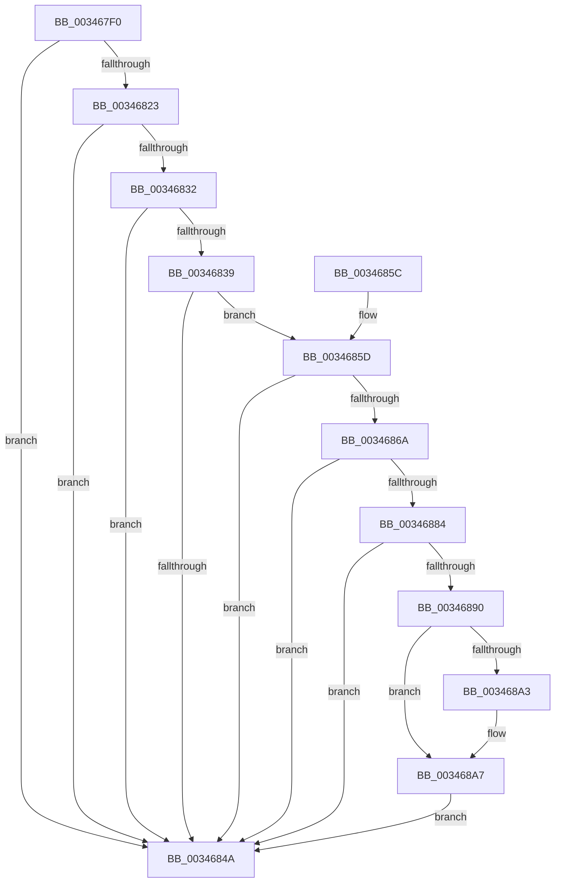

# MiGetContainingPageTable

- RVA: `0x003467F0`–`0x003468B7` (길이 `199` bytes)
- VA: `0x00000001403467F0`
- 실행 섹션: `.text`
- PDB 이름 있음: `예`; PDB Function 태그: `아니요`
- unwind 정보 RVA: `0x000DB714`
- 디코드: `47`개 명령, `199/199` bytes 표시
- 미해석 바이트: `0` (있으면 어셈블리에 `.byte`로 보존)

> 이 문서는 커널 이미지의 기계어와 PDB 기호를 분석해 생성했습니다. 4번과 5번은 함수 원형과 자료형을 바이너리 사용 방식에서 추정한 C 해석이며 원본 소스 복구 결과는 아닙니다.

## 1. Dependencies

- 직접 호출 지점: **0**; 고유 호출 대상: **0**
- 직접 호출자로 확인된 함수: **37**
- RIP 상대 이미지 참조: **1**

### Outgoing calls
- 직접 디코드된 call 명령이 없습니다.

### Direct callers
- [MiDemoteCombinedPte](../22/MiDemoteCombinedPte_function_0022ABAC.md) at `0x0022ACDA`
- [MiCombineInitialInstance](../22/MiCombineInitialInstance_function_0022BC0C.md) at `0x0022BF9E`
- [MiResolveProtoCombine](../22/MiResolveProtoCombine_function_0022CD00.md) at `0x0022CD37`
- [MiResolveProtoCombine](../22/MiResolveProtoCombine_function_0022CD00.md) at `0x0022CE14`
- [MiWsleFree](../28/MiWsleFree_function_00284600.md) at `0x00284D76`
- [MiWsleFree](../28/MiWsleFree_function_00284600.md) at `0x0028504C`
- [sub_00293C9B](../29/Unknown_function_00293C9B.md) at `0x00293CC4`
- [MiMakeSystemCachePteValid](../2A/MiMakeSystemCachePteValid_function_002A35D8.md) at `0x002A3648`
- [MiInitializeTransitionPfn](../2A/MiInitializeTransitionPfn_function_002AC2E8.md) at `0x002AC320`
- [MiInsertPhysicalPteMapping](../2A/MiInsertPhysicalPteMapping_function_002AE26C.md) at `0x002AE3AE`
- [MiInitializeReadInProgressPfn](../2B/MiInitializeReadInProgressPfn_function_002B6990.md) at `0x002B6AA5`
- [MiCompleteRestrictedImageFault](../2C/MiCompleteRestrictedImageFault_function_002C60D4.md) at `0x002C631F`
- [MiDeleteRotateVa](../2C/MiDeleteRotateVa_function_002C79D4.md) at `0x002C7A89`
- [MiLinkPoolCommitChain](../31/MiLinkPoolCommitChain_function_00313D20.md) at `0x00314015`
- [sub_003451F8](Unknown_function_003451F8.md) at `0x0034523E`
- [MiCompleteProtoPteFault](MiCompleteProtoPteFault_function_00345710.md) at `0x003457E4`
- [MiDeleteClusterPage](MiDeleteClusterPage_function_00346CB0.md) at `0x00346CE1`
- [sub_00347472](Unknown_function_00347472.md) at `0x003474C4`
- [MmCopyToCachedPage](MmCopyToCachedPage_function_00347B44.md) at `0x00347C57`
- [MiCopyOnWrite](../36/MiCopyOnWrite_function_00362A0C.md) at `0x00362D83`
- [MiInitializeHardFaultPfn](../36/MiInitializeHardFaultPfn_function_00363DD8.md) at `0x00363DFD`
- [MiDecommitLargePoolVa](../37/MiDecommitLargePoolVa_function_00377DD4.md) at `0x00377E35`
- [MiUnmapMdlCommon](../3E/MiUnmapMdlCommon_function_003E7DF0.md) at `0x003E83AA`
- [MiUnlockWsle](../40/MiUnlockWsle_function_00407F84.md) at `0x0040805E`
- [MiDecommitFreePagesTail](../41/MiDecommitFreePagesTail_function_0041ECE0.md) at `0x0041EE26`
- [MiDecommitFreePagesTail](../41/MiDecommitFreePagesTail_function_0041ECE0.md) at `0x0041F014`
- [MiInitializeSystemPageTable](../45/MiInitializeSystemPageTable_function_00451C88.md) at `0x00451D8F`
- [MiUnmapKernelScp](../4A/MiUnmapKernelScp_function_004A82E8.md) at `0x004A8474`
- [MiTrimSystemImagePages](../4B/MiTrimSystemImagePages_function_004B18FC.md) at `0x004B1A43`
- [MiSwitchToTransition](../4C/MiSwitchToTransition_function_004C0F5C.md) at `0x004C1274`
- [MiMapKernelScp](../4D/MiMapKernelScp_function_004DCAD4.md) at `0x004DCCBC`
- [MiMakeLargePageTable](../4F/MiMakeLargePageTable_function_004F9198.md) at `0x004F92AE`
- [MiInitializeNewPfns](../67/MiInitializeNewPfns_function_00670E94.md) at `0x00670FE7`
- [MmContainingPageForReservedMapping](../67/MmContainingPageForReservedMapping_function_00674B74.md) at `0x00674B96`
- [MmMapDriverTablePage](../68/MmMapDriverTablePage_function_00683EAC.md) at `0x00683FB8`
- [MI_GET_DIRECTORY_FRAME_FROM_PROCESS_PDE](../68/MI_GET_DIRECTORY_FRAME_FROM_PROCESS_PDE_function_0068A278.md) at `0x0068A28E`
- [MiCaptureSparsePages](../../page/80/MiCaptureSparsePages_function_0080BAF8.md) at `0x0080BB4F`
- [MiClearStaleSecurePageMapping](../../init/C6/MiClearStaleSecurePageMapping_function_00C61CD8.md) at `0x00C61D2B`
- [MxCreatePfnsForPtes](../../init/C6/MxCreatePfnsForPtes_function_00C635B0.md) at `0x00C63604`
- [MiFillGapPtes](../../init/C6/MiFillGapPtes_function_00C65AC0.md) at `0x00C65BBF`

### Static image references
- `0x0034685D` → RVA `0x00FC6A88` (`ALMOSTRO`; read)

## 2. Other-region calls and transfers

- 다른 실행 섹션으로 향하는 call: **0**
- 별도 외부 분기/꼬리 이동을 확인하지 못했습니다.

## 3. Assembly (complete function range)

```asm
003467F0  48 8B D1                        mov rdx, rcx
003467F3  48 B8 F8 FF FF FF 7F 00 00 00   movabs rax, 0x7ffffffff8
003467FD  48 C1 EA 09                     shr rdx, 9
00346801  48 23 D0                        and rdx, rax
00346804  48 B8 00 00 00 00 80 F6 FF FF   movabs rax, 0xfffff68000000000
0034680E  48 03 D0                        add rdx, rax
00346811  48 8B 02                        mov rax, qword ptr [rdx]
00346814  48 B9 00 D0 BE 7D FB F6 FF FF   movabs rcx, 0xfffff6fb7dbed000
0034681E  48 3B D1                        cmp rdx, rcx
00346821  72 27                           jb 0x14034684a
00346823  48 B9 F8 D7 BE 7D FB F6 FF FF   movabs rcx, 0xfffff6fb7dbed7f8
0034682D  48 3B D1                        cmp rdx, rcx
00346830  77 18                           ja 0x14034684a
00346832  48 8B C8                        mov rcx, rax
00346835  A8 01                           test al, 1
00346837  74 11                           je 0x14034684a
00346839  A8 42                           test al, 0x42
0034683B  41 0F 95 C1                     setne r9b
0034683F  A8 20                           test al, 0x20
00346841  41 0F 95 C0                     setne r8b
00346845  45 84 C8                        test r8b, r9b
00346848  74 13                           je 0x14034685d
0034684A  48 C1 E8 0C                     shr rax, 0xc
0034684E  48 B9 FF FF FF FF FF 00 00 00   movabs rcx, 0xffffffffff
00346858  48 23 C1                        and rax, rcx
0034685B  C3                              ret
0034685C  CC                              int3
0034685D  48 F7 05 20 02 C8 00 00 00 60 00  test qword ptr [rip + 0xc80220], 0x600000
00346868  74 E0                           je 0x14034684a
0034686A  65 4C 8B 04 25 88 01 00 00      mov r8, qword ptr gs:[0x188]
00346873  4D 8B 88 B8 00 00 00            mov r9, qword ptr [r8 + 0xb8]
0034687A  41 80 B9 60 01 00 00 01         cmp byte ptr [r9 + 0x160], 1
00346882  74 C6                           je 0x14034684a
00346884  4D 8B 81 08 05 00 00            mov r8, qword ptr [r9 + 0x508]
0034688B  4D 85 C0                        test r8, r8
0034688E  74 BA                           je 0x14034684a
00346890  48 C1 EA 03                     shr rdx, 3
00346894  81 E2 FF 01 00 00               and edx, 0x1ff
0034689A  49 8B 14 D0                     mov rdx, qword ptr [r8 + rdx*8]
0034689E  F6 C2 20                        test dl, 0x20
003468A1  74 04                           je 0x1403468a7
003468A3  48 83 C9 20                     or rcx, 0x20
003468A7  48 8B C1                        mov rax, rcx
003468AA  48 83 C8 42                     or rax, 0x42
003468AE  F6 C2 42                        test dl, 0x42
003468B1  48 0F 44 C1                     cmove rax, rcx
003468B5  EB 93                           jmp 0x14034684a
```

## 4. C-style interpretation (structured pseudocode)

```c
__int64 __fastcall MiGetContainingPageTable(__int64 a1)
{
    __int64 result;

    a2 = (a1) >> (9);
    a2 = (a2) & (result);
    a2 = (a2) + (result);
    if (a2 < a1) goto loc_0034684A;
    if (a2 > a1) goto loc_0034684A;
    if ((((unsigned __int8)(*(unsigned __int64 *)(a2))) & (1)) == 0) goto loc_0034684A;
    a4 = ((((unsigned __int8)(*(unsigned __int64 *)(a2))) & (66)) != 0) ? 1 : 0;
    a3 = ((((unsigned __int8)(*(unsigned __int64 *)(a2))) & (32)) != 0) ? 1 : 0;
    if ((((unsigned __int8)(a3)) & ((unsigned __int8)(a4))) == 0) goto loc_0034685D;
loc_0034684A:
    result = (*(unsigned __int64 *)(a2)) >> (12);
    result = (result) & (*(unsigned __int64 *)(a2));
    return result;
loc_0034685D:
    if (((*(unsigned __int64 *)(v_rip + 13107744)) & (0x600000ULL)) == 0) goto loc_0034684A;
    if ((*(unsigned __int8 *)(*(unsigned __int64 *)(*(unsigned __int64 *)(gs_base + (0 + 392)) + 184) + 352)) == 1) goto loc_0034684A;
    if (*(unsigned __int64 *)(*(unsigned __int64 *)(*(unsigned __int64 *)(gs_base + (0 + 392)) + 184) + 1288) == 0) goto loc_0034684A;
    a2 = (a2) >> (3);
    a2 = (unsigned int)((a2) & (511));
    if ((((unsigned __int8)(*(unsigned __int64 *)(*(unsigned __int64 *)(*(unsigned __int64 *)(*(unsigned __int64 *)(gs_base + (0 + 392)) + 184) + 1288) + a2 * 8))) & (32)) != 0) {
        a1 = (*(unsigned __int64 *)(a2)) | (32);
    }
    result = (a1) | (66);
    if ((((unsigned __int8)(*(unsigned __int64 *)(*(unsigned __int64 *)(*(unsigned __int64 *)(*(unsigned __int64 *)(gs_base + (0 + 392)) + 184) + 1288) + a2 * 8))) & (66)) == 0) { result = a1; }
    goto loc_0034684A;
}
```

## 5. (Beta) C Style

```c
int64_t MiGetContainingPageTable(int64_t Arg1)
{
    int64_t result;

    a2 = (Arg1) >> (9);
    a2 = (a2) & (result);
    a2 = (a2) + (result);
    if (a2 < Arg1) goto loc_0034684A;
    if (a2 > Arg1) goto loc_0034684A;
    if ((((uint8_t)(*(uint64_t *)(a2))) & (1)) == 0) goto loc_0034684A;
    a4 = ((((uint8_t)(*(uint64_t *)(a2))) & (66)) != 0) ? 1 : 0;
    a3 = ((((uint8_t)(*(uint64_t *)(a2))) & (32)) != 0) ? 1 : 0;
    if ((((uint8_t)(a3)) & ((uint8_t)(a4))) == 0) goto loc_0034685D;
loc_0034684A:
    result = (*(uint64_t *)(a2)) >> (12);
    result = (result) & (*(uint64_t *)(a2));
    return result;
loc_0034685D:
    if (((*(uint64_t *)(v_rip + 0xC80220)) & (0x600000ULL)) == 0) goto loc_0034684A;
    if ((*(uint8_t *)(*(uint64_t *)(*(uint64_t *)(gs_base + (0 + 0x188)) + 0xB8) + 0x160)) == 1) goto loc_0034684A;
    if (*(uint64_t *)(*(uint64_t *)(*(uint64_t *)(gs_base + (0 + 0x188)) + 0xB8) + 0x508) == 0) goto loc_0034684A;
    a2 = (a2) >> (3);
    a2 = (uint32_t)((a2) & (511));
    if ((((uint8_t)(*(uint64_t *)(*(uint64_t *)(*(uint64_t *)(*(uint64_t *)(gs_base + (0 + 0x188)) + 0xB8) + 0x508) + a2 * 8))) & (32)) != 0) {
        Arg1 = (*(uint64_t *)(a2)) | (32);
    }
    result = (Arg1) | (66);
    if ((((uint8_t)(*(uint64_t *)(*(uint64_t *)(*(uint64_t *)(*(uint64_t *)(gs_base + (0 + 0x188)) + 0xB8) + 0x508) + a2 * 8))) & (66)) == 0) { result = Arg1; }
    goto loc_0034684A;
}
```

## 6. Execution-region graph

[열기: 2D/3D 그래프와 함수 탐색 컨트롤 패널](../../../control-panel.html?section=text&rva=0x003467F0&view=graph)

- 2D 그래프는 위에서 아래로 흐르고, 3D 그래프는 빈 공간을 드래그해 회전합니다. Shift+드래그는 이동, 휠은 확대·축소, 함수 노드 선택은 대상 보고서 이동입니다.

### Static fallback


