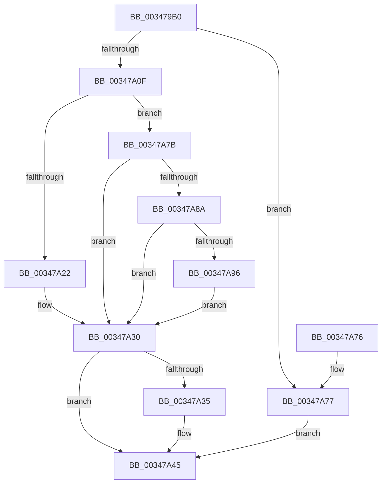

# MiGetMultiplexedVm

- RVA: `0x003479B0`–`0x00347A9B` (길이 `235` bytes)
- VA: `0x00000001403479B0`
- 실행 섹션: `.text`
- PDB 이름 있음: `예`; PDB Function 태그: `아니요`
- unwind 정보 RVA: `0x000DB714`
- 디코드: `57`개 명령, `235/235` bytes 표시
- 미해석 바이트: `0` (있으면 어셈블리에 `.byte`로 보존)

> 이 문서는 커널 이미지의 기계어와 PDB 기호를 분석해 생성했습니다. 4번과 5번은 함수 원형과 자료형을 바이너리 사용 방식에서 추정한 C 해석이며 원본 소스 복구 결과는 아닙니다.

## 1. Dependencies

- 직접 호출 지점: **0**; 고유 호출 대상: **0**
- 직접 호출자로 확인된 함수: **4**
- RIP 상대 이미지 참조: **3**

### Outgoing calls
- 직접 디코드된 call 명령이 없습니다.

### Direct callers
- [MmSetAddressRangeModifiedEx](../23/MmSetAddressRangeModifiedEx_function_00236F20.md) at `0x00236FCD`
- [MiSynchronizeSystemVa](../28/MiSynchronizeSystemVa_function_0028ECB8.md) at `0x0028EE2B`
- [MiTrimSharedPageFromViews](../2E/MiTrimSharedPageFromViews_function_002E16F8.md) at `0x002E1BDD`
- [sub_00347472](Unknown_function_00347472.md) at `0x003474EA`

### Static image references
- `0x00347A29` → RVA `0x00E38BB8` (`.data`; read)
- `0x00347A5E` → RVA `0x00E30088` (`.data`; read)
- `0x00347A8A` → RVA `0x00FC6AB0` (`ALMOSTRO`; read)

## 2. Other-region calls and transfers

- 다른 실행 섹션으로 향하는 call: **0**
- 별도 외부 분기/꼬리 이동을 확인하지 못했습니다.

## 3. Assembly (complete function range)

```asm
003479B0  48 8B C2                        mov rax, rdx
003479B3  4C 8B C2                        mov r8, rdx
003479B6  48 C1 E8 12                     shr rax, 0x12
003479BA  25 F8 FF FF 3F                  and eax, 0x3ffffff8
003479BF  48 B9 00 00 00 40 FB F6 FF FF   movabs rcx, 0xfffff6fb40000000
003479C9  48 8B 04 08                     mov rax, qword ptr [rax + rcx]
003479CD  48 B9 FF FF FF FF FF 00 00 00   movabs rcx, 0xffffffffff
003479D7  48 C1 E8 0C                     shr rax, 0xc
003479DB  48 23 C1                        and rax, rcx
003479DE  48 8D 04 40                     lea rax, [rax + rax*2]
003479E2  48 C1 E0 04                     shl rax, 4
003479E6  48 B9 00 00 00 00 00 DE FF FF   movabs rcx, 0xffffde0000000000
003479F0  48 03 C1                        add rax, rcx
003479F3  48 8B 08                        mov rcx, qword ptr [rax]
003479F6  8B 50 24                        mov edx, dword ptr [rax + 0x24]
003479F9  81 E2 00 00 FF 03               and edx, 0x3ff0000
003479FF  48 D1 E9                        shr rcx, 1
00347A02  48 C1 E2 0F                     shl rdx, 0xf
00347A06  0F BA F1 1F                     btr ecx, 0x1f
00347A0A  48 0B D1                        or rdx, rcx
00347A0D  74 68                           je 0x140347a77
00347A0F  48 B8 00 00 00 00 00 FF FF FF   movabs rax, 0xffffff0000000000
00347A19  48 03 C2                        add rax, rdx
00347A1C  48 83 F8 01                     cmp rax, 1
00347A20  76 59                           jbe 0x140347a7b
00347A22  48 FF CA                        dec rdx
00347A25  48 C1 E2 04                     shl rdx, 4
00347A29  48 03 15 88 11 AF 00            add rdx, qword ptr [rip + 0xaf1188]
00347A30  48 85 D2                        test rdx, rdx
00347A33  74 10                           je 0x140347a45
00347A35  49 C1 E8 12                     shr r8, 0x12
00347A39  41 83 E0 07                     and r8d, 7
00347A3D  4B 8D 04 80                     lea rax, [r8 + r8*4]
00347A41  48 8D 14 C2                     lea rdx, [rdx + rax*8]
00347A45  48 8B 52 18                     mov rdx, qword ptr [rdx + 0x18]
00347A49  48 8B CA                        mov rcx, rdx
00347A4C  48 83 E1 FE                     and rcx, 0xfffffffffffffffe
00347A50  F6 C2 01                        test dl, 1
00347A53  48 0F 44 CA                     cmove rcx, rdx
00347A57  48 8B 01                        mov rax, qword ptr [rcx]
00347A5A  0F B7 48 3C                     movzx ecx, word ptr [rax + 0x3c]
00347A5E  48 8B 05 23 86 AE 00            mov rax, qword ptr [rip + 0xae8623]
00347A65  81 E1 FF 03 00 00               and ecx, 0x3ff
00347A6B  48 8B 04 C8                     mov rax, qword ptr [rax + rcx*8]
00347A6F  48 05 80 49 00 00               add rax, 0x4980
00347A75  C3                              ret
00347A76  CC                              int3
00347A77  33 D2                           xor edx, edx
00347A79  EB CA                           jmp 0x140347a45
00347A7B  48 B8 01 00 00 00 00 01 00 00   movabs rax, 0x10000000001
00347A85  48 3B D0                        cmp rdx, rax
00347A88  75 A6                           jne 0x140347a30
00347A8A  48 8B 05 1F F0 C7 00            mov rax, qword ptr [rip + 0xc7f01f]
00347A91  48 85 C0                        test rax, rax
00347A94  74 9A                           je 0x140347a30
00347A96  48 8B D0                        mov rdx, rax
00347A99  EB 95                           jmp 0x140347a30
```

## 4. C-style interpretation (structured pseudocode)

```c
__int64 __fastcall MiGetMultiplexedVm(__int64 a1, __int64 a2)
{
    __int64 result;

    result = (a2) >> (18);
    result = (unsigned int)((result) & (0x3FFFFFF8ULL));
    result = (*(unsigned __int64 *)(result + a1 * 1)) >> (12);
    result = (result) & (a1);
    result = (result + result * 2) << (4);
    result = (result) + (a1);
    a2 = (unsigned int)(((unsigned int)(*(unsigned int *)(result + 36))) & (0x3FF0000ULL));
    a1 = (*(unsigned __int64 *)(result)) >> (1);
    a2 = (a2) << (15);
    a2 = (a2) | (a1);
    if (condition_is_equal) goto loc_00347A77;
    result = (result) + (a2);
    if (result <= 1) goto loc_00347A7B;
    a2 = (a2) - 1;
    a2 = (a2) << (4);
    a2 = (a2) + (*(unsigned __int64 *)(v_rip + 11473288));
loc_00347A30:
    if (a2 != 0) {
        a3 = (a2) >> (18);
        a3 = (unsigned int)((a3) & (7));
        result = a3 + a3 * 4;
        a2 = a2 + result * 8;
    }
    a1 = (*(unsigned __int64 *)(a2 + 24)) & (-2);
    if ((((unsigned __int8)(*(unsigned __int64 *)(a2 + 24))) & (1)) == 0) { a1 = *(unsigned __int64 *)(a2 + 24); }
    a1 = (unsigned int)((*(unsigned __int16 *)(*(unsigned __int64 *)(a1) + 60)) & (0x3FFULL));
    result = (*(unsigned __int64 *)(*(unsigned __int64 *)(v_rip + 11437603) + a1 * 8)) + (0x4980ULL);
    return result;
loc_00347A77:
    a2 = 0;
    goto loc_00347A45;
loc_00347A7B:
    if (0 != result) goto loc_00347A30;
    if (*(unsigned __int64 *)(v_rip + 13103135) == 0) goto loc_00347A30;
    goto loc_00347A30;
}
```

## 5. (Beta) C Style

```c
int64_t MiGetMultiplexedVm(int64_t Arg1, int64_t Arg2)
{
    int64_t result;

    result = (Arg2) >> (18);
    result = (uint32_t)((result) & (0x3FFFFFF8ULL));
    result = (*(uint64_t *)(result + Arg1 * 1)) >> (12);
    result = (result) & (Arg1);
    result = (result + result * 2) << (4);
    result = (result) + (Arg1);
    Arg2 = (uint32_t)(((uint32_t)(*(uint32_t *)(result + 0x24))) & (0x3FF0000ULL));
    Arg1 = (*(uint64_t *)(result)) >> (1);
    Arg2 = (Arg2) << (15);
    Arg2 = (Arg2) | (Arg1);
    if (condition_is_equal) goto loc_00347A77;
    result = (result) + (Arg2);
    if (result <= 1) goto loc_00347A7B;
    Arg2 = (Arg2) - 1;
    Arg2 = (Arg2) << (4);
    Arg2 = (Arg2) + (*(uint64_t *)(v_rip + 0xAF1188));
loc_00347A30:
    if (Arg2 != 0) {
        a3 = (Arg2) >> (18);
        a3 = (uint32_t)((a3) & (7));
        result = a3 + a3 * 4;
        Arg2 = Arg2 + result * 8;
    }
    Arg1 = (*(uint64_t *)(Arg2 + 0x18)) & (-2);
    if ((((uint8_t)(*(uint64_t *)(Arg2 + 0x18))) & (1)) == 0) { Arg1 = *(uint64_t *)(Arg2 + 0x18); }
    Arg1 = (uint32_t)((*(uint16_t *)(*(uint64_t *)(Arg1) + 0x3C)) & (0x3FFULL));
    result = (*(uint64_t *)(*(uint64_t *)(v_rip + 0xAE8623) + Arg1 * 8)) + (0x4980ULL);
    return result;
loc_00347A77:
    Arg2 = 0;
    goto loc_00347A45;
loc_00347A7B:
    if (0 != result) goto loc_00347A30;
    if (*(uint64_t *)(v_rip + 0xC7F01F) == 0) goto loc_00347A30;
    goto loc_00347A30;
}
```

## 6. Execution-region graph

[열기: 2D/3D 그래프와 함수 탐색 컨트롤 패널](../../../control-panel.html?section=text&rva=0x003479B0&view=graph)

- 2D 그래프는 위에서 아래로 흐르고, 3D 그래프는 빈 공간을 드래그해 회전합니다. Shift+드래그는 이동, 휠은 확대·축소, 함수 노드 선택은 대상 보고서 이동입니다.

### Static fallback


