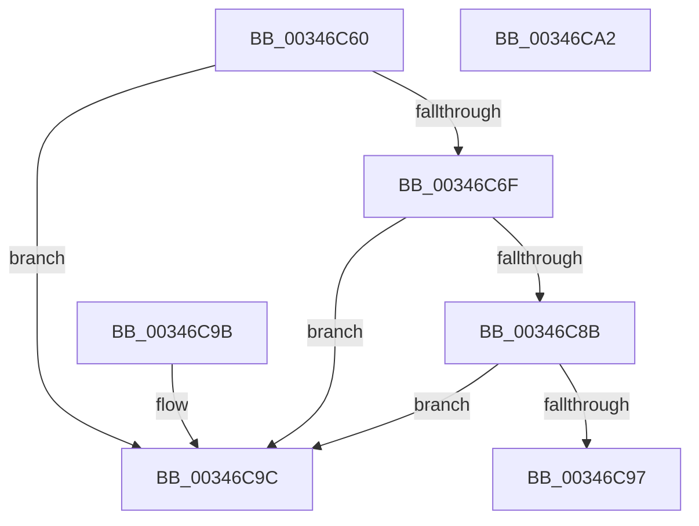

# MiGetSessionIdForVa

- RVA: `0x00346C60`–`0x00346CA3` (길이 `67` bytes)
- VA: `0x0000000140346C60`
- 실행 섹션: `.text`
- PDB 이름 있음: `예`; PDB Function 태그: `아니요`
- unwind 정보 RVA: `0x000DB714`
- 디코드: `16`개 명령, `67/67` bytes 표시
- 미해석 바이트: `0` (있으면 어셈블리에 `.byte`로 보존)

> 이 문서는 커널 이미지의 기계어와 PDB 기호를 분석해 생성했습니다. 4번과 5번은 함수 원형과 자료형을 바이너리 사용 방식에서 추정한 C 해석이며 원본 소스 복구 결과는 아닙니다.

## 1. Dependencies

- 직접 호출 지점: **0**; 고유 호출 대상: **0**
- 직접 호출자로 확인된 함수: **6**
- RIP 상대 이미지 참조: **0**

### Outgoing calls
- 직접 디코드된 call 명령이 없습니다.

### Direct callers
- [MiCopyDataPageToImagePage](../2A/MiCopyDataPageToImagePage_function_002AE818.md) at `0x002AE89E`
- [MiCompleteRestrictedImageFault](../2C/MiCompleteRestrictedImageFault_function_002C60D4.md) at `0x002C6232`
- [MiCompleteProtoPteFault](MiCompleteProtoPteFault_function_00345710.md) at `0x00345CF2`
- [MiResolveMappedFileFault](../36/MiResolveMappedFileFault_function_0036B640.md) at `0x0036BE87`
- [MiIssueHardFault](../38/MiIssueHardFault_function_00380074.md) at `0x003800D4`
- [MiFaultGetFileExtents](../47/MiFaultGetFileExtents_function_00479758.md) at `0x0047979C`

### Static image references
- 디코드된 RIP-relative 메모리 참조가 없습니다.

## 2. Other-region calls and transfers

- 다른 실행 섹션으로 향하는 call: **0**
- 별도 외부 분기/꼬리 이동을 확인하지 못했습니다.

## 3. Assembly (complete function range)

```asm
00346C60  48 B8 00 00 00 00 00 80 FF FF   movabs rax, 0xffff800000000000
00346C6A  48 3B C8                        cmp rcx, rax
00346C6D  73 2D                           jae 0x140346c9c
00346C6F  65 48 8B 04 25 88 01 00 00      mov rax, qword ptr gs:[0x188]
00346C78  48 8B 88 B8 00 00 00            mov rcx, qword ptr [rax + 0xb8]
00346C7F  48 8B 81 E8 02 00 00            mov rax, qword ptr [rcx + 0x2e8]
00346C86  48 85 C0                        test rax, rax
00346C89  74 11                           je 0x140346c9c
00346C8B  F7 81 FC 05 00 00 00 10 00 00   test dword ptr [rcx + 0x5fc], 0x1000
00346C95  75 05                           jne 0x140346c9c
00346C97  8B 40 08                        mov eax, dword ptr [rax + 8]
00346C9A  C3                              ret
00346C9B  CC                              int3
00346C9C  B8 FF FF FF FF                  mov eax, 0xffffffff
00346CA1  C3                              ret
00346CA2  CC                              int3
```

## 4. C-style interpretation (structured pseudocode)

```c
__int64 __fastcall MiGetSessionIdForVa(__int64 a1)
{
    if (a1 >= result) goto loc_00346C9C;
    if (*(unsigned __int64 *)(*(unsigned __int64 *)(*(unsigned __int64 *)(gs_base + (0 + 392)) + 184) + 744) == 0) goto loc_00346C9C;
    if (((*(unsigned int *)(*(unsigned __int64 *)(*(unsigned __int64 *)(gs_base + (0 + 392)) + 184) + 1532)) & (0x1000ULL)) != 0) goto loc_00346C9C;
    return (unsigned int)(*(unsigned int *)(*(unsigned __int64 *)(*(unsigned __int64 *)(*(unsigned __int64 *)(gs_base + (0 + 392)) + 184) + 744) + 8));
loc_00346C9C:
    return (unsigned int)(0xFFFFFFFFULL);
}
```

## 5. (Beta) C Style

```c
int64_t MiGetSessionIdForVa(int64_t Arg1)
{
    if (Arg1 >= result) goto loc_00346C9C;
    if (*(uint64_t *)(*(uint64_t *)(*(uint64_t *)(gs_base + (0 + 0x188)) + 0xB8) + 0x2E8) == 0) goto loc_00346C9C;
    if (((*(uint32_t *)(*(uint64_t *)(*(uint64_t *)(gs_base + (0 + 0x188)) + 0xB8) + 0x5FC)) & (0x1000ULL)) != 0) goto loc_00346C9C;
    return (uint32_t)(*(uint32_t *)(*(uint64_t *)(*(uint64_t *)(*(uint64_t *)(gs_base + (0 + 0x188)) + 0xB8) + 0x2E8) + 0x8));
loc_00346C9C:
    return (uint32_t)(0xFFFFFFFFULL);
}
```

## 6. Execution-region graph

[열기: 2D/3D 그래프와 함수 탐색 컨트롤 패널](../../../control-panel.html?section=text&rva=0x00346C60&view=graph)

- 2D 그래프는 위에서 아래로 흐르고, 3D 그래프는 빈 공간을 드래그해 회전합니다. Shift+드래그는 이동, 휠은 확대·축소, 함수 노드 선택은 대상 보고서 이동입니다.

### Static fallback


