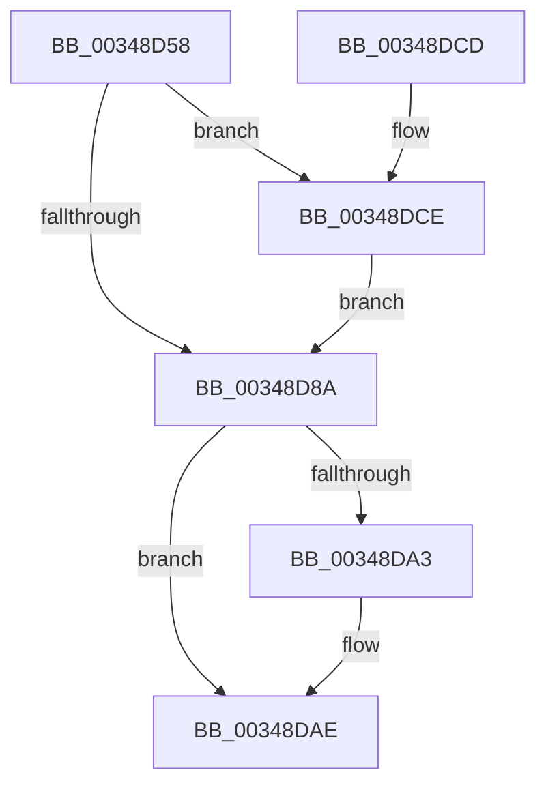

# MiGetSharedProtos

- RVA: `0x00348D58`–`0x00348DD7` (길이 `127` bytes)
- VA: `0x0000000140348D58`
- 실행 섹션: `.text`
- PDB 이름 있음: `예`; PDB Function 태그: `아니요`
- unwind 정보 RVA: `0x00078298`
- 디코드: `36`개 명령, `127/127` bytes 표시
- 미해석 바이트: `0` (있으면 어셈블리에 `.byte`로 보존)

> 이 문서는 커널 이미지의 기계어와 PDB 기호를 분석해 생성했습니다. 4번과 5번은 함수 원형과 자료형을 바이너리 사용 방식에서 추정한 C 해석이며 원본 소스 복구 결과는 아닙니다.

## 1. Dependencies

- 직접 호출 지점: **3**; 고유 호출 대상: **3**
- 직접 호출자로 확인된 함수: **15**
- RIP 상대 이미지 참조: **1**

### Outgoing calls
- `0x00348D92` → [MiGetSharedProtosAtDpc](../42/MiGetSharedProtosAtDpc_function_0042F924.md) (function, `0x0042F924`)
- `0x00348DA9` → [KiLowerIrqlProcessIrqlFlags](../4F/KiLowerIrqlProcessIrqlFlags_function_004F5698.md) (function, `0x004F5698`)
- `0x00348DD0` → [KiRaiseIrqlProcessIrqlFlags](../4F/KiRaiseIrqlProcessIrqlFlags_function_004F56FC.md) (function, `0x004F56FC`)

### Direct callers
- [MiMakePerSessionProtoPte](../22/MiMakePerSessionProtoPte_function_0022F7EC.md) at `0x0022F8AF`
- [MiMakePerSessionProtoPte](../22/MiMakePerSessionProtoPte_function_0022F7EC.md) at `0x0022F8C7`
- [sub_002E0B15](../2E/Unknown_function_002E0B15.md) at `0x002E0F71`
- [sub_002E0B15](../2E/Unknown_function_002E0B15.md) at `0x002E0FAE`
- [MiViewMayContainPage](../2E/MiViewMayContainPage_function_002E11F0.md) at `0x002E1552`
- [MiQueryAddressState](../32/MiQueryAddressState_function_0032C380.md) at `0x0032CE75`
- [sub_0032EA98](../32/Unknown_function_0032EA98.md) at `0x0032EBC7`
- [MiCompleteProtoPteFault](MiCompleteProtoPteFault_function_00345710.md) at `0x00346384`
- [MiStartingOffset](MiStartingOffset_function_003482E0.md) at `0x00348375`
- [sub_003490AD](Unknown_function_003490AD.md) at `0x0034923B`
- [MiWalkEntireImage](../36/MiWalkEntireImage_function_00365D70.md) at `0x003669B5`
- [MiResolveMappedFileFault](../36/MiResolveMappedFileFault_function_0036B640.md) at `0x0036BED5`
- [sub_00380A72](../38/Unknown_function_00380A72.md) at `0x00380A93`
- [MiStartingOffsetNeedLock](../44/MiStartingOffsetNeedLock_function_00443964.md) at `0x00443A7E`
- [MiFaultGetFileExtents](../47/MiFaultGetFileExtents_function_00479758.md) at `0x004797AC`
- [MiPfPrepareSequentialReadList](../../page/93/MiPfPrepareSequentialReadList_function_0093D8E8.md) at `0x0093DFD2`
- [sub_00B252B0](../../page/B2/Unknown_function_00B252B0.md) at `0x00B252D0`

### Static image references
- `0x00348D81` → RVA `0x00FC6D20` (`ALMOSTRO`; read)

## 2. Other-region calls and transfers

- 다른 실행 섹션으로 향하는 call: **0**
- 별도 외부 분기/꼬리 이동을 확인하지 못했습니다.

## 3. Assembly (complete function range)

```asm
00348D58  48 89 5C 24 08                  mov qword ptr [rsp + 8], rbx
00348D5D  48 89 6C 24 10                  mov qword ptr [rsp + 0x10], rbp
00348D62  48 89 74 24 18                  mov qword ptr [rsp + 0x18], rsi
00348D67  57                              push rdi
00348D68  48 83 EC 20                     sub rsp, 0x20
00348D6C  49 8B F8                        mov rdi, r8
00348D6F  8B F2                           mov esi, edx
00348D71  48 8B E9                        mov rbp, rcx
00348D74  44 0F 20 C3                     mov rbx, cr8
00348D78  BA 02 00 00 00                  mov edx, 2
00348D7D  44 0F 22 C2                     mov cr8, rdx
00348D81  83 3D 98 DF C7 00 00            cmp dword ptr [rip + 0xc7df98], 0
00348D88  75 44                           jne 0x140348dce
00348D8A  4C 8B C7                        mov r8, rdi
00348D8D  8B D6                           mov edx, esi
00348D8F  48 8B CD                        mov rcx, rbp
00348D92  E8 8D 6B 0E 00                  call 0x14042f924
00348D97  83 3D 82 DF C7 00 00            cmp dword ptr [rip + 0xc7df82], 0
00348D9E  48 8B F8                        mov rdi, rax
00348DA1  74 0B                           je 0x140348dae
00348DA3  44 0F 20 C1                     mov rcx, cr8
00348DA7  8A D3                           mov dl, bl
00348DA9  E8 EA C8 1A 00                  call 0x1404f5698
00348DAE  0F B6 CB                        movzx ecx, bl
00348DB1  44 0F 22 C1                     mov cr8, rcx
00348DB5  48 8B 5C 24 30                  mov rbx, qword ptr [rsp + 0x30]
00348DBA  48 8B C7                        mov rax, rdi
00348DBD  48 8B 6C 24 38                  mov rbp, qword ptr [rsp + 0x38]
00348DC2  48 8B 74 24 40                  mov rsi, qword ptr [rsp + 0x40]
00348DC7  48 83 C4 20                     add rsp, 0x20
00348DCB  5F                              pop rdi
00348DCC  C3                              ret
00348DCD  CC                              int3
00348DCE  8A CB                           mov cl, bl
00348DD0  E8 27 C9 1A 00                  call 0x1404f56fc
00348DD5  EB B3                           jmp 0x140348d8a
```

## 4. C-style interpretation (structured pseudocode)

```c
__int64 __fastcall MiGetSharedProtos(__int64 a1, int a2, __int64 a3)
{
    __int64 result;
    __int64 v_rsp;
    unsigned __int64 v_stack_p10;
    unsigned __int64 v_stack_p18;
    unsigned __int64 v_stack_p8;

    v_stack_p8 = v_rbx;
    v_stack_p10 = v_rbp;
    v_stack_p18 = v_rsi;
    v_rsp = (v_rsp) - (32);
    if ((*(unsigned int *)(v_rip + 13098904)) != 0) goto loc_00348DCE;
loc_00348D8A:
    result = MiGetSharedProtosAtDpc(a1, (unsigned int)((unsigned int)((unsigned int)(a2))), a3, a4);
    if ((*(unsigned int *)(v_rip + 13098882)) != 0) {
        a1 = 2;
        a2 = (unsigned __int8)(v_cr8);
        result = KiLowerIrqlProcessIrqlFlags(a1, a2, a3, a4);
    }
    v_rsp = (v_rsp) + (32);
    return result;
loc_00348DCE:
    result = KiRaiseIrqlProcessIrqlFlags((unsigned __int8)(v_stack_p8), a2, a3, a4);
    goto loc_00348D8A;
}
```

## 5. (Beta) C Style

```c
int64_t MiGetSharedProtos(int64_t Arg1, int32_t Arg2, int64_t Arg3)
{
    int64_t result;
    int64_t local_rsp;
    uint64_t v_stack_p10;
    uint64_t v_stack_p18;
    uint64_t v_stack_p8;

    v_stack_p8 = local_rbx;
    v_stack_p10 = local_rbp;
    v_stack_p18 = local_rsi;
    local_rsp = (local_rsp) - (32);
    if ((*(uint32_t *)(v_rip + 0xC7DF98)) != 0) goto loc_00348DCE;
loc_00348D8A:
    result = MiGetSharedProtosAtDpc(Arg1, (uint32_t)((uint32_t)((uint32_t)(Arg2))), Arg3, a4);
    if ((*(uint32_t *)(v_rip + 0xC7DF82)) != 0) {
        Arg1 = 2;
        Arg2 = (uint8_t)(v_cr8);
        result = KiLowerIrqlProcessIrqlFlags(Arg1, Arg2, Arg3, a4);
    }
    local_rsp = (local_rsp) + (32);
    return result;
loc_00348DCE:
    result = KiRaiseIrqlProcessIrqlFlags((uint8_t)(v_stack_p8), Arg2, Arg3, a4);
    goto loc_00348D8A;
}
```

## 6. Execution-region graph

[열기: 2D/3D 그래프와 함수 탐색 컨트롤 패널](../../../control-panel.html?section=text&rva=0x00348D58&view=graph)

- 2D 그래프는 위에서 아래로 흐르고, 3D 그래프는 빈 공간을 드래그해 회전합니다. Shift+드래그는 이동, 휠은 확대·축소, 함수 노드 선택은 대상 보고서 이동입니다.

### Static fallback


