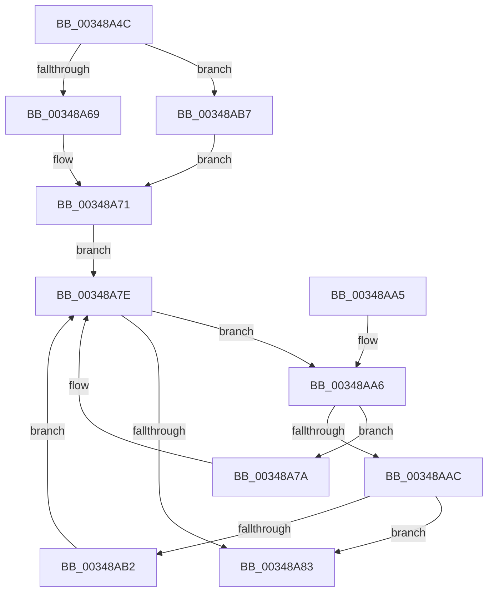

# MiKernelStackVaToStackNode

- RVA: `0x00348A4C`–`0x00348AC1` (길이 `117` bytes)
- VA: `0x0000000140348A4C`
- 실행 섹션: `.text`
- PDB 이름 있음: `예`; PDB Function 태그: `아니요`
- unwind 정보 RVA: `0x00063C10`
- 디코드: `34`개 명령, `117/117` bytes 표시
- 미해석 바이트: `0` (있으면 어셈블리에 `.byte`로 보존)

> 이 문서는 커널 이미지의 기계어와 PDB 기호를 분석해 생성했습니다. 4번과 5번은 함수 원형과 자료형을 바이너리 사용 방식에서 추정한 C 해석이며 원본 소스 복구 결과는 아닙니다.

## 1. Dependencies

- 직접 호출 지점: **3**; 고유 호출 대상: **3**
- 직접 호출자로 확인된 함수: **2**
- RIP 상대 이미지 참조: **2**

### Outgoing calls
- `0x00348A6C` → [ExAcquireSpinLockSharedAtDpcLevel](../24/ExAcquireSpinLockSharedAtDpcLevel_function_00248E30.md) (function, `0x00248E30`)
- `0x00348A8D` → [MiReleaseSpinLockShared](MiReleaseSpinLockShared_function_00348BF0.md) (function, `0x00348BF0`)
- `0x00348AB7` → [ExAcquireSpinLockShared](../24/ExAcquireSpinLockShared_function_0024DCE0.md) (function, `0x0024DCE0`)

### Direct callers
- [MiInPageSingleKernelStack](../36/MiInPageSingleKernelStack_function_0036A3E8.md) at `0x0036A79B`
- [MiResolvePageFileFault](../36/MiResolvePageFileFault_function_0036D968.md) at `0x0036ED6C`

### Static image references
- `0x00348A5E` → RVA `0x00E35FD8` (`.data`; read)
- `0x00348A71` → RVA `0x00E35FD0` (`.data`; read)

## 2. Other-region calls and transfers

- 다른 실행 섹션으로 향하는 call: **0**
- 별도 외부 분기/꼬리 이동을 확인하지 못했습니다.

## 3. Assembly (complete function range)

```asm
00348A4C  48 89 5C 24 08                  mov qword ptr [rsp + 8], rbx
00348A51  48 89 74 24 10                  mov qword ptr [rsp + 0x10], rsi
00348A56  57                              push rdi
00348A57  48 83 EC 20                     sub rsp, 0x20
00348A5B  48 8B F9                        mov rdi, rcx
00348A5E  48 8D 0D 73 D5 AE 00            lea rcx, [rip + 0xaed573]
00348A65  85 D2                           test edx, edx
00348A67  74 4E                           je 0x140348ab7
00348A69  40 B6 11                        mov sil, 0x11
00348A6C  E8 BF 03 F0 FF                  call 0x140248e30
00348A71  48 8B 1D 58 D5 AE 00            mov rbx, qword ptr [rip + 0xaed558]
00348A78  EB 04                           jmp 0x140348a7e
00348A7A  48 8B 5B 08                     mov rbx, qword ptr [rbx + 8]
00348A7E  48 85 DB                        test rbx, rbx
00348A81  75 23                           jne 0x140348aa6
00348A83  40 8A D6                        mov dl, sil
00348A86  48 8D 0D 4B D5 AE 00            lea rcx, [rip + 0xaed54b]
00348A8D  E8 5E 01 00 00                  call 0x140348bf0
00348A92  48 8B 74 24 38                  mov rsi, qword ptr [rsp + 0x38]
00348A97  48 8B C3                        mov rax, rbx
00348A9A  48 8B 5C 24 30                  mov rbx, qword ptr [rsp + 0x30]
00348A9F  48 83 C4 20                     add rsp, 0x20
00348AA3  5F                              pop rdi
00348AA4  C3                              ret
00348AA5  CC                              int3
00348AA6  48 3B 7B 18                     cmp rdi, qword ptr [rbx + 0x18]
00348AAA  77 CE                           ja 0x140348a7a
00348AAC  48 3B 7B 20                     cmp rdi, qword ptr [rbx + 0x20]
00348AB0  73 D1                           jae 0x140348a83
00348AB2  48 8B 1B                        mov rbx, qword ptr [rbx]
00348AB5  EB C7                           jmp 0x140348a7e
00348AB7  E8 24 52 F0 FF                  call 0x14024dce0
00348ABC  40 8A F0                        mov sil, al
00348ABF  EB B0                           jmp 0x140348a71
```

## 4. C-style interpretation (structured pseudocode)

```c
__int64 __fastcall MiKernelStackVaToStackNode(__int64 a1, int a2)
{
    __int64 result;
    __int64 v_rsp;
    unsigned __int64 v_stack_p10;
    unsigned __int64 v_stack_p8;

    v_stack_p8 = v_rbx;
    v_stack_p10 = v_rsi;
    v_rsp = (v_rsp) - (32);
    if (a2 == 0) goto loc_00348AB7;
    result = ExAcquireSpinLockSharedAtDpcLevel(v_rip + 11457907, a2, a3, a4);
loc_00348A71:
    goto loc_00348A7E;
loc_00348A7A:
loc_00348A7E:
    if (*(unsigned __int64 *)(*(unsigned __int64 *)(v_rip + 11457880) + 8) != 0) goto loc_00348AA6;
loc_00348A83:
    result = MiReleaseSpinLockShared(v_rip + 11457867, 17, a3, a4);
    v_rsp = (v_rsp) + (32);
    return *(unsigned __int64 *)(*(unsigned __int64 *)(v_rip + 11457880) + 8);
loc_00348AA6:
    if (a1 > (*(unsigned __int64 *)(v_stack_p8 + 24))) goto loc_00348A7A;
    if (a1 >= (*(unsigned __int64 *)(v_stack_p8 + 32))) goto loc_00348A83;
    goto loc_00348A7E;
loc_00348AB7:
    result = ExAcquireSpinLockShared(v_rip + 11457867, 17, a3, a4);
    goto loc_00348A71;
}
```

## 5. (Beta) C Style

```c
int64_t MiKernelStackVaToStackNode(int64_t Arg1, int32_t Arg2)
{
    int64_t result;
    int64_t local_rsp;
    uint64_t v_stack_p10;
    uint64_t v_stack_p8;

    v_stack_p8 = local_rbx;
    v_stack_p10 = local_rsi;
    local_rsp = (local_rsp) - (32);
    if (Arg2 == 0) goto loc_00348AB7;
    result = ExAcquireSpinLockSharedAtDpcLevel(v_rip + 11457907, Arg2, a3, a4);
loc_00348A71:
    goto loc_00348A7E;
loc_00348A7A:
loc_00348A7E:
    if (*(uint64_t *)(*(uint64_t *)(v_rip + 0xAED558) + 0x8) != 0) goto loc_00348AA6;
loc_00348A83:
    result = MiReleaseSpinLockShared(v_rip + 11457867, 17, a3, a4);
    local_rsp = (local_rsp) + (32);
    return *(uint64_t *)(*(uint64_t *)(v_rip + 0xAED558) + 0x8);
loc_00348AA6:
    if (Arg1 > (*(uint64_t *)(v_stack_p8 + 0x18))) goto loc_00348A7A;
    if (Arg1 >= (*(uint64_t *)(v_stack_p8 + 0x20))) goto loc_00348A83;
    goto loc_00348A7E;
loc_00348AB7:
    result = ExAcquireSpinLockShared(v_rip + 11457867, 17, a3, a4);
    goto loc_00348A71;
}
```

## 6. Execution-region graph

[열기: 2D/3D 그래프와 함수 탐색 컨트롤 패널](../../../control-panel.html?section=text&rva=0x00348A4C&view=graph)

- 2D 그래프는 위에서 아래로 흐르고, 3D 그래프는 빈 공간을 드래그해 회전합니다. Shift+드래그는 이동, 휠은 확대·축소, 함수 노드 선택은 대상 보고서 이동입니다.

### Static fallback


