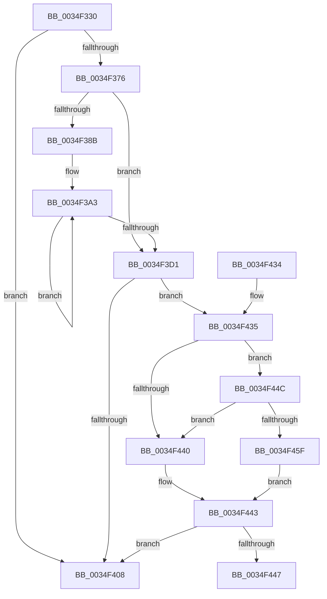

# MiLogPartitionState

- RVA: `0x0034F330`–`0x0034F461` (길이 `305` bytes)
- VA: `0x000000014034F330`
- 실행 섹션: `.text`
- PDB 이름 있음: `예`; PDB Function 태그: `예`
- unwind 정보 RVA: `0x00078BE4`
- 디코드: `75`개 명령, `305/305` bytes 표시
- 미해석 바이트: `0` (있으면 어셈블리에 `.byte`로 보존)

> 이 문서는 커널 이미지의 기계어와 PDB 기호를 분석해 생성했습니다. 4번과 5번은 함수 원형과 자료형을 바이너리 사용 방식에서 추정한 C 해석이며 원본 소스 복구 결과는 아닙니다.

## 1. Dependencies

- 직접 호출 지점: **1**; 고유 호출 대상: **1**
- 직접 호출자로 확인된 함수: **1**
- RIP 상대 이미지 참조: **2**

### Outgoing calls
- `0x0034F412` → [_security_check_cookie](../6A/_security_check_cookie_function_006AC640.md) (function, `0x006AC640`)

### Direct callers
- [MiProcessWorkingSets](MiProcessWorkingSets_function_0034E710.md) at `0x0034E754`

### Static image references
- `0x0034F352` → RVA `0x00E0A740` (`.data`; read)
- `0x0034F369` → RVA `0x00E37618` (`.data`; read)

## 2. Other-region calls and transfers

- 다른 실행 섹션으로 향하는 call: **0**
- call이 아닌 외부 분기/꼬리 이동: **1**
  - `0x0034F447` → [sub_006E22D2](../6E/Unknown_function_006E22D2.md) (`tail-transfer`)

## 3. Assembly (complete function range)

```asm
0034F330  48 8B C4                        mov rax, rsp
0034F333  48 89 58 08                     mov qword ptr [rax + 8], rbx
0034F337  48 89 70 10                     mov qword ptr [rax + 0x10], rsi
0034F33B  48 89 78 18                     mov qword ptr [rax + 0x18], rdi
0034F33F  55                              push rbp
0034F340  41 56                           push r14
0034F342  41 57                           push r15
0034F344  48 8D A8 38 FD FF FF            lea rbp, [rax - 0x2c8]
0034F34B  48 81 EC B0 03 00 00            sub rsp, 0x3b0
0034F352  48 8B 05 E7 B3 AB 00            mov rax, qword ptr [rip + 0xabb3e7]
0034F359  48 33 C4                        xor rax, rsp
0034F35C  48 89 85 A0 02 00 00            mov qword ptr [rbp + 0x2a0], rax
0034F363  45 33 F6                        xor r14d, r14d
0034F366  4C 8B C1                        mov r8, rcx
0034F369  4C 39 35 A8 82 AE 00            cmp qword ptr [rip + 0xae82a8], r14
0034F370  0F 84 92 00 00 00               je 0x14034f408
0034F376  8B 81 58 48 00 00               mov eax, dword ptr [rcx + 0x4858]
0034F37C  45 8D 7E 08                     lea r15d, [r14 + 8]
0034F380  66 89 44 24 40                  mov word ptr [rsp + 0x40], ax
0034F385  66 44 3B F0                     cmp r14w, ax
0034F389  73 46                           jae 0x14034f3d1
0034F38B  4C 8D 8D A8 00 00 00            lea r9, [rbp + 0xa8]
0034F392  0F B7 D8                        movzx ebx, ax
0034F395  4C 8D 91 80 10 00 00            lea r10, [rcx + 0x1080]
0034F39C  4C 8D 99 60 48 00 00            lea r11, [rcx + 0x4860]
0034F3A3  49 8B 13                        mov rdx, qword ptr [r11]
0034F3A6  4D 03 DF                        add r11, r15
0034F3A9  8B 02                           mov eax, dword ptr [rdx]
0034F3AB  49 89 41 F8                     mov qword ptr [r9 - 8], rax
0034F3AF  8B 42 0C                        mov eax, dword ptr [rdx + 0xc]
0034F3B2  49 89 01                        mov qword ptr [r9], rax
0034F3B5  4D 8D 49 20                     lea r9, [r9 + 0x20]
0034F3B9  8B 42 14                        mov eax, dword ptr [rdx + 0x14]
0034F3BC  49 89 41 E8                     mov qword ptr [r9 - 0x18], rax
0034F3C0  49 8B 02                        mov rax, qword ptr [r10]
0034F3C3  4D 8D 52 58                     lea r10, [r10 + 0x58]
0034F3C7  49 89 41 F0                     mov qword ptr [r9 - 0x10], rax
0034F3CB  48 83 EB 01                     sub rbx, 1
0034F3CF  75 D2                           jne 0x14034f3a3
0034F3D1  48 8B 91 C0 4B 00 00            mov rdx, qword ptr [rcx + 0x4bc0]
0034F3D8  4C 8B 99 C0 0B 00 00            mov r11, qword ptr [rcx + 0xbc0]
0034F3DF  48 8B 99 40 0B 00 00            mov rbx, qword ptr [rcx + 0xb40]
0034F3E6  48 8B B9 80 0F 00 00            mov rdi, qword ptr [rcx + 0xf80]
0034F3ED  48 8B B1 00 10 00 00            mov rsi, qword ptr [rcx + 0x1000]
0034F3F4  4C 8B 15 1D 82 AE 00            mov r10, qword ptr [rip + 0xae821d]
0034F3FB  4C 8B 89 A0 4C 00 00            mov r9, qword ptr [rcx + 0x4ca0]
0034F402  41 83 3A 05                     cmp dword ptr [r10], 5
0034F406  77 2D                           ja 0x14034f435
0034F408  48 8B 8D A0 02 00 00            mov rcx, qword ptr [rbp + 0x2a0]
0034F40F  48 33 CC                        xor rcx, rsp
0034F412  E8 29 D2 35 00                  call 0x1406ac640
0034F417  4C 8D 9C 24 B0 03 00 00         lea r11, [rsp + 0x3b0]
0034F41F  49 8B 5B 20                     mov rbx, qword ptr [r11 + 0x20]
0034F423  49 8B 73 28                     mov rsi, qword ptr [r11 + 0x28]
0034F427  49 8B 7B 30                     mov rdi, qword ptr [r11 + 0x30]
0034F42B  49 8B E3                        mov rsp, r11
0034F42E  41 5F                           pop r15
0034F430  41 5E                           pop r14
0034F432  5D                              pop rbp
0034F433  C3                              ret
0034F434  CC                              int3
0034F435  41 8B 42 10                     mov eax, dword ptr [r10 + 0x10]
0034F439  48 0F BA E0 0B                  bt rax, 0xb
0034F43E  72 0C                           jb 0x14034f44c
0034F440  41 8A C6                        mov al, r14b
0034F443  84 C0                           test al, al
0034F445  74 C1                           je 0x14034f408
0034F447  E9 86 2E 39 00                  jmp 0x1406e22d2
0034F44C  49 8B 4A 18                     mov rcx, qword ptr [r10 + 0x18]
0034F450  48 8B C1                        mov rax, rcx
0034F453  25 00 08 00 00                  and eax, 0x800
0034F458  48 3B C1                        cmp rax, rcx
0034F45B  B0 01                           mov al, 1
0034F45D  75 E1                           jne 0x14034f440
0034F45F  EB E2                           jmp 0x14034f443
```

## 4. C-style interpretation (structured pseudocode)

```c
__int64 __fastcall MiLogPartitionState(__int64 a1)
{
    __int64 result;
    __int64 v_r11;
    __int64 v_r14;
    __int64 v_rbx;
    __int64 v_rsp;
    unsigned __int64 v_stack_m18;
    unsigned __int16 v_stack_m388;

    *(unsigned __int64 *)(v_rsp + 8) = v_rbx;
    *(unsigned __int64 *)(v_rsp + 16) = v_rsi;
    *(unsigned __int64 *)(v_rsp + 24) = v_rdi;
    v_rsp = (v_rsp) - (944);
    result = (*(unsigned __int64 *)(v_rip + 11252711)) ^ (v_rsp);
    *(unsigned __int64 *)(v_rsp - 712 + 672) = result;
    v_r14 = 0;
    if ((*(unsigned __int64 *)(v_rip + 11436712)) == 0) goto loc_0034F408;
    v_stack_m388 = (unsigned __int16)((unsigned int)(*(unsigned int *)(a1 + 18520)));
    if (0 >= ((unsigned __int16)((unsigned int)(*(unsigned int *)(a1 + 18520))))) goto loc_0034F3D1;
loc_0034F3A3:
    v_r11 = (a1 + 18528) + (v_r14 + 8);
    *(unsigned __int64 *)(v_rsp - 712 + 168 - 8) = (unsigned int)(*(unsigned int *)(*(unsigned __int64 *)(a1 + 18528)));
    *(unsigned __int64 *)(v_rsp - 712 + 168) = (unsigned int)(*(unsigned int *)(*(unsigned __int64 *)(a1 + 18528) + 12));
    *(unsigned __int64 *)(v_rsp - 712 + 168 + 32 - 24) = (unsigned int)(*(unsigned int *)(*(unsigned __int64 *)(a1 + 18528) + 20));
    *(unsigned __int64 *)(v_rsp - 712 + 168 + 32 - 16) = *(unsigned __int64 *)(a1 + 4224);
    v_rbx = ((unsigned __int16)((unsigned int)(*(unsigned int *)(a1 + 18520)))) - (1);
    if (condition_is_not_equal) goto loc_0034F3A3;
loc_0034F3D1:
    if ((*(unsigned int *)(*(unsigned __int64 *)(v_rip + 11436573))) > 5) goto loc_0034F435;
loc_0034F408:
    a1 = (*(unsigned __int64 *)(v_rsp - 712 + 672)) ^ (v_rsp);
    result = _security_check_cookie(a1, *(unsigned __int64 *)(a1 + 19392), a1, *(unsigned __int64 *)(a1 + 19616));
    return result;
loc_0034F435:
    if (condition_is_below) goto loc_0034F44C;
loc_0034F440:
loc_0034F443:
    if (0 == 0) goto loc_0034F408;
loc_0034F44C:
    result = (unsigned int)((*(unsigned __int64 *)(*(unsigned __int64 *)(v_rip + 11436573) + 24)) & (0x800ULL));
    if (result != (*(unsigned __int64 *)(*(unsigned __int64 *)(v_rip + 11436573) + 24))) goto loc_0034F440;
    goto loc_0034F443;
}
```

## 5. (Beta) C Style

```c
int64_t MiLogPartitionState(void *Arg1)
{
    uint8_t *arg1 = (uint8_t *)Arg1;

    int64_t result;
    int64_t local_r11;
    int64_t local_r14;
    int64_t local_rbx;
    int64_t local_rsp;
    uint64_t v_stack_m18;
    uint16_t v_stack_m388;

    *(uint64_t *)(local_rsp + 0x8) = local_rbx;
    *(uint64_t *)(local_rsp + 0x10) = local_rsi;
    *(uint64_t *)(local_rsp + 0x18) = local_rdi;
    local_rsp = (local_rsp) - (944);
    result = (*(uint64_t *)(v_rip + 0xABB3E7)) ^ (local_rsp);
    *(uint64_t *)(local_rsp - 0x2C8 + 0x2A0) = result;
    local_r14 = 0;
    if ((*(uint64_t *)(v_rip + 0xAE82A8)) == 0) goto loc_0034F408;
    v_stack_m388 = (uint16_t)((uint32_t)(*(uint32_t *)(arg1 + 0x4858)));
    if (0 >= ((uint16_t)((uint32_t)(*(uint32_t *)(arg1 + 0x4858))))) goto loc_0034F3D1;
loc_0034F3A3:
    local_r11 = (Arg1 + 18528) + (local_r14 + 8);
    *(uint64_t *)(local_rsp - 0x2C8 + 0xA8 - 0x8) = (uint32_t)(*(uint32_t *)(*(uint64_t *)(arg1 + 0x4860)));
    *(uint64_t *)(local_rsp - 0x2C8 + 0xA8) = (uint32_t)(*(uint32_t *)(*(uint64_t *)(arg1 + 0x4860) + 0xC));
    *(uint64_t *)(local_rsp - 0x2C8 + 0xA8 + 0x20 - 0x18) = (uint32_t)(*(uint32_t *)(*(uint64_t *)(arg1 + 0x4860) + 0x14));
    *(uint64_t *)(local_rsp - 0x2C8 + 0xA8 + 0x20 - 0x10) = *(uint64_t *)(arg1 + 0x1080);
    local_rbx = ((uint16_t)((uint32_t)(*(uint32_t *)(arg1 + 0x4858)))) - (1);
    if (condition_is_not_equal) goto loc_0034F3A3;
loc_0034F3D1:
    if ((*(uint32_t *)(*(uint64_t *)(v_rip + 0xAE821D))) > 5) goto loc_0034F435;
loc_0034F408:
    Arg1 = (*(uint64_t *)(local_rsp - 0x2C8 + 0x2A0)) ^ (local_rsp);
    result = _security_check_cookie(Arg1, *(uint64_t *)(arg1 + 0x4BC0), Arg1, *(uint64_t *)(arg1 + 0x4CA0));
    return result;
loc_0034F435:
    if (condition_is_below) goto loc_0034F44C;
loc_0034F440:
loc_0034F443:
    if (0 == 0) goto loc_0034F408;
loc_0034F44C:
    result = (uint32_t)((*(uint64_t *)(*(uint64_t *)(v_rip + 0xAE821D) + 0x18)) & (0x800ULL));
    if (result != (*(uint64_t *)(*(uint64_t *)(v_rip + 0xAE821D) + 0x18))) goto loc_0034F440;
    goto loc_0034F443;
}
```

### 관측된 메모리 오프셋

구조체 형식이 확인되지 않은 접근은 인자 기준의 오프셋으로만 기록했습니다.

| 기준 인자 | 오프셋 표현 | 폭 (bit) | 접근 |
|---|---:|---:|---|
| `Arg1` | `+ 0x0` | `64` | `R` |
| `Arg1` | `+ 0x58` | `64` | `R` |
| `Arg1` | `+ 0xB40` | `64` | `R` |
| `Arg1` | `+ 0xBC0` | `64` | `R` |
| `Arg1` | `+ 0xF80` | `64` | `R` |
| `Arg1` | `+ 0x1000` | `64` | `R` |
| `Arg1` | `+ 0x1080` | `64` | `R` |
| `Arg1` | `+ 0x4858` | `32` | `R` |
| `Arg1` | `+ 0x4860` | `64` | `R` |
| `Arg1` | `+ 0x4BC0` | `64` | `R` |
| `Arg1` | `+ 0x4CA0` | `64` | `R` |

## 6. Execution-region graph

[열기: 2D/3D 그래프와 함수 탐색 컨트롤 패널](../../../control-panel.html?section=text&rva=0x0034F330&view=graph)

- 2D 그래프는 위에서 아래로 흐르고, 3D 그래프는 빈 공간을 드래그해 회전합니다. Shift+드래그는 이동, 휠은 확대·축소, 함수 노드 선택은 대상 보고서 이동입니다.

### Static fallback


