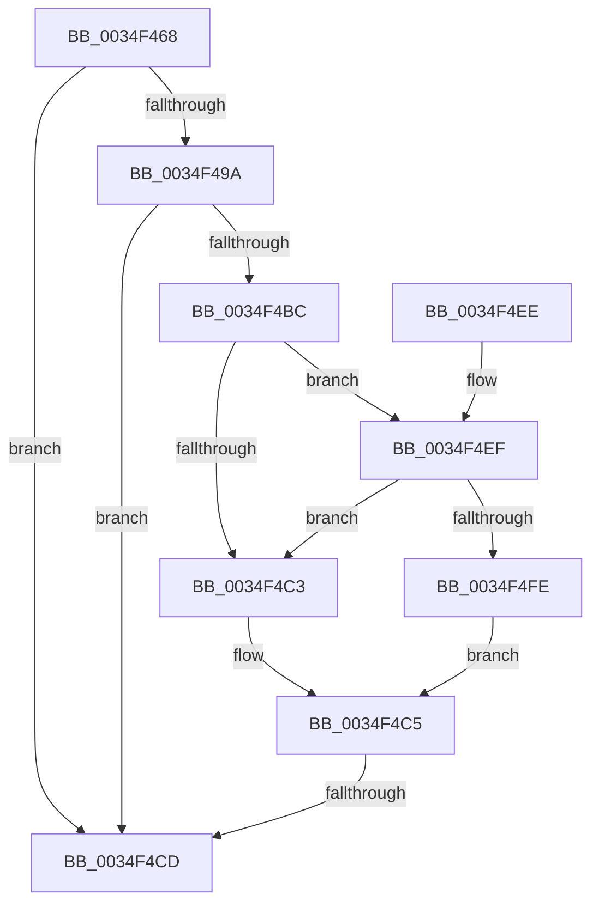

# MiLogProcessWorkingSetsStart

- RVA: `0x0034F468`–`0x0034F502` (길이 `154` bytes)
- VA: `0x000000014034F468`
- 실행 섹션: `.text`
- PDB 이름 있음: `예`; PDB Function 태그: `예`
- unwind 정보 RVA: `0x00078C1C`
- 디코드: `39`개 명령, `154/154` bytes 표시
- 미해석 바이트: `0` (있으면 어셈블리에 `.byte`로 보존)

> 이 문서는 커널 이미지의 기계어와 PDB 기호를 분석해 생성했습니다. 4번과 5번은 함수 원형과 자료형을 바이너리 사용 방식에서 추정한 C 해석이며 원본 소스 복구 결과는 아닙니다.

## 1. Dependencies

- 직접 호출 지점: **1**; 고유 호출 대상: **1**
- 직접 호출자로 확인된 함수: **1**
- RIP 상대 이미지 참조: **2**

### Outgoing calls
- `0x0034F4D4` → [_security_check_cookie](../6A/_security_check_cookie_function_006AC640.md) (function, `0x006AC640`)

### Direct callers
- [MiProcessWorkingSets](MiProcessWorkingSets_function_0034E710.md) at `0x0034E783`

### Static image references
- `0x0034F47F` → RVA `0x00E0A740` (`.data`; read)
- `0x0034F48D` → RVA `0x00E37618` (`.data`; read)

## 2. Other-region calls and transfers

- 다른 실행 섹션으로 향하는 call: **0**
- call이 아닌 외부 분기/꼬리 이동: **1**
  - `0x0034F4C7` → [sub_006E2434](../6E/Unknown_function_006E2434.md) (`tail-transfer`)

## 3. Assembly (complete function range)

```asm
0034F468  48 89 5C 24 08                  mov qword ptr [rsp + 8], rbx
0034F46D  48 89 7C 24 10                  mov qword ptr [rsp + 0x10], rdi
0034F472  55                              push rbp
0034F473  48 8D 6C 24 B0                  lea rbp, [rsp - 0x50]
0034F478  48 81 EC 50 01 00 00            sub rsp, 0x150
0034F47F  48 8B 05 BA B2 AB 00            mov rax, qword ptr [rip + 0xabb2ba]
0034F486  48 33 C4                        xor rax, rsp
0034F489  48 89 45 40                     mov qword ptr [rbp + 0x40], rax
0034F48D  48 83 3D 83 81 AE 00 00         cmp qword ptr [rip + 0xae8183], 0
0034F495  4C 8B C9                        mov r9, rcx
0034F498  74 33                           je 0x14034f4cd
0034F49A  48 8B 99 C0 4B 00 00            mov rbx, qword ptr [rcx + 0x4bc0]
0034F4A1  4C 8B 15 70 81 AE 00            mov r10, qword ptr [rip + 0xae8170]
0034F4A8  4C 8B 99 C0 44 00 00            mov r11, qword ptr [rcx + 0x44c0]
0034F4AF  48 8B B9 A0 4C 00 00            mov rdi, qword ptr [rcx + 0x4ca0]
0034F4B6  41 83 3A 05                     cmp dword ptr [r10], 5
0034F4BA  76 11                           jbe 0x14034f4cd
0034F4BC  41 F6 42 10 01                  test byte ptr [r10 + 0x10], 1
0034F4C1  75 2C                           jne 0x14034f4ef
0034F4C3  32 C0                           xor al, al
0034F4C5  84 C0                           test al, al
0034F4C7  0F 85 67 2F 39 00               jne 0x1406e2434
0034F4CD  48 8B 4D 40                     mov rcx, qword ptr [rbp + 0x40]
0034F4D1  48 33 CC                        xor rcx, rsp
0034F4D4  E8 67 D1 35 00                  call 0x1406ac640
0034F4D9  4C 8D 9C 24 50 01 00 00         lea r11, [rsp + 0x150]
0034F4E1  49 8B 5B 10                     mov rbx, qword ptr [r11 + 0x10]
0034F4E5  49 8B 7B 18                     mov rdi, qword ptr [r11 + 0x18]
0034F4E9  49 8B E3                        mov rsp, r11
0034F4EC  5D                              pop rbp
0034F4ED  C3                              ret
0034F4EE  CC                              int3
0034F4EF  49 8B 4A 18                     mov rcx, qword ptr [r10 + 0x18]
0034F4F3  48 8B C1                        mov rax, rcx
0034F4F6  83 E0 01                        and eax, 1
0034F4F9  48 3B C1                        cmp rax, rcx
0034F4FC  75 C5                           jne 0x14034f4c3
0034F4FE  B0 01                           mov al, 1
0034F500  EB C3                           jmp 0x14034f4c5
```

## 4. C-style interpretation (structured pseudocode)

```c
__int64 __fastcall MiLogProcessWorkingSetsStart(__int64 a1)
{
    __int64 result;
    __int64 v_rsp;
    unsigned __int64 v_stack_m18;
    unsigned __int64 v_stack_m58;
    unsigned __int64 v_stack_m8;
    unsigned __int64 v_stack_p10;
    unsigned __int64 v_stack_p8;

    v_stack_p8 = v_rbx;
    v_stack_p10 = v_rdi;
    v_rsp = (v_rsp) - (336);
    result = (*(unsigned __int64 *)(v_rip + 11252410)) ^ (v_rsp);
    v_stack_m18 = result;
    if ((*(unsigned __int64 *)(v_rip + 11436419)) == 0) goto loc_0034F4CD;
    if ((*(unsigned int *)(*(unsigned __int64 *)(v_rip + 11436400))) <= 5) goto loc_0034F4CD;
    if (((*(unsigned __int8 *)(*(unsigned __int64 *)(v_rip + 11436400) + 16)) & (1)) != 0) goto loc_0034F4EF;
loc_0034F4C3:
    result = 0;
loc_0034F4C5:
loc_0034F4CD:
    a1 = (v_stack_m18) ^ (v_rsp);
    result = _security_check_cookie(a1, a2, a3, a1);
    return result;
loc_0034F4EF:
    result = (unsigned int)((*(unsigned __int64 *)(*(unsigned __int64 *)(v_rip + 11436400) + 24)) & (1));
    if (result != (*(unsigned __int64 *)(*(unsigned __int64 *)(v_rip + 11436400) + 24))) goto loc_0034F4C3;
    goto loc_0034F4C5;
}
```

## 5. (Beta) C Style

```c
int64_t MiLogProcessWorkingSetsStart(void *Arg1)
{
    uint8_t *arg1 = (uint8_t *)Arg1;

    int64_t result;
    int64_t local_rsp;
    uint64_t v_stack_m18;
    uint64_t v_stack_m58;
    uint64_t v_stack_m8;
    uint64_t v_stack_p10;
    uint64_t v_stack_p8;

    v_stack_p8 = local_rbx;
    v_stack_p10 = local_rdi;
    local_rsp = (local_rsp) - (336);
    result = (*(uint64_t *)(v_rip + 0xABB2BA)) ^ (local_rsp);
    v_stack_m18 = result;
    if ((*(uint64_t *)(v_rip + 0xAE8183)) == 0) goto loc_0034F4CD;
    if ((*(uint32_t *)(*(uint64_t *)(v_rip + 0xAE8170))) <= 5) goto loc_0034F4CD;
    if (((*(uint8_t *)(*(uint64_t *)(v_rip + 0xAE8170) + 0x10)) & (1)) != 0) goto loc_0034F4EF;
loc_0034F4C3:
    result = 0;
loc_0034F4C5:
loc_0034F4CD:
    Arg1 = (v_stack_m18) ^ (local_rsp);
    result = _security_check_cookie(Arg1, a2, a3, Arg1);
    return result;
loc_0034F4EF:
    result = (uint32_t)((*(uint64_t *)(*(uint64_t *)(v_rip + 0xAE8170) + 0x18)) & (1));
    if (result != (*(uint64_t *)(*(uint64_t *)(v_rip + 0xAE8170) + 0x18))) goto loc_0034F4C3;
    goto loc_0034F4C5;
}
```

### 관측된 메모리 오프셋

구조체 형식이 확인되지 않은 접근은 인자 기준의 오프셋으로만 기록했습니다.

| 기준 인자 | 오프셋 표현 | 폭 (bit) | 접근 |
|---|---:|---:|---|
| `Arg1` | `+ 0x44C0` | `64` | `R` |
| `Arg1` | `+ 0x4BC0` | `64` | `R` |
| `Arg1` | `+ 0x4CA0` | `64` | `R` |

## 6. Execution-region graph

[열기: 2D/3D 그래프와 함수 탐색 컨트롤 패널](../../../control-panel.html?section=text&rva=0x0034F468&view=graph)

- 2D 그래프는 위에서 아래로 흐르고, 3D 그래프는 빈 공간을 드래그해 회전합니다. Shift+드래그는 이동, 휠은 확대·축소, 함수 노드 선택은 대상 보고서 이동입니다.

### Static fallback


