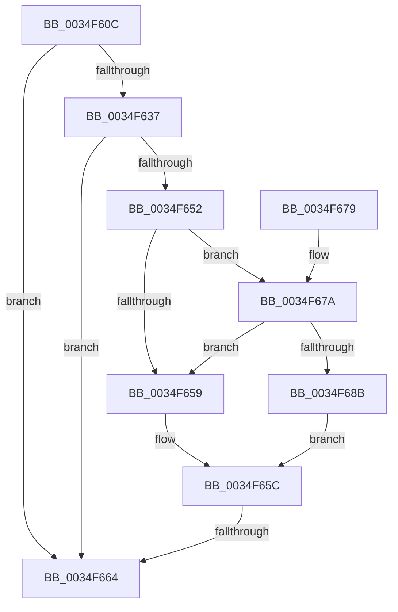

# MiLogProcessWorkingSetsStop

- RVA: `0x0034F60C`–`0x0034F68D` (길이 `129` bytes)
- VA: `0x000000014034F60C`
- 실행 섹션: `.text`
- PDB 이름 있음: `예`; PDB Function 태그: `예`
- unwind 정보 RVA: `0x00078C4C`
- 디코드: `34`개 명령, `129/129` bytes 표시
- 미해석 바이트: `0` (있으면 어셈블리에 `.byte`로 보존)

> 이 문서는 커널 이미지의 기계어와 PDB 기호를 분석해 생성했습니다. 4번과 5번은 함수 원형과 자료형을 바이너리 사용 방식에서 추정한 C 해석이며 원본 소스 복구 결과는 아닙니다.

## 1. Dependencies

- 직접 호출 지점: **1**; 고유 호출 대상: **1**
- 직접 호출자로 확인된 함수: **1**
- RIP 상대 이미지 참조: **2**

### Outgoing calls
- `0x0034F66B` → [_security_check_cookie](../6A/_security_check_cookie_function_006AC640.md) (function, `0x006AC640`)

### Direct callers
- [MiProcessWorkingSets](MiProcessWorkingSets_function_0034E710.md) at `0x0034E9E8`

### Static image references
- `0x0034F61A` → RVA `0x00E0A740` (`.data`; read)
- `0x0034F62E` → RVA `0x00E37618` (`.data`; read)

## 2. Other-region calls and transfers

- 다른 실행 섹션으로 향하는 call: **0**
- call이 아닌 외부 분기/꼬리 이동: **1**
  - `0x0034F65E` → [sub_006E2562](../6E/Unknown_function_006E2562.md) (`tail-transfer`)

## 3. Assembly (complete function range)

```asm
0034F60C  40 55                           push rbp
0034F60E  48 8D 6C 24 A9                  lea rbp, [rsp - 0x57]
0034F613  48 81 EC D0 00 00 00            sub rsp, 0xd0
0034F61A  48 8B 05 1F B1 AB 00            mov rax, qword ptr [rip + 0xabb11f]
0034F621  48 33 C4                        xor rax, rsp
0034F624  48 89 45 47                     mov qword ptr [rbp + 0x47], rax
0034F628  45 33 DB                        xor r11d, r11d
0034F62B  48 8B D1                        mov rdx, rcx
0034F62E  4C 39 1D E3 7F AE 00            cmp qword ptr [rip + 0xae7fe3], r11
0034F635  74 2D                           je 0x14034f664
0034F637  4C 8B 89 C0 4B 00 00            mov r9, qword ptr [rcx + 0x4bc0]
0034F63E  4C 8B 05 D3 7F AE 00            mov r8, qword ptr [rip + 0xae7fd3]
0034F645  4C 8B 91 A0 4C 00 00            mov r10, qword ptr [rcx + 0x4ca0]
0034F64C  41 83 38 05                     cmp dword ptr [r8], 5
0034F650  76 12                           jbe 0x14034f664
0034F652  41 F6 40 10 01                  test byte ptr [r8 + 0x10], 1
0034F657  75 21                           jne 0x14034f67a
0034F659  41 8A C3                        mov al, r11b
0034F65C  84 C0                           test al, al
0034F65E  0F 85 FE 2E 39 00               jne 0x1406e2562
0034F664  48 8B 4D 47                     mov rcx, qword ptr [rbp + 0x47]
0034F668  48 33 CC                        xor rcx, rsp
0034F66B  E8 D0 CF 35 00                  call 0x1406ac640
0034F670  48 81 C4 D0 00 00 00            add rsp, 0xd0
0034F677  5D                              pop rbp
0034F678  C3                              ret
0034F679  CC                              int3
0034F67A  49 8B 48 18                     mov rcx, qword ptr [r8 + 0x18]
0034F67E  48 8B C1                        mov rax, rcx
0034F681  83 E0 01                        and eax, 1
0034F684  48 3B C1                        cmp rax, rcx
0034F687  B0 01                           mov al, 1
0034F689  75 CE                           jne 0x14034f659
0034F68B  EB CF                           jmp 0x14034f65c
```

## 4. C-style interpretation (structured pseudocode)

```c
__int64 __fastcall MiLogProcessWorkingSetsStop(__int64 a1)
{
    __int64 result;
    __int64 v_r11;
    __int64 v_rsp;
    unsigned __int64 v_stack_m18;
    unsigned __int64 v_stack_m5F;

    v_rsp = (v_rsp) - (208);
    result = (*(unsigned __int64 *)(v_rip + 11251999)) ^ (v_rsp);
    v_stack_m18 = result;
    v_r11 = 0;
    if ((*(unsigned __int64 *)(v_rip + 11436003)) == 0) goto loc_0034F664;
    if ((*(unsigned int *)(*(unsigned __int64 *)(v_rip + 11435987))) <= 5) goto loc_0034F664;
    if (((*(unsigned __int8 *)(*(unsigned __int64 *)(v_rip + 11435987) + 16)) & (1)) != 0) goto loc_0034F67A;
loc_0034F659:
loc_0034F65C:
loc_0034F664:
    a1 = (v_stack_m18) ^ (v_rsp);
    result = _security_check_cookie(a1, a1, *(unsigned __int64 *)(v_rip + 11435987), *(unsigned __int64 *)(a1 + 19392));
    v_rsp = (v_rsp) + (208);
    return result;
loc_0034F67A:
    result = (unsigned int)((*(unsigned __int64 *)(*(unsigned __int64 *)(v_rip + 11435987) + 24)) & (1));
    if (result != (*(unsigned __int64 *)(*(unsigned __int64 *)(v_rip + 11435987) + 24))) goto loc_0034F659;
    goto loc_0034F65C;
}
```

## 5. (Beta) C Style

```c
int64_t MiLogProcessWorkingSetsStop(void *Arg1)
{
    uint8_t *arg1 = (uint8_t *)Arg1;

    int64_t result;
    int64_t local_r11;
    int64_t local_rsp;
    uint64_t v_stack_m18;
    uint64_t v_stack_m5F;

    local_rsp = (local_rsp) - (208);
    result = (*(uint64_t *)(v_rip + 0xABB11F)) ^ (local_rsp);
    v_stack_m18 = result;
    local_r11 = 0;
    if ((*(uint64_t *)(v_rip + 0xAE7FE3)) == 0) goto loc_0034F664;
    if ((*(uint32_t *)(*(uint64_t *)(v_rip + 0xAE7FD3))) <= 5) goto loc_0034F664;
    if (((*(uint8_t *)(*(uint64_t *)(v_rip + 0xAE7FD3) + 0x10)) & (1)) != 0) goto loc_0034F67A;
loc_0034F659:
loc_0034F65C:
loc_0034F664:
    Arg1 = (v_stack_m18) ^ (local_rsp);
    result = _security_check_cookie(Arg1, Arg1, *(uint64_t *)(v_rip + 0xAE7FD3), *(uint64_t *)(arg1 + 0x4BC0));
    local_rsp = (local_rsp) + (208);
    return result;
loc_0034F67A:
    result = (uint32_t)((*(uint64_t *)(*(uint64_t *)(v_rip + 0xAE7FD3) + 0x18)) & (1));
    if (result != (*(uint64_t *)(*(uint64_t *)(v_rip + 0xAE7FD3) + 0x18))) goto loc_0034F659;
    goto loc_0034F65C;
}
```

### 관측된 메모리 오프셋

구조체 형식이 확인되지 않은 접근은 인자 기준의 오프셋으로만 기록했습니다.

| 기준 인자 | 오프셋 표현 | 폭 (bit) | 접근 |
|---|---:|---:|---|
| `Arg1` | `+ 0x4BC0` | `64` | `R` |
| `Arg1` | `+ 0x4CA0` | `64` | `R` |

## 6. Execution-region graph

[열기: 2D/3D 그래프와 함수 탐색 컨트롤 패널](../../../control-panel.html?section=text&rva=0x0034F60C&view=graph)

- 2D 그래프는 위에서 아래로 흐르고, 3D 그래프는 빈 공간을 드래그해 회전합니다. Shift+드래그는 이동, 휠은 확대·축소, 함수 노드 선택은 대상 보고서 이동입니다.

### Static fallback


