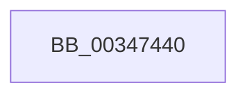

# MiMakeSystemCacheRangeValid

- RVA: `0x00347440`–`0x00347472` (길이 `50` bytes)
- VA: `0x0000000140347440`
- 실행 섹션: `.text`
- PDB 이름 있음: `예`; PDB Function 태그: `아니요`
- unwind 정보 RVA: `0x00078044`
- 디코드: `14`개 명령, `50/50` bytes 표시
- 미해석 바이트: `0` (있으면 어셈블리에 `.byte`로 보존)

> 이 문서는 커널 이미지의 기계어와 PDB 기호를 분석해 생성했습니다. 4번과 5번은 함수 원형과 자료형을 바이너리 사용 방식에서 추정한 C 해석이며 원본 소스 복구 결과는 아닙니다.

## 1. Dependencies

- 직접 호출 지점: **0**; 고유 호출 대상: **0**
- 직접 호출자로 확인된 함수: **3**
- RIP 상대 이미지 참조: **1**

### Outgoing calls
- 직접 디코드된 call 명령이 없습니다.

### Direct callers
- [sub_002F6DF4](../2F/Unknown_function_002F6DF4.md) at `0x002F6E1E`
- [sub_002F6E32](../2F/Unknown_function_002F6E32.md) at `0x002F6F05`
- [sub_002F7743](../2F/Unknown_function_002F7743.md) at `0x002F779B`

### Static image references
- `0x00347458` → RVA `0x00E0A740` (`.data`; read)

## 2. Other-region calls and transfers

- 다른 실행 섹션으로 향하는 call: **0**
- 별도 외부 분기/꼬리 이동을 확인하지 못했습니다.

## 3. Assembly (complete function range)

```asm
00347440  40 55                           push rbp
00347442  53                              push rbx
00347443  56                              push rsi
00347444  57                              push rdi
00347445  41 55                           push r13
00347447  41 56                           push r14
00347449  48 8D AC 24 68 FF FF FF         lea rbp, [rsp - 0x98]
00347451  48 81 EC 98 01 00 00            sub rsp, 0x198
00347458  48 8B 05 E1 32 AC 00            mov rax, qword ptr [rip + 0xac32e1]
0034745F  48 33 C4                        xor rax, rsp
00347462  48 89 85 80 00 00 00            mov qword ptr [rbp + 0x80], rax
00347469  41 8B D8                        mov ebx, r8d
0034746C  48 8B FA                        mov rdi, rdx
0034746F  4C 8B F1                        mov r14, rcx
```

## 4. C-style interpretation (structured pseudocode)

```c
__int64 __fastcall MiMakeSystemCacheRangeValid(__int64 a1, __int64 a2, int a3)
{
    __int64 result;
    __int64 v_rsp;
    unsigned __int64 v_stack_m48;
    unsigned __int64 v_stack_mC8;

    v_rsp = (v_rsp) - (408);
    result = (*(unsigned __int64 *)(v_rip + 11285217)) ^ (v_rsp);
    v_stack_m48 = result;
    return result;
}
```

## 5. (Beta) C Style

```c
int64_t MiMakeSystemCacheRangeValid(int64_t Arg1, int64_t Arg2, int32_t Arg3)
{
    int64_t result;
    int64_t local_rsp;
    uint64_t v_stack_m48;
    uint64_t v_stack_mC8;

    local_rsp = (local_rsp) - (408);
    result = (*(uint64_t *)(v_rip + 0xAC32E1)) ^ (local_rsp);
    v_stack_m48 = result;
    return result;
}
```

## 6. Execution-region graph

[열기: 2D/3D 그래프와 함수 탐색 컨트롤 패널](../../../control-panel.html?section=text&rva=0x00347440&view=graph)

- 2D 그래프는 위에서 아래로 흐르고, 3D 그래프는 빈 공간을 드래그해 회전합니다. Shift+드래그는 이동, 휠은 확대·축소, 함수 노드 선택은 대상 보고서 이동입니다.

### Static fallback


