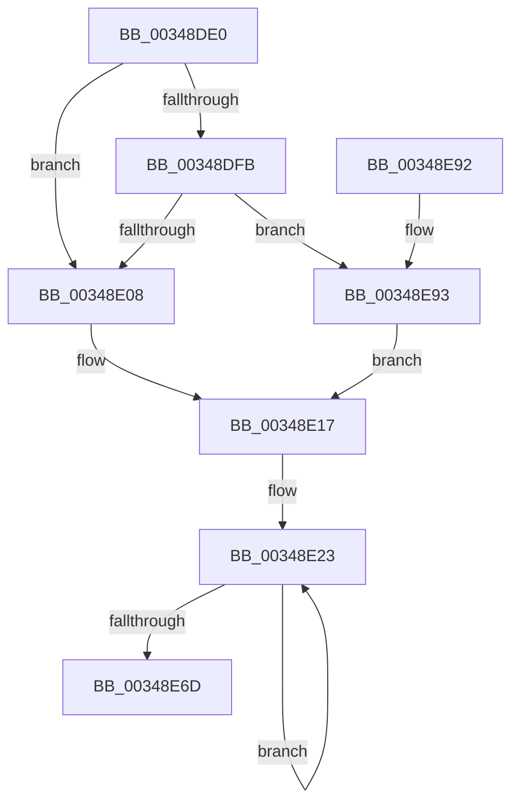

# MiObtainParkedCoreMasks

- RVA: `0x00348DE0`–`0x00348EA7` (길이 `199` bytes)
- VA: `0x0000000140348DE0`
- 실행 섹션: `.text`
- PDB 이름 있음: `예`; PDB Function 태그: `아니요`
- unwind 정보 RVA: `0x0006B090`
- 디코드: `51`개 명령, `199/199` bytes 표시
- 미해석 바이트: `0` (있으면 어셈블리에 `.byte`로 보존)

> 이 문서는 커널 이미지의 기계어와 PDB 기호를 분석해 생성했습니다. 4번과 5번은 함수 원형과 자료형을 바이너리 사용 방식에서 추정한 C 해석이며 원본 소스 복구 결과는 아닙니다.

## 1. Dependencies

- 직접 호출 지점: **3**; 고유 호출 대상: **3**
- 직접 호출자로 확인된 함수: **2**
- RIP 상대 이미지 참조: **2**

### Outgoing calls
- `0x00348E12` → [ExAcquireSpinLockSharedAtDpcLevel](../24/ExAcquireSpinLockSharedAtDpcLevel_function_00248E30.md) (function, `0x00248E30`)
- `0x00348E7D` → [MiReleaseSpinLockShared](MiReleaseSpinLockShared_function_00348BF0.md) (function, `0x00348BF0`)
- `0x00348E9A` → [ExAcquireSpinLockShared](../24/ExAcquireSpinLockShared_function_0024DCE0.md) (function, `0x0024DCE0`)

### Direct callers
- [MiInitializeAffinityWalker](../2C/MiInitializeAffinityWalker_function_002CA2F0.md) at `0x002CA344`
- [MiComputeIdealDpcGang](../43/MiComputeIdealDpcGang_function_0043EAAC.md) at `0x0043EDAC`

### Static image references
- `0x00348E08` → RVA `0x00E2ED40` (`.data`; read)
- `0x00348E17` → RVA `0x00E2ED48` (`.data`; read)

## 2. Other-region calls and transfers

- 다른 실행 섹션으로 향하는 call: **0**
- 별도 외부 분기/꼬리 이동을 확인하지 못했습니다.

## 3. Assembly (complete function range)

```asm
00348DE0  48 89 5C 24 08                  mov qword ptr [rsp + 8], rbx
00348DE5  48 89 74 24 10                  mov qword ptr [rsp + 0x10], rsi
00348DEA  57                              push rdi
00348DEB  48 83 EC 20                     sub rsp, 0x20
00348DEF  48 8B D9                        mov rbx, rcx
00348DF2  BE 02 00 00 00                  mov esi, 2
00348DF7  85 D2                           test edx, edx
00348DF9  75 0D                           jne 0x140348e08
00348DFB  44 0F 20 C0                     mov rax, cr8
00348DFF  40 3A C6                        cmp al, sil
00348E02  0F 85 8B 00 00 00               jne 0x140348e93
00348E08  48 8D 0D 31 5F AE 00            lea rcx, [rip + 0xae5f31]
00348E0F  40 B7 11                        mov dil, 0x11
00348E12  E8 19 00 F0 FF                  call 0x140248e30
00348E17  48 8D 05 2A 5F AE 00            lea rax, [rip + 0xae5f2a]
00348E1E  B9 80 00 00 00                  mov ecx, 0x80
00348E23  0F 10 00                        movups xmm0, xmmword ptr [rax]
00348E26  0F 11 03                        movups xmmword ptr [rbx], xmm0
00348E29  0F 10 48 10                     movups xmm1, xmmword ptr [rax + 0x10]
00348E2D  0F 11 4B 10                     movups xmmword ptr [rbx + 0x10], xmm1
00348E31  0F 10 40 20                     movups xmm0, xmmword ptr [rax + 0x20]
00348E35  0F 11 43 20                     movups xmmword ptr [rbx + 0x20], xmm0
00348E39  0F 10 48 30                     movups xmm1, xmmword ptr [rax + 0x30]
00348E3D  0F 11 4B 30                     movups xmmword ptr [rbx + 0x30], xmm1
00348E41  0F 10 40 40                     movups xmm0, xmmword ptr [rax + 0x40]
00348E45  0F 11 43 40                     movups xmmword ptr [rbx + 0x40], xmm0
00348E49  0F 10 48 50                     movups xmm1, xmmword ptr [rax + 0x50]
00348E4D  0F 11 4B 50                     movups xmmword ptr [rbx + 0x50], xmm1
00348E51  0F 10 40 60                     movups xmm0, xmmword ptr [rax + 0x60]
00348E55  0F 11 43 60                     movups xmmword ptr [rbx + 0x60], xmm0
00348E59  48 03 D9                        add rbx, rcx
00348E5C  0F 10 48 70                     movups xmm1, xmmword ptr [rax + 0x70]
00348E60  48 03 C1                        add rax, rcx
00348E63  0F 11 4B F0                     movups xmmword ptr [rbx - 0x10], xmm1
00348E67  48 83 EE 01                     sub rsi, 1
00348E6B  75 B6                           jne 0x140348e23
00348E6D  48 8B 00                        mov rax, qword ptr [rax]
00348E70  48 8D 0D C9 5E AE 00            lea rcx, [rip + 0xae5ec9]
00348E77  40 8A D7                        mov dl, dil
00348E7A  48 89 03                        mov qword ptr [rbx], rax
00348E7D  E8 6E FD FF FF                  call 0x140348bf0
00348E82  48 8B 5C 24 30                  mov rbx, qword ptr [rsp + 0x30]
00348E87  48 8B 74 24 38                  mov rsi, qword ptr [rsp + 0x38]
00348E8C  48 83 C4 20                     add rsp, 0x20
00348E90  5F                              pop rdi
00348E91  C3                              ret
00348E92  CC                              int3
00348E93  48 8D 0D A6 5E AE 00            lea rcx, [rip + 0xae5ea6]
00348E9A  E8 41 4E F0 FF                  call 0x14024dce0
00348E9F  40 8A F8                        mov dil, al
00348EA2  E9 70 FF FF FF                  jmp 0x140348e17
```

## 4. C-style interpretation (structured pseudocode)

```c
__int64 __fastcall MiObtainParkedCoreMasks(__int64 a1, int a2)
{
    __int64 result;
    __int64 v_rbx;
    __int64 v_rsi;
    __int64 v_rsp;
    unsigned __int64 v_stack_p10;
    unsigned __int64 v_stack_p8;

    v_stack_p8 = v_rbx;
    v_stack_p10 = v_rsi;
    v_rsp = (v_rsp) - (32);
    if (a2 != 0) goto loc_00348E08;
    if (((unsigned __int8)(v_cr8)) != 2) goto loc_00348E93;
loc_00348E08:
    result = ExAcquireSpinLockSharedAtDpcLevel(v_rip + 11427633, a2, a3, a4);
loc_00348E17:
loc_00348E23:
    *(unsigned __int64 *)(a1) = v_xmm0;
    *(unsigned __int64 *)(a1 + 16) = v_xmm1;
    *(unsigned __int64 *)(a1 + 32) = v_xmm0;
    *(unsigned __int64 *)(a1 + 48) = v_xmm1;
    *(unsigned __int64 *)(a1 + 64) = v_xmm0;
    *(unsigned __int64 *)(a1 + 80) = v_xmm1;
    *(unsigned __int64 *)(a1 + 96) = v_xmm0;
    v_rbx = (a1) + (128);
    result = (v_rip + 11427626) + (128);
    *(unsigned __int64 *)(v_rbx - 16) = v_xmm1;
    v_rsi = (2) - (1);
    if (condition_is_not_equal) goto loc_00348E23;
    *(unsigned __int64 *)(v_rbx) = *(unsigned __int64 *)(result);
    result = MiReleaseSpinLockShared(v_rip + 11427529, 17, a3, a4);
    v_rsp = (v_rsp) + (32);
    return result;
loc_00348E93:
    result = ExAcquireSpinLockShared(v_rip + 11427494, 17, a3, a4);
    goto loc_00348E17;
}
```

## 5. (Beta) C Style

```c
int64_t MiObtainParkedCoreMasks(void *Arg1, int32_t Arg2)
{
    uint8_t *arg1 = (uint8_t *)Arg1;

    int64_t result;
    int64_t local_rbx;
    int64_t local_rsi;
    int64_t local_rsp;
    uint64_t v_stack_p10;
    uint64_t v_stack_p8;

    v_stack_p8 = local_rbx;
    v_stack_p10 = local_rsi;
    local_rsp = (local_rsp) - (32);
    if (Arg2 != 0) goto loc_00348E08;
    if (((uint8_t)(v_cr8)) != 2) goto loc_00348E93;
loc_00348E08:
    result = ExAcquireSpinLockSharedAtDpcLevel(v_rip + 11427633, Arg2, a3, a4);
loc_00348E17:
loc_00348E23:
    *(uint64_t *)(arg1) = v_xmm0;
    *(uint64_t *)(arg1 + 0x10) = v_xmm1;
    *(uint64_t *)(arg1 + 0x20) = v_xmm0;
    *(uint64_t *)(arg1 + 0x30) = v_xmm1;
    *(uint64_t *)(arg1 + 0x40) = v_xmm0;
    *(uint64_t *)(arg1 + 0x50) = v_xmm1;
    *(uint64_t *)(arg1 + 0x60) = v_xmm0;
    local_rbx = (Arg1) + (128);
    result = (v_rip + 11427626) + (128);
    *(uint64_t *)(local_rbx - 0x10) = v_xmm1;
    local_rsi = (2) - (1);
    if (condition_is_not_equal) goto loc_00348E23;
    *(uint64_t *)(local_rbx) = *(uint64_t *)(result);
    result = MiReleaseSpinLockShared(v_rip + 11427529, 17, a3, a4);
    local_rsp = (local_rsp) + (32);
    return result;
loc_00348E93:
    result = ExAcquireSpinLockShared(v_rip + 11427494, 17, a3, a4);
    goto loc_00348E17;
}
```

### 관측된 메모리 오프셋

구조체 형식이 확인되지 않은 접근은 인자 기준의 오프셋으로만 기록했습니다.

| 기준 인자 | 오프셋 표현 | 폭 (bit) | 접근 |
|---|---:|---:|---|
| `Arg1` | `- 0x10` | `128` | `R` |
| `Arg1` | `+ 0x0` | `64` | `W` |
| `Arg1` | `+ 0x0` | `128` | `R` |
| `Arg1` | `+ 0x10` | `128` | `R` |
| `Arg1` | `+ 0x20` | `128` | `R` |
| `Arg1` | `+ 0x30` | `128` | `R` |
| `Arg1` | `+ 0x40` | `128` | `R` |
| `Arg1` | `+ 0x50` | `128` | `R` |
| `Arg1` | `+ 0x60` | `128` | `R` |

## 6. Execution-region graph

[열기: 2D/3D 그래프와 함수 탐색 컨트롤 패널](../../../control-panel.html?section=text&rva=0x00348DE0&view=graph)

- 2D 그래프는 위에서 아래로 흐르고, 3D 그래프는 빈 공간을 드래그해 회전합니다. Shift+드래그는 이동, 휠은 확대·축소, 함수 노드 선택은 대상 보고서 이동입니다.

### Static fallback


