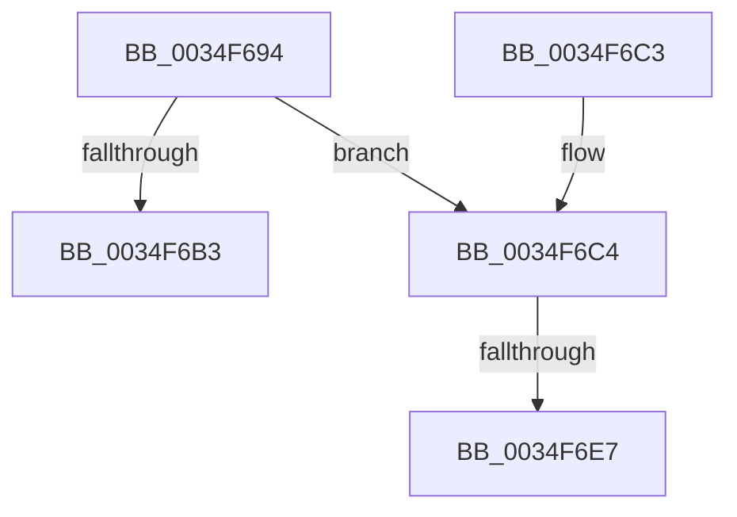

# MiPulseLowAvailableEvent

- RVA: `0x0034F694`–`0x0034F6F7` (길이 `99` bytes)
- VA: `0x000000014034F694`
- 실행 섹션: `.text`
- PDB 이름 있음: `예`; PDB Function 태그: `예`
- unwind 정보 RVA: `0x00078C74`
- 디코드: `26`개 명령, `99/99` bytes 표시
- 미해석 바이트: `0` (있으면 어셈블리에 `.byte`로 보존)

> 이 문서는 커널 이미지의 기계어와 PDB 기호를 분석해 생성했습니다. 4번과 5번은 함수 원형과 자료형을 바이너리 사용 방식에서 추정한 C 해석이며 원본 소스 복구 결과는 아닙니다.

## 1. Dependencies

- 직접 호출 지점: **2**; 고유 호출 대상: **2**
- 직접 호출자로 확인된 함수: **1**
- RIP 상대 이미지 참조: **0**

### Outgoing calls
- `0x0034F6CE` → [ExAcquireSpinLockExclusive](../24/ExAcquireSpinLockExclusive_function_00248690.md) (function, `0x00248690`)
- `0x0034F6EC` → [KePulseEvent](../35/KePulseEvent_function_00351EF0.md) (function, `0x00351EF0`)

### Direct callers
- [MiComputeSystemTrimCriteria](MiComputeSystemTrimCriteria_function_0034E184.md) at `0x0034E3F7`

### Static image references
- 디코드된 RIP-relative 메모리 참조가 없습니다.

## 2. Other-region calls and transfers

- 다른 실행 섹션으로 향하는 call: **0**
- call이 아닌 외부 분기/꼬리 이동: **2**
  - `0x0034F6E1` → [sub_006E25E8](../6E/Unknown_function_006E25E8.md) (`tail-transfer`)
  - `0x0034F6F2` → [sub_006E25E8](../6E/Unknown_function_006E25E8.md) (`tail-transfer`)

## 3. Assembly (complete function range)

```asm
0034F694  48 89 5C 24 08                  mov qword ptr [rsp + 8], rbx
0034F699  48 89 74 24 10                  mov qword ptr [rsp + 0x10], rsi
0034F69E  57                              push rdi
0034F69F  48 83 EC 20                     sub rsp, 0x20
0034F6A3  48 8B 81 18 01 00 00            mov rax, qword ptr [rcx + 0x118]
0034F6AA  48 8B D9                        mov rbx, rcx
0034F6AD  83 78 04 00                     cmp dword ptr [rax + 4], 0
0034F6B1  74 11                           je 0x14034f6c4
0034F6B3  48 8B 5C 24 30                  mov rbx, qword ptr [rsp + 0x30]
0034F6B8  48 8B 74 24 38                  mov rsi, qword ptr [rsp + 0x38]
0034F6BD  48 83 C4 20                     add rsp, 0x20
0034F6C1  5F                              pop rdi
0034F6C2  C3                              ret
0034F6C3  CC                              int3
0034F6C4  48 8D B9 40 3F 00 00            lea rdi, [rcx + 0x3f40]
0034F6CB  48 8B CF                        mov rcx, rdi
0034F6CE  E8 BD 8F EF FF                  call 0x140248690
0034F6D3  48 8B 8B 18 01 00 00            mov rcx, qword ptr [rbx + 0x118]
0034F6DA  40 8A F0                        mov sil, al
0034F6DD  83 79 04 00                     cmp dword ptr [rcx + 4], 0
0034F6E1  0F 85 01 2F 39 00               jne 0x1406e25e8
0034F6E7  45 33 C0                        xor r8d, r8d
0034F6EA  33 D2                           xor edx, edx
0034F6EC  E8 FF 27 00 00                  call 0x140351ef0
0034F6F1  90                              nop
0034F6F2  E9 F1 2E 39 00                  jmp 0x1406e25e8
```

## 4. C-style interpretation (structured pseudocode)

```c
__int64 __fastcall MiPulseLowAvailableEvent(__int64 a1, int a2, int a3)
{
    __int64 result;
    __int64 v_rsp;
    unsigned __int64 v_stack_p10;
    unsigned __int64 v_stack_p8;

    v_stack_p8 = v_rbx;
    v_stack_p10 = v_rsi;
    v_rsp = (v_rsp) - (32);
    if ((*(unsigned int *)(*(unsigned __int64 *)(a1 + 280) + 4)) == 0) goto loc_0034F6C4;
    v_rsp = (v_rsp) + (32);
    return *(unsigned __int64 *)(a1 + 280);
loc_0034F6C4:
    result = ExAcquireSpinLockExclusive(a1 + 16192, a2, a3, a4);
    a3 = 0;
    a2 = 0;
    result = KePulseEvent(*(unsigned __int64 *)(v_stack_p8 + 280), a2, a3, a4);
}
```

## 5. (Beta) C Style

```c
int64_t MiPulseLowAvailableEvent(void *Arg1, int32_t Arg2, int32_t Arg3)
{
    uint8_t *arg1 = (uint8_t *)Arg1;

    int64_t result;
    int64_t local_rsp;
    uint64_t v_stack_p10;
    uint64_t v_stack_p8;

    v_stack_p8 = local_rbx;
    v_stack_p10 = local_rsi;
    local_rsp = (local_rsp) - (32);
    if ((*(uint32_t *)(*(uint64_t *)(arg1 + 0x118) + 0x4)) == 0) goto loc_0034F6C4;
    local_rsp = (local_rsp) + (32);
    return *(uint64_t *)(arg1 + 0x118);
loc_0034F6C4:
    result = ExAcquireSpinLockExclusive(Arg1 + 16192, Arg2, Arg3, a4);
    Arg3 = 0;
    Arg2 = 0;
    result = KePulseEvent(*(uint64_t *)(v_stack_p8 + 0x118), Arg2, Arg3, a4);
}
```

### 관측된 메모리 오프셋

구조체 형식이 확인되지 않은 접근은 인자 기준의 오프셋으로만 기록했습니다.

| 기준 인자 | 오프셋 표현 | 폭 (bit) | 접근 |
|---|---:|---:|---|
| `Arg1` | `+ 0x118` | `64` | `R` |
| `Arg1` | `+ 0x3F40` | `64` | `R` |

## 6. Execution-region graph

[열기: 2D/3D 그래프와 함수 탐색 컨트롤 패널](../../../control-panel.html?section=text&rva=0x0034F694&view=graph)

- 2D 그래프는 위에서 아래로 흐르고, 3D 그래프는 빈 공간을 드래그해 회전합니다. Shift+드래그는 이동, 휠은 확대·축소, 함수 노드 선택은 대상 보고서 이동입니다.

### Static fallback


