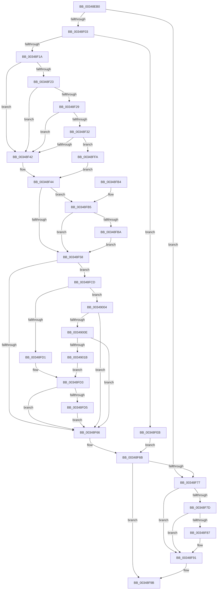

# MiQueuePageAccessLog

- RVA: `0x00348EB0`–`0x00349027` (길이 `375` bytes)
- VA: `0x0000000140348EB0`
- 실행 섹션: `.text`
- PDB 이름 있음: `예`; PDB Function 태그: `아니요`
- unwind 정보 RVA: `0x00072DBC`
- 디코드: `99`개 명령, `375/375` bytes 표시
- 미해석 바이트: `0` (있으면 어셈블리에 `.byte`로 보존)

> 이 문서는 커널 이미지의 기계어와 PDB 기호를 분석해 생성했습니다. 4번과 5번은 함수 원형과 자료형을 바이너리 사용 방식에서 추정한 C 해석이며 원본 소스 복구 결과는 아닙니다.

## 1. Dependencies

- 직접 호출 지점: **11**; 고유 호출 대상: **8**
- 직접 호출자로 확인된 함수: **4**
- RIP 상대 이미지 참조: **1**

### Outgoing calls
- `0x00348EFA` → [ExAcquireRundownProtection](../21/ExAcquireRundownProtection_function_00216620.md) (function, `0x00216620`)
- `0x00348F1A` → [Feature_PrefetchQueueWorkerProactivelyForProcessExit__private_IsEnabledDeviceUsageNoInline](Feature_PrefetchQueueWorkerProactivelyForProcessExit__private_IsEnabledDeviceUsageNoInline_function_0034A690.md) (function, `0x0034A690`)
- `0x00348F35` → [PfIsProcessExitingInNonSystemPartition](../48/PfIsProcessExitingInNonSystemPartition_function_00488E34.md) (function, `0x00488E34`)
- `0x00348F4A` → [ExpInterlockedPushEntrySList](../6B/ExpInterlockedPushEntrySList_function_006BA5B0.md) (function, `0x006BA5B0`)
- `0x00348F58` → [Feature_PrefetchQueueWorkerProactivelyForProcessExit__private_IsEnabledDeviceUsageNoInline](Feature_PrefetchQueueWorkerProactivelyForProcessExit__private_IsEnabledDeviceUsageNoInline_function_0034A690.md) (function, `0x0034A690`)
- `0x00348F6E` → [ExReleaseRundownProtection](ExReleaseRundownProtection_function_00349E80.md) (function, `0x00349E80`)
- `0x00348F8C` → [ObDereferenceObjectDeferDeleteWithTag](../26/ObDereferenceObjectDeferDeleteWithTag_function_00263EA0.md) (function, `0x00263EA0`)
- `0x00348F96` → [ExFreePoolWithTag](../../poolcode/B8/ExFreePoolWithTag_function_00B82870.md) (function, `0x00B82870`)
- `0x00348FC6` → [KeSetEvent](../33/KeSetEvent_function_0033F310.md) (function, `0x0033F310`)
- `0x00348FE1` → [KeSetEvent](../33/KeSetEvent_function_0033F310.md) (function, `0x0033F310`)
- `0x0034901E` → [PfIsProcessExitingInNonSystemPartition](../48/PfIsProcessExitingInNonSystemPartition_function_00488E34.md) (function, `0x00488E34`)

### Direct callers
- [MiEmptyPageAccessLog](MiEmptyPageAccessLog_function_00348700.md) at `0x003489C0`
- [MiCheckAndProcessCcAccessLog](../45/MiCheckAndProcessCcAccessLog_function_0045D1A4.md) at `0x0045D1E8`
- [MiReturnCcAccessLog](../45/MiReturnCcAccessLog_function_0045D1F8.md) at `0x0045D261`
- [MiGetCcAccessLog](../../page/93/MiGetCcAccessLog_function_0093E364.md) at `0x0093E3A6`

### Static image references
- `0x00348EDC` → RVA `0x00F0F228` (`.data`; read)

## 2. Other-region calls and transfers

- 다른 실행 섹션으로 향하는 call: **1**
  - `0x00348F96` → [ExFreePoolWithTag](../../poolcode/B8/ExFreePoolWithTag_function_00B82870.md) (`.text` → `POOLCODE`)
- 별도 외부 분기/꼬리 이동을 확인하지 못했습니다.

## 3. Assembly (complete function range)

```asm
00348EB0  48 89 5C 24 08                  mov qword ptr [rsp + 8], rbx
00348EB5  48 89 6C 24 10                  mov qword ptr [rsp + 0x10], rbp
00348EBA  48 89 74 24 18                  mov qword ptr [rsp + 0x18], rsi
00348EBF  57                              push rdi
00348EC0  41 56                           push r14
00348EC2  41 57                           push r15
00348EC4  48 83 EC 20                     sub rsp, 0x20
00348EC8  48 B8 20 03 00 00 80 F7 FF FF   movabs rax, 0xfffff78000000320
00348ED2  48 8B FA                        mov rdi, rdx
00348ED5  48 8B 00                        mov rax, qword ptr [rax]
00348ED8  48 89 42 18                     mov qword ptr [rdx + 0x18], rax
00348EDC  8B 05 46 63 BC 00               mov eax, dword ptr [rip + 0xbc6346]
00348EE2  89 42 0C                        mov dword ptr [rdx + 0xc], eax
00348EE5  48 8B 81 B8 00 00 00            mov rax, qword ptr [rcx + 0xb8]
00348EEC  48 8B 58 20                     mov rbx, qword ptr [rax + 0x20]
00348EF0  4C 8D BB D8 02 00 00            lea r15, [rbx + 0x2d8]
00348EF7  49 8B CF                        mov rcx, r15
00348EFA  E8 21 D7 EC FF                  call 0x140216620
00348EFF  84 C0                           test al, al
00348F01  74 74                           je 0x140348f77
00348F03  4C 8D B3 00 03 00 00            lea r14, [rbx + 0x300]
00348F0A  41 0F B7 2E                     movzx ebp, word ptr [r14]
00348F0E  3B AB F8 02 00 00               cmp ebp, dword ptr [rbx + 0x2f8]
00348F14  0F 83 D1 00 00 00               jae 0x140348feb
00348F1A  E8 71 17 00 00                  call 0x14034a690
00348F1F  85 C0                           test eax, eax
00348F21  74 1F                           je 0x140348f42
00348F23  83 7F 08 01                     cmp dword ptr [rdi + 8], 1
00348F27  7F 19                           jg 0x140348f42
00348F29  48 8B 57 38                     mov rdx, qword ptr [rdi + 0x38]
00348F2D  48 85 D2                        test rdx, rdx
00348F30  74 10                           je 0x140348f42
00348F32  48 8B CB                        mov rcx, rbx
00348F35  E8 FA FE 13 00                  call 0x140488e34
00348F3A  84 C0                           test al, al
00348F3C  0F 85 B8 00 00 00               jne 0x140348ffa
00348F42  33 F6                           xor esi, esi
00348F44  48 8B D7                        mov rdx, rdi
00348F47  49 8B CE                        mov rcx, r14
00348F4A  E8 61 16 37 00                  call 0x1406ba5b0
00348F4F  83 BB E4 02 00 00 00            cmp dword ptr [rbx + 0x2e4], 0
00348F56  74 5D                           je 0x140348fb5
00348F58  E8 33 17 00 00                  call 0x14034a690
00348F5D  83 BB E4 02 00 00 00            cmp dword ptr [rbx + 0x2e4], 0
00348F64  74 67                           je 0x140348fcd
00348F66  BB 01 00 00 00                  mov ebx, 1
00348F6B  49 8B CF                        mov rcx, r15
00348F6E  E8 0D 0F 00 00                  call 0x140349e80
00348F73  85 DB                           test ebx, ebx
00348F75  75 24                           jne 0x140348f9b
00348F77  83 7F 08 00                     cmp dword ptr [rdi + 8], 0
00348F7B  75 14                           jne 0x140348f91
00348F7D  48 8B 4F 38                     mov rcx, qword ptr [rdi + 0x38]
00348F81  48 83 F9 01                     cmp rcx, 1
00348F85  76 0A                           jbe 0x140348f91
00348F87  BA 4D 6D 41 4C                  mov edx, 0x4c416d4d
00348F8C  E8 0F AF F1 FF                  call 0x140263ea0
00348F91  33 D2                           xor edx, edx
00348F93  48 8B CF                        mov rcx, rdi
00348F96  E8 D5 98 83 00                  call 0x140b82870
00348F9B  48 8B 5C 24 40                  mov rbx, qword ptr [rsp + 0x40]
00348FA0  48 8B 6C 24 48                  mov rbp, qword ptr [rsp + 0x48]
00348FA5  48 8B 74 24 50                  mov rsi, qword ptr [rsp + 0x50]
00348FAA  48 83 C4 20                     add rsp, 0x20
00348FAE  41 5F                           pop r15
00348FB0  41 5E                           pop r14
00348FB2  5F                              pop rdi
00348FB3  C3                              ret
00348FB4  CC                              int3
00348FB5  83 FD 08                        cmp ebp, 8
00348FB8  72 9E                           jb 0x140348f58
00348FBA  48 8D 8B E0 02 00 00            lea rcx, [rbx + 0x2e0]
00348FC1  45 33 C0                        xor r8d, r8d
00348FC4  33 D2                           xor edx, edx
00348FC6  E8 45 63 FF FF                  call 0x14033f310
00348FCB  EB 8B                           jmp 0x140348f58
00348FCD  85 C0                           test eax, eax
00348FCF  74 33                           je 0x140349004
00348FD1  85 F6                           test esi, esi
00348FD3  74 91                           je 0x140348f66
00348FD5  45 33 C0                        xor r8d, r8d
00348FD8  48 8D 8B E0 02 00 00            lea rcx, [rbx + 0x2e0]
00348FDF  33 D2                           xor edx, edx
00348FE1  E8 2A 63 FF FF                  call 0x14033f310
00348FE6  E9 7B FF FF FF                  jmp 0x140348f66
00348FEB  F0 83 83 B0 02 00 00 64         lock add dword ptr [rbx + 0x2b0], 0x64
00348FF3  33 DB                           xor ebx, ebx
00348FF5  E9 71 FF FF FF                  jmp 0x140348f6b
00348FFA  BE 01 00 00 00                  mov esi, 1
00348FFF  E9 40 FF FF FF                  jmp 0x140348f44
00349004  83 7F 08 01                     cmp dword ptr [rdi + 8], 1
00349008  0F 8F 58 FF FF FF               jg 0x140348f66
0034900E  48 8B 57 38                     mov rdx, qword ptr [rdi + 0x38]
00349012  48 85 D2                        test rdx, rdx
00349015  0F 84 4B FF FF FF               je 0x140348f66
0034901B  48 8B CB                        mov rcx, rbx
0034901E  E8 11 FE 13 00                  call 0x140488e34
00349023  84 C0                           test al, al
00349025  EB AC                           jmp 0x140348fd3
```

## 4. C-style interpretation (structured pseudocode)

```c
__int64 __fastcall MiQueuePageAccessLog(__int64 a1, __int64 a2, int a3)
{
    __int64 result;
    __int64 v_rbx;
    __int64 v_rsi;
    __int64 v_rsp;
    unsigned __int64 v_stack_p10;
    unsigned __int64 v_stack_p18;
    unsigned __int64 v_stack_p8;

    v_stack_p8 = v_rbx;
    v_stack_p10 = v_rbp;
    v_stack_p18 = v_rsi;
    v_rsp = (v_rsp) - (32);
    *(unsigned __int64 *)(a2 + 24) = *(unsigned __int64 *)(result);
    *(unsigned int *)(a2 + 12) = (unsigned int)((unsigned int)(*(unsigned int *)(v_rip + 12346182)));
    result = ExAcquireRundownProtection(*(unsigned __int64 *)(*(unsigned __int64 *)(a1 + 184) + 32) + 728, a2, a3, a4);
    if ((unsigned __int8)(result) == 0) goto loc_00348F77;
    if (((unsigned int)(*(unsigned __int16 *)(*(unsigned __int64 *)(*(unsigned __int64 *)(a1 + 184) + 32) + 768))) >= (*(unsigned int *)(*(unsigned __int64 *)(*(unsigned __int64 *)(a1 + 184) + 32) + 760))) goto loc_00348FEB;
    result = Feature_PrefetchQueueWorkerProactivelyForProcessExit__private_IsEnabledDeviceUsageNoInline(*(unsigned __int64 *)(*(unsigned __int64 *)(a1 + 184) + 32) + 728, a2, a3, a4);
    if ((unsigned int)(result) == 0) goto loc_00348F42;
    if ((*(unsigned int *)(a2 + 8)) > 1) goto loc_00348F42;
    if (*(unsigned __int64 *)(a2 + 56) == 0) goto loc_00348F42;
    result = PfIsProcessExitingInNonSystemPartition(*(unsigned __int64 *)(*(unsigned __int64 *)(a1 + 184) + 32), *(unsigned __int64 *)(a2 + 56), a3, a4);
    if ((unsigned __int8)(result) != 0) goto loc_00348FFA;
loc_00348F42:
    v_rsi = 0;
loc_00348F44:
    result = ExpInterlockedPushEntrySList(*(unsigned __int64 *)(*(unsigned __int64 *)(a1 + 184) + 32) + 768, a2, a3, a4);
    if ((*(unsigned int *)(*(unsigned __int64 *)(*(unsigned __int64 *)(a1 + 184) + 32) + 740)) == 0) goto loc_00348FB5;
loc_00348F58:
    result = Feature_PrefetchQueueWorkerProactivelyForProcessExit__private_IsEnabledDeviceUsageNoInline(*(unsigned __int64 *)(*(unsigned __int64 *)(a1 + 184) + 32) + 768, a2, a3, a4);
    if ((*(unsigned int *)(*(unsigned __int64 *)(*(unsigned __int64 *)(a1 + 184) + 32) + 740)) == 0) goto loc_00348FCD;
loc_00348F66:
loc_00348F6B:
    result = ExReleaseRundownProtection(*(unsigned __int64 *)(*(unsigned __int64 *)(a1 + 184) + 32) + 728, a2, a3, a4);
    if (1 != 0) goto loc_00348F9B;
loc_00348F77:
    if ((*(unsigned int *)(a2 + 8)) != 0) goto loc_00348F91;
    if ((*(unsigned __int64 *)(a2 + 56)) >= = 1) {
        a2 = 0x4C416D4DULL;
        result = ObDereferenceObjectDeferDeleteWithTag(*(unsigned __int64 *)(a2 + 56), a2, a3, a4);
    }
    a2 = 0;
    result = ExFreePoolWithTag(0, a2, a3, a4);
loc_00348F9B:
    v_rsp = (v_rsp) + (32);
    return result;
loc_00348FB5:
    if (((unsigned int)(v_stack_p10)) < 8) goto loc_00348F58;
    a3 = 0;
    a2 = 0;
    result = KeSetEvent(v_stack_p8 + 736, a2, a3, a4);
    goto loc_00348F58;
loc_00348FCD:
    if ((unsigned int)(result) == 0) goto loc_00349004;
loc_00348FD3:
    if ((unsigned int)(v_stack_p18) == 0) goto loc_00348F66;
    a3 = 0;
    a2 = 0;
    result = KeSetEvent(v_stack_p8 + 736, a2, a3, a4);
    goto loc_00348F66;
loc_00348FEB:
    v_rbx = 0;
    goto loc_00348F6B;
loc_00348FFA:
    goto loc_00348F44;
loc_00349004:
    if ((*(unsigned int *)(a2 + 8)) > 1) goto loc_00348F66;
    if (*(unsigned __int64 *)(a2 + 56) == 0) goto loc_00348F66;
    result = PfIsProcessExitingInNonSystemPartition(0, *(unsigned __int64 *)(a2 + 56), a3, a4);
    goto loc_00348FD3;
}
```

## 5. (Beta) C Style

```c
int64_t MiQueuePageAccessLog(void *Arg1, void *Arg2, int32_t Arg3)
{
    uint8_t *arg1 = (uint8_t *)Arg1;
    uint8_t *arg2 = (uint8_t *)Arg2;

    int64_t result;
    int64_t local_rbx;
    int64_t local_rsi;
    int64_t local_rsp;
    uint64_t v_stack_p10;
    uint64_t v_stack_p18;
    uint64_t v_stack_p8;

    v_stack_p8 = local_rbx;
    v_stack_p10 = local_rbp;
    v_stack_p18 = local_rsi;
    local_rsp = (local_rsp) - (32);
    *(uint64_t *)(arg2 + 0x18) = *(uint64_t *)(result);
    *(uint32_t *)(arg2 + 0xC) = (uint32_t)((uint32_t)(*(uint32_t *)(v_rip + 0xBC6346)));
    result = ExAcquireRundownProtection(*(uint64_t *)(*(uint64_t *)(arg1 + 0xB8) + 0x20) + 728, Arg2, Arg3, a4);
    if ((uint8_t)(result) == 0) goto loc_00348F77;
    if (((uint32_t)(*(uint16_t *)(*(uint64_t *)(*(uint64_t *)(arg1 + 0xB8) + 0x20) + 0x300))) >= (*(uint32_t *)(*(uint64_t *)(*(uint64_t *)(arg1 + 0xB8) + 0x20) + 0x2F8))) goto loc_00348FEB;
    result = Feature_PrefetchQueueWorkerProactivelyForProcessExit__private_IsEnabledDeviceUsageNoInline(*(uint64_t *)(*(uint64_t *)(arg1 + 0xB8) + 0x20) + 728, Arg2, Arg3, a4);
    if ((uint32_t)(result) == 0) goto loc_00348F42;
    if ((*(uint32_t *)(arg2 + 0x8)) > 1) goto loc_00348F42;
    if (*(uint64_t *)(arg2 + 0x38) == 0) goto loc_00348F42;
    result = PfIsProcessExitingInNonSystemPartition(*(uint64_t *)(*(uint64_t *)(arg1 + 0xB8) + 0x20), *(uint64_t *)(arg2 + 0x38), Arg3, a4);
    if ((uint8_t)(result) != 0) goto loc_00348FFA;
loc_00348F42:
    local_rsi = 0;
loc_00348F44:
    result = ExpInterlockedPushEntrySList(*(uint64_t *)(*(uint64_t *)(arg1 + 0xB8) + 0x20) + 768, Arg2, Arg3, a4);
    if ((*(uint32_t *)(*(uint64_t *)(*(uint64_t *)(arg1 + 0xB8) + 0x20) + 0x2E4)) == 0) goto loc_00348FB5;
loc_00348F58:
    result = Feature_PrefetchQueueWorkerProactivelyForProcessExit__private_IsEnabledDeviceUsageNoInline(*(uint64_t *)(*(uint64_t *)(arg1 + 0xB8) + 0x20) + 768, Arg2, Arg3, a4);
    if ((*(uint32_t *)(*(uint64_t *)(*(uint64_t *)(arg1 + 0xB8) + 0x20) + 0x2E4)) == 0) goto loc_00348FCD;
loc_00348F66:
loc_00348F6B:
    result = ExReleaseRundownProtection(*(uint64_t *)(*(uint64_t *)(arg1 + 0xB8) + 0x20) + 728, Arg2, Arg3, a4);
    if (1 != 0) goto loc_00348F9B;
loc_00348F77:
    if ((*(uint32_t *)(arg2 + 0x8)) != 0) goto loc_00348F91;
    if ((*(uint64_t *)(arg2 + 0x38)) >= = 1) {
        Arg2 = 0x4C416D4DULL;
        result = ObDereferenceObjectDeferDeleteWithTag(*(uint64_t *)(arg2 + 0x38), Arg2, Arg3, a4);
    }
    Arg2 = 0;
    result = ExFreePoolWithTag(0, Arg2, Arg3, a4);
loc_00348F9B:
    local_rsp = (local_rsp) + (32);
    return result;
loc_00348FB5:
    if (((uint32_t)(v_stack_p10)) < 8) goto loc_00348F58;
    Arg3 = 0;
    Arg2 = 0;
    result = KeSetEvent(v_stack_p8 + 736, Arg2, Arg3, a4);
    goto loc_00348F58;
loc_00348FCD:
    if ((uint32_t)(result) == 0) goto loc_00349004;
loc_00348FD3:
    if ((uint32_t)(v_stack_p18) == 0) goto loc_00348F66;
    Arg3 = 0;
    Arg2 = 0;
    result = KeSetEvent(v_stack_p8 + 736, Arg2, Arg3, a4);
    goto loc_00348F66;
loc_00348FEB:
    local_rbx = 0;
    goto loc_00348F6B;
loc_00348FFA:
    goto loc_00348F44;
loc_00349004:
    if ((*(uint32_t *)(arg2 + 0x8)) > 1) goto loc_00348F66;
    if (*(uint64_t *)(arg2 + 0x38) == 0) goto loc_00348F66;
    result = PfIsProcessExitingInNonSystemPartition(0, *(uint64_t *)(arg2 + 0x38), Arg3, a4);
    goto loc_00348FD3;
}
```

### 관측된 메모리 오프셋

구조체 형식이 확인되지 않은 접근은 인자 기준의 오프셋으로만 기록했습니다.

| 기준 인자 | 오프셋 표현 | 폭 (bit) | 접근 |
|---|---:|---:|---|
| `Arg1` | `+ 0xB8` | `64` | `R` |
| `Arg2` | `+ 0x8` | `32` | `R` |
| `Arg2` | `+ 0xC` | `32` | `W` |
| `Arg2` | `+ 0x18` | `64` | `W` |
| `Arg2` | `+ 0x38` | `64` | `R` |

## 6. Execution-region graph

[열기: 2D/3D 그래프와 함수 탐색 컨트롤 패널](../../../control-panel.html?section=text&rva=0x00348EB0&view=graph)

- 2D 그래프는 위에서 아래로 흐르고, 3D 그래프는 빈 공간을 드래그해 회전합니다. Shift+드래그는 이동, 휠은 확대·축소, 함수 노드 선택은 대상 보고서 이동입니다.

### Static fallback


