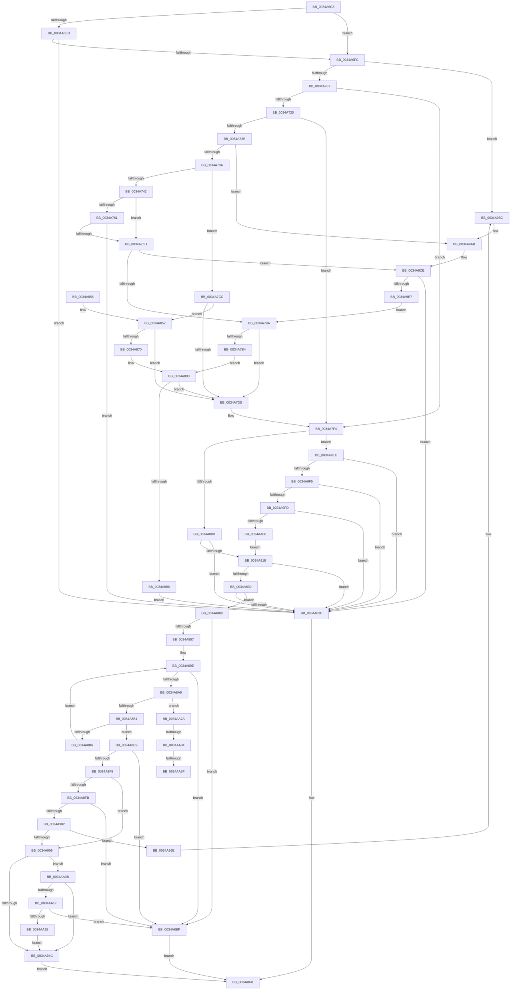

# MiRaisedIrqlFault

- RVA: `0x0034A6C8`–`0x0034AA5D` (길이 `917` bytes)
- VA: `0x000000014034A6C8`
- 실행 섹션: `.text`
- PDB 이름 있음: `예`; PDB Function 태그: `예`
- unwind 정보 RVA: `0x00078500`
- 디코드: `223`개 명령, `917/917` bytes 표시
- 미해석 바이트: `0` (있으면 어셈블리에 `.byte`로 보존)

> 이 문서는 커널 이미지의 기계어와 PDB 기호를 분석해 생성했습니다. 4번과 5번은 함수 원형과 자료형을 바이너리 사용 방식에서 추정한 C 해석이며 원본 소스 복구 결과는 아닙니다.

## 1. Dependencies

- 직접 호출 지점: **11**; 고유 호출 대상: **6**
- 직접 호출자로 확인된 함수: **1**
- RIP 상대 이미지 참조: **0**

### Outgoing calls
- `0x0034A6EF` → [KeInvalidAccessAllowed](KeInvalidAccessAllowed_function_0034B3F0.md) (function, `0x0034B3F0`)
- `0x0034A7EE` → [KeBugCheckEx](../4F/KeBugCheckEx_function_004FD660.md) (function, `0x004FD660`)
- `0x0034A80F` → [KeInvalidAccessAllowed](KeInvalidAccessAllowed_function_0034B3F0.md) (function, `0x0034B3F0`)
- `0x0034A827` → [MiTransientCombineAddress](MiTransientCombineAddress_function_00348C84.md) (function, `0x00348C84`)
- `0x0034A833` → [MiGenerateAccessViolation](MiGenerateAccessViolation_function_0034B50C.md) (function, `0x0034B50C`)
- `0x0034A912` → [MiCheckSystemNxFault](../4A/MiCheckSystemNxFault_function_004A44C0.md) (function, `0x004A44C0`)
- `0x0034A962` → [MiNoFaultFound](../41/MiNoFaultFound_function_0041BB20.md) (function, `0x0041BB20`)
- `0x0034A986` → [KeBugCheckEx](../4F/KeBugCheckEx_function_004FD660.md) (function, `0x004FD660`)
- `0x0034A9A5` → [KeBugCheckEx](../4F/KeBugCheckEx_function_004FD660.md) (function, `0x004FD660`)
- `0x0034A9C8` → [KeBugCheckEx](../4F/KeBugCheckEx_function_004FD660.md) (function, `0x004FD660`)
- `0x0034AA57` → [KeBugCheckEx](../4F/KeBugCheckEx_function_004FD660.md) (function, `0x004FD660`)

### Direct callers
- [sub_0027F1E6](../27/Unknown_function_0027F1E6.md) at `0x0027F1EB`

### Static image references
- 디코드된 RIP-relative 메모리 참조가 없습니다.

## 2. Other-region calls and transfers

- 다른 실행 섹션으로 향하는 call: **0**
- call이 아닌 외부 분기/꼬리 이동: **2**
  - `0x0034AA2E` → [sub_006E2130](../6E/Unknown_function_006E2130.md) (`tail-transfer`)
  - `0x0034AA39` → [sub_006E2130](../6E/Unknown_function_006E2130.md) (`tail-transfer`)

## 3. Assembly (complete function range)

```asm
0034A6C8  48 89 5C 24 08                  mov qword ptr [rsp + 8], rbx
0034A6CD  48 89 6C 24 10                  mov qword ptr [rsp + 0x10], rbp
0034A6D2  48 89 74 24 18                  mov qword ptr [rsp + 0x18], rsi
0034A6D7  57                              push rdi
0034A6D8  48 83 EC 30                     sub rsp, 0x30
0034A6DC  48 8B F9                        mov rdi, rcx
0034A6DF  BD 01 00 00 00                  mov ebp, 1
0034A6E4  48 8B 49 10                     mov rcx, qword ptr [rcx + 0x10]
0034A6E8  40 84 CD                        test bpl, cl
0034A6EB  75 0F                           jne 0x14034a6fc
0034A6ED  8B D5                           mov edx, ebp
0034A6EF  E8 FC 0C 00 00                  call 0x14034b3f0
0034A6F4  84 C0                           test al, al
0034A6F6  0F 85 40 01 00 00               jne 0x14034a83c
0034A6FC  8B 47 50                        mov eax, dword ptr [rdi + 0x50]
0034A6FF  84 C0                           test al, al
0034A701  0F 88 85 02 00 00               js 0x14034a98c
0034A707  65 48 8B 04 25 20 00 00 00      mov rax, qword ptr gs:[0x20]
0034A710  48 8B 88 38 88 00 00            mov rcx, qword ptr [rax + 0x8838]
0034A717  48 85 C9                        test rcx, rcx
0034A71A  0F 84 D4 00 00 00               je 0x14034a7f4
0034A720  8B 89 40 01 00 00               mov ecx, dword ptr [rcx + 0x140]
0034A726  85 C9                           test ecx, ecx
0034A728  0F 84 C6 00 00 00               je 0x14034a7f4
0034A72E  44 0F 20 C0                     mov rax, cr8
0034A732  3C 02                           cmp al, 2
0034A734  0F 85 71 02 00 00               jne 0x14034a9ab
0034A73A  3B CD                           cmp ecx, ebp
0034A73C  0F 85 8A 00 00 00               jne 0x14034a7cc
0034A742  4C 8B 07                        mov r8, qword ptr [rdi]
0034A745  49 BA 00 00 00 40 FB F6 FF FF   movabs r10, 0xfffff6fb40000000
0034A74F  49 8B C2                        mov rax, r10
0034A752  49 BB FF FF FF 7F FB F6 FF FF   movabs r11, 0xfffff6fb7fffffff
0034A75C  4C 3B C0                        cmp r8, rax
0034A75F  72 0C                           jb 0x14034a76d
0034A761  49 8B C3                        mov rax, r11
0034A764  4C 3B C0                        cmp r8, rax
0034A767  0F 86 CF 00 00 00               jbe 0x14034a83c
0034A76D  49 8B CA                        mov rcx, r10
0034A770  48 C1 E9 09                     shr rcx, 9
0034A774  49 B9 F8 FF FF FF 7F 00 00 00   movabs r9, 0x7ffffffff8
0034A77E  49 23 C9                        and rcx, r9
0034A781  48 BA 00 00 00 00 80 F6 FF FF   movabs rdx, 0xfffff68000000000
0034A78B  48 8B C2                        mov rax, rdx
0034A78E  48 03 C8                        add rcx, rax
0034A791  4C 3B C1                        cmp r8, rcx
0034A794  0F 83 34 02 00 00               jae 0x14034a9ce
0034A79A  49 8B CA                        mov rcx, r10
0034A79D  48 C1 E9 12                     shr rcx, 0x12
0034A7A1  BA F8 FF FF 3F                  mov edx, 0x3ffffff8
0034A7A6  48 23 CA                        and rcx, rdx
0034A7A9  49 8B C2                        mov rax, r10
0034A7AC  48 03 C8                        add rcx, rax
0034A7AF  4C 3B C1                        cmp r8, rcx
0034A7B2  72 21                           jb 0x14034a7d5
0034A7B4  49 8B CB                        mov rcx, r11
0034A7B7  48 C1 E9 12                     shr rcx, 0x12
0034A7BB  48 23 CA                        and rcx, rdx
0034A7BE  49 8B C2                        mov rax, r10
0034A7C1  48 03 C8                        add rcx, rax
0034A7C4  4C 3B C1                        cmp r8, rcx
0034A7C7  E9 B4 00 00 00                  jmp 0x14034a880
0034A7CC  83 F9 02                        cmp ecx, 2
0034A7CF  0F 84 82 00 00 00               je 0x14034a857
0034A7D5  4C 8B 4F 10                     mov r9, qword ptr [rdi + 0x10]
0034A7D9  B9 50 00 00 00                  mov ecx, 0x50
0034A7DE  4C 8B 47 08                     mov r8, qword ptr [rdi + 8]
0034A7E2  48 8B 17                        mov rdx, qword ptr [rdi]
0034A7E5  48 C7 44 24 20 0B 00 00 00      mov qword ptr [rsp + 0x20], 0xb
0034A7EE  E8 6D 2E 1B 00                  call 0x1404fd660
0034A7F3  CC                              int3
0034A7F4  48 8B 4F 10                     mov rcx, qword ptr [rdi + 0x10]
0034A7F8  BB 03 00 00 00                  mov ebx, 3
0034A7FD  48 8B C1                        mov rax, rcx
0034A800  48 83 E0 FE                     and rax, 0xfffffffffffffffe
0034A804  40 84 CD                        test bpl, cl
0034A807  0F 85 DF 01 00 00               jne 0x14034a9ec
0034A80D  33 D2                           xor edx, edx
0034A80F  E8 DC 0B 00 00                  call 0x14034b3f0
0034A814  84 C0                           test al, al
0034A816  75 24                           jne 0x14034a83c
0034A818  65 48 8B 0C 25 88 01 00 00      mov rcx, qword ptr gs:[0x188]
0034A821  44 8B C5                        mov r8d, ebp
0034A824  48 8B 17                        mov rdx, qword ptr [rdi]
0034A827  E8 58 E4 FF FF                  call 0x140348c84
0034A82C  85 C0                           test eax, eax
0034A82E  75 0C                           jne 0x14034a83c
0034A830  48 8B CF                        mov rcx, rdi
0034A833  E8 D4 0C 00 00                  call 0x14034b50c
0034A838  85 C0                           test eax, eax
0034A83A  74 4C                           je 0x14034a888
0034A83C  B8 05 00 00 C0                  mov eax, 0xc0000005
0034A841  48 8B 5C 24 40                  mov rbx, qword ptr [rsp + 0x40]
0034A846  48 8B 6C 24 48                  mov rbp, qword ptr [rsp + 0x48]
0034A84B  48 8B 74 24 50                  mov rsi, qword ptr [rsp + 0x50]
0034A850  48 83 C4 30                     add rsp, 0x30
0034A854  5F                              pop rdi
0034A855  C3                              ret
0034A856  CC                              int3
0034A857  48 8B 0F                        mov rcx, qword ptr [rdi]
0034A85A  48 BA 00 00 00 00 80 F6 FF FF   movabs rdx, 0xfffff68000000000
0034A864  48 8B C2                        mov rax, rdx
0034A867  48 3B C8                        cmp rcx, rax
0034A86A  0F 82 65 FF FF FF               jb 0x14034a7d5
0034A870  48 B8 FF FF FF FF FF F6 FF FF   movabs rax, 0xfffff6ffffffffff
0034A87A  48 8B C0                        mov rax, rax
0034A87D  48 3B C8                        cmp rcx, rax
0034A880  0F 87 4F FF FF FF               ja 0x14034a7d5
0034A886  EB B4                           jmp 0x14034a83c
0034A888  48 B8 00 00 00 00 00 80 FF FF   movabs rax, 0xffff800000000000
0034A892  48 39 07                        cmp qword ptr [rdi], rax
0034A895  72 28                           jb 0x14034a8bf
0034A897  48 8B C3                        mov rax, rbx
0034A89A  48 8D 4F 30                     lea rcx, [rdi + 0x30]
0034A89E  48 8B 11                        mov rdx, qword ptr [rcx]
0034A8A1  48 8B 12                        mov rdx, qword ptr [rdx]
0034A8A4  40 84 D5                        test bpl, dl
0034A8A7  74 16                           je 0x14034a8bf
0034A8A9  84 D2                           test dl, dl
0034A8AB  0F 88 79 01 00 00               js 0x14034aa2a
0034A8B1  48 85 C0                        test rax, rax
0034A8B4  74 13                           je 0x14034a8c9
0034A8B6  48 2B C5                        sub rax, rbp
0034A8B9  48 83 E9 08                     sub rcx, 8
0034A8BD  EB DF                           jmp 0x14034a89e
0034A8BF  B8 06 00 00 D0                  mov eax, 0xd0000006
0034A8C4  E9 78 FF FF FF                  jmp 0x14034a841
0034A8C9  48 8B 37                        mov rsi, qword ptr [rdi]
0034A8CC  49 B9 F8 FF FF FF 7F 00 00 00   movabs r9, 0x7ffffffff8
0034A8D6  48 C1 EE 09                     shr rsi, 9
0034A8DA  49 23 F1                        and rsi, r9
0034A8DD  48 BA 00 00 00 00 80 F6 FF FF   movabs rdx, 0xfffff68000000000
0034A8E7  48 8B C2                        mov rax, rdx
0034A8EA  48 03 F0                        add rsi, rax
0034A8ED  48 8B 1E                        mov rbx, qword ptr [rsi]
0034A8F0  40 84 DD                        test bpl, bl
0034A8F3  74 CA                           je 0x14034a8bf
0034A8F5  F6 47 08 02                     test byte ptr [rdi + 8], 2
0034A8F9  74 0E                           je 0x14034a909
0034A8FB  48 0F BA E3 09                  bt rbx, 9
0034A900  72 BD                           jb 0x14034a8bf
0034A902  48 0F BA E3 0B                  bt rbx, 0xb
0034A907  73 65                           jae 0x14034a96e
0034A909  45 33 C0                        xor r8d, r8d
0034A90C  48 8B D3                        mov rdx, rbx
0034A90F  48 8B CF                        mov rcx, rdi
0034A912  E8 A9 9B 15 00                  call 0x1404a44c0
0034A917  48 B9 FF FF FF FF FF 00 00 00   movabs rcx, 0xffffffffff
0034A921  48 8B C3                        mov rax, rbx
0034A924  48 C1 E8 0C                     shr rax, 0xc
0034A928  48 23 C1                        and rax, rcx
0034A92B  48 8D 0C 40                     lea rcx, [rax + rax*2]
0034A92F  48 C1 E1 04                     shl rcx, 4
0034A933  48 B8 00 00 00 00 00 DE FF FF   movabs rax, 0xffffde0000000000
0034A93D  48 03 C8                        add rcx, rax
0034A940  8B 41 20                        mov eax, dword ptr [rcx + 0x20]
0034A943  66 3B C5                        cmp ax, bp
0034A946  0F 86 BF 00 00 00               jbe 0x14034aa0b
0034A94C  4C 8B 4F 10                     mov r9, qword ptr [rdi + 0x10]
0034A950  48 8B D6                        mov rdx, rsi
0034A953  4C 8B 07                        mov r8, qword ptr [rdi]
0034A956  48 8B CF                        mov rcx, rdi
0034A959  48 89 5C 24 28                  mov qword ptr [rsp + 0x28], rbx
0034A95E  89 6C 24 20                     mov dword ptr [rsp + 0x20], ebp
0034A962  E8 B9 11 0D 00                  call 0x14041bb20
0034A967  33 C0                           xor eax, eax
0034A969  E9 D3 FE FF FF                  jmp 0x14034a841
0034A96E  4C 8B 4F 10                     mov r9, qword ptr [rdi + 0x10]
0034A972  4C 8B C3                        mov r8, rbx
0034A975  48 8B 17                        mov rdx, qword ptr [rdi]
0034A978  B9 BE 00 00 00                  mov ecx, 0xbe
0034A97D  48 C7 44 24 20 0A 00 00 00      mov qword ptr [rsp + 0x20], 0xa
0034A986  E8 D5 2C 1B 00                  call 0x1404fd660
0034A98B  CC                              int3
0034A98C  4C 8B 4F 10                     mov r9, qword ptr [rdi + 0x10]
0034A990  B9 50 00 00 00                  mov ecx, 0x50
0034A995  4C 8B 47 08                     mov r8, qword ptr [rdi + 8]
0034A999  48 8B 17                        mov rdx, qword ptr [rdi]
0034A99C  48 C7 44 24 20 0E 00 00 00      mov qword ptr [rsp + 0x20], 0xe
0034A9A5  E8 B6 2C 1B 00                  call 0x1404fd660
0034A9AA  CC                              int3
0034A9AB  44 0F 20 C0                     mov rax, cr8
0034A9AF  4C 8B 47 08                     mov r8, qword ptr [rdi + 8]
0034A9B3  B9 50 00 00 00                  mov ecx, 0x50
0034A9B8  48 8B 17                        mov rdx, qword ptr [rdi]
0034A9BB  44 0F B6 C8                     movzx r9d, al
0034A9BF  48 C7 44 24 20 0A 00 00 00      mov qword ptr [rsp + 0x20], 0xa
0034A9C8  E8 93 2C 1B 00                  call 0x1404fd660
0034A9CD  CC                              int3
0034A9CE  49 8B CB                        mov rcx, r11
0034A9D1  48 C1 E9 09                     shr rcx, 9
0034A9D5  49 23 C9                        and rcx, r9
0034A9D8  48 8B C2                        mov rax, rdx
0034A9DB  48 03 C8                        add rcx, rax
0034A9DE  4C 3B C1                        cmp r8, rcx
0034A9E1  0F 86 55 FE FF FF               jbe 0x14034a83c
0034A9E7  E9 AE FD FF FF                  jmp 0x14034a79a
0034A9EC  40 38 28                        cmp byte ptr [rax], bpl
0034A9EF  0F 84 47 FE FF FF               je 0x14034a83c
0034A9F5  38 18                           cmp byte ptr [rax], bl
0034A9F7  0F 84 3F FE FF FF               je 0x14034a83c
0034A9FD  80 38 06                        cmp byte ptr [rax], 6
0034AA00  0F 84 36 FE FF FF               je 0x14034a83c
0034AA06  E9 0D FE FF FF                  jmp 0x14034a818
0034AA0B  48 8B 01                        mov rax, qword ptr [rcx]
0034AA0E  40 84 C5                        test bpl, al
0034AA11  0F 84 35 FF FF FF               je 0x14034a94c
0034AA17  8B 41 20                        mov eax, dword ptr [rcx + 0x20]
0034AA1A  C1 E8 18                        shr eax, 0x18
0034AA1D  A8 08                           test al, 8
0034AA1F  0F 84 9A FE FF FF               je 0x14034a8bf
0034AA25  E9 22 FF FF FF                  jmp 0x14034a94c
0034AA2A  F6 47 08 02                     test byte ptr [rdi + 8], 2
0034AA2E  0F 84 FC 76 39 00               je 0x1406e2130
0034AA34  48 0F BA E2 0B                  bt rdx, 0xb
0034AA39  0F 82 F1 76 39 00               jb 0x1406e2130
0034AA3F  4C 8B 4F 10                     mov r9, qword ptr [rdi + 0x10]
0034AA43  4C 8B C2                        mov r8, rdx
0034AA46  48 8B 17                        mov rdx, qword ptr [rdi]
0034AA49  B9 BE 00 00 00                  mov ecx, 0xbe
0034AA4E  48 C7 44 24 20 0F 00 00 00      mov qword ptr [rsp + 0x20], 0xf
0034AA57  E8 04 2C 1B 00                  call 0x1404fd660
0034AA5C  CC                              int3
```

## 4. C-style interpretation (structured pseudocode)

```c
__int64 __fastcall MiRaisedIrqlFault(__int64 a1)
{
    __int64 result;
    __int64 v_rsi;
    __int64 v_rsp;
    unsigned __int64 v_stack_m18;
    unsigned __int64 v_stack_p10;
    unsigned __int64 v_stack_p18;
    unsigned int v_stack_p20;
    unsigned __int64 v_stack_p28;
    unsigned __int64 v_stack_p8;

    v_stack_p8 = v_rbx;
    v_stack_p10 = v_rbp;
    v_stack_p18 = v_rsi;
    v_rsp = (v_rsp) - (48);
    if (((1) & ((unsigned __int8)(*(unsigned __int64 *)(a1 + 16)))) != 0) goto loc_0034A6FC;
    result = KeInvalidAccessAllowed(*(unsigned __int64 *)(a1 + 16), 1, a3, a4);
    if ((unsigned __int8)(result) != 0) goto loc_0034A83C;
loc_0034A6FC:
    if (sign_flag) goto loc_0034A98C;
    if (*(unsigned __int64 *)(*(unsigned __int64 *)(gs_base + (0 + 32)) + 34872) == 0) goto loc_0034A7F4;
    if ((unsigned int)((unsigned int)(*(unsigned int *)(*(unsigned __int64 *)(*(unsigned __int64 *)(gs_base + (0 + 32)) + 34872) + 320))) == 0) goto loc_0034A7F4;
    if (((unsigned __int8)(v_cr8)) != 2) goto loc_0034A9AB;
    if (((unsigned int)((unsigned int)(*(unsigned int *)(*(unsigned __int64 *)(*(unsigned __int64 *)(gs_base + (0 + 32)) + 34872) + 320)))) != 1) goto loc_0034A7CC;
    if ((*(unsigned __int64 *)(a1)) < v_r10) goto loc_0034A76D;
    if ((*(unsigned __int64 *)(a1)) <= v_r11) goto loc_0034A83C;
loc_0034A76D:
    a1 = (v_r10) >> (9);
    a1 = (a1) & (a4);
    a1 = (a1) + (1);
    if ((*(unsigned __int64 *)(a1)) >= a1) goto loc_0034A9CE;
loc_0034A79A:
    a1 = (v_r10) >> (18);
    a1 = (a1) & ((unsigned int)(0x3FFFFFF8ULL));
    a1 = (a1) + (v_r10);
    if ((*(unsigned __int64 *)(a1)) < a1) goto loc_0034A7D5;
    a1 = (v_r11) >> (18);
    a1 = (a1) & ((unsigned int)(0x3FFFFFF8ULL));
    a1 = (a1) + (v_r10);
    goto loc_0034A880;
loc_0034A7CC:
    if (((unsigned int)(a1)) == 2) goto loc_0034A857;
loc_0034A7D5:
    v_stack_m18 = 11;
    result = KeBugCheckEx(80, *(unsigned __int64 *)(a1), *(unsigned __int64 *)(a1 + 8), *(unsigned __int64 *)(a1 + 16));
loc_0034A7F4:
    result = (*(unsigned __int64 *)(a1 + 16)) & (-2);
    if (((1) & ((unsigned __int8)(*(unsigned __int64 *)(a1 + 16)))) != 0) goto loc_0034A9EC;
    a2 = 0;
    result = KeInvalidAccessAllowed(*(unsigned __int64 *)(a1 + 16), a2, *(unsigned __int64 *)(a1 + 8), *(unsigned __int64 *)(a1 + 16));
    if ((unsigned __int8)(result) != 0) goto loc_0034A83C;
loc_0034A818:
    result = MiTransientCombineAddress(*(unsigned __int64 *)(gs_base + (0 + 392)), *(unsigned __int64 *)(a1), 1, *(unsigned __int64 *)(a1 + 16));
    if ((unsigned int)(result) != 0) goto loc_0034A83C;
    result = MiGenerateAccessViolation(a1, *(unsigned __int64 *)(a1), 1, *(unsigned __int64 *)(a1 + 16));
    if ((unsigned int)(result) == 0) goto loc_0034A888;
loc_0034A83C:
loc_0034A841:
    v_rsp = (v_rsp) + (48);
    return (unsigned int)(0xC0000005ULL);
loc_0034A857:
    if ((*(unsigned __int64 *)(a1)) < (*(unsigned __int64 *)(a1))) goto loc_0034A7D5;
loc_0034A880:
    if ((*(unsigned __int64 *)(a1)) > (*(unsigned __int64 *)(a1))) goto loc_0034A7D5;
    goto loc_0034A83C;
loc_0034A888:
    if ((*(unsigned __int64 *)(a1)) < (*(unsigned __int64 *)(a1))) goto loc_0034A8BF;
loc_0034A89E:
    if ((((unsigned __int8)(v_stack_p10)) & ((unsigned __int8)(*(unsigned __int64 *)(*(unsigned __int64 *)(a1 + 48))))) == 0) goto loc_0034A8BF;
    if (sign_flag) goto loc_0034AA2A;
    if (v_stack_p8 == 0) goto loc_0034A8C9;
    result = (v_stack_p8) - (v_stack_p10);
    a1 = (a1 + 48) - (8);
    goto loc_0034A89E;
loc_0034A8BF:
    goto loc_0034A841;
loc_0034A8C9:
    v_rsi = (*(unsigned __int64 *)(a1)) >> (9);
    v_rsi = (v_rsi) & (*(unsigned __int64 *)(a1 + 16));
    v_rsi = (v_rsi) + (*(unsigned __int64 *)(*(unsigned __int64 *)(a1 + 48)));
    if ((((unsigned __int8)(v_stack_p10)) & ((unsigned __int8)(*(unsigned __int64 *)(v_rsi)))) == 0) goto loc_0034A8BF;
    if (((*(unsigned __int8 *)(a1 + 8)) & (2)) == 0) goto loc_0034A909;
    if (condition_is_below) goto loc_0034A8BF;
    if (condition_is_above_or_equal) goto loc_0034A96E;
loc_0034A909:
    a3 = 0;
    result = MiCheckSystemNxFault(a1, *(unsigned __int64 *)(v_rsi), a3, *(unsigned __int64 *)(a1 + 16));
    result = (*(unsigned __int64 *)(v_rsi)) >> (12);
    result = (result) & (a1);
    a1 = (result + result * 2) << (4);
    a1 = (a1) + (result);
    if (((unsigned __int16)((unsigned int)(*(unsigned int *)(a1 + 32)))) <= ((unsigned __int16)(v_stack_p10))) goto loc_0034AA0B;
loc_0034A94C:
    v_stack_p28 = *(unsigned __int64 *)(v_rsi);
    v_stack_p20 = (unsigned int)(v_stack_p10);
    result = MiNoFaultFound(a1, v_rsi, *(unsigned __int64 *)(a1), *(unsigned __int64 *)(a1 + 16));
    result = 0;
    goto loc_0034A841;
loc_0034A96E:
    v_stack_p20 = 10;
    result = KeBugCheckEx(190, *(unsigned __int64 *)(a1), *(unsigned __int64 *)(v_rsi), *(unsigned __int64 *)(a1 + 16));
loc_0034A98C:
    v_stack_p20 = 14;
    result = KeBugCheckEx(80, *(unsigned __int64 *)(a1), *(unsigned __int64 *)(a1 + 8), *(unsigned __int64 *)(a1 + 16));
loc_0034A9AB:
    v_stack_p20 = 10;
    result = KeBugCheckEx(80, *(unsigned __int64 *)(a1), *(unsigned __int64 *)(a1 + 8), (unsigned __int8)(v_cr8));
loc_0034A9CE:
    a1 = (v_r11) >> (9);
    a1 = (a1) & ((unsigned __int8)(v_cr8));
    a1 = (a1) + (*(unsigned __int64 *)(a1));
    if ((*(unsigned __int64 *)(a1 + 8)) <= a1) goto loc_0034A83C;
    goto loc_0034A79A;
loc_0034A9EC:
    if ((*(unsigned __int8 *)(*(unsigned __int64 *)(a1))) == ((unsigned __int8)(v_stack_p10))) goto loc_0034A83C;
    if ((*(unsigned __int8 *)(*(unsigned __int64 *)(a1))) == ((unsigned __int8)(*(unsigned __int64 *)(v_rsi)))) goto loc_0034A83C;
    if ((*(unsigned __int8 *)(*(unsigned __int64 *)(a1))) == 6) goto loc_0034A83C;
    goto loc_0034A818;
loc_0034AA0B:
    if ((((unsigned __int8)(v_stack_p10)) & ((unsigned __int8)(*(unsigned __int64 *)(a1)))) == 0) goto loc_0034A94C;
    result = (unsigned int)(((unsigned int)(*(unsigned int *)(a1 + 32))) >> (24));
    if ((((unsigned __int8)(result)) & (8)) == 0) goto loc_0034A8BF;
    goto loc_0034A94C;
loc_0034AA2A:
    v_stack_p20 = 15;
    result = KeBugCheckEx(190, *(unsigned __int64 *)(a1), *(unsigned __int64 *)(a1), *(unsigned __int64 *)(a1 + 16));
    return result;
}
```

## 5. (Beta) C Style

```c
int64_t MiRaisedIrqlFault(void *Arg1)
{
    uint8_t *arg1 = (uint8_t *)Arg1;

    int64_t result;
    int64_t local_rsi;
    int64_t local_rsp;
    uint64_t v_stack_m18;
    uint64_t v_stack_p10;
    uint64_t v_stack_p18;
    uint32_t v_stack_p20;
    uint64_t v_stack_p28;
    uint64_t v_stack_p8;

    v_stack_p8 = local_rbx;
    v_stack_p10 = local_rbp;
    v_stack_p18 = local_rsi;
    local_rsp = (local_rsp) - (48);
    if (((1) & ((uint8_t)(*(uint64_t *)(arg1 + 0x10)))) != 0) goto loc_0034A6FC;
    result = KeInvalidAccessAllowed(*(uint64_t *)(arg1 + 0x10), 1, a3, a4);
    if ((uint8_t)(result) != 0) goto loc_0034A83C;
loc_0034A6FC:
    if (sign_flag) goto loc_0034A98C;
    if (*(uint64_t *)(*(uint64_t *)(gs_base + (0 + 0x20)) + 0x8838) == 0) goto loc_0034A7F4;
    if ((uint32_t)((uint32_t)(*(uint32_t *)(*(uint64_t *)(*(uint64_t *)(gs_base + (0 + 0x20)) + 0x8838) + 0x140))) == 0) goto loc_0034A7F4;
    if (((uint8_t)(v_cr8)) != 2) goto loc_0034A9AB;
    if (((uint32_t)((uint32_t)(*(uint32_t *)(*(uint64_t *)(*(uint64_t *)(gs_base + (0 + 0x20)) + 0x8838) + 0x140)))) != 1) goto loc_0034A7CC;
    if ((*(uint64_t *)(arg1)) < local_r10) goto loc_0034A76D;
    if ((*(uint64_t *)(arg1)) <= local_r11) goto loc_0034A83C;
loc_0034A76D:
    Arg1 = (local_r10) >> (9);
    Arg1 = (Arg1) & (a4);
    Arg1 = (Arg1) + (1);
    if ((*(uint64_t *)(arg1)) >= Arg1) goto loc_0034A9CE;
loc_0034A79A:
    Arg1 = (local_r10) >> (18);
    Arg1 = (Arg1) & ((uint32_t)(0x3FFFFFF8ULL));
    Arg1 = (Arg1) + (local_r10);
    if ((*(uint64_t *)(arg1)) < Arg1) goto loc_0034A7D5;
    Arg1 = (local_r11) >> (18);
    Arg1 = (Arg1) & ((uint32_t)(0x3FFFFFF8ULL));
    Arg1 = (Arg1) + (local_r10);
    goto loc_0034A880;
loc_0034A7CC:
    if (((uint32_t)(Arg1)) == 2) goto loc_0034A857;
loc_0034A7D5:
    v_stack_m18 = 11;
    result = KeBugCheckEx(80, *(uint64_t *)(arg1), *(uint64_t *)(arg1 + 0x8), *(uint64_t *)(arg1 + 0x10));
loc_0034A7F4:
    result = (*(uint64_t *)(arg1 + 0x10)) & (-2);
    if (((1) & ((uint8_t)(*(uint64_t *)(arg1 + 0x10)))) != 0) goto loc_0034A9EC;
    a2 = 0;
    result = KeInvalidAccessAllowed(*(uint64_t *)(arg1 + 0x10), a2, *(uint64_t *)(arg1 + 0x8), *(uint64_t *)(arg1 + 0x10));
    if ((uint8_t)(result) != 0) goto loc_0034A83C;
loc_0034A818:
    result = MiTransientCombineAddress(*(uint64_t *)(gs_base + (0 + 0x188)), *(uint64_t *)(arg1), 1, *(uint64_t *)(arg1 + 0x10));
    if ((uint32_t)(result) != 0) goto loc_0034A83C;
    result = MiGenerateAccessViolation(Arg1, *(uint64_t *)(arg1), 1, *(uint64_t *)(arg1 + 0x10));
    if ((uint32_t)(result) == 0) goto loc_0034A888;
loc_0034A83C:
loc_0034A841:
    local_rsp = (local_rsp) + (48);
    return (uint32_t)(0xC0000005ULL);
loc_0034A857:
    if ((*(uint64_t *)(arg1)) < (*(uint64_t *)(arg1))) goto loc_0034A7D5;
loc_0034A880:
    if ((*(uint64_t *)(arg1)) > (*(uint64_t *)(arg1))) goto loc_0034A7D5;
    goto loc_0034A83C;
loc_0034A888:
    if ((*(uint64_t *)(arg1)) < (*(uint64_t *)(arg1))) goto loc_0034A8BF;
loc_0034A89E:
    if ((((uint8_t)(v_stack_p10)) & ((uint8_t)(*(uint64_t *)(*(uint64_t *)(arg1 + 0x30))))) == 0) goto loc_0034A8BF;
    if (sign_flag) goto loc_0034AA2A;
    if (v_stack_p8 == 0) goto loc_0034A8C9;
    result = (v_stack_p8) - (v_stack_p10);
    Arg1 = (Arg1 + 48) - (8);
    goto loc_0034A89E;
loc_0034A8BF:
    goto loc_0034A841;
loc_0034A8C9:
    local_rsi = (*(uint64_t *)(arg1)) >> (9);
    local_rsi = (local_rsi) & (*(uint64_t *)(arg1 + 0x10));
    local_rsi = (local_rsi) + (*(uint64_t *)(*(uint64_t *)(arg1 + 0x30)));
    if ((((uint8_t)(v_stack_p10)) & ((uint8_t)(*(uint64_t *)(local_rsi)))) == 0) goto loc_0034A8BF;
    if (((*(uint8_t *)(arg1 + 0x8)) & (2)) == 0) goto loc_0034A909;
    if (condition_is_below) goto loc_0034A8BF;
    if (condition_is_above_or_equal) goto loc_0034A96E;
loc_0034A909:
    a3 = 0;
    result = MiCheckSystemNxFault(Arg1, *(uint64_t *)(local_rsi), a3, *(uint64_t *)(arg1 + 0x10));
    result = (*(uint64_t *)(local_rsi)) >> (12);
    result = (result) & (Arg1);
    Arg1 = (result + result * 2) << (4);
    Arg1 = (Arg1) + (result);
    if (((uint16_t)((uint32_t)(*(uint32_t *)(arg1 + 0x20)))) <= ((uint16_t)(v_stack_p10))) goto loc_0034AA0B;
loc_0034A94C:
    v_stack_p28 = *(uint64_t *)(local_rsi);
    v_stack_p20 = (uint32_t)(v_stack_p10);
    result = MiNoFaultFound(Arg1, local_rsi, *(uint64_t *)(arg1), *(uint64_t *)(arg1 + 0x10));
    result = 0;
    goto loc_0034A841;
loc_0034A96E:
    v_stack_p20 = 10;
    result = KeBugCheckEx(190, *(uint64_t *)(arg1), *(uint64_t *)(local_rsi), *(uint64_t *)(arg1 + 0x10));
loc_0034A98C:
    v_stack_p20 = 14;
    result = KeBugCheckEx(80, *(uint64_t *)(arg1), *(uint64_t *)(arg1 + 0x8), *(uint64_t *)(arg1 + 0x10));
loc_0034A9AB:
    v_stack_p20 = 10;
    result = KeBugCheckEx(80, *(uint64_t *)(arg1), *(uint64_t *)(arg1 + 0x8), (uint8_t)(v_cr8));
loc_0034A9CE:
    Arg1 = (local_r11) >> (9);
    Arg1 = (Arg1) & ((uint8_t)(v_cr8));
    Arg1 = (Arg1) + (*(uint64_t *)(arg1));
    if ((*(uint64_t *)(arg1 + 0x8)) <= Arg1) goto loc_0034A83C;
    goto loc_0034A79A;
loc_0034A9EC:
    if ((*(uint8_t *)(*(uint64_t *)(arg1))) == ((uint8_t)(v_stack_p10))) goto loc_0034A83C;
    if ((*(uint8_t *)(*(uint64_t *)(arg1))) == ((uint8_t)(*(uint64_t *)(local_rsi)))) goto loc_0034A83C;
    if ((*(uint8_t *)(*(uint64_t *)(arg1))) == 6) goto loc_0034A83C;
    goto loc_0034A818;
loc_0034AA0B:
    if ((((uint8_t)(v_stack_p10)) & ((uint8_t)(*(uint64_t *)(arg1)))) == 0) goto loc_0034A94C;
    result = (uint32_t)(((uint32_t)(*(uint32_t *)(arg1 + 0x20))) >> (24));
    if ((((uint8_t)(result)) & (8)) == 0) goto loc_0034A8BF;
    goto loc_0034A94C;
loc_0034AA2A:
    v_stack_p20 = 15;
    result = KeBugCheckEx(190, *(uint64_t *)(arg1), *(uint64_t *)(arg1), *(uint64_t *)(arg1 + 0x10));
    return result;
}
```

### 관측된 메모리 오프셋

구조체 형식이 확인되지 않은 접근은 인자 기준의 오프셋으로만 기록했습니다.

| 기준 인자 | 오프셋 표현 | 폭 (bit) | 접근 |
|---|---:|---:|---|
| `Arg1` | `+ 0x0` | `64` | `R` |
| `Arg1` | `+ 0x8` | `8` | `R` |
| `Arg1` | `+ 0x8` | `64` | `R` |
| `Arg1` | `+ 0x10` | `64` | `R` |
| `Arg1` | `+ 0x30` | `64` | `R` |
| `Arg1` | `+ 0x50` | `32` | `R` |

## 6. Execution-region graph

[열기: 2D/3D 그래프와 함수 탐색 컨트롤 패널](../../../control-panel.html?section=text&rva=0x0034A6C8&view=graph)

- 2D 그래프는 위에서 아래로 흐르고, 3D 그래프는 빈 공간을 드래그해 회전합니다. Shift+드래그는 이동, 휠은 확대·축소, 함수 노드 선택은 대상 보고서 이동입니다.

### Static fallback


