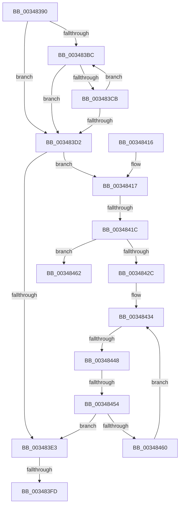

# MiReferenceControlAreaFileWithTag

- RVA: `0x00348390`–`0x0034847F` (길이 `239` bytes)
- VA: `0x0000000140348390`
- 실행 섹션: `.text`
- PDB 이름 있음: `예`; PDB Function 태그: `아니요`
- unwind 정보 RVA: `0x000781B4`
- 디코드: `67`개 명령, `239/239` bytes 표시
- 미해석 바이트: `0` (있으면 어셈블리에 `.byte`로 보존)

> 이 문서는 커널 이미지의 기계어와 PDB 기호를 분석해 생성했습니다. 4번과 5번은 함수 원형과 자료형을 바이너리 사용 방식에서 추정한 C 해석이며 원본 소스 복구 결과는 아닙니다.

## 1. Dependencies

- 직접 호출 지점: **2**; 고유 호출 대상: **2**
- 직접 호출자로 확인된 함수: **13**
- RIP 상대 이미지 참조: **0**

### Outgoing calls
- `0x003483EF` → [ObpTraceObjectReferenceIfActive](../21/ObpTraceObjectReferenceIfActive_function_00210780.md) (function, `0x00210780`)
- `0x00348479` → [KeBugCheckEx](../4F/KeBugCheckEx_function_004FD660.md) (function, `0x004FD660`)

### Direct callers
- [MmFlushSection](../23/MmFlushSection_function_002375E4.md) at `0x002376D8`
- [MiLogPageAccess](../24/MiLogPageAccess_function_00240870.md) at `0x00240A2C`
- [MiMakeSystemCachePteValid](../2A/MiMakeSystemCachePteValid_function_002A35D8.md) at `0x002A3797`
- [MiCompleteRestrictedImageFault](../2C/MiCompleteRestrictedImageFault_function_002C60D4.md) at `0x002C6188`
- [sub_0034753C](Unknown_function_0034753C.md) at `0x0034756E`
- [MiEmptyPageAccessLog](MiEmptyPageAccessLog_function_00348700.md) at `0x0034887C`
- [MiFlushSection](../40/MiFlushSection_function_004036B0.md) at `0x004037C4`
- [MiGatherMappedPages](../40/MiGatherMappedPages_function_00404E80.md) at `0x00404FDB`
- [MiDeprioritizeVad](../42/MiDeprioritizeVad_function_0042AAB4.md) at `0x0042AB36`
- [MiCreateSystemSection](../45/MiCreateSystemSection_function_00453158.md) at `0x00453250`
- [MiSetPagesModified](../49/MiSetPagesModified_function_0049DC2C.md) at `0x0049DE23`
- [MiNotifyUserOfLostData](../67/MiNotifyUserOfLostData_function_00678280.md) at `0x006782FF`
- [MmGetFileObjectForSection](../../page/8D/MmGetFileObjectForSection_function_008D68E0.md) at `0x008D68F4`

### Static image references
- 디코드된 RIP-relative 메모리 참조가 없습니다.

## 2. Other-region calls and transfers

- 다른 실행 섹션으로 향하는 call: **0**
- call이 아닌 외부 분기/꼬리 이동: **4**
  - `0x003483F7` → [sub_0034847F](Unknown_function_0034847F.md) (`tail-transfer`)
  - `0x0034841A` → [sub_0034847F](Unknown_function_0034847F.md) (`tail-transfer`)
  - `0x00348442` → [sub_003484CA](Unknown_function_003484CA.md) (`tail-transfer`)
  - `0x00348452` → [sub_003484CA](Unknown_function_003484CA.md) (`tail-transfer`)

## 3. Assembly (complete function range)

```asm
00348390  48 89 5C 24 10                  mov qword ptr [rsp + 0x10], rbx
00348395  48 89 6C 24 18                  mov qword ptr [rsp + 0x18], rbp
0034839A  48 89 7C 24 20                  mov qword ptr [rsp + 0x20], rdi
0034839F  41 56                           push r14
003483A1  48 83 EC 30                     sub rsp, 0x30
003483A5  41 8B E8                        mov ebp, r8d
003483A8  44 8B F2                        mov r14d, edx
003483AB  48 8B F9                        mov rdi, rcx
003483AE  0F 0D 49 40                     prefetchw byte ptr [rcx + 0x40]
003483B2  4C 8B 49 40                     mov r9, qword ptr [rcx + 0x40]
003483B6  41 F6 C1 0F                     test r9b, 0xf
003483BA  74 16                           je 0x1403483d2
003483BC  49 8D 51 FF                     lea rdx, [r9 - 1]
003483C0  49 8B C1                        mov rax, r9
003483C3  F0 48 0F B1 51 40               lock cmpxchg qword ptr [rcx + 0x40], rdx
003483C9  74 07                           je 0x1403483d2
003483CB  4C 8B C8                        mov r9, rax
003483CE  A8 0F                           test al, 0xf
003483D0  75 EA                           jne 0x1403483bc
003483D2  49 8B D9                        mov rbx, r9
003483D5  41 83 E1 0F                     and r9d, 0xf
003483D9  48 83 E3 F0                     and rbx, 0xfffffffffffffff0
003483DD  41 83 F9 01                     cmp r9d, 1
003483E1  76 34                           jbe 0x140348417
003483E3  48 8D 4B D0                     lea rcx, [rbx - 0x30]
003483E7  45 8B C6                        mov r8d, r14d
003483EA  BA 01 00 00 00                  mov edx, 1
003483EF  E8 8C 83 EC FF                  call 0x140210780
003483F4  48 85 DB                        test rbx, rbx
003483F7  0F 84 82 00 00 00               je 0x14034847f
003483FD  48 8B 6C 24 50                  mov rbp, qword ptr [rsp + 0x50]
00348402  48 8B C3                        mov rax, rbx
00348405  48 8B 5C 24 48                  mov rbx, qword ptr [rsp + 0x48]
0034840A  48 8B 7C 24 58                  mov rdi, qword ptr [rsp + 0x58]
0034840F  48 83 C4 30                     add rsp, 0x30
00348413  41 5E                           pop r14
00348415  C3                              ret
00348416  CC                              int3
00348417  45 85 C9                        test r9d, r9d
0034841A  74 63                           je 0x14034847f
0034841C  B8 0F 00 00 00                  mov eax, 0xf
00348421  F0 48 0F C1 43 D0               lock xadd qword ptr [rbx - 0x30], rax
00348427  48 85 C0                        test rax, rax
0034842A  7E 36                           jle 0x140348462
0034842C  0F 0D 49 40                     prefetchw byte ptr [rcx + 0x40]
00348430  48 8B 41 40                     mov rax, qword ptr [rcx + 0x40]
00348434  48 8B C8                        mov rcx, rax
00348437  83 E1 0F                        and ecx, 0xf
0034843A  48 83 C1 0F                     add rcx, 0xf
0034843E  48 83 F9 0F                     cmp rcx, 0xf
00348442  0F 87 82 00 00 00               ja 0x1403484ca
00348448  48 8B C8                        mov rcx, rax
0034844B  48 83 E1 F0                     and rcx, 0xfffffffffffffff0
0034844F  48 3B D9                        cmp rbx, rcx
00348452  75 76                           jne 0x1403484ca
00348454  48 8D 48 0F                     lea rcx, [rax + 0xf]
00348458  F0 48 0F B1 4F 40               lock cmpxchg qword ptr [rdi + 0x40], rcx
0034845E  74 83                           je 0x1403483e3
00348460  EB D2                           jmp 0x140348434
00348462  33 D2                           xor edx, edx
00348464  48 83 C0 0F                     add rax, 0xf
00348468  41 B9 10 00 00 00               mov r9d, 0x10
0034846E  48 89 44 24 20                  mov qword ptr [rsp + 0x20], rax
00348473  4C 8B C3                        mov r8, rbx
00348476  8D 4A 18                        lea ecx, [rdx + 0x18]
00348479  E8 E2 51 1B 00                  call 0x1404fd660
0034847E  CC                              int3
```

## 4. C-style interpretation (structured pseudocode)

```c
__int64 __fastcall MiReferenceControlAreaFileWithTag(__int64 a1, int a2, int a3)
{
    __int64 result;
    __int64 v_rbx;
    __int64 v_rsp;
    unsigned __int64 v_stack_p10;
    unsigned __int64 v_stack_p18;
    unsigned __int64 v_stack_p20;

    v_stack_p10 = v_rbx;
    v_stack_p18 = v_rbp;
    v_stack_p20 = v_rdi;
    v_rsp = (v_rsp) - (48);
    if ((((unsigned __int8)(*(unsigned __int64 *)(a1 + 64))) & (15)) == 0) goto loc_003483D2;
loc_003483BC:
    if ((((unsigned __int8)(*(unsigned __int64 *)(a1 + 64))) & (15)) == 0) goto loc_003483D2;
    if ((((unsigned __int8)(*(unsigned __int64 *)(a1 + 64))) & (15)) != 0) goto loc_003483BC;
loc_003483D2:
    a4 = (unsigned int)((*(unsigned __int64 *)(a1 + 64)) & (15));
    v_rbx = (*(unsigned __int64 *)(a1 + 64)) & (-16);
    if (((unsigned int)(a4)) <= 1) goto loc_00348417;
loc_003483E3:
    result = ObpTraceObjectReferenceIfActive(v_rbx - 48, 1, (unsigned int)((unsigned int)((unsigned int)(a2))), a4);
    v_rsp = (v_rsp) + (48);
    return v_rbx;
loc_00348417:
    if (condition_is_less_or_equal) goto loc_00348462;
loc_00348434:
    a1 = (unsigned int)((*(unsigned __int64 *)(v_rbx - 48 + 64)) & (15));
    a1 = (a1) + (15);
    a1 = (*(unsigned __int64 *)(v_rbx - 48 + 64)) & (-16);
    if (v_stack_p10 == a1) goto loc_003483E3;
    goto loc_00348434;
loc_00348462:
    a2 = 0;
    result = (*(unsigned __int64 *)(v_rbx - 48 + 64)) + (15);
    v_stack_p20 = result;
    result = KeBugCheckEx(a2 + 24, a2, v_stack_p10, 16);
    return result;
}
```

## 5. (Beta) C Style

```c
int64_t MiReferenceControlAreaFileWithTag(void *Arg1, int32_t Arg2, int32_t Arg3)
{
    uint8_t *arg1 = (uint8_t *)Arg1;

    int64_t result;
    int64_t local_rbx;
    int64_t local_rsp;
    uint64_t v_stack_p10;
    uint64_t v_stack_p18;
    uint64_t v_stack_p20;

    v_stack_p10 = local_rbx;
    v_stack_p18 = local_rbp;
    v_stack_p20 = local_rdi;
    local_rsp = (local_rsp) - (48);
    if ((((uint8_t)(*(uint64_t *)(arg1 + 0x40))) & (15)) == 0) goto loc_003483D2;
loc_003483BC:
    if ((((uint8_t)(*(uint64_t *)(arg1 + 0x40))) & (15)) == 0) goto loc_003483D2;
    if ((((uint8_t)(*(uint64_t *)(arg1 + 0x40))) & (15)) != 0) goto loc_003483BC;
loc_003483D2:
    a4 = (uint32_t)((*(uint64_t *)(arg1 + 0x40)) & (15));
    local_rbx = (*(uint64_t *)(arg1 + 0x40)) & (-16);
    if (((uint32_t)(a4)) <= 1) goto loc_00348417;
loc_003483E3:
    result = ObpTraceObjectReferenceIfActive(local_rbx - 48, 1, (uint32_t)((uint32_t)((uint32_t)(Arg2))), a4);
    local_rsp = (local_rsp) + (48);
    return local_rbx;
loc_00348417:
    if (condition_is_less_or_equal) goto loc_00348462;
loc_00348434:
    Arg1 = (uint32_t)((*(uint64_t *)(local_rbx - 0x30 + 0x40)) & (15));
    Arg1 = (Arg1) + (15);
    Arg1 = (*(uint64_t *)(local_rbx - 0x30 + 0x40)) & (-16);
    if (v_stack_p10 == Arg1) goto loc_003483E3;
    goto loc_00348434;
loc_00348462:
    Arg2 = 0;
    result = (*(uint64_t *)(local_rbx - 0x30 + 0x40)) + (15);
    v_stack_p20 = result;
    result = KeBugCheckEx(Arg2 + 24, Arg2, v_stack_p10, 16);
    return result;
}
```

### 관측된 메모리 오프셋

구조체 형식이 확인되지 않은 접근은 인자 기준의 오프셋으로만 기록했습니다.

| 기준 인자 | 오프셋 표현 | 폭 (bit) | 접근 |
|---|---:|---:|---|
| `Arg1` | `+ 0x40` | `8` | `R` |
| `Arg1` | `+ 0x40` | `64` | `R` |

## 6. Execution-region graph

[열기: 2D/3D 그래프와 함수 탐색 컨트롤 패널](../../../control-panel.html?section=text&rva=0x00348390&view=graph)

- 2D 그래프는 위에서 아래로 흐르고, 3D 그래프는 빈 공간을 드래그해 회전합니다. Shift+드래그는 이동, 휠은 확대·축소, 함수 노드 선택은 대상 보고서 이동입니다.

### Static fallback


