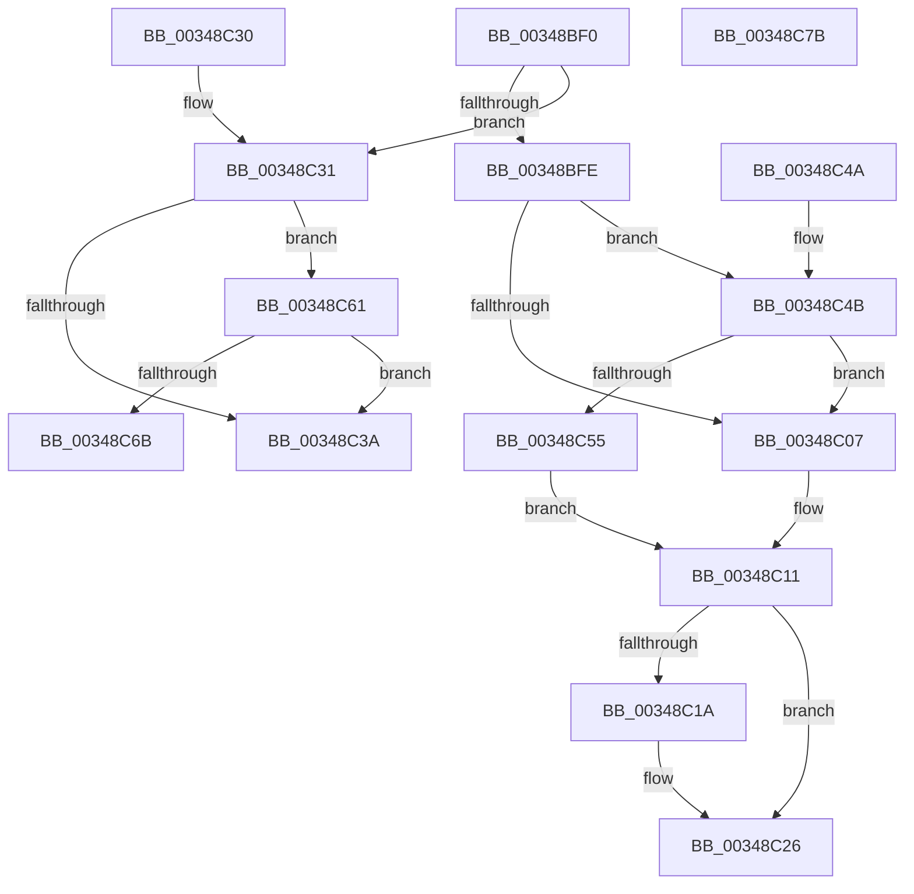

# MiReleaseSpinLockShared

- RVA: `0x00348BF0`–`0x00348C7C` (길이 `140` bytes)
- VA: `0x0000000140348BF0`
- 실행 섹션: `.text`
- PDB 이름 있음: `예`; PDB Function 태그: `아니요`
- unwind 정보 RVA: `0x0007826C`
- 디코드: `42`개 명령, `140/140` bytes 표시
- 미해석 바이트: `0` (있으면 어셈블리에 `.byte`로 보존)

> 이 문서는 커널 이미지의 기계어와 PDB 기호를 분석해 생성했습니다. 4번과 5번은 함수 원형과 자료형을 바이너리 사용 방식에서 추정한 C 해석이며 원본 소스 복구 결과는 아닙니다.

## 1. Dependencies

- 직접 호출 지점: **3**; 고유 호출 대상: **2**
- 직접 호출자로 확인된 함수: **39**
- RIP 상대 이미지 참조: **3**

### Outgoing calls
- `0x00348C21` → [KiLowerIrqlProcessIrqlFlags](../4F/KiLowerIrqlProcessIrqlFlags_function_004F5698.md) (function, `0x004F5698`)
- `0x00348C5A` → [ExpReleaseSpinLockSharedFromDpcLevelInstrumented](../2F/ExpReleaseSpinLockSharedFromDpcLevelInstrumented_function_002F0F48.md) (function, `0x002F0F48`)
- `0x00348C70` → [ExpReleaseSpinLockSharedFromDpcLevelInstrumented](../2F/ExpReleaseSpinLockSharedFromDpcLevelInstrumented_function_002F0F48.md) (function, `0x002F0F48`)

### Direct callers
- [MiLocateCombineBlock](../22/MiLocateCombineBlock_function_0022B3A8.md) at `0x0022B46E`
- [MiReferenceIoPages](../23/MiReferenceIoPages_function_0023C804.md) at `0x0023CBBD`
- [MiChargeCommit](../28/MiChargeCommit_function_00286EB0.md) at `0x00287370`
- [MiChargeCommit](../28/MiChargeCommit_function_00286EB0.md) at `0x002873F4`
- [MiChargeCommit](../28/MiChargeCommit_function_00286EB0.md) at `0x0028740A`
- [MiChargeCommit](../28/MiChargeCommit_function_00286EB0.md) at `0x0028741D`
- [MiPageFileLargestBitmapsRun](../2A/MiPageFileLargestBitmapsRun_function_002AA708.md) at `0x002AA7D4`
- [MiDereferenceIoPages](../2A/MiDereferenceIoPages_function_002AB1B0.md) at `0x002AB664`
- [MiFindBestZeroingProcessor](../2C/MiFindBestZeroingProcessor_function_002CC73C.md) at `0x002CC867`
- [sub_002E0B15](../2E/Unknown_function_002E0B15.md) at `0x002E1015`
- [MiCompleteProtoPteFault](MiCompleteProtoPteFault_function_00345710.md) at `0x00346509`
- [sub_0034847F](Unknown_function_0034847F.md) at `0x003484B1`
- [MiKernelStackVaToStackNode](MiKernelStackVaToStackNode_function_00348A4C.md) at `0x00348A8D`
- [MiCheckSlabPage](MiCheckSlabPage_function_00348AC8.md) at `0x00348B9A`
- [MiTransientCombineAddress](MiTransientCombineAddress_function_00348C84.md) at `0x00348D07`
- [MiObtainParkedCoreMasks](MiObtainParkedCoreMasks_function_00348DE0.md) at `0x00348E7D`
- [MiSystemFault](MiSystemFault_function_0034AA64.md) at `0x0034AE26`
- [MiGenerateAccessViolation](MiGenerateAccessViolation_function_0034B50C.md) at `0x0034B551`
- [MiGetPageFromSlabAllocator](../37/MiGetPageFromSlabAllocator_function_00377294.md) at `0x003773D4`
- [sub_00380A2B](../38/Unknown_function_00380A2B.md) at `0x00380A59`
- [MiGetChannelInformation](../3B/MiGetChannelInformation_function_003B8738.md) at `0x003B884D`
- [MiGetPartitionNodeInformation](../3B/MiGetPartitionNodeInformation_function_003B8D48.md) at `0x003B8E25`
- [MiFindFreePageFileSpace](../3E/MiFindFreePageFileSpace_function_003E2CAC.md) at `0x003E2F31`
- [MiFindFreePageFileSpace](../3E/MiFindFreePageFileSpace_function_003E2CAC.md) at `0x003E3043`
- [MiFindFreePageFileSpace](../3E/MiFindFreePageFileSpace_function_003E2CAC.md) at `0x003E30D9`
- [MmUnmapReservedMapping](../3E/MmUnmapReservedMapping_function_003E7BE0.md) at `0x003E7C74`
- [MmMapLockedPagesWithReservedMapping](../3E/MmMapLockedPagesWithReservedMapping_function_003E8910.md) at `0x003E89B4`
- [MiReferenceControlAreaFile](../43/MiReferenceControlAreaFile_function_00431554.md) at `0x0043165E`
- [MiMarkHugeRangeTransition](../43/MiMarkHugeRangeTransition_function_004374C0.md) at `0x00437622`
- [MiAgeAweRegions](../44/MiAgeAweRegions_function_004464A4.md) at `0x00446585`
- [MiComputeUnusedSegmentReduction](../46/MiComputeUnusedSegmentReduction_function_00464E58.md) at `0x00464EB4`
- [MiGetPrivatePageCount](../49/MiGetPrivatePageCount_function_0049E4E4.md) at `0x0049E52D`
- [MiGetOptimalEngineMix](../49/MiGetOptimalEngineMix_function_0049EF44.md) at `0x0049F066`
- [MiIsCalibrationWorthwhile](../4A/MiIsCalibrationWorthwhile_function_004A0770.md) at `0x004A07FE`
- [MiInitializeCachedExtentWalker](../4C/MiInitializeCachedExtentWalker_function_004CAC6C.md) at `0x004CACFC`
- [MiInitializeCachedExtentWalker](../4C/MiInitializeCachedExtentWalker_function_004CAC6C.md) at `0x004CADB9`
- [MiTransientPageListWriter](../4D/MiTransientPageListWriter_function_004DB35C.md) at `0x004DB3D2`
- [MiApplyDebuggerPatches](../4F/MiApplyDebuggerPatches_function_004F7BE4.md) at `0x004F7D5A`
- [MiReleasePartitionHugeIoSpace](../67/MiReleasePartitionHugeIoSpace_function_00677038.md) at `0x00677113`
- [MiReleasePartitionHugeIoSpace](../67/MiReleasePartitionHugeIoSpace_function_00677038.md) at `0x00677166`
- [MiEnumerateQuarantinedBadHugeRangePages](../67/MiEnumerateQuarantinedBadHugeRangePages_function_006798AC.md) at `0x00679938`
- [MiEnumerateQuarantinedBadHugeRangePages](../67/MiEnumerateQuarantinedBadHugeRangePages_function_006798AC.md) at `0x0067996F`
- [MiGetListOfPendingBadPages](../67/MiGetListOfPendingBadPages_function_006799D0.md) at `0x00679AB2`
- [MiGetListOfPendingBadPages](../67/MiGetListOfPendingBadPages_function_006799D0.md) at `0x00679B03`
- [MiGetListOfPendingBadPages](../67/MiGetListOfPendingBadPages_function_006799D0.md) at `0x00679D09`
- [MiDeleteAwePageTables](../68/MiDeleteAwePageTables_function_006884B0.md) at `0x0068867D`
- [MiDeleteAwePageTables](../68/MiDeleteAwePageTables_function_006884B0.md) at `0x00688757`
- [MiFindPageFileMemoryExtent](../69/MiFindPageFileMemoryExtent_function_00694F70.md) at `0x00695019`
- [MiAbsorbPossibleEngineChanges](../69/MiAbsorbPossibleEngineChanges_function_006958B4.md) at `0x006959A8`
- [MiAbsorbPossibleEngineChanges](../69/MiAbsorbPossibleEngineChanges_function_006958B4.md) at `0x00695AD9`
- [sub_006E3F8C](../6E/Unknown_function_006E3F8C.md) at `0x006E3FC9`

### Static image references
- `0x00348BFE` → RVA `0x00FC6B06` (`ALMOSTRO`; read)
- `0x00348C11` → RVA `0x00FC6D20` (`ALMOSTRO`; read)
- `0x00348C4B` → RVA `0x00F0DE58` (`.data`; read)

## 2. Other-region calls and transfers

- 다른 실행 섹션으로 향하는 call: **0**
- 별도 외부 분기/꼬리 이동을 확인하지 못했습니다.

## 3. Assembly (complete function range)

```asm
00348BF0  40 53                           push rbx
00348BF2  48 83 EC 20                     sub rsp, 0x20
00348BF6  0F B6 DA                        movzx ebx, dl
00348BF9  80 FB 11                        cmp bl, 0x11
00348BFC  74 33                           je 0x140348c31
00348BFE  F6 05 01 DF C7 00 01            test byte ptr [rip + 0xc7df01], 1
00348C05  75 44                           jne 0x140348c4b
00348C07  F0 81 21 FF FF FF BF            lock and dword ptr [rcx], 0xbfffffff
00348C0E  F0 FF 09                        lock dec dword ptr [rcx]
00348C11  83 3D 08 E1 C7 00 00            cmp dword ptr [rip + 0xc7e108], 0
00348C18  74 0C                           je 0x140348c26
00348C1A  44 0F 20 C1                     mov rcx, cr8
00348C1E  0F B6 D3                        movzx edx, bl
00348C21  E8 72 CA 1A 00                  call 0x1404f5698
00348C26  44 0F 22 C3                     mov cr8, rbx
00348C2A  48 83 C4 20                     add rsp, 0x20
00348C2E  5B                              pop rbx
00348C2F  C3                              ret
00348C30  CC                              int3
00348C31  F6 05 CE DE C7 00 01            test byte ptr [rip + 0xc7dece], 1
00348C38  75 27                           jne 0x140348c61
00348C3A  F0 81 21 FF FF FF BF            lock and dword ptr [rcx], 0xbfffffff
00348C41  F0 FF 09                        lock dec dword ptr [rcx]
00348C44  48 83 C4 20                     add rsp, 0x20
00348C48  5B                              pop rbx
00348C49  C3                              ret
00348C4A  CC                              int3
00348C4B  8B 05 07 52 BC 00               mov eax, dword ptr [rip + 0xbc5207]
00348C51  85 C0                           test eax, eax
00348C53  75 B2                           jne 0x140348c07
00348C55  48 8B 54 24 28                  mov rdx, qword ptr [rsp + 0x28]
00348C5A  E8 E9 82 FA FF                  call 0x1402f0f48
00348C5F  EB B0                           jmp 0x140348c11
00348C61  8B 05 F1 51 BC 00               mov eax, dword ptr [rip + 0xbc51f1]
00348C67  85 C0                           test eax, eax
00348C69  75 CF                           jne 0x140348c3a
00348C6B  48 8B 54 24 28                  mov rdx, qword ptr [rsp + 0x28]
00348C70  E8 D3 82 FA FF                  call 0x1402f0f48
00348C75  48 83 C4 20                     add rsp, 0x20
00348C79  5B                              pop rbx
00348C7A  C3                              ret
00348C7B  CC                              int3
```

## 4. C-style interpretation (structured pseudocode)

```c
__int64 __fastcall MiReleaseSpinLockShared(__int64 a1, unsigned __int8 a2)
{
    __int64 result;
    __int64 v_rsp;
    unsigned __int64 v_stack_p50;

    v_rsp = (v_rsp) - (32);
    if (a2 == 17) goto loc_00348C31;
    if (((*(unsigned __int8 *)(v_rip + 13098753)) & (1)) != 0) goto loc_00348C4B;
loc_00348C07:
loc_00348C11:
    if ((*(unsigned int *)(v_rip + 13099272)) != 0) {
        a1 = v_cr8;
        a2 = a2;
        result = KiLowerIrqlProcessIrqlFlags(a1, a2, a3, a4);
    }
    v_rsp = (v_rsp) + (32);
    return result;
loc_00348C31:
    if (((*(unsigned __int8 *)(v_rip + 13098702)) & (1)) != 0) goto loc_00348C61;
loc_00348C3A:
    v_rsp = (v_rsp) + (32);
    return result;
loc_00348C4B:
    if ((unsigned int)((unsigned int)(*(unsigned int *)(v_rip + 12341767))) != 0) goto loc_00348C07;
    result = ExpReleaseSpinLockSharedFromDpcLevelInstrumented(a1, v_stack_p50, a3, a4);
    goto loc_00348C11;
loc_00348C61:
    if ((unsigned int)((unsigned int)(*(unsigned int *)(v_rip + 12341745))) != 0) goto loc_00348C3A;
    result = ExpReleaseSpinLockSharedFromDpcLevelInstrumented(a1, v_stack_p50, a3, a4);
    v_rsp = (v_rsp) + (32);
    return result;
}
```

## 5. (Beta) C Style

```c
int64_t MiReleaseSpinLockShared(void *Arg1, uint8_t Arg2)
{
    uint8_t *arg1 = (uint8_t *)Arg1;

    int64_t result;
    int64_t local_rsp;
    uint64_t v_stack_p50;

    local_rsp = (local_rsp) - (32);
    if (Arg2 == 17) goto loc_00348C31;
    if (((*(uint8_t *)(v_rip + 0xC7DF01)) & (1)) != 0) goto loc_00348C4B;
loc_00348C07:
loc_00348C11:
    if ((*(uint32_t *)(v_rip + 0xC7E108)) != 0) {
        Arg1 = v_cr8;
        Arg2 = Arg2;
        result = KiLowerIrqlProcessIrqlFlags(Arg1, Arg2, a3, a4);
    }
    local_rsp = (local_rsp) + (32);
    return result;
loc_00348C31:
    if (((*(uint8_t *)(v_rip + 0xC7DECE)) & (1)) != 0) goto loc_00348C61;
loc_00348C3A:
    local_rsp = (local_rsp) + (32);
    return result;
loc_00348C4B:
    if ((uint32_t)((uint32_t)(*(uint32_t *)(v_rip + 0xBC5207))) != 0) goto loc_00348C07;
    result = ExpReleaseSpinLockSharedFromDpcLevelInstrumented(Arg1, v_stack_p50, a3, a4);
    goto loc_00348C11;
loc_00348C61:
    if ((uint32_t)((uint32_t)(*(uint32_t *)(v_rip + 0xBC51F1))) != 0) goto loc_00348C3A;
    result = ExpReleaseSpinLockSharedFromDpcLevelInstrumented(Arg1, v_stack_p50, a3, a4);
    local_rsp = (local_rsp) + (32);
    return result;
}
```

### 관측된 메모리 오프셋

구조체 형식이 확인되지 않은 접근은 인자 기준의 오프셋으로만 기록했습니다.

| 기준 인자 | 오프셋 표현 | 폭 (bit) | 접근 |
|---|---:|---:|---|
| `Arg1` | `+ 0x0` | `32` | `R/W` |

## 6. Execution-region graph

[열기: 2D/3D 그래프와 함수 탐색 컨트롤 패널](../../../control-panel.html?section=text&rva=0x00348BF0&view=graph)

- 2D 그래프는 위에서 아래로 흐르고, 3D 그래프는 빈 공간을 드래그해 회전합니다. Shift+드래그는 이동, 휠은 확대·축소, 함수 노드 선택은 대상 보고서 이동입니다.

### Static fallback


