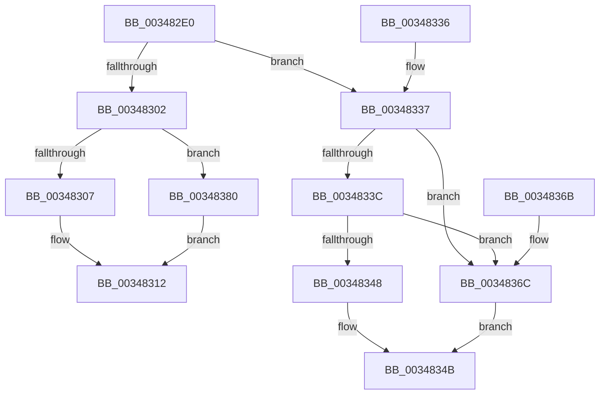

# MiStartingOffset

- RVA: `0x003482E0`–`0x00348384` (길이 `164` bytes)
- VA: `0x00000001403482E0`
- 실행 섹션: `.text`
- PDB 이름 있음: `예`; PDB Function 태그: `아니요`
- unwind 정보 RVA: `0x000781A0`
- 디코드: `53`개 명령, `164/164` bytes 표시
- 미해석 바이트: `0` (있으면 어셈블리에 `.byte`로 보존)

> 이 문서는 커널 이미지의 기계어와 PDB 기호를 분석해 생성했습니다. 4번과 5번은 함수 원형과 자료형을 바이너리 사용 방식에서 추정한 C 해석이며 원본 소스 복구 결과는 아닙니다.

## 1. Dependencies

- 직접 호출 지점: **1**; 고유 호출 대상: **1**
- 직접 호출자로 확인된 함수: **24**
- RIP 상대 이미지 참조: **0**

### Outgoing calls
- `0x00348375` → [MiGetSharedProtos](MiGetSharedProtos_function_00348D58.md) (function, `0x00348D58`)

### Direct callers
- [MiLogPageAccess](../24/MiLogPageAccess_function_00240870.md) at `0x00240A51`
- [MiMakeSystemCachePteValid](../2A/MiMakeSystemCachePteValid_function_002A35D8.md) at `0x002A37A9`
- [MiAdvanceVadView](../2A/MiAdvanceVadView_function_002A60EC.md) at `0x002A6154`
- [MiInitializeImageProtos](../2A/MiInitializeImageProtos_function_002ABDAC.md) at `0x002ABE50`
- [MiFinishMdlForMappedFileFault](../2A/MiFinishMdlForMappedFileFault_function_002AC974.md) at `0x002ACA59`
- [MiCopyDataPageToImagePage](../2A/MiCopyDataPageToImagePage_function_002AE818.md) at `0x002AE8AC`
- [MiCompleteRestrictedImageFault](../2C/MiCompleteRestrictedImageFault_function_002C60D4.md) at `0x002C6241`
- [MiViewMayContainPage](../2E/MiViewMayContainPage_function_002E11F0.md) at `0x002E12FE`
- [MiTrimSharedPageFromViews](../2E/MiTrimSharedPageFromViews_function_002E16F8.md) at `0x002E1D96`
- [sub_0031CD16](../31/Unknown_function_0031CD16.md) at `0x0031CDE9`
- [sub_0034753C](Unknown_function_0034753C.md) at `0x00347584`
- [MiEmptyPageAccessLog](MiEmptyPageAccessLog_function_00348700.md) at `0x0034894B`
- [MiWalkEntireImage](../36/MiWalkEntireImage_function_00365D70.md) at `0x00366011`
- [MiCopyFileOnlyGlobalSubsectionPage](../36/MiCopyFileOnlyGlobalSubsectionPage_function_0036A9EC.md) at `0x0036ACC5`
- [MiReadyFlushMdlToWrite](../40/MiReadyFlushMdlToWrite_function_00404664.md) at `0x004046B2`
- [MiGatherMappedPages](../40/MiGatherMappedPages_function_00404E80.md) at `0x00405055`
- [MiInitializeCachedExtentWalker](../4C/MiInitializeCachedExtentWalker_function_004CAC6C.md) at `0x004CAD7B`
- [MiLocateCachedExtent](../4C/MiLocateCachedExtent_function_004CADF8.md) at `0x004CAE10`
- [MiCommitFileBackedSection](../../page/88/MiCommitFileBackedSection_function_00882238.md) at `0x0088229E`
- [MiPfPrepareSequentialReadList](../../page/93/MiPfPrepareSequentialReadList_function_0093D8E8.md) at `0x0093E032`
- [MiPfAllocateMdls](../../page/93/MiPfAllocateMdls_function_0093E45C.md) at `0x0093E637`
- [MiFillMapFileInfo](../../page/97/MiFillMapFileInfo_function_0097E15C.md) at `0x0097E2BB`
- [MiAllocateFileExtents](../../page/AB/MiAllocateFileExtents_function_00ABDF54.md) at `0x00ABDFE1`
- [sub_00B314C0](../../page/B3/Unknown_function_00B314C0.md) at `0x00B31552`

### Static image references
- 디코드된 RIP-relative 메모리 참조가 없습니다.

## 2. Other-region calls and transfers

- 다른 실행 섹션으로 향하는 call: **0**
- 별도 외부 분기/꼬리 이동을 확인하지 못했습니다.

## 3. Assembly (complete function range)

```asm
003482E0  48 89 5C 24 08                  mov qword ptr [rsp + 8], rbx
003482E5  57                              push rdi
003482E6  48 83 EC 20                     sub rsp, 0x20
003482EA  4C 8B 09                        mov r9, qword ptr [rcx]
003482ED  48 8B F9                        mov rdi, rcx
003482F0  45 8B D0                        mov r10d, r8d
003482F3  48 8B DA                        mov rbx, rdx
003482F6  41 8B 41 38                     mov eax, dword ptr [r9 + 0x38]
003482FA  48 8B 49 08                     mov rcx, qword ptr [rcx + 8]
003482FE  A8 20                           test al, 0x20
00348300  75 35                           jne 0x140348337
00348302  48 85 C9                        test rcx, rcx
00348305  74 79                           je 0x140348380
00348307  48 2B D9                        sub rbx, rcx
0034830A  48 C1 FB 03                     sar rbx, 3
0034830E  48 C1 E3 0C                     shl rbx, 0xc
00348312  8B 47 20                        mov eax, dword ptr [rdi + 0x20]
00348315  8B 4F 24                        mov ecx, dword ptr [rdi + 0x24]
00348318  25 C0 FF 00 00                  and eax, 0xffc0
0034831D  48 C1 E0 1A                     shl rax, 0x1a
00348321  48 0B C1                        or rax, rcx
00348324  48 C1 E0 0C                     shl rax, 0xc
00348328  48 03 C3                        add rax, rbx
0034832B  48 8B 5C 24 30                  mov rbx, qword ptr [rsp + 0x30]
00348330  48 83 C4 20                     add rsp, 0x20
00348334  5F                              pop rdi
00348335  C3                              ret
00348336  CC                              int3
00348337  48 3B D9                        cmp rbx, rcx
0034833A  72 30                           jb 0x14034836c
0034833C  8B 47 2C                        mov eax, dword ptr [rdi + 0x2c]
0034833F  48 8D 14 C1                     lea rdx, [rcx + rax*8]
00348343  48 3B DA                        cmp rbx, rdx
00348346  73 24                           jae 0x14034836c
00348348  48 2B D9                        sub rbx, rcx
0034834B  8B 47 24                        mov eax, dword ptr [rdi + 0x24]
0034834E  48 C1 E3 09                     shl rbx, 9
00348352  48 81 E3 00 F0 FF FF            and rbx, 0xfffffffffffff000
00348359  48 C1 E0 09                     shl rax, 9
0034835D  48 03 C3                        add rax, rbx
00348360  48 8B 5C 24 30                  mov rbx, qword ptr [rsp + 0x30]
00348365  48 83 C4 20                     add rsp, 0x20
00348369  5F                              pop rdi
0034836A  C3                              ret
0034836B  CC                              int3
0034836C  4C 8B C7                        mov r8, rdi
0034836F  41 8B D2                        mov edx, r10d
00348372  49 8B C9                        mov rcx, r9
00348375  E8 DE 09 00 00                  call 0x140348d58
0034837A  48 2B 58 48                     sub rbx, qword ptr [rax + 0x48]
0034837E  EB CB                           jmp 0x14034834b
00348380  33 DB                           xor ebx, ebx
00348382  EB 8E                           jmp 0x140348312
```

## 4. C-style interpretation (structured pseudocode)

```c
__int64 __fastcall MiStartingOffset(__int64 a1, __int64 a2, int a3)
{
    __int64 result;
    __int64 v_rbx;
    __int64 v_rsp;
    unsigned __int64 v_stack_p30;
    unsigned __int64 v_stack_p8;

    v_stack_p8 = v_rbx;
    v_rsp = (v_rsp) - (32);
    if ((((unsigned __int8)((unsigned int)(*(unsigned int *)(*(unsigned __int64 *)(a1) + 56)))) & (32)) != 0) goto loc_00348337;
    if (*(unsigned __int64 *)(a1 + 8) == 0) goto loc_00348380;
    v_rbx = (a2) - (*(unsigned __int64 *)(a1 + 8));
    v_rbx = (v_rbx) >> (3);
    v_rbx = (v_rbx) << (12);
loc_00348312:
    result = (unsigned int)(((unsigned int)(*(unsigned int *)(a1 + 32))) & (0xFFC0ULL));
    result = (result) << (26);
    result = (result) | ((unsigned int)(*(unsigned int *)(a1 + 36)));
    result = (result) << (12);
    result = (result) + (v_rbx);
    v_rsp = (v_rsp) + (32);
    return result;
loc_00348337:
    if (v_stack_p8 < ((unsigned int)(*(unsigned int *)(a1 + 36)))) goto loc_0034836C;
    if (v_stack_p8 >= ((unsigned int)(*(unsigned int *)(a1 + 36)) + (unsigned int)(*(unsigned int *)(a1 + 44)) * 8)) goto loc_0034836C;
    v_rbx = (v_stack_p8) - ((unsigned int)(*(unsigned int *)(a1 + 36)));
loc_0034834B:
    v_rbx = (v_rbx) << (9);
    v_rbx = (v_rbx) & (0xFFFFFFFFFFFFF000ULL);
    result = ((unsigned int)(*(unsigned int *)(a1 + 36))) << (9);
    result = (result) + (v_rbx);
    v_rsp = (v_rsp) + (32);
    return result;
loc_0034836C:
    result = MiGetSharedProtos(*(unsigned __int64 *)(a1), (unsigned int)((unsigned int)((unsigned int)(a3))), a1, *(unsigned __int64 *)(a1));
    v_rbx = (v_stack_p30) - (*(unsigned __int64 *)(result + 72));
    goto loc_0034834B;
loc_00348380:
    v_rbx = 0;
    goto loc_00348312;
}
```

## 5. (Beta) C Style

```c
int64_t MiStartingOffset(void *Arg1, int64_t Arg2, int32_t Arg3)
{
    uint8_t *arg1 = (uint8_t *)Arg1;

    int64_t result;
    int64_t local_rbx;
    int64_t local_rsp;
    uint64_t v_stack_p30;
    uint64_t v_stack_p8;

    v_stack_p8 = local_rbx;
    local_rsp = (local_rsp) - (32);
    if ((((uint8_t)((uint32_t)(*(uint32_t *)(*(uint64_t *)(arg1) + 0x38)))) & (32)) != 0) goto loc_00348337;
    if (*(uint64_t *)(arg1 + 0x8) == 0) goto loc_00348380;
    local_rbx = (Arg2) - (*(uint64_t *)(arg1 + 0x8));
    local_rbx = (local_rbx) >> (3);
    local_rbx = (local_rbx) << (12);
loc_00348312:
    result = (uint32_t)(((uint32_t)(*(uint32_t *)(arg1 + 0x20))) & (0xFFC0ULL));
    result = (result) << (26);
    result = (result) | ((uint32_t)(*(uint32_t *)(arg1 + 0x24)));
    result = (result) << (12);
    result = (result) + (local_rbx);
    local_rsp = (local_rsp) + (32);
    return result;
loc_00348337:
    if (v_stack_p8 < ((uint32_t)(*(uint32_t *)(arg1 + 0x24)))) goto loc_0034836C;
    if (v_stack_p8 >= ((uint32_t)(*(uint32_t *)(arg1 + 0x24)) + (uint32_t)(*(uint32_t *)(arg1 + 0x2C)) * 8)) goto loc_0034836C;
    local_rbx = (v_stack_p8) - ((uint32_t)(*(uint32_t *)(arg1 + 0x24)));
loc_0034834B:
    local_rbx = (local_rbx) << (9);
    local_rbx = (local_rbx) & (0xFFFFFFFFFFFFF000ULL);
    result = ((uint32_t)(*(uint32_t *)(arg1 + 0x24))) << (9);
    result = (result) + (local_rbx);
    local_rsp = (local_rsp) + (32);
    return result;
loc_0034836C:
    result = MiGetSharedProtos(*(uint64_t *)(arg1), (uint32_t)((uint32_t)((uint32_t)(Arg3))), Arg1, *(uint64_t *)(arg1));
    local_rbx = (v_stack_p30) - (*(uint64_t *)(result + 0x48));
    goto loc_0034834B;
loc_00348380:
    local_rbx = 0;
    goto loc_00348312;
}
```

### 관측된 메모리 오프셋

구조체 형식이 확인되지 않은 접근은 인자 기준의 오프셋으로만 기록했습니다.

| 기준 인자 | 오프셋 표현 | 폭 (bit) | 접근 |
|---|---:|---:|---|
| `Arg1` | `+ 0x0` | `64` | `R` |
| `Arg1` | `+ 0x8` | `64` | `R` |
| `Arg1` | `+ 0x20` | `32` | `R` |
| `Arg1` | `+ 0x24` | `32` | `R` |
| `Arg1` | `+ 0x2C` | `32` | `R` |

## 6. Execution-region graph

[열기: 2D/3D 그래프와 함수 탐색 컨트롤 패널](../../../control-panel.html?section=text&rva=0x003482E0&view=graph)

- 2D 그래프는 위에서 아래로 흐르고, 3D 그래프는 빈 공간을 드래그해 회전합니다. Shift+드래그는 이동, 휠은 확대·축소, 함수 노드 선택은 대상 보고서 이동입니다.

### Static fallback


