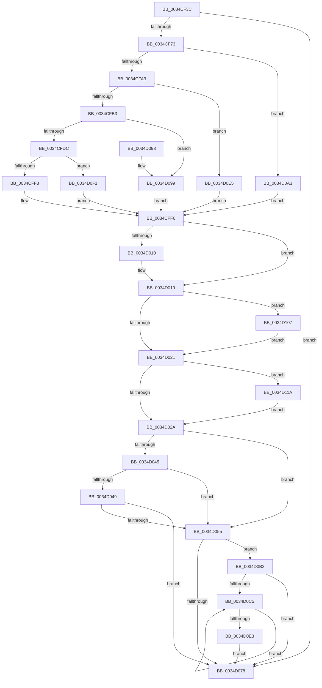

# MiStoreUpdateMemoryConditions

- RVA: `0x0034CF3C`–`0x0034D130` (길이 `500` bytes)
- VA: `0x000000014034CF3C`
- 실행 섹션: `.text`
- PDB 이름 있음: `예`; PDB Function 태그: `아니요`
- unwind 정보 RVA: `0x000788CC`
- 디코드: `130`개 명령, `500/500` bytes 표시
- 미해석 바이트: `0` (있으면 어셈블리에 `.byte`로 보존)

> 이 문서는 커널 이미지의 기계어와 PDB 기호를 분석해 생성했습니다. 4번과 5번은 함수 원형과 자료형을 바이너리 사용 방식에서 추정한 C 해석이며 원본 소스 복구 결과는 아닙니다.

## 1. Dependencies

- 직접 호출 지점: **9**; 고유 호출 대상: **9**
- 직접 호출자로 확인된 함수: **4**
- RIP 상대 이미지 참조: **0**

### Outgoing calls
- `0x0034CF5D` → [ExAcquireSpinLockExclusive](../24/ExAcquireSpinLockExclusive_function_00248690.md) (function, `0x00248690`)
- `0x0034CF7D` → [MiUseLowIoPriorityForModifiedPages](MiUseLowIoPriorityForModifiedPages_function_0034D284.md) (function, `0x0034D284`)
- `0x0034CFBC` → [MiGetAvailablePagesBelowPriority](MiGetAvailablePagesBelowPriority_function_0034D340.md) (function, `0x0034D340`)
- `0x0034D002` → [KiIsThreadRankNonZero](KiIsThreadRankNonZero_function_0034D140.md) (function, `0x0034D140`)
- `0x0034D06F` → [SMKM_STORE_MGR<SM_TRAITS>::SmUpdateMemoryConditions](SMKM_STORE_MGR_SM_TRAITS_SmUpdateMemoryConditions_function_0034BD60.md) (function, `0x0034BD60`)
- `0x0034D07E` → [MiReleaseSpinLockExclusive](../24/MiReleaseSpinLockExclusive_function_002482C0.md) (function, `0x002482C0`)
- `0x0034D0D4` → [SMKM_STORE_MGR<SM_TRAITS>::SmDrainSList](../47/SMKM_STORE_MGR_SM_TRAITS_SmDrainSList_function_0047204C.md) (function, `0x0047204C`)
- `0x0034D110` → [KeSetActualBasePriorityThread](../3C/KeSetActualBasePriorityThread_function_003C4370.md) (function, `0x003C4370`)
- `0x0034D126` → [KeSetEvent](../33/KeSetEvent_function_0033F310.md) (function, `0x0033F310`)

### Direct callers
- [MiAdjustModifiedPageLoad](../2D/MiAdjustModifiedPageLoad_function_002DC07C.md) at `0x002DC1C1`
- [MiFlushAllStoreSwapPages](../3B/MiFlushAllStoreSwapPages_function_003BC890.md) at `0x003BC931`
- [MiFlushAllPagesWorker](../3B/MiFlushAllPagesWorker_function_003BCED4.md) at `0x003BCF85`
- [MiModifiedPageWriter](../47/MiModifiedPageWriter_function_0047E5F0.md) at `0x0047EBA6`

### Static image references
- 디코드된 RIP-relative 메모리 참조가 없습니다.

## 2. Other-region calls and transfers

- 다른 실행 섹션으로 향하는 call: **0**
- 별도 외부 분기/꼬리 이동을 확인하지 못했습니다.

## 3. Assembly (complete function range)

```asm
0034CF3C  48 89 5C 24 18                  mov qword ptr [rsp + 0x18], rbx
0034CF41  55                              push rbp
0034CF42  56                              push rsi
0034CF43  57                              push rdi
0034CF44  41 54                           push r12
0034CF46  41 55                           push r13
0034CF48  41 56                           push r14
0034CF4A  41 57                           push r15
0034CF4C  48 83 EC 20                     sub rsp, 0x20
0034CF50  4C 8D B1 A8 06 00 00            lea r14, [rcx + 0x6a8]
0034CF57  48 8B F9                        mov rdi, rcx
0034CF5A  49 8B CE                        mov rcx, r14
0034CF5D  E8 2E B7 EF FF                  call 0x140248690
0034CF62  33 DB                           xor ebx, ebx
0034CF64  44 8A E8                        mov r13b, al
0034CF67  39 9F 4C 05 00 00               cmp dword ptr [rdi + 0x54c], ebx
0034CF6D  0F 85 05 01 00 00               jne 0x14034d078
0034CF73  48 8B B7 00 49 00 00            mov rsi, qword ptr [rdi + 0x4900]
0034CF7A  48 8B CF                        mov rcx, rdi
0034CF7D  E8 02 03 00 00                  call 0x14034d284
0034CF82  8B C8                           mov ecx, eax
0034CF84  89 44 24 68                     mov dword ptr [rsp + 0x68], eax
0034CF88  8B C3                           mov eax, ebx
0034CF8A  85 C9                           test ecx, ecx
0034CF8C  0F 94 C0                        sete al
0034CF8F  89 44 24 60                     mov dword ptr [rsp + 0x60], eax
0034CF93  8D 43 01                        lea eax, [rbx + 1]
0034CF96  48 81 FE A0 00 00 00            cmp rsi, 0xa0
0034CF9D  0F 82 00 01 00 00               jb 0x14034d0a3
0034CFA3  44 8B FB                        mov r15d, ebx
0034CFA6  48 81 FE 20 04 00 00            cmp rsi, 0x420
0034CFAD  0F 82 32 01 00 00               jb 0x14034d0e5
0034CFB3  8D 53 06                        lea edx, [rbx + 6]
0034CFB6  48 8B CF                        mov rcx, rdi
0034CFB9  8D 6B 08                        lea ebp, [rbx + 8]
0034CFBC  E8 7F 03 00 00                  call 0x14034d340
0034CFC1  48 8B 8F C0 44 00 00            mov rcx, qword ptr [rdi + 0x44c0]
0034CFC8  48 8B 91 40 01 00 00            mov rdx, qword ptr [rcx + 0x140]
0034CFCF  48 8D 0C 52                     lea rcx, [rdx + rdx*2]
0034CFD3  48 3B C1                        cmp rax, rcx
0034CFD6  0F 82 BD 00 00 00               jb 0x14034d099
0034CFDC  48 8B 8F A0 4C 00 00            mov rcx, qword ptr [rdi + 0x4ca0]
0034CFE3  48 8D 90 00 20 00 00            lea rdx, [rax + 0x2000]
0034CFEA  48 3B CA                        cmp rcx, rdx
0034CFED  0F 83 FE 00 00 00               jae 0x14034d0f1
0034CFF3  8D 73 04                        lea esi, [rbx + 4]
0034CFF6  4C 8B A7 28 05 00 00            mov r12, qword ptr [rdi + 0x528]
0034CFFD  33 D2                           xor edx, edx
0034CFFF  49 8B CC                        mov rcx, r12
0034D002  E8 39 01 00 00                  call 0x14034d140
0034D007  84 C0                           test al, al
0034D009  B8 01 00 00 00                  mov eax, 1
0034D00E  75 09                           jne 0x14034d019
0034D010  41 0F BE 84 24 33 02 00 00      movsx eax, byte ptr [r12 + 0x233]
0034D019  3B C5                           cmp eax, ebp
0034D01B  0F 85 E6 00 00 00               jne 0x14034d107
0034D021  45 85 FF                        test r15d, r15d
0034D024  0F 85 F0 00 00 00               jne 0x14034d11a
0034D02A  48 8B 87 B8 00 00 00            mov rax, qword ptr [rdi + 0xb8]
0034D031  44 8B 44 24 60                  mov r8d, dword ptr [rsp + 0x60]
0034D036  48 8B 48 18                     mov rcx, qword ptr [rax + 0x18]
0034D03A  0F B6 81 98 08 00 00            movzx eax, byte ptr [rcx + 0x898]
0034D041  3B C6                           cmp eax, esi
0034D043  75 10                           jne 0x14034d055
0034D045  85 F6                           test esi, esi
0034D047  74 0C                           je 0x14034d055
0034D049  0F B6 81 99 08 00 00            movzx eax, byte ptr [rcx + 0x899]
0034D050  41 3B C0                        cmp eax, r8d
0034D053  74 23                           je 0x14034d078
0034D055  39 5C 24 68                     cmp dword ptr [rsp + 0x68], ebx
0034D059  40 88 B1 98 08 00 00            mov byte ptr [rcx + 0x898], sil
0034D060  0F 94 C0                        sete al
0034D063  88 81 99 08 00 00               mov byte ptr [rcx + 0x899], al
0034D069  F0 09 1C 24                     lock or dword ptr [rsp], ebx
0034D06D  8B D6                           mov edx, esi
0034D06F  E8 EC EC FF FF                  call 0x14034bd60
0034D074  85 F6                           test esi, esi
0034D076  74 3A                           je 0x14034d0b2
0034D078  41 8A D5                        mov dl, r13b
0034D07B  49 8B CE                        mov rcx, r14
0034D07E  E8 3D B2 EF FF                  call 0x1402482c0
0034D083  48 8B 5C 24 70                  mov rbx, qword ptr [rsp + 0x70]
0034D088  48 83 C4 20                     add rsp, 0x20
0034D08C  41 5F                           pop r15
0034D08E  41 5E                           pop r14
0034D090  41 5D                           pop r13
0034D092  41 5C                           pop r12
0034D094  5F                              pop rdi
0034D095  5E                              pop rsi
0034D096  5D                              pop rbp
0034D097  C3                              ret
0034D098  CC                              int3
0034D099  BE 02 00 00 00                  mov esi, 2
0034D09E  E9 53 FF FF FF                  jmp 0x14034cff6
0034D0A3  8B F3                           mov esi, ebx
0034D0A5  BD 12 00 00 00                  mov ebp, 0x12
0034D0AA  44 8B F8                        mov r15d, eax
0034D0AD  E9 44 FF FF FF                  jmp 0x14034cff6
0034D0B2  48 8B 87 B8 00 00 00            mov rax, qword ptr [rdi + 0xb8]
0034D0B9  48 8B 78 18                     mov rdi, qword ptr [rax + 0x18]
0034D0BD  39 9F D4 07 00 00               cmp dword ptr [rdi + 0x7d4], ebx
0034D0C3  76 B3                           jbe 0x14034d078
0034D0C5  8B CB                           mov ecx, ebx
0034D0C7  33 D2                           xor edx, edx
0034D0C9  48 C1 E1 04                     shl rcx, 4
0034D0CD  48 03 8F 10 05 00 00            add rcx, qword ptr [rdi + 0x510]
0034D0D4  E8 73 4F 12 00                  call 0x14047204c
0034D0D9  FF C3                           inc ebx
0034D0DB  3B 9F D4 07 00 00               cmp ebx, dword ptr [rdi + 0x7d4]
0034D0E1  72 E2                           jb 0x14034d0c5
0034D0E3  EB 93                           jmp 0x14034d078
0034D0E5  8B F0                           mov esi, eax
0034D0E7  BD 12 00 00 00                  mov ebp, 0x12
0034D0EC  E9 05 FF FF FF                  jmp 0x14034cff6
0034D0F1  48 03 C2                        add rax, rdx
0034D0F4  BE 02 00 00 00                  mov esi, 2
0034D0F9  48 3B C8                        cmp rcx, rax
0034D0FC  1B C0                           sbb eax, eax
0034D0FE  F7 D8                           neg eax
0034D100  03 F0                           add esi, eax
0034D102  E9 EF FE FF FF                  jmp 0x14034cff6
0034D107  48 8B 8F 28 05 00 00            mov rcx, qword ptr [rdi + 0x528]
0034D10E  8B D5                           mov edx, ebp
0034D110  E8 5B 72 07 00                  call 0x1403c4370
0034D115  E9 07 FF FF FF                  jmp 0x14034d021
0034D11A  48 8D 8F 30 05 00 00            lea rcx, [rdi + 0x530]
0034D121  45 33 C0                        xor r8d, r8d
0034D124  33 D2                           xor edx, edx
0034D126  E8 E5 21 FF FF                  call 0x14033f310
0034D12B  E9 FA FE FF FF                  jmp 0x14034d02a
```

## 4. C-style interpretation (structured pseudocode)

```c
__int64 __fastcall MiStoreUpdateMemoryConditions(__int64 a1)
{
    __int64 result;
    __int64 v_rbx;
    __int64 v_rsi;
    __int64 v_rsp;
    unsigned int v_stack_m58;
    unsigned int v_stack_p10;
    unsigned __int64 v_stack_p18;
    unsigned int v_stack_p8;

    v_stack_p18 = v_rbx;
    v_rsp = (v_rsp) - (32);
    result = ExAcquireSpinLockExclusive(a1 + 1704, a2, a3, a4);
    v_rbx = 0;
    if ((*(unsigned int *)(a1 + 1356)) != 0) goto loc_0034D078;
    result = MiUseLowIoPriorityForModifiedPages(a1, a2, a3, a4);
    v_stack_p10 = (unsigned int)(result);
    result = ((unsigned int)((unsigned int)((unsigned int)(result))) == 0) ? 1 : 0;
    v_stack_p8 = (unsigned int)(result);
    if ((*(unsigned __int64 *)(a1 + 18688)) < 160) goto loc_0034D0A3;
    if ((*(unsigned __int64 *)(a1 + 18688)) < 0x420ULL) goto loc_0034D0E5;
    result = MiGetAvailablePagesBelowPriority(a1, v_rbx + 6, a3, a4);
    if (result < (*(unsigned __int64 *)(*(unsigned __int64 *)(a1 + 17600) + 320) + *(unsigned __int64 *)(*(unsigned __int64 *)(a1 + 17600) + 320) * 2)) goto loc_0034D099;
    if ((*(unsigned __int64 *)(a1 + 19616)) >= (result + 8192)) goto loc_0034D0F1;
loc_0034CFF6:
    a2 = 0;
    result = KiIsThreadRankNonZero(*(unsigned __int64 *)(a1 + 1320), a2, a3, a4);
    result = 1;
    if ((unsigned __int8)(result) == 0) {
        result = (__int8)(*(unsigned __int8 *)(*(unsigned __int64 *)(a1 + 1320) + 563));
    }
    if (((unsigned int)(result)) != ((unsigned int)(v_rbx + 8))) goto loc_0034D107;
loc_0034D021:
    if (0 != 0) goto loc_0034D11A;
loc_0034D02A:
    if (((unsigned int)(*(unsigned __int8 *)(*(unsigned __int64 *)(*(unsigned __int64 *)(a1 + 184) + 24) + 2200))) != ((unsigned int)(v_rbx + 4))) goto loc_0034D055;
    if ((unsigned int)(v_rbx + 4) == 0) goto loc_0034D055;
    if (((unsigned int)(*(unsigned __int8 *)(*(unsigned __int64 *)(*(unsigned __int64 *)(a1 + 184) + 24) + 2201))) == ((unsigned int)((unsigned int)(v_stack_p8)))) goto loc_0034D078;
loc_0034D055:
    *(unsigned __int8 *)(*(unsigned __int64 *)(*(unsigned __int64 *)(a1 + 184) + 24) + 2200) = (unsigned __int8)(v_rbx + 4);
    result = (v_stack_p10 == 0) ? 1 : 0;
    *(unsigned __int8 *)(*(unsigned __int64 *)(*(unsigned __int64 *)(a1 + 184) + 24) + 2201) = (unsigned __int8)(result);
    result = SMKM_STORE_MGR_SM_TRAITS___SmUpdateMemoryConditions(*(unsigned __int64 *)(*(unsigned __int64 *)(a1 + 184) + 24), (unsigned int)((unsigned int)(v_rbx + 4)), (unsigned int)(v_stack_p8), a4);
    if ((unsigned int)(v_rbx + 4) == 0) goto loc_0034D0B2;
loc_0034D078:
    result = MiReleaseSpinLockExclusive(a1 + 1704, (unsigned __int8)((unsigned __int8)(result)), (unsigned int)(v_stack_p8), a4);
    v_rsp = (v_rsp) + (32);
    return result;
loc_0034D099:
    goto loc_0034CFF6;
loc_0034D0A3:
    goto loc_0034CFF6;
loc_0034D0B2:
    if ((*(unsigned int *)(*(unsigned __int64 *)(*(unsigned __int64 *)(a1 + 184) + 24) + 2004)) <= ((unsigned int)(v_stack_p18))) goto loc_0034D078;
loc_0034D0C5:
    a2 = 0;
    a1 = ((unsigned int)((unsigned int)(v_stack_p18))) << (4);
    a1 = (a1) + (*(unsigned __int64 *)(*(unsigned __int64 *)(*(unsigned __int64 *)(a1 + 184) + 24) + 1296));
    result = SMKM_STORE_MGR_SM_TRAITS___SmDrainSList(a1, a2, (unsigned int)(v_stack_p8), a4);
    v_rbx = (unsigned int)((v_stack_p18) + 1);
    if (((unsigned int)(v_rbx)) < (*(unsigned int *)(*(unsigned __int64 *)(*(unsigned __int64 *)(a1 + 184) + 24) + 2004))) goto loc_0034D0C5;
    goto loc_0034D078;
loc_0034D0E5:
    goto loc_0034CFF6;
loc_0034D0F1:
    result = (result) + (0);
    result = (unsigned int)(-(result));
    v_rsi = (unsigned int)((2) + ((unsigned int)(result)));
    goto loc_0034CFF6;
loc_0034D107:
    result = KeSetActualBasePriorityThread(*(unsigned __int64 *)(*(unsigned __int64 *)(*(unsigned __int64 *)(a1 + 184) + 24) + 1320), 18, (unsigned int)(v_stack_p8), a4);
    goto loc_0034D021;
loc_0034D11A:
    a3 = 0;
    a2 = 0;
    result = KeSetEvent(*(unsigned __int64 *)(*(unsigned __int64 *)(a1 + 184) + 24) + 1328, a2, a3, a4);
    goto loc_0034D02A;
}
```

## 5. (Beta) C Style

```c
int64_t MiStoreUpdateMemoryConditions(void *Arg1)
{
    uint8_t *arg1 = (uint8_t *)Arg1;

    int64_t result;
    int64_t local_rbx;
    int64_t local_rsi;
    int64_t local_rsp;
    uint32_t v_stack_m58;
    uint32_t v_stack_p10;
    uint64_t v_stack_p18;
    uint32_t v_stack_p8;

    v_stack_p18 = local_rbx;
    local_rsp = (local_rsp) - (32);
    result = ExAcquireSpinLockExclusive(Arg1 + 1704, a2, a3, a4);
    local_rbx = 0;
    if ((*(uint32_t *)(arg1 + 0x54C)) != 0) goto loc_0034D078;
    result = MiUseLowIoPriorityForModifiedPages(Arg1, a2, a3, a4);
    v_stack_p10 = (uint32_t)(result);
    result = ((uint32_t)((uint32_t)((uint32_t)(result))) == 0) ? 1 : 0;
    v_stack_p8 = (uint32_t)(result);
    if ((*(uint64_t *)(arg1 + 0x4900)) < 160) goto loc_0034D0A3;
    if ((*(uint64_t *)(arg1 + 0x4900)) < 0x420ULL) goto loc_0034D0E5;
    result = MiGetAvailablePagesBelowPriority(Arg1, local_rbx + 6, a3, a4);
    if (result < (*(uint64_t *)(*(uint64_t *)(arg1 + 0x44C0) + 0x140) + *(uint64_t *)(*(uint64_t *)(arg1 + 0x44C0) + 0x140) * 2)) goto loc_0034D099;
    if ((*(uint64_t *)(arg1 + 0x4CA0)) >= (result + 8192)) goto loc_0034D0F1;
loc_0034CFF6:
    a2 = 0;
    result = KiIsThreadRankNonZero(*(uint64_t *)(arg1 + 0x528), a2, a3, a4);
    result = 1;
    if ((uint8_t)(result) == 0) {
        result = (int8_t)(*(uint8_t *)(*(uint64_t *)(arg1 + 0x528) + 0x233));
    }
    if (((uint32_t)(result)) != ((uint32_t)(local_rbx + 8))) goto loc_0034D107;
loc_0034D021:
    if (0 != 0) goto loc_0034D11A;
loc_0034D02A:
    if (((uint32_t)(*(uint8_t *)(*(uint64_t *)(*(uint64_t *)(arg1 + 0xB8) + 0x18) + 0x898))) != ((uint32_t)(local_rbx + 4))) goto loc_0034D055;
    if ((uint32_t)(local_rbx + 4) == 0) goto loc_0034D055;
    if (((uint32_t)(*(uint8_t *)(*(uint64_t *)(*(uint64_t *)(arg1 + 0xB8) + 0x18) + 0x899))) == ((uint32_t)((uint32_t)(v_stack_p8)))) goto loc_0034D078;
loc_0034D055:
    *(uint8_t *)(*(uint64_t *)(*(uint64_t *)(arg1 + 0xB8) + 0x18) + 0x898) = (uint8_t)(local_rbx + 4);
    result = (v_stack_p10 == 0) ? 1 : 0;
    *(uint8_t *)(*(uint64_t *)(*(uint64_t *)(arg1 + 0xB8) + 0x18) + 0x899) = (uint8_t)(result);
    result = SMKM_STORE_MGR_SM_TRAITS___SmUpdateMemoryConditions(*(uint64_t *)(*(uint64_t *)(arg1 + 0xB8) + 0x18), (uint32_t)((uint32_t)(local_rbx + 4)), (uint32_t)(v_stack_p8), a4);
    if ((uint32_t)(local_rbx + 4) == 0) goto loc_0034D0B2;
loc_0034D078:
    result = MiReleaseSpinLockExclusive(Arg1 + 1704, (uint8_t)((uint8_t)(result)), (uint32_t)(v_stack_p8), a4);
    local_rsp = (local_rsp) + (32);
    return result;
loc_0034D099:
    goto loc_0034CFF6;
loc_0034D0A3:
    goto loc_0034CFF6;
loc_0034D0B2:
    if ((*(uint32_t *)(*(uint64_t *)(*(uint64_t *)(arg1 + 0xB8) + 0x18) + 0x7D4)) <= ((uint32_t)(v_stack_p18))) goto loc_0034D078;
loc_0034D0C5:
    a2 = 0;
    Arg1 = ((uint32_t)((uint32_t)(v_stack_p18))) << (4);
    Arg1 = (Arg1) + (*(uint64_t *)(*(uint64_t *)(*(uint64_t *)(arg1 + 0xB8) + 0x18) + 0x510));
    result = SMKM_STORE_MGR_SM_TRAITS___SmDrainSList(Arg1, a2, (uint32_t)(v_stack_p8), a4);
    local_rbx = (uint32_t)((v_stack_p18) + 1);
    if (((uint32_t)(local_rbx)) < (*(uint32_t *)(*(uint64_t *)(*(uint64_t *)(arg1 + 0xB8) + 0x18) + 0x7D4))) goto loc_0034D0C5;
    goto loc_0034D078;
loc_0034D0E5:
    goto loc_0034CFF6;
loc_0034D0F1:
    result = (result) + (0);
    result = (uint32_t)(-(result));
    local_rsi = (uint32_t)((2) + ((uint32_t)(result)));
    goto loc_0034CFF6;
loc_0034D107:
    result = KeSetActualBasePriorityThread(*(uint64_t *)(*(uint64_t *)(*(uint64_t *)(arg1 + 0xB8) + 0x18) + 0x528), 18, (uint32_t)(v_stack_p8), a4);
    goto loc_0034D021;
loc_0034D11A:
    a3 = 0;
    a2 = 0;
    result = KeSetEvent(*(uint64_t *)(*(uint64_t *)(arg1 + 0xB8) + 0x18) + 1328, a2, a3, a4);
    goto loc_0034D02A;
}
```

### 관측된 메모리 오프셋

구조체 형식이 확인되지 않은 접근은 인자 기준의 오프셋으로만 기록했습니다.

| 기준 인자 | 오프셋 표현 | 폭 (bit) | 접근 |
|---|---:|---:|---|
| `Arg1` | `+ 0xB8` | `64` | `R` |
| `Arg1` | `+ 0x528` | `64` | `R` |
| `Arg1` | `+ 0x530` | `64` | `R` |
| `Arg1` | `+ 0x54C` | `32` | `R` |
| `Arg1` | `+ 0x6A8` | `64` | `R` |
| `Arg1` | `+ 0x44C0` | `64` | `R` |
| `Arg1` | `+ 0x4900` | `64` | `R` |
| `Arg1` | `+ 0x4CA0` | `64` | `R` |

## 6. Execution-region graph

[열기: 2D/3D 그래프와 함수 탐색 컨트롤 패널](../../../control-panel.html?section=text&rva=0x0034CF3C&view=graph)

- 2D 그래프는 위에서 아래로 흐르고, 3D 그래프는 빈 공간을 드래그해 회전합니다. Shift+드래그는 이동, 휠은 확대·축소, 함수 노드 선택은 대상 보고서 이동입니다.

### Static fallback


