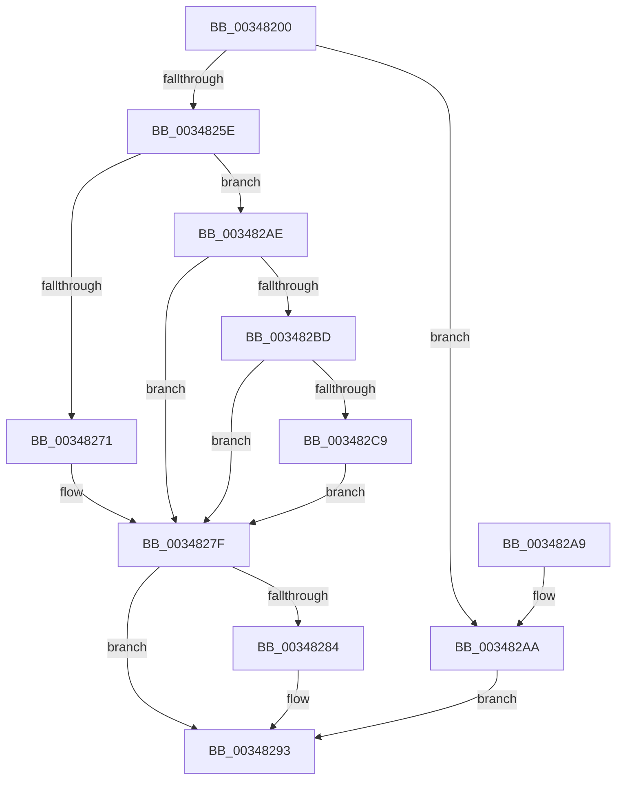

# MiSystemCacheVaControlArea

- RVA: `0x00348200`–`0x003482CE` (길이 `206` bytes)
- VA: `0x0000000140348200`
- 실행 섹션: `.text`
- PDB 이름 있음: `예`; PDB Function 태그: `아니요`
- unwind 정보 RVA: `0x000DB714`
- 디코드: `52`개 명령, `206/206` bytes 표시
- 미해석 바이트: `0` (있으면 어셈블리에 `.byte`로 보존)

> 이 문서는 커널 이미지의 기계어와 PDB 기호를 분석해 생성했습니다. 4번과 5번은 함수 원형과 자료형을 바이너리 사용 방식에서 추정한 C 해석이며 원본 소스 복구 결과는 아닙니다.

## 1. Dependencies

- 직접 호출 지점: **0**; 고유 호출 대상: **0**
- 직접 호출자로 확인된 함수: **2**
- RIP 상대 이미지 참조: **2**

### Outgoing calls
- 직접 디코드된 call 명령이 없습니다.

### Direct callers
- [sub_002F6C7D](../2F/Unknown_function_002F6C7D.md) at `0x002F6D0D`
- [MmCopyToCachedPage](MmCopyToCachedPage_function_00347B44.md) at `0x00347B92`

### Static image references
- `0x00348278` → RVA `0x00E38BB8` (`.data`; read)
- `0x003482BD` → RVA `0x00FC6AB0` (`ALMOSTRO`; read)

## 2. Other-region calls and transfers

- 다른 실행 섹션으로 향하는 call: **0**
- 별도 외부 분기/꼬리 이동을 확인하지 못했습니다.

## 3. Assembly (complete function range)

```asm
00348200  48 8B C1                        mov rax, rcx
00348203  48 8B D1                        mov rdx, rcx
00348206  48 C1 E8 12                     shr rax, 0x12
0034820A  25 F8 FF FF 3F                  and eax, 0x3ffffff8
0034820F  48 B9 00 00 00 40 FB F6 FF FF   movabs rcx, 0xfffff6fb40000000
00348219  48 8B 04 08                     mov rax, qword ptr [rax + rcx]
0034821D  48 B9 FF FF FF FF FF 00 00 00   movabs rcx, 0xffffffffff
00348227  48 C1 E8 0C                     shr rax, 0xc
0034822B  48 23 C1                        and rax, rcx
0034822E  48 8D 04 40                     lea rax, [rax + rax*2]
00348232  48 C1 E0 04                     shl rax, 4
00348236  48 B9 00 00 00 00 00 DE FF FF   movabs rcx, 0xffffde0000000000
00348240  48 03 C1                        add rax, rcx
00348243  48 8B 08                        mov rcx, qword ptr [rax]
00348246  8B 40 24                        mov eax, dword ptr [rax + 0x24]
00348249  25 00 00 FF 03                  and eax, 0x3ff0000
0034824E  48 D1 E9                        shr rcx, 1
00348251  48 C1 E0 0F                     shl rax, 0xf
00348255  0F BA F1 1F                     btr ecx, 0x1f
00348259  48 0B C1                        or rax, rcx
0034825C  74 4C                           je 0x1403482aa
0034825E  48 B9 00 00 00 00 00 FF FF FF   movabs rcx, 0xffffff0000000000
00348268  48 03 C8                        add rcx, rax
0034826B  48 83 F9 01                     cmp rcx, 1
0034826F  76 3D                           jbe 0x1403482ae
00348271  48 FF C8                        dec rax
00348274  48 C1 E0 04                     shl rax, 4
00348278  48 03 05 39 09 AF 00            add rax, qword ptr [rip + 0xaf0939]
0034827F  48 85 C0                        test rax, rax
00348282  74 0F                           je 0x140348293
00348284  48 C1 EA 12                     shr rdx, 0x12
00348288  83 E2 07                        and edx, 7
0034828B  48 8D 0C 92                     lea rcx, [rdx + rdx*4]
0034828F  48 8D 04 C8                     lea rax, [rax + rcx*8]
00348293  48 8B 50 18                     mov rdx, qword ptr [rax + 0x18]
00348297  48 8B C2                        mov rax, rdx
0034829A  48 83 E0 FE                     and rax, 0xfffffffffffffffe
0034829E  F6 C2 01                        test dl, 1
003482A1  48 0F 44 C2                     cmove rax, rdx
003482A5  48 8B 00                        mov rax, qword ptr [rax]
003482A8  C3                              ret
003482A9  CC                              int3
003482AA  33 C0                           xor eax, eax
003482AC  EB E5                           jmp 0x140348293
003482AE  48 B9 01 00 00 00 00 01 00 00   movabs rcx, 0x10000000001
003482B8  48 3B C1                        cmp rax, rcx
003482BB  75 C2                           jne 0x14034827f
003482BD  48 8B 0D EC E7 C7 00            mov rcx, qword ptr [rip + 0xc7e7ec]
003482C4  48 85 C9                        test rcx, rcx
003482C7  74 B6                           je 0x14034827f
003482C9  48 8B C1                        mov rax, rcx
003482CC  EB B1                           jmp 0x14034827f
```

## 4. C-style interpretation (structured pseudocode)

```c
__int64 __fastcall MiSystemCacheVaControlArea(__int64 a1)
{
    __int64 result;

    result = (a1) >> (18);
    result = (unsigned int)((result) & (0x3FFFFFF8ULL));
    result = (*(unsigned __int64 *)(result + a1 * 1)) >> (12);
    result = (result) & (a1);
    result = (result + result * 2) << (4);
    result = (result) + (a1);
    result = (unsigned int)(((unsigned int)(*(unsigned int *)(result + 36))) & (0x3FF0000ULL));
    a1 = (*(unsigned __int64 *)(result)) >> (1);
    result = (result) << (15);
    result = (result) | (a1);
    if (condition_is_equal) goto loc_003482AA;
    a1 = (a1) + (result);
    if (a1 <= 1) goto loc_003482AE;
    result = (result) - 1;
    result = (result) << (4);
    result = (result) + (*(unsigned __int64 *)(v_rip + 11471161));
loc_0034827F:
    if (result != 0) {
        a2 = (a1) >> (18);
        a2 = (unsigned int)((a2) & (7));
        a1 = a2 + a2 * 4;
        result = result + a1 * 8;
    }
    result = (*(unsigned __int64 *)(result + 24)) & (-2);
    if ((((unsigned __int8)(*(unsigned __int64 *)(result + 24))) & (1)) == 0) { result = *(unsigned __int64 *)(result + 24); }
    return *(unsigned __int64 *)(result);
loc_003482AA:
    result = 0;
    goto loc_00348293;
loc_003482AE:
    if (0 != a1) goto loc_0034827F;
    if (*(unsigned __int64 *)(v_rip + 13101036) == 0) goto loc_0034827F;
    goto loc_0034827F;
}
```

## 5. (Beta) C Style

```c
int64_t MiSystemCacheVaControlArea(int64_t Arg1)
{
    int64_t result;

    result = (Arg1) >> (18);
    result = (uint32_t)((result) & (0x3FFFFFF8ULL));
    result = (*(uint64_t *)(result + Arg1 * 1)) >> (12);
    result = (result) & (Arg1);
    result = (result + result * 2) << (4);
    result = (result) + (Arg1);
    result = (uint32_t)(((uint32_t)(*(uint32_t *)(result + 0x24))) & (0x3FF0000ULL));
    Arg1 = (*(uint64_t *)(result)) >> (1);
    result = (result) << (15);
    result = (result) | (Arg1);
    if (condition_is_equal) goto loc_003482AA;
    Arg1 = (Arg1) + (result);
    if (Arg1 <= 1) goto loc_003482AE;
    result = (result) - 1;
    result = (result) << (4);
    result = (result) + (*(uint64_t *)(v_rip + 0xAF0939));
loc_0034827F:
    if (result != 0) {
        a2 = (Arg1) >> (18);
        a2 = (uint32_t)((a2) & (7));
        Arg1 = a2 + a2 * 4;
        result = result + Arg1 * 8;
    }
    result = (*(uint64_t *)(result + 0x18)) & (-2);
    if ((((uint8_t)(*(uint64_t *)(result + 0x18))) & (1)) == 0) { result = *(uint64_t *)(result + 0x18); }
    return *(uint64_t *)(result);
loc_003482AA:
    result = 0;
    goto loc_00348293;
loc_003482AE:
    if (0 != Arg1) goto loc_0034827F;
    if (*(uint64_t *)(v_rip + 0xC7E7EC) == 0) goto loc_0034827F;
    goto loc_0034827F;
}
```

## 6. Execution-region graph

[열기: 2D/3D 그래프와 함수 탐색 컨트롤 패널](../../../control-panel.html?section=text&rva=0x00348200&view=graph)

- 2D 그래프는 위에서 아래로 흐르고, 3D 그래프는 빈 공간을 드래그해 회전합니다. Shift+드래그는 이동, 휠은 확대·축소, 함수 노드 선택은 대상 보고서 이동입니다.

### Static fallback


