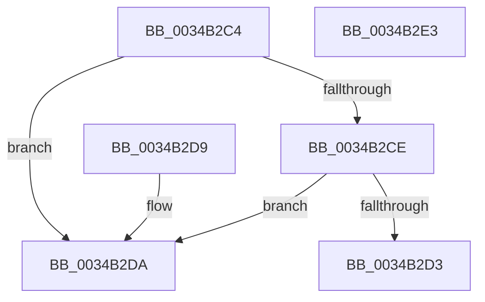

# MiSystemVaTypeHasWsles

- RVA: `0x0034B2C4`–`0x0034B2E4` (길이 `32` bytes)
- VA: `0x000000014034B2C4`
- 실행 섹션: `.text`
- PDB 이름 있음: `예`; PDB Function 태그: `아니요`
- unwind 정보 RVA: `0x000DB714`
- 디코드: `13`개 명령, `32/32` bytes 표시
- 미해석 바이트: `0` (있으면 어셈블리에 `.byte`로 보존)

> 이 문서는 커널 이미지의 기계어와 PDB 기호를 분석해 생성했습니다. 4번과 5번은 함수 원형과 자료형을 바이너리 사용 방식에서 추정한 C 해석이며 원본 소스 복구 결과는 아닙니다.

## 1. Dependencies

- 직접 호출 지점: **0**; 고유 호출 대상: **0**
- 직접 호출자로 확인된 함수: **2**
- RIP 상대 이미지 참조: **0**

### Outgoing calls
- 직접 디코드된 call 명령이 없습니다.

### Direct callers
- [MiTrimSharedPageFromViews](../2E/MiTrimSharedPageFromViews_function_002E16F8.md) at `0x002E1AFF`
- [MiSystemFault](MiSystemFault_function_0034AA64.md) at `0x0034ABBC`

### Static image references
- 디코드된 RIP-relative 메모리 참조가 없습니다.

## 2. Other-region calls and transfers

- 다른 실행 섹션으로 향하는 call: **0**
- 별도 외부 분기/꼬리 이동을 확인하지 못했습니다.

## 3. Assembly (complete function range)

```asm
0034B2C4  8D 41 FB                        lea eax, [rcx - 5]
0034B2C7  A9 F9 FF FF FF                  test eax, 0xfffffff9
0034B2CC  75 0C                           jne 0x14034b2da
0034B2CE  83 F9 09                        cmp ecx, 9
0034B2D1  74 07                           je 0x14034b2da
0034B2D3  B8 01 00 00 00                  mov eax, 1
0034B2D8  C3                              ret
0034B2D9  CC                              int3
0034B2DA  33 C0                           xor eax, eax
0034B2DC  83 F9 11                        cmp ecx, 0x11
0034B2DF  0F 94 C0                        sete al
0034B2E2  C3                              ret
0034B2E3  CC                              int3
```

## 4. C-style interpretation (structured pseudocode)

```c
__int64 __fastcall MiSystemVaTypeHasWsles(__int64 a1)
{
    __int64 result;

    if ((((unsigned int)(a1 - 5)) & (0xFFFFFFF9ULL)) != 0) goto loc_0034B2DA;
    if (((unsigned int)(a1)) == 9) goto loc_0034B2DA;
    return 1;
loc_0034B2DA:
    result = 0;
    result = (((unsigned int)(a1)) == 17) ? 1 : 0;
    return result;
}
```

## 5. (Beta) C Style

```c
int64_t MiSystemVaTypeHasWsles(void *Arg1)
{
    uint8_t *arg1 = (uint8_t *)Arg1;

    int64_t result;

    if ((((uint32_t)(Arg1 - 5)) & (0xFFFFFFF9ULL)) != 0) goto loc_0034B2DA;
    if (((uint32_t)(Arg1)) == 9) goto loc_0034B2DA;
    return 1;
loc_0034B2DA:
    result = 0;
    result = (((uint32_t)(Arg1)) == 17) ? 1 : 0;
    return result;
}
```

### 관측된 메모리 오프셋

구조체 형식이 확인되지 않은 접근은 인자 기준의 오프셋으로만 기록했습니다.

| 기준 인자 | 오프셋 표현 | 폭 (bit) | 접근 |
|---|---:|---:|---|
| `Arg1` | `- 0x5` | `32` | `R` |

## 6. Execution-region graph

[열기: 2D/3D 그래프와 함수 탐색 컨트롤 패널](../../../control-panel.html?section=text&rva=0x0034B2C4&view=graph)

- 2D 그래프는 위에서 아래로 흐르고, 3D 그래프는 빈 공간을 드래그해 회전합니다. Shift+드래그는 이동, 휠은 확대·축소, 함수 노드 선택은 대상 보고서 이동입니다.

### Static fallback


