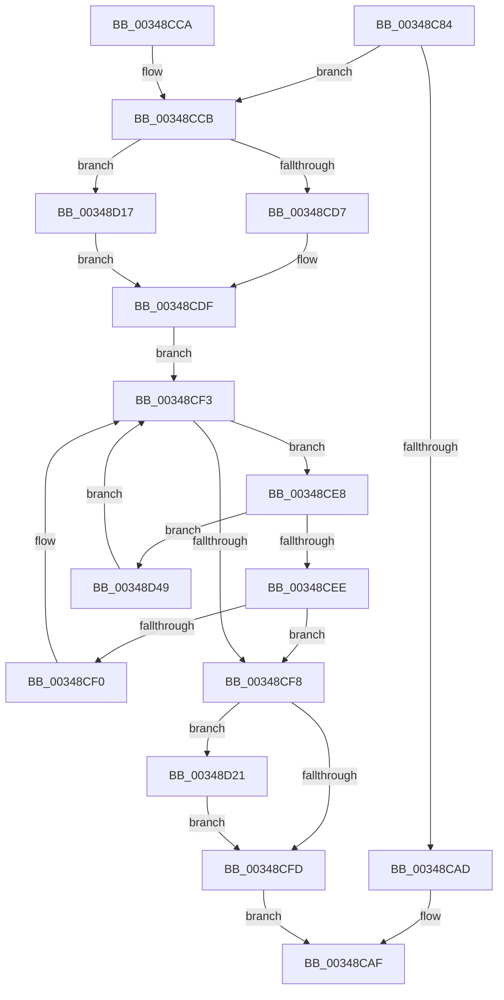

# MiTransientCombineAddress

- RVA: `0x00348C84`–`0x00348D4F` (길이 `203` bytes)
- VA: `0x0000000140348C84`
- 실행 섹션: `.text`
- PDB 이름 있음: `예`; PDB Function 태그: `아니요`
- unwind 정보 RVA: `0x0007827C`
- 디코드: `56`개 명령, `203/203` bytes 표시
- 미해석 바이트: `0` (있으면 어셈블리에 `.byte`로 보존)

> 이 문서는 커널 이미지의 기계어와 PDB 기호를 분석해 생성했습니다. 4번과 5번은 함수 원형과 자료형을 바이너리 사용 방식에서 추정한 C 해석이며 원본 소스 복구 결과는 아닙니다.

## 1. Dependencies

- 직접 호출 지점: **3**; 고유 호출 대상: **3**
- 직접 호출자로 확인된 함수: **1**
- RIP 상대 이미지 참조: **3**

### Outgoing calls
- `0x00348CD7` → [ExAcquireSpinLockShared](../24/ExAcquireSpinLockShared_function_0024DCE0.md) (function, `0x0024DCE0`)
- `0x00348D07` → [MiReleaseSpinLockShared](MiReleaseSpinLockShared_function_00348BF0.md) (function, `0x00348BF0`)
- `0x00348D1A` → [ExAcquireSpinLockSharedAtDpcLevel](../24/ExAcquireSpinLockSharedAtDpcLevel_function_00248E30.md) (function, `0x00248E30`)

### Direct callers
- [MiRaisedIrqlFault](MiRaisedIrqlFault_function_0034A6C8.md) at `0x0034A827`

### Static image references
- `0x00348CA2` → RVA `0x00E2FF04` (`.data`; read)
- `0x00348CCB` → RVA `0x00E2FF00` (`.data`; read)
- `0x00348CDF` → RVA `0x00E2FF08` (`.data`; read)

## 2. Other-region calls and transfers

- 다른 실행 섹션으로 향하는 call: **0**
- 별도 외부 분기/꼬리 이동을 확인하지 못했습니다.

## 3. Assembly (complete function range)

```asm
00348C84  48 8B C4                        mov rax, rsp
00348C87  48 89 58 08                     mov qword ptr [rax + 8], rbx
00348C8B  48 89 68 10                     mov qword ptr [rax + 0x10], rbp
00348C8F  48 89 70 18                     mov qword ptr [rax + 0x18], rsi
00348C93  48 89 78 20                     mov qword ptr [rax + 0x20], rdi
00348C97  41 56                           push r14
00348C99  48 83 EC 20                     sub rsp, 0x20
00348C9D  33 FF                           xor edi, edi
00348C9F  48 8B F2                        mov rsi, rdx
00348CA2  39 3D 5C 72 AE 00               cmp dword ptr [rip + 0xae725c], edi
00348CA8  48 8B E9                        mov rbp, rcx
00348CAB  75 1E                           jne 0x140348ccb
00348CAD  33 C0                           xor eax, eax
00348CAF  48 8B 5C 24 30                  mov rbx, qword ptr [rsp + 0x30]
00348CB4  48 8B 6C 24 38                  mov rbp, qword ptr [rsp + 0x38]
00348CB9  48 8B 74 24 40                  mov rsi, qword ptr [rsp + 0x40]
00348CBE  48 8B 7C 24 48                  mov rdi, qword ptr [rsp + 0x48]
00348CC3  48 83 C4 20                     add rsp, 0x20
00348CC7  41 5E                           pop r14
00348CC9  C3                              ret
00348CCA  CC                              int3
00348CCB  48 8D 0D 2E 72 AE 00            lea rcx, [rip + 0xae722e]
00348CD2  45 85 C0                        test r8d, r8d
00348CD5  75 40                           jne 0x140348d17
00348CD7  E8 04 50 F0 FF                  call 0x14024dce0
00348CDC  44 8A F0                        mov r14b, al
00348CDF  48 8B 1D 22 72 AE 00            mov rbx, qword ptr [rip + 0xae7222]
00348CE6  EB 0B                           jmp 0x140348cf3
00348CE8  48 3B 6B 18                     cmp rbp, qword ptr [rbx + 0x18]
00348CEC  77 5B                           ja 0x140348d49
00348CEE  73 08                           jae 0x140348cf8
00348CF0  48 8B 1B                        mov rbx, qword ptr [rbx]
00348CF3  48 85 DB                        test rbx, rbx
00348CF6  75 F0                           jne 0x140348ce8
00348CF8  48 85 DB                        test rbx, rbx
00348CFB  75 24                           jne 0x140348d21
00348CFD  41 8A D6                        mov dl, r14b
00348D00  48 8D 0D F9 71 AE 00            lea rcx, [rip + 0xae71f9]
00348D07  E8 E4 FE FF FF                  call 0x140348bf0
00348D0C  48 85 DB                        test rbx, rbx
00348D0F  40 0F 95 C7                     setne dil
00348D13  8B C7                           mov eax, edi
00348D15  EB 98                           jmp 0x140348caf
00348D17  41 B6 11                        mov r14b, 0x11
00348D1A  E8 11 01 F0 FF                  call 0x140248e30
00348D1F  EB BE                           jmp 0x140348cdf
00348D21  48 C1 EE 09                     shr rsi, 9
00348D25  48 B8 F8 FF FF FF 7F 00 00 00   movabs rax, 0x7ffffffff8
00348D2F  48 23 F0                        and rsi, rax
00348D32  48 B8 00 00 00 00 80 F6 FF FF   movabs rax, 0xfffff68000000000
00348D3C  48 03 F0                        add rsi, rax
00348D3F  48 39 73 28                     cmp qword ptr [rbx + 0x28], rsi
00348D43  48 0F 45 DF                     cmovne rbx, rdi
00348D47  EB B4                           jmp 0x140348cfd
00348D49  48 8B 5B 08                     mov rbx, qword ptr [rbx + 8]
00348D4D  EB A4                           jmp 0x140348cf3
```

## 4. C-style interpretation (structured pseudocode)

```c
__int64 __fastcall MiTransientCombineAddress(__int64 a1, __int64 a2, int a3)
{
    __int64 result;
    __int64 v_rbx;
    __int64 v_rdi;
    __int64 v_rsi;
    __int64 v_rsp;
    unsigned __int64 v_stack_p10;
    unsigned __int64 v_stack_p18;
    unsigned __int64 v_stack_p20;
    unsigned __int64 v_stack_p8;

    *(unsigned __int64 *)(v_rsp + 8) = v_rbx;
    *(unsigned __int64 *)(v_rsp + 16) = v_rbp;
    *(unsigned __int64 *)(v_rsp + 24) = v_rsi;
    *(unsigned __int64 *)(v_rsp + 32) = v_rdi;
    v_rsp = (v_rsp) - (32);
    v_rdi = 0;
    if ((*(unsigned int *)(v_rip + 11432540)) != 0) goto loc_00348CCB;
    result = 0;
loc_00348CAF:
    v_rsp = (v_rsp) + (32);
    return result;
loc_00348CCB:
    if (a3 != 0) goto loc_00348D17;
    result = ExAcquireSpinLockShared(v_rip + 11432494, a2, a3, a4);
loc_00348CDF:
    goto loc_00348CF3;
loc_00348CE8:
    if (v_stack_p10 > (*(unsigned __int64 *)(*(unsigned __int64 *)(v_rip + 11432482) + 24))) goto loc_00348D49;
    if (v_stack_p10 >= (*(unsigned __int64 *)(*(unsigned __int64 *)(v_rip + 11432482) + 24))) goto loc_00348CF8;
loc_00348CF3:
    if (*(unsigned __int64 *)(*(unsigned __int64 *)(v_rip + 11432482)) != 0) goto loc_00348CE8;
loc_00348CF8:
    if (*(unsigned __int64 *)(*(unsigned __int64 *)(v_rip + 11432482)) != 0) goto loc_00348D21;
loc_00348CFD:
    result = MiReleaseSpinLockShared(v_rip + 11432441, (unsigned __int8)((unsigned __int8)(result)), a3, a4);
    v_rdi = (*(unsigned __int64 *)(*(unsigned __int64 *)(v_rip + 11432482)) != 0) ? 1 : 0;
    goto loc_00348CAF;
loc_00348D17:
    result = ExAcquireSpinLockSharedAtDpcLevel(v_rip + 11432441, (unsigned __int8)((unsigned __int8)(result)), a3, a4);
    goto loc_00348CDF;
loc_00348D21:
    v_rsi = (v_stack_p18) >> (9);
    v_rsi = (v_rsi) & (result);
    v_rsi = (v_rsi) + (result);
    v_rbx = *(unsigned __int64 *)(*(unsigned __int64 *)(v_rip + 11432482));
    if ((*(unsigned __int64 *)(*(unsigned __int64 *)(*(unsigned __int64 *)(v_rip + 11432482)) + 40)) != v_rsi) { v_rbx = v_rdi; }
    goto loc_00348CFD;
loc_00348D49:
    goto loc_00348CF3;
}
```

## 5. (Beta) C Style

```c
int64_t MiTransientCombineAddress(int64_t Arg1, int64_t Arg2, int32_t Arg3)
{
    int64_t result;
    int64_t local_rbx;
    int64_t local_rdi;
    int64_t local_rsi;
    int64_t local_rsp;
    uint64_t v_stack_p10;
    uint64_t v_stack_p18;
    uint64_t v_stack_p20;
    uint64_t v_stack_p8;

    *(uint64_t *)(local_rsp + 0x8) = local_rbx;
    *(uint64_t *)(local_rsp + 0x10) = local_rbp;
    *(uint64_t *)(local_rsp + 0x18) = local_rsi;
    *(uint64_t *)(local_rsp + 0x20) = local_rdi;
    local_rsp = (local_rsp) - (32);
    local_rdi = 0;
    if ((*(uint32_t *)(v_rip + 0xAE725C)) != 0) goto loc_00348CCB;
    result = 0;
loc_00348CAF:
    local_rsp = (local_rsp) + (32);
    return result;
loc_00348CCB:
    if (Arg3 != 0) goto loc_00348D17;
    result = ExAcquireSpinLockShared(v_rip + 11432494, Arg2, Arg3, a4);
loc_00348CDF:
    goto loc_00348CF3;
loc_00348CE8:
    if (v_stack_p10 > (*(uint64_t *)(*(uint64_t *)(v_rip + 0xAE7222) + 0x18))) goto loc_00348D49;
    if (v_stack_p10 >= (*(uint64_t *)(*(uint64_t *)(v_rip + 0xAE7222) + 0x18))) goto loc_00348CF8;
loc_00348CF3:
    if (*(uint64_t *)(*(uint64_t *)(v_rip + 0xAE7222)) != 0) goto loc_00348CE8;
loc_00348CF8:
    if (*(uint64_t *)(*(uint64_t *)(v_rip + 0xAE7222)) != 0) goto loc_00348D21;
loc_00348CFD:
    result = MiReleaseSpinLockShared(v_rip + 11432441, (uint8_t)((uint8_t)(result)), Arg3, a4);
    local_rdi = (*(uint64_t *)(*(uint64_t *)(v_rip + 0xAE7222)) != 0) ? 1 : 0;
    goto loc_00348CAF;
loc_00348D17:
    result = ExAcquireSpinLockSharedAtDpcLevel(v_rip + 11432441, (uint8_t)((uint8_t)(result)), Arg3, a4);
    goto loc_00348CDF;
loc_00348D21:
    local_rsi = (v_stack_p18) >> (9);
    local_rsi = (local_rsi) & (result);
    local_rsi = (local_rsi) + (result);
    local_rbx = *(uint64_t *)(*(uint64_t *)(v_rip + 0xAE7222));
    if ((*(uint64_t *)(*(uint64_t *)(*(uint64_t *)(v_rip + 0xAE7222)) + 0x28)) != local_rsi) { local_rbx = local_rdi; }
    goto loc_00348CFD;
loc_00348D49:
    goto loc_00348CF3;
}
```

## 6. Execution-region graph

[열기: 2D/3D 그래프와 함수 탐색 컨트롤 패널](../../../control-panel.html?section=text&rva=0x00348C84&view=graph)

- 2D 그래프는 위에서 아래로 흐르고, 3D 그래프는 빈 공간을 드래그해 회전합니다. Shift+드래그는 이동, 휠은 확대·축소, 함수 노드 선택은 대상 보고서 이동입니다.

### Static fallback


