# MiTrimOrAgeWorkingSet

- RVA: `0x0034EFC0`–`0x0034F327` (길이 `871` bytes)
- VA: `0x000000014034EFC0`
- 실행 섹션: `.text`
- PDB 이름 있음: `예`; PDB Function 태그: `아니요`
- unwind 정보 RVA: `0x00078BC8`
- 디코드: `237`개 명령, `871/871` bytes 표시
- 미해석 바이트: `0` (있으면 어셈블리에 `.byte`로 보존)

> 이 문서는 커널 이미지의 기계어와 PDB 기호를 분석해 생성했습니다. 4번과 5번은 함수 원형과 자료형을 바이너리 사용 방식에서 추정한 C 해석이며 원본 소스 복구 결과는 아닙니다.

## 1. Dependencies

- 직접 호출 지점: **17**; 고유 호출 대상: **13**
- 직접 호출자로 확인된 함수: **1**
- RIP 상대 이미지 참조: **2**

### Outgoing calls
- `0x0034EFF4` → [PfLogForegroundProcess](../3B/PfLogForegroundProcess_function_003BA5CC.md) (function, `0x003BA5CC`)
- `0x0034F059` → [MiAttachWorkingSet](../44/MiAttachWorkingSet_function_00443BBC.md) (function, `0x00443BBC`)
- `0x0034F070` → [MiEmptyWorkingSetInitiate](../2A/MiEmptyWorkingSetInitiate_function_002A7128.md) (function, `0x002A7128`)
- `0x0034F078` → [MiLockWorkingSetShared](../27/MiLockWorkingSetShared_function_0027CBF0.md) (function, `0x0027CBF0`)
- `0x0034F09D` → [MiTrimWorkingSet](../2A/MiTrimWorkingSet_function_002AD134.md) (function, `0x002AD134`)
- `0x0034F0BF` → [MiTrimWorkingSet](../2A/MiTrimWorkingSet_function_002AD134.md) (function, `0x002AD134`)
- `0x0034F10B` → [MiComputeTrimAmount](../4E/MiComputeTrimAmount_function_004EDAE4.md) (function, `0x004EDAE4`)
- `0x0034F14F` → [MiTrimWorkingSet](../2A/MiTrimWorkingSet_function_002AD134.md) (function, `0x002AD134`)
- `0x0034F20D` → [MiCaptureAndResetWorkingSetAccessBits](../47/MiCaptureAndResetWorkingSetAccessBits_function_00473FC0.md) (function, `0x00473FC0`)
- `0x0034F226` → [MiDrainOldAccessBuffers](../2C/MiDrainOldAccessBuffers_function_002C0C30.md) (function, `0x002C0C30`)
- `0x0034F231` → [MiUnlockWorkingSetShared](../27/MiUnlockWorkingSetShared_function_0027D690.md) (function, `0x0027D690`)
- `0x0034F23B` → [MiAgeAweRegions](../44/MiAgeAweRegions_function_004464A4.md) (function, `0x004464A4`)
- `0x0034F243` → [MiDetachFromWorkingSet](../3C/MiDetachFromWorkingSet_function_003C72B0.md) (function, `0x003C72B0`)
- `0x0034F260` → [MiCheckAndProcessCcAccessLog](../45/MiCheckAndProcessCcAccessLog_function_0045D1A4.md) (function, `0x0045D1A4`)
- `0x0034F293` → [MiAgeWorkingSet](../2C/MiAgeWorkingSet_function_002C21E0.md) (function, `0x002C21E0`)
- `0x0034F2D6` → [MiAgeWorkingSet](../2C/MiAgeWorkingSet_function_002C21E0.md) (function, `0x002C21E0`)
- `0x0034F2FF` → [MiAgeWorkingSet](../2C/MiAgeWorkingSet_function_002C21E0.md) (function, `0x002C21E0`)

### Direct callers
- [MiProcessWorkingSets](MiProcessWorkingSets_function_0034E710.md) at `0x0034E8CC`

### Static image references
- `0x0034F037` → RVA `0x00E30088` (`.data`; read)
- `0x0034F0F4` → RVA `0x000110F0` (`.rdata`; read)

## 2. Other-region calls and transfers

- 다른 실행 섹션으로 향하는 call: **0**
- 별도 외부 분기/꼬리 이동을 확인하지 못했습니다.

## 3. Assembly (complete function range)

```asm
0034EFC0  48 89 5C 24 10                  mov qword ptr [rsp + 0x10], rbx
0034EFC5  55                              push rbp
0034EFC6  56                              push rsi
0034EFC7  57                              push rdi
0034EFC8  41 54                           push r12
0034EFCA  41 55                           push r13
0034EFCC  41 56                           push r14
0034EFCE  41 57                           push r15
0034EFD0  48 83 EC 40                     sub rsp, 0x40
0034EFD4  8B 99 B8 00 00 00               mov ebx, dword ptr [rcx + 0xb8]
0034EFDA  41 8B F8                        mov edi, r8d
0034EFDD  8B C3                           mov eax, ebx
0034EFDF  4C 8B EA                        mov r13, rdx
0034EFE2  C1 E8 10                        shr eax, 0x10
0034EFE5  48 8B F1                        mov rsi, rcx
0034EFE8  45 8B F0                        mov r14d, r8d
0034EFEB  3C 02                           cmp al, 2
0034EFED  75 0A                           jne 0x14034eff9
0034EFEF  F6 C3 0F                        test bl, 0xf
0034EFF2  75 05                           jne 0x14034eff9
0034EFF4  E8 D3 B5 06 00                  call 0x1403ba5cc
0034EFF9  33 ED                           xor ebp, ebp
0034EFFB  41 BC 00 03 00 00               mov r12d, 0x300
0034F001  41 85 FC                        test r12d, edi
0034F004  74 2A                           je 0x14034f030
0034F006  F6 C3 0F                        test bl, 0xf
0034F009  75 14                           jne 0x14034f01f
0034F00B  48 8B 86 80 FE FF FF            mov rax, qword ptr [rsi - 0x180]
0034F012  0F BA F7 08                     btr edi, 8
0034F016  48 85 C0                        test rax, rax
0034F019  41 0F 45 FE                     cmovne edi, r14d
0034F01D  EB 06                           jmp 0x14034f025
0034F01F  81 E7 FF FC FF FF               and edi, 0xfffffcff
0034F025  85 FF                           test edi, edi
0034F027  75 07                           jne 0x14034f030
0034F029  33 C0                           xor eax, eax
0034F02B  E9 38 02 00 00                  jmp 0x14034f268
0034F030  0F B7 8E AE 00 00 00            movzx ecx, word ptr [rsi + 0xae]
0034F037  48 8B 05 4A 10 AE 00            mov rax, qword ptr [rip + 0xae104a]
0034F03E  48 8B 04 C8                     mov rax, qword ptr [rax + rcx*8]
0034F042  48 8B CE                        mov rcx, rsi
0034F045  48 89 44 24 30                  mov qword ptr [rsp + 0x30], rax
0034F04A  48 8B 98 C0 44 00 00            mov rbx, qword ptr [rax + 0x44c0]
0034F051  48 89 9C 24 98 00 00 00         mov qword ptr [rsp + 0x98], rbx
0034F059  E8 5E 4B 0F 00                  call 0x140443bbc
0034F05E  40 F6 C7 04                     test dil, 4
0034F062  74 11                           je 0x14034f075
0034F064  49 83 C9 FF                     or r9, 0xffffffffffffffff
0034F068  45 33 C0                        xor r8d, r8d
0034F06B  33 D2                           xor edx, edx
0034F06D  48 8B CE                        mov rcx, rsi
0034F070  E8 B3 80 F5 FF                  call 0x1402a7128
0034F075  48 8B CE                        mov rcx, rsi
0034F078  E8 73 DB F2 FF                  call 0x14027cbf0
0034F07D  44 8A F8                        mov r15b, al
0034F080  41 85 FC                        test r12d, edi
0034F083  74 1D                           je 0x14034f0a2
0034F085  48 8B 96 90 00 00 00            mov rdx, qword ptr [rsi + 0x90]
0034F08C  45 33 C9                        xor r9d, r9d
0034F08F  44 8A C0                        mov r8b, al
0034F092  C7 44 24 20 02 00 00 00         mov dword ptr [rsp + 0x20], 2
0034F09A  48 8B CE                        mov rcx, rsi
0034F09D  E8 92 E0 F5 FF                  call 0x1402ad134
0034F0A2  40 84 FF                        test dil, dil
0034F0A5  79 1D                           jns 0x14034f0c4
0034F0A7  48 8B 96 90 00 00 00            mov rdx, qword ptr [rsi + 0x90]
0034F0AE  45 33 C9                        xor r9d, r9d
0034F0B1  45 8A C7                        mov r8b, r15b
0034F0B4  C7 44 24 20 04 00 00 00         mov dword ptr [rsp + 0x20], 4
0034F0BC  48 8B CE                        mov rcx, rsi
0034F0BF  E8 70 E0 F5 FF                  call 0x1402ad134
0034F0C4  44 0F B7 A3 12 01 00 00         movzx r12d, word ptr [rbx + 0x112]
0034F0CC  41 BA 01 00 00 00               mov r10d, 1
0034F0D2  44 89 A4 24 80 00 00 00         mov dword ptr [rsp + 0x80], r12d
0034F0DA  8B C5                           mov eax, ebp
0034F0DC  89 84 24 90 00 00 00            mov dword ptr [rsp + 0x90], eax
0034F0E3  44 8B F5                        mov r14d, ebp
0034F0E6  41 84 FA                        test r10b, dil
0034F0E9  0F 84 92 01 00 00               je 0x14034f281
0034F0EF  41 0F B6 45 00                  movzx eax, byte ptr [r13]
0034F0F4  48 8D 0D F5 1F CC FF            lea rcx, [rip - 0x33e00b]
0034F0FB  83 E0 7F                        and eax, 0x7f
0034F0FE  48 8B D6                        mov rdx, rsi
0034F101  8A 04 08                        mov al, byte ptr [rax + rcx]
0034F104  49 8B CD                        mov rcx, r13
0034F107  41 88 45 01                     mov byte ptr [r13 + 1], al
0034F10B  E8 D4 E9 19 00                  call 0x1404edae4
0034F110  48 8B D8                        mov rbx, rax
0034F113  48 85 C0                        test rax, rax
0034F116  74 56                           je 0x14034f16e
0034F118  41 B4 08                        mov r12b, 8
0034F11B  45 38 65 01                     cmp byte ptr [r13 + 1], r12b
0034F11F  74 45                           je 0x14034f166
0034F121  41 80 C4 FF                     add r12b, 0xff
0034F125  48 8B D3                        mov rdx, rbx
0034F128  41 0F B6 CC                     movzx ecx, r12b
0034F12C  4C 8B 44 CE 28                  mov r8, qword ptr [rsi + rcx*8 + 0x28]
0034F131  4C 3B C3                        cmp r8, rbx
0034F134  49 0F 46 D0                     cmovbe rdx, r8
0034F138  48 85 D2                        test rdx, rdx
0034F13B  74 23                           je 0x14034f160
0034F13D  45 0F B6 CC                     movzx r9d, r12b
0034F141  45 8A C7                        mov r8b, r15b
0034F144  48 8B CE                        mov rcx, rsi
0034F147  C7 44 24 20 11 00 00 00         mov dword ptr [rsp + 0x20], 0x11
0034F14F  E8 E0 DF F5 FF                  call 0x1402ad134
0034F154  49 01 45 60                     add qword ptr [r13 + 0x60], rax
0034F158  48 3B D8                        cmp rbx, rax
0034F15B  76 09                           jbe 0x14034f166
0034F15D  48 2B D8                        sub rbx, rax
0034F160  45 3A 65 01                     cmp r12b, byte ptr [r13 + 1]
0034F164  75 BB                           jne 0x14034f121
0034F166  44 8B A4 24 80 00 00 00         mov r12d, dword ptr [rsp + 0x80]
0034F16E  41 8A 4D 00                     mov cl, byte ptr [r13]
0034F172  44 8B C5                        mov r8d, ebp
0034F175  8A C1                           mov al, cl
0034F177  24 7F                           and al, 0x7f
0034F179  75 04                           jne 0x14034f17f
0034F17B  84 C9                           test cl, cl
0034F17D  79 04                           jns 0x14034f183
0034F17F  3C 04                           cmp al, 4
0034F181  75 1B                           jne 0x14034f19e
0034F183  48 8B 84 24 98 00 00 00         mov rax, qword ptr [rsp + 0x98]
0034F18B  41 BA 01 00 00 00               mov r10d, 1
0034F191  66 39 A8 12 01 00 00            cmp word ptr [rax + 0x112], bp
0034F198  45 0F 45 C2                     cmovne r8d, r10d
0034F19C  EB 06                           jmp 0x14034f1a4
0034F19E  41 BA 01 00 00 00               mov r10d, 1
0034F1A4  41 8A 45 04                     mov al, byte ptr [r13 + 4]
0034F1A8  41 2A C2                        sub al, r10b
0034F1AB  A8 FD                           test al, 0xfd
0034F1AD  0F 84 43 01 00 00               je 0x14034f2f6
0034F1B3  8B C5                           mov eax, ebp
0034F1B5  8B 9E B8 00 00 00               mov ebx, dword ptr [rsi + 0xb8]
0034F1BB  4C 8B E5                        mov r12, rbp
0034F1BE  45 85 F6                        test r14d, r14d
0034F1C1  75 68                           jne 0x14034f22b
0034F1C3  85 C0                           test eax, eax
0034F1C5  74 31                           je 0x14034f1f8
0034F1C7  8B C3                           mov eax, ebx
0034F1C9  41 8D 4E 03                     lea ecx, [r14 + 3]
0034F1CD  C1 E8 10                        shr eax, 0x10
0034F1D0  49 8D 55 08                     lea rdx, [r13 + 8]
0034F1D4  3C 02                           cmp al, 2
0034F1D6  45 8D 4E 08                     lea r9d, [r14 + 8]
0034F1DA  4C 8B C6                        mov r8, rsi
0034F1DD  41 0F 45 CA                     cmovne ecx, r10d
0034F1E1  4D 2B C5                        sub r8, r13
0034F1E4  49 8B 44 10 20                  mov rax, qword ptr [r8 + rdx + 0x20]
0034F1E9  48 D3 E8                        shr rax, cl
0034F1EC  48 01 02                        add qword ptr [rdx], rax
0034F1EF  48 8D 52 08                     lea rdx, [rdx + 8]
0034F1F3  4D 2B CA                        sub r9, r10
0034F1F6  75 EC                           jne 0x14034f1e4
0034F1F8  40 F6 C7 10                     test dil, 0x10
0034F1FC  75 06                           jne 0x14034f204
0034F1FE  40 F6 C7 08                     test dil, 8
0034F202  74 0E                           je 0x14034f212
0034F204  44 8B C7                        mov r8d, edi
0034F207  41 8A D7                        mov dl, r15b
0034F20A  48 8B CE                        mov rcx, rsi
0034F20D  E8 AE 4D 12 00                  call 0x140473fc0
0034F212  49 BC 20 03 00 00 80 F7 FF FF   movabs r12, 0xfffff78000000320
0034F21C  48 8B CE                        mov rcx, rsi
0034F21F  4D 8B 24 24                     mov r12, qword ptr [r12]
0034F223  49 8B D4                        mov rdx, r12
0034F226  E8 05 1A F7 FF                  call 0x1402c0c30
0034F22B  41 8A D7                        mov dl, r15b
0034F22E  48 8B CE                        mov rcx, rsi
0034F231  E8 5A E4 F2 FF                  call 0x14027d690
0034F236  F6 C3 0F                        test bl, 0xf
0034F239  75 05                           jne 0x14034f240
0034F23B  E8 64 72 0F 00                  call 0x1404464a4
0034F240  48 8B CE                        mov rcx, rsi
0034F243  E8 68 80 07 00                  call 0x1403c72b0
0034F248  45 85 F6                        test r14d, r14d
0034F24B  75 18                           jne 0x14034f265
0034F24D  48 8B 4C 24 30                  mov rcx, qword ptr [rsp + 0x30]
0034F252  40 F6 C7 18                     test dil, 0x18
0034F256  49 8B D4                        mov rdx, r12
0034F259  40 0F 95 C5                     setne bpl
0034F25D  44 8B C5                        mov r8d, ebp
0034F260  E8 3F DF 10 00                  call 0x14045d1a4
0034F265  41 8B C6                        mov eax, r14d
0034F268  48 8B 9C 24 88 00 00 00         mov rbx, qword ptr [rsp + 0x88]
0034F270  48 83 C4 40                     add rsp, 0x40
0034F274  41 5F                           pop r15
0034F276  41 5E                           pop r14
0034F278  41 5D                           pop r13
0034F27A  41 5C                           pop r12
0034F27C  5F                              pop rdi
0034F27D  5E                              pop rsi
0034F27E  5D                              pop rbp
0034F27F  C3                              ret
0034F280  CC                              int3
0034F281  40 F6 C7 02                     test dil, 2
0034F285  74 66                           je 0x14034f2ed
0034F287  45 8B CC                        mov r9d, r12d
0034F28A  45 8B C2                        mov r8d, r10d
0034F28D  41 8A D7                        mov dl, r15b
0034F290  48 8B CE                        mov rcx, rsi
0034F293  E8 48 2F F7 FF                  call 0x1402c21e0
0034F298  44 8B F0                        mov r14d, eax
0034F29B  41 BA 01 00 00 00               mov r10d, 1
0034F2A1  41 8B C2                        mov eax, r10d
0034F2A4  89 84 24 90 00 00 00            mov dword ptr [rsp + 0x90], eax
0034F2AB  45 85 F6                        test r14d, r14d
0034F2AE  0F 85 01 FF FF FF               jne 0x14034f1b5
0034F2B4  40 38 6B 37                     cmp byte ptr [rbx + 0x37], bpl
0034F2B8  0F 84 F7 FE FF FF               je 0x14034f1b5
0034F2BE  41 8D 44 24 FF                  lea eax, [r12 - 1]
0034F2C3  83 F8 08                        cmp eax, 8
0034F2C6  77 45                           ja 0x14034f30d
0034F2C8  45 8D 4A 09                     lea r9d, [r10 + 9]
0034F2CC  41 8A D7                        mov dl, r15b
0034F2CF  45 8D 42 01                     lea r8d, [r10 + 1]
0034F2D3  48 8B CE                        mov rcx, rsi
0034F2D6  E8 05 2F F7 FF                  call 0x1402c21e0
0034F2DB  44 8B F0                        mov r14d, eax
0034F2DE  8B 84 24 90 00 00 00            mov eax, dword ptr [rsp + 0x90]
0034F2E5  44 8B D0                        mov r10d, eax
0034F2E8  E9 C8 FE FF FF                  jmp 0x14034f1b5
0034F2ED  40 F6 C7 20                     test dil, 0x20
0034F2F1  74 22                           je 0x14034f315
0034F2F3  45 8B C2                        mov r8d, r10d
0034F2F6  45 8B CC                        mov r9d, r12d
0034F2F9  41 8A D7                        mov dl, r15b
0034F2FC  48 8B CE                        mov rcx, rsi
0034F2FF  E8 DC 2E F7 FF                  call 0x1402c21e0
0034F304  44 8B F0                        mov r14d, eax
0034F307  41 BA 01 00 00 00               mov r10d, 1
0034F30D  41 8B C2                        mov eax, r10d
0034F310  E9 A0 FE FF FF                  jmp 0x14034f1b5
0034F315  40 F6 C7 40                     test dil, 0x40
0034F319  0F 84 96 FE FF FF               je 0x14034f1b5
0034F31F  41 B8 02 00 00 00               mov r8d, 2
0034F325  EB CF                           jmp 0x14034f2f6
```

## 4. C-style interpretation (structured pseudocode)

```c
__int64 __fastcall MiTrimOrAgeWorkingSet(__int64 a1, __int64 a2, int a3, __int64 a4)
{
    __int64 result;
    __int64 v_r12;
    __int64 v_rbp;
    __int64 v_rbx;
    __int64 v_rdi;
    __int64 v_rsp;
    unsigned __int64 v_stack_m48;
    unsigned int v_stack_m58;
    unsigned __int64 v_stack_p10;
    unsigned int v_stack_p18;
    unsigned __int64 v_stack_p20;
    unsigned int v_stack_p8;
    unsigned int v_stack_p90;

    v_stack_p10 = v_rbx;
    v_rsp = (v_rsp) - (64);
    result = (unsigned int)(((unsigned int)((unsigned int)((unsigned int)(*(unsigned int *)(a1 + 184))))) >> (16));
    if (((unsigned __int8)(result)) != 2) goto loc_0034EFF9;
    if ((((unsigned __int8)((unsigned int)(*(unsigned int *)(a1 + 184)))) & (15)) == 0) {
        result = PfLogForegroundProcess(a1, a2, a3, a4);
    }
    v_rbp = 0;
    if (((768) & ((unsigned int)((unsigned int)(a3)))) == 0) goto loc_0034F030;
    if ((((unsigned __int8)((unsigned int)(*(unsigned int *)(a1 + 184)))) & (15)) != 0) goto loc_0034F01F;
    v_rdi = (unsigned int)(a3);
    if (*(unsigned __int64 *)(a1 - 384) != 0) { v_rdi = (unsigned int)((unsigned int)(a3)); }
    goto loc_0034F025;
loc_0034F01F:
    v_rdi = (unsigned int)((v_rdi) & (0xFFFFFCFFULL));
loc_0034F025:
    if ((unsigned int)(v_rdi) != 0) goto loc_0034F030;
    result = 0;
    goto loc_0034F268;
loc_0034F030:
    v_stack_m48 = *(unsigned __int64 *)(*(unsigned __int64 *)(v_rip + 11407434) + *(unsigned __int16 *)(a1 + 174) * 8);
    v_stack_p20 = *(unsigned __int64 *)(*(unsigned __int64 *)(*(unsigned __int64 *)(v_rip + 11407434) + *(unsigned __int16 *)(a1 + 174) * 8) + 17600);
    result = MiAttachWorkingSet(a1, a2, a3, a4);
    if ((((unsigned __int8)(v_rdi)) & (4)) != 0) {
        a4 = (a4) | (-1);
        a3 = 0;
        a2 = 0;
        a1 = a1;
        result = MiEmptyWorkingSetInitiate(a1, a2, a3, a4);
    }
    result = MiLockWorkingSetShared(a1, a2, a3, a4);
    if (((768) & ((unsigned int)(v_rdi))) != 0) {
        a2 = *(unsigned __int64 *)(a1 + 144);
        a4 = 0;
        a3 = (unsigned __int8)(result);
        v_stack_m58 = 2;
        a1 = a1;
        result = MiTrimWorkingSet(a1, a2, a3, a4);
    }
    if (sign_flag) {
        a2 = *(unsigned __int64 *)(a1 + 144);
        a4 = 0;
        a3 = (unsigned __int8)((unsigned __int8)(result));
        v_stack_m58 = 4;
        a1 = a1;
        result = MiTrimWorkingSet(a1, a2, a3, a4);
    }
    v_stack_p8 = (unsigned int)(*(unsigned __int16 *)(*(unsigned __int64 *)(*(unsigned __int64 *)(*(unsigned __int64 *)(v_rip + 11407434) + *(unsigned __int16 *)(a1 + 174) * 8) + 17600) + 274));
    v_stack_p18 = 0;
    if (((1) & ((unsigned __int8)(v_rdi))) == 0) goto loc_0034F281;
    result = (unsigned int)((*(unsigned __int8 *)(a2)) & (127));
    *(unsigned __int8 *)(a2 + 1) = (unsigned __int8)(*(unsigned __int8 *)(result + v_rip - 3399691 * 1));
    result = MiComputeTrimAmount(a2, a1, a3, a4);
    if (result == 0) goto loc_0034F16E;
    if ((*(unsigned __int8 *)(a2 + 1)) == 8) goto loc_0034F166;
loc_0034F121:
    v_r12 = (unsigned __int8)((8) + (255));
    a2 = result;
    if ((*(unsigned __int64 *)(a1 + (unsigned __int8)(v_r12) * 8 + 40)) <= result) { a2 = *(unsigned __int64 *)(a1 + (unsigned __int8)(v_r12) * 8 + 40); }
    if (a2 == 0) goto loc_0034F160;
    v_stack_m58 = 17;
    result = MiTrimWorkingSet(a1, a2, (unsigned __int8)((unsigned __int8)(result)), (unsigned __int8)(v_r12));
    if (result <= result) goto loc_0034F166;
    v_rbx = (result) - (result);
loc_0034F160:
    if (((unsigned __int8)(v_r12)) != (*(unsigned __int8 *)(a2 + 1))) goto loc_0034F121;
loc_0034F166:
loc_0034F16E:
    result = (unsigned __int8)(((unsigned __int8)(*(unsigned __int8 *)(a2))) & (127));
    if (condition_is_not_equal) goto loc_0034F17F;
    if (!sign_flag) goto loc_0034F183;
loc_0034F17F:
    if (((unsigned __int8)(result)) != 4) goto loc_0034F19E;
loc_0034F183:
    a3 = 0;
    if ((*(unsigned __int16 *)(v_stack_p20 + 274)) != 0) { a3 = 1; }
    goto loc_0034F1A4;
loc_0034F19E:
loc_0034F1A4:
    result = (unsigned __int8)((*(unsigned __int8 *)(a2 + 4)) - (1));
    if ((((unsigned __int8)(result)) & (253)) == 0) goto loc_0034F2F6;
loc_0034F1B5:
    if (0 != 0) goto loc_0034F22B;
    if (0 == 0) goto loc_0034F1F8;
    result = (unsigned int)(((unsigned int)((unsigned int)((unsigned int)(*(unsigned int *)(a1 + 184))))) >> (16));
    a1 = 0 + 3;
    if (((unsigned __int8)(result)) != 2) { a1 = 1; }
    a3 = (a1) - (a2);
loc_0034F1E4:
    result = (*(unsigned __int64 *)(a3 + a2 + 8 * 1 + 32)) >> ((unsigned __int8)(a1));
    a4 = (0 + 8) - (1);
    if (condition_is_not_equal) goto loc_0034F1E4;
loc_0034F1F8:
    if ((((unsigned __int8)(v_rdi)) & (16)) != 0) goto loc_0034F204;
    if ((((unsigned __int8)(v_rdi)) & (8)) != 0) {
        a3 = (unsigned int)(v_rdi);
        a2 = (unsigned __int8)((unsigned __int8)(result));
        a1 = a1;
        result = MiCaptureAndResetWorkingSetAccessBits(a1, a2, a3, a4);
    }
    result = MiDrainOldAccessBuffers(a1, *(unsigned __int64 *)(0), a3, a4);
loc_0034F22B:
    result = MiUnlockWorkingSetShared(a1, (unsigned __int8)((unsigned __int8)(result)), a3, a4);
    if ((((unsigned __int8)((unsigned int)(*(unsigned int *)(a1 + 184)))) & (15)) == 0) {
        result = MiAgeAweRegions(a1, (unsigned __int8)((unsigned __int8)(result)), a3, a4);
    }
    result = MiDetachFromWorkingSet(a1, (unsigned __int8)((unsigned __int8)(result)), a3, a4);
    if (0 == 0) {
        a1 = v_stack_m48;
        a2 = *(unsigned __int64 *)(0);
        v_rbp = ((((unsigned __int8)(v_rdi)) & (24)) != 0) ? 1 : 0;
        a3 = (unsigned int)(v_rbp);
        result = MiCheckAndProcessCcAccessLog(a1, a2, a3, a4);
    }
loc_0034F268:
    v_rsp = (v_rsp) + (64);
    return 0;
loc_0034F281:
    if ((((unsigned __int8)(v_rdi)) & (2)) == 0) goto loc_0034F2ED;
    result = MiAgeWorkingSet(a1, (unsigned __int8)((unsigned __int8)(result)), 1, (unsigned int)((unsigned int)(*(unsigned __int64 *)(0))));
    v_stack_p90 = 1;
    if ((unsigned int)((unsigned int)((unsigned int)(result))) != 0) goto loc_0034F1B5;
    if ((*(unsigned __int8 *)(v_stack_p10 + 55)) == ((unsigned __int8)(v_rbp))) goto loc_0034F1B5;
    if (((unsigned int)(*(unsigned __int64 *)(0) - 1)) > 8) goto loc_0034F30D;
    result = MiAgeWorkingSet(a1, (unsigned __int8)((unsigned __int8)(result)), 1 + 1, 1 + 9);
    goto loc_0034F1B5;
loc_0034F2ED:
    if ((((unsigned __int8)(v_rdi)) & (32)) == 0) goto loc_0034F315;
loc_0034F2F6:
    result = MiAgeWorkingSet(a1, (unsigned __int8)((unsigned __int8)(result)), (unsigned int)((unsigned int)((unsigned int)((unsigned int)((unsigned int)(v_stack_p90))))), (unsigned int)((unsigned int)(*(unsigned __int64 *)(0))));
loc_0034F30D:
    goto loc_0034F1B5;
loc_0034F315:
    if ((((unsigned __int8)(v_rdi)) & (64)) == 0) goto loc_0034F1B5;
    goto loc_0034F2F6;
}
```

## 5. (Beta) C Style

```c
int64_t MiTrimOrAgeWorkingSet(void *Arg1, void *Arg2, int32_t Arg3, int64_t Arg4)
{
    uint8_t *arg1 = (uint8_t *)Arg1;
    uint8_t *arg2 = (uint8_t *)Arg2;

    int64_t result;
    int64_t local_r12;
    int64_t local_rbp;
    int64_t local_rbx;
    int64_t local_rdi;
    int64_t local_rsp;
    uint64_t v_stack_m48;
    uint32_t v_stack_m58;
    uint64_t v_stack_p10;
    uint32_t v_stack_p18;
    uint64_t v_stack_p20;
    uint32_t v_stack_p8;
    uint32_t v_stack_p90;

    v_stack_p10 = local_rbx;
    local_rsp = (local_rsp) - (64);
    result = (uint32_t)(((uint32_t)((uint32_t)((uint32_t)(*(uint32_t *)(arg1 + 0xB8))))) >> (16));
    if (((uint8_t)(result)) != 2) goto loc_0034EFF9;
    if ((((uint8_t)((uint32_t)(*(uint32_t *)(arg1 + 0xB8)))) & (15)) == 0) {
        result = PfLogForegroundProcess(Arg1, Arg2, Arg3, Arg4);
    }
    local_rbp = 0;
    if (((768) & ((uint32_t)((uint32_t)(Arg3)))) == 0) goto loc_0034F030;
    if ((((uint8_t)((uint32_t)(*(uint32_t *)(arg1 + 0xB8)))) & (15)) != 0) goto loc_0034F01F;
    local_rdi = (uint32_t)(Arg3);
    if (*(uint64_t *)(arg1 - 0x180) != 0) { local_rdi = (uint32_t)((uint32_t)(Arg3)); }
    goto loc_0034F025;
loc_0034F01F:
    local_rdi = (uint32_t)((local_rdi) & (0xFFFFFCFFULL));
loc_0034F025:
    if ((uint32_t)(local_rdi) != 0) goto loc_0034F030;
    result = 0;
    goto loc_0034F268;
loc_0034F030:
    v_stack_m48 = *(uint64_t *)(*(uint64_t *)(v_rip + 0xAE104A) + *(uint16_t *)(arg1 + 0xAE) * 8);
    v_stack_p20 = *(uint64_t *)(*(uint64_t *)(*(uint64_t *)(v_rip + 0xAE104A) + *(uint16_t *)(arg1 + 0xAE) * 8) + 0x44C0);
    result = MiAttachWorkingSet(Arg1, Arg2, Arg3, Arg4);
    if ((((uint8_t)(local_rdi)) & (4)) != 0) {
        Arg4 = (Arg4) | (-1);
        Arg3 = 0;
        Arg2 = 0;
        Arg1 = Arg1;
        result = MiEmptyWorkingSetInitiate(Arg1, Arg2, Arg3, Arg4);
    }
    result = MiLockWorkingSetShared(Arg1, Arg2, Arg3, Arg4);
    if (((768) & ((uint32_t)(local_rdi))) != 0) {
        Arg2 = *(uint64_t *)(arg1 + 0x90);
        Arg4 = 0;
        Arg3 = (uint8_t)(result);
        v_stack_m58 = 2;
        Arg1 = Arg1;
        result = MiTrimWorkingSet(Arg1, Arg2, Arg3, Arg4);
    }
    if (sign_flag) {
        Arg2 = *(uint64_t *)(arg1 + 0x90);
        Arg4 = 0;
        Arg3 = (uint8_t)((uint8_t)(result));
        v_stack_m58 = 4;
        Arg1 = Arg1;
        result = MiTrimWorkingSet(Arg1, Arg2, Arg3, Arg4);
    }
    v_stack_p8 = (uint32_t)(*(uint16_t *)(*(uint64_t *)(*(uint64_t *)(*(uint64_t *)(v_rip + 0xAE104A) + *(uint16_t *)(arg1 + 0xAE) * 8) + 0x44C0) + 0x112));
    v_stack_p18 = 0;
    if (((1) & ((uint8_t)(local_rdi))) == 0) goto loc_0034F281;
    result = (uint32_t)((*(uint8_t *)(arg2)) & (127));
    *(uint8_t *)(arg2 + 0x1) = (uint8_t)(*(uint8_t *)(result + v_rip - 0x33E00B * 1));
    result = MiComputeTrimAmount(Arg2, Arg1, Arg3, Arg4);
    if (result == 0) goto loc_0034F16E;
    if ((*(uint8_t *)(arg2 + 0x1)) == 8) goto loc_0034F166;
loc_0034F121:
    local_r12 = (uint8_t)((8) + (255));
    Arg2 = result;
    if ((*(uint64_t *)(arg1 + (uint8_t)(local_r12) * 8 + 0x28)) <= result) { Arg2 = *(uint64_t *)(arg1 + (uint8_t)(local_r12) * 8 + 0x28); }
    if (Arg2 == NULL) goto loc_0034F160;
    v_stack_m58 = 17;
    result = MiTrimWorkingSet(Arg1, Arg2, (uint8_t)((uint8_t)(result)), (uint8_t)(local_r12));
    if (result <= result) goto loc_0034F166;
    local_rbx = (result) - (result);
loc_0034F160:
    if (((uint8_t)(local_r12)) != (*(uint8_t *)(arg2 + 0x1))) goto loc_0034F121;
loc_0034F166:
loc_0034F16E:
    result = (uint8_t)(((uint8_t)(*(uint8_t *)(arg2))) & (127));
    if (condition_is_not_equal) goto loc_0034F17F;
    if (!sign_flag) goto loc_0034F183;
loc_0034F17F:
    if (((uint8_t)(result)) != 4) goto loc_0034F19E;
loc_0034F183:
    Arg3 = 0;
    if ((*(uint16_t *)(v_stack_p20 + 0x112)) != 0) { Arg3 = 1; }
    goto loc_0034F1A4;
loc_0034F19E:
loc_0034F1A4:
    result = (uint8_t)((*(uint8_t *)(arg2 + 0x4)) - (1));
    if ((((uint8_t)(result)) & (253)) == 0) goto loc_0034F2F6;
loc_0034F1B5:
    if (0 != 0) goto loc_0034F22B;
    if (0 == 0) goto loc_0034F1F8;
    result = (uint32_t)(((uint32_t)((uint32_t)((uint32_t)(*(uint32_t *)(arg1 + 0xB8))))) >> (16));
    Arg1 = 0 + 3;
    if (((uint8_t)(result)) != 2) { Arg1 = 1; }
    Arg3 = (Arg1) - (Arg2);
loc_0034F1E4:
    result = (*(uint64_t *)(Arg3 + arg2 + 0x8 * 1 + 0x20)) >> ((uint8_t)(Arg1));
    Arg4 = (0 + 8) - (1);
    if (condition_is_not_equal) goto loc_0034F1E4;
loc_0034F1F8:
    if ((((uint8_t)(local_rdi)) & (16)) != 0) goto loc_0034F204;
    if ((((uint8_t)(local_rdi)) & (8)) != 0) {
        Arg3 = (uint32_t)(local_rdi);
        Arg2 = (uint8_t)((uint8_t)(result));
        Arg1 = Arg1;
        result = MiCaptureAndResetWorkingSetAccessBits(Arg1, Arg2, Arg3, Arg4);
    }
    result = MiDrainOldAccessBuffers(Arg1, *(uint64_t *)(0), Arg3, Arg4);
loc_0034F22B:
    result = MiUnlockWorkingSetShared(Arg1, (uint8_t)((uint8_t)(result)), Arg3, Arg4);
    if ((((uint8_t)((uint32_t)(*(uint32_t *)(arg1 + 0xB8)))) & (15)) == 0) {
        result = MiAgeAweRegions(Arg1, (uint8_t)((uint8_t)(result)), Arg3, Arg4);
    }
    result = MiDetachFromWorkingSet(Arg1, (uint8_t)((uint8_t)(result)), Arg3, Arg4);
    if (0 == 0) {
        Arg1 = v_stack_m48;
        Arg2 = *(uint64_t *)(0);
        local_rbp = ((((uint8_t)(local_rdi)) & (24)) != 0) ? 1 : 0;
        Arg3 = (uint32_t)(local_rbp);
        result = MiCheckAndProcessCcAccessLog(Arg1, Arg2, Arg3, Arg4);
    }
loc_0034F268:
    local_rsp = (local_rsp) + (64);
    return 0;
loc_0034F281:
    if ((((uint8_t)(local_rdi)) & (2)) == 0) goto loc_0034F2ED;
    result = MiAgeWorkingSet(Arg1, (uint8_t)((uint8_t)(result)), 1, (uint32_t)((uint32_t)(*(uint64_t *)(0))));
    v_stack_p90 = 1;
    if ((uint32_t)((uint32_t)((uint32_t)(result))) != 0) goto loc_0034F1B5;
    if ((*(uint8_t *)(v_stack_p10 + 0x37)) == ((uint8_t)(local_rbp))) goto loc_0034F1B5;
    if (((uint32_t)(*(uint64_t *)(0) - 1)) > 8) goto loc_0034F30D;
    result = MiAgeWorkingSet(Arg1, (uint8_t)((uint8_t)(result)), 1 + 1, 1 + 9);
    goto loc_0034F1B5;
loc_0034F2ED:
    if ((((uint8_t)(local_rdi)) & (32)) == 0) goto loc_0034F315;
loc_0034F2F6:
    result = MiAgeWorkingSet(Arg1, (uint8_t)((uint8_t)(result)), (uint32_t)((uint32_t)((uint32_t)((uint32_t)((uint32_t)(v_stack_p90))))), (uint32_t)((uint32_t)(*(uint64_t *)(0))));
loc_0034F30D:
    goto loc_0034F1B5;
loc_0034F315:
    if ((((uint8_t)(local_rdi)) & (64)) == 0) goto loc_0034F1B5;
    goto loc_0034F2F6;
}
```

### 관측된 메모리 오프셋

구조체 형식이 확인되지 않은 접근은 인자 기준의 오프셋으로만 기록했습니다.

| 기준 인자 | 오프셋 표현 | 폭 (bit) | 접근 |
|---|---:|---:|---|
| `Arg1` | `- 0x180` | `64` | `R` |
| `Arg1` | `+ 0x20 + rdx*1` | `64` | `R` |
| `Arg1` | `+ 0x28 + rcx*8` | `64` | `R` |
| `Arg1` | `+ 0x90` | `64` | `R` |
| `Arg1` | `+ 0xAE` | `16` | `R` |
| `Arg1` | `+ 0xB8` | `32` | `R` |
| `Arg2` | `+ 0x0` | `8` | `R` |
| `Arg2` | `+ 0x0` | `64` | `R/W` |
| `Arg2` | `+ 0x1` | `8` | `R` |
| `Arg2` | `+ 0x1` | `8` | `W` |
| `Arg2` | `+ 0x4` | `8` | `R` |
| `Arg2` | `+ 0x8` | `64` | `R` |
| `Arg2` | `+ 0x60` | `64` | `R/W` |

## 6. Execution-region graph

[열기: 2D/3D 그래프와 함수 탐색 컨트롤 패널](../../../control-panel.html?section=text&rva=0x0034EFC0&view=graph)

- 2D 그래프는 위에서 아래로 흐르고, 3D 그래프는 빈 공간을 드래그해 회전합니다. Shift+드래그는 이동, 휠은 확대·축소, 함수 노드 선택은 대상 보고서 이동입니다.

### Static fallback

```mermaid
flowchart TD
  bb_0034EFC0[BB_0034EFC0]
  bb_0034EFEF[BB_0034EFEF]
  bb_0034EFF4[BB_0034EFF4]
  bb_0034EFF9[BB_0034EFF9]
  bb_0034F006[BB_0034F006]
  bb_0034F00B[BB_0034F00B]
  bb_0034F01F[BB_0034F01F]
  bb_0034F025[BB_0034F025]
  bb_0034F029[BB_0034F029]
  bb_0034F030[BB_0034F030]
  bb_0034F064[BB_0034F064]
  bb_0034F075[BB_0034F075]
  bb_0034F085[BB_0034F085]
  bb_0034F0A2[BB_0034F0A2]
  bb_0034F0A7[BB_0034F0A7]
  bb_0034F0C4[BB_0034F0C4]
  bb_0034F0EF[BB_0034F0EF]
  bb_0034F118[BB_0034F118]
  bb_0034F121[BB_0034F121]
  bb_0034F13D[BB_0034F13D]
  bb_0034F15D[BB_0034F15D]
  bb_0034F160[BB_0034F160]
  bb_0034F166[BB_0034F166]
  bb_0034F16E[BB_0034F16E]
  bb_0034F17B[BB_0034F17B]
  bb_0034F17F[BB_0034F17F]
  bb_0034F183[BB_0034F183]
  bb_0034F19E[BB_0034F19E]
  bb_0034F1A4[BB_0034F1A4]
  bb_0034F1B3[BB_0034F1B3]
  bb_0034F1B5[BB_0034F1B5]
  bb_0034F1C3[BB_0034F1C3]
  bb_0034F1C7[BB_0034F1C7]
  bb_0034F1E4[BB_0034F1E4]
  bb_0034F1F8[BB_0034F1F8]
  bb_0034F1FE[BB_0034F1FE]
  bb_0034F204[BB_0034F204]
  bb_0034F212[BB_0034F212]
  bb_0034F22B[BB_0034F22B]
  bb_0034F23B[BB_0034F23B]
  bb_0034F240[BB_0034F240]
  bb_0034F24D[BB_0034F24D]
  bb_0034F265[BB_0034F265]
  bb_0034F268[BB_0034F268]
  bb_0034F280[BB_0034F280]
  bb_0034F281[BB_0034F281]
  bb_0034F287[BB_0034F287]
  bb_0034F2B4[BB_0034F2B4]
  bb_0034F2BE[BB_0034F2BE]
  bb_0034F2C8[BB_0034F2C8]
  bb_0034F2ED[BB_0034F2ED]
  bb_0034F2F3[BB_0034F2F3]
  bb_0034F2F6[BB_0034F2F6]
  bb_0034F30D[BB_0034F30D]
  bb_0034F315[BB_0034F315]
  bb_0034F31F[BB_0034F31F]
  bb_0034EFC0 -->|branch| bb_0034EFF9
  bb_0034EFC0 -->|fallthrough| bb_0034EFEF
  bb_0034EFEF -->|branch| bb_0034EFF9
  bb_0034EFEF -->|fallthrough| bb_0034EFF4
  bb_0034EFF4 -->|flow| bb_0034EFF9
  bb_0034EFF9 -->|branch| bb_0034F030
  bb_0034EFF9 -->|fallthrough| bb_0034F006
  bb_0034F006 -->|branch| bb_0034F01F
  bb_0034F006 -->|fallthrough| bb_0034F00B
  bb_0034F00B -->|branch| bb_0034F025
  bb_0034F01F -->|flow| bb_0034F025
  bb_0034F025 -->|branch| bb_0034F030
  bb_0034F025 -->|fallthrough| bb_0034F029
  bb_0034F029 -->|branch| bb_0034F268
  bb_0034F030 -->|branch| bb_0034F075
  bb_0034F030 -->|fallthrough| bb_0034F064
  bb_0034F064 -->|flow| bb_0034F075
  bb_0034F075 -->|branch| bb_0034F0A2
  bb_0034F075 -->|fallthrough| bb_0034F085
  bb_0034F085 -->|flow| bb_0034F0A2
  bb_0034F0A2 -->|branch| bb_0034F0C4
  bb_0034F0A2 -->|fallthrough| bb_0034F0A7
  bb_0034F0A7 -->|flow| bb_0034F0C4
  bb_0034F0C4 -->|branch| bb_0034F281
  bb_0034F0C4 -->|fallthrough| bb_0034F0EF
  bb_0034F0EF -->|branch| bb_0034F16E
  bb_0034F0EF -->|fallthrough| bb_0034F118
  bb_0034F118 -->|branch| bb_0034F166
  bb_0034F118 -->|fallthrough| bb_0034F121
  bb_0034F121 -->|branch| bb_0034F160
  bb_0034F121 -->|fallthrough| bb_0034F13D
  bb_0034F13D -->|branch| bb_0034F166
  bb_0034F13D -->|fallthrough| bb_0034F15D
  bb_0034F15D -->|flow| bb_0034F160
  bb_0034F160 -->|branch| bb_0034F121
  bb_0034F160 -->|fallthrough| bb_0034F166
  bb_0034F166 -->|flow| bb_0034F16E
  bb_0034F16E -->|branch| bb_0034F17F
  bb_0034F16E -->|fallthrough| bb_0034F17B
  bb_0034F17B -->|branch| bb_0034F183
  bb_0034F17B -->|fallthrough| bb_0034F17F
  bb_0034F17F -->|branch| bb_0034F19E
  bb_0034F17F -->|fallthrough| bb_0034F183
  bb_0034F183 -->|branch| bb_0034F1A4
  bb_0034F19E -->|flow| bb_0034F1A4
  bb_0034F1A4 -->|branch| bb_0034F2F6
  bb_0034F1A4 -->|fallthrough| bb_0034F1B3
  bb_0034F1B3 -->|flow| bb_0034F1B5
  bb_0034F1B5 -->|branch| bb_0034F22B
  bb_0034F1B5 -->|fallthrough| bb_0034F1C3
  bb_0034F1C3 -->|branch| bb_0034F1F8
  bb_0034F1C3 -->|fallthrough| bb_0034F1C7
  bb_0034F1C7 -->|flow| bb_0034F1E4
  bb_0034F1E4 -->|branch| bb_0034F1E4
  bb_0034F1E4 -->|fallthrough| bb_0034F1F8
  bb_0034F1F8 -->|branch| bb_0034F204
  bb_0034F1F8 -->|fallthrough| bb_0034F1FE
  bb_0034F1FE -->|branch| bb_0034F212
  bb_0034F1FE -->|fallthrough| bb_0034F204
  bb_0034F204 -->|flow| bb_0034F212
  bb_0034F212 -->|flow| bb_0034F22B
  bb_0034F22B -->|branch| bb_0034F240
  bb_0034F22B -->|fallthrough| bb_0034F23B
  bb_0034F23B -->|flow| bb_0034F240
  bb_0034F240 -->|branch| bb_0034F265
  bb_0034F240 -->|fallthrough| bb_0034F24D
  bb_0034F24D -->|flow| bb_0034F265
  bb_0034F265 -->|flow| bb_0034F268
  bb_0034F280 -->|flow| bb_0034F281
  bb_0034F281 -->|branch| bb_0034F2ED
  bb_0034F281 -->|fallthrough| bb_0034F287
  bb_0034F287 -->|branch| bb_0034F1B5
  bb_0034F287 -->|fallthrough| bb_0034F2B4
  bb_0034F2B4 -->|branch| bb_0034F1B5
  bb_0034F2B4 -->|fallthrough| bb_0034F2BE
  bb_0034F2BE -->|branch| bb_0034F30D
  bb_0034F2BE -->|fallthrough| bb_0034F2C8
  bb_0034F2C8 -->|branch| bb_0034F1B5
  bb_0034F2ED -->|branch| bb_0034F315
  bb_0034F2ED -->|fallthrough| bb_0034F2F3
  bb_0034F2F3 -->|flow| bb_0034F2F6
  bb_0034F2F6 -->|flow| bb_0034F30D
  bb_0034F30D -->|branch| bb_0034F1B5
  bb_0034F315 -->|branch| bb_0034F1B5
  bb_0034F315 -->|fallthrough| bb_0034F31F
  bb_0034F31F -->|branch| bb_0034F2F6
```


