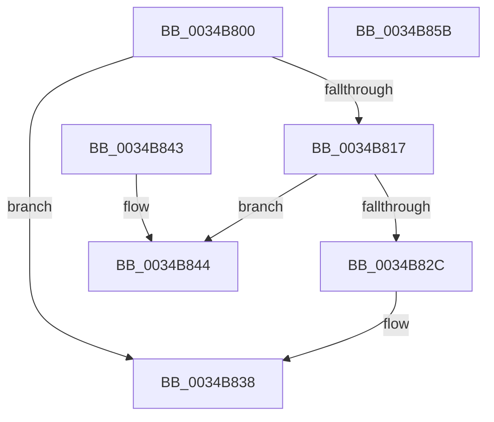

# MiUnlockSystemVa

- RVA: `0x0034B800`–`0x0034B85C` (길이 `92` bytes)
- VA: `0x000000014034B800`
- 실행 섹션: `.text`
- PDB 이름 있음: `예`; PDB Function 태그: `아니요`
- unwind 정보 RVA: `0x000785F4`
- 디코드: `27`개 명령, `92/92` bytes 표시
- 미해석 바이트: `0` (있으면 어셈블리에 `.byte`로 보존)

> 이 문서는 커널 이미지의 기계어와 PDB 기호를 분석해 생성했습니다. 4번과 5번은 함수 원형과 자료형을 바이너리 사용 방식에서 추정한 C 해석이며 원본 소스 복구 결과는 아닙니다.

## 1. Dependencies

- 직접 호출 지점: **3**; 고유 호출 대상: **3**
- 직접 호출자로 확인된 함수: **5**
- RIP 상대 이미지 참조: **0**

### Outgoing calls
- `0x0034B81A` → [MiUnlockFaultPageTable](../27/MiUnlockFaultPageTable_function_0027D870.md) (function, `0x0027D870`)
- `0x0034B82C` → [MiUnlockWorkingSetShared](../27/MiUnlockWorkingSetShared_function_0027D690.md) (function, `0x0027D690`)
- `0x0034B844` → [MiUnlockWorkingSetExclusive](../27/MiUnlockWorkingSetExclusive_function_0027EC70.md) (function, `0x0027EC70`)

### Direct callers
- [MmCopyMemory](../22/MmCopyMemory_function_002285B0.md) at `0x002287F9`
- [MmCopyMemory](../22/MmCopyMemory_function_002285B0.md) at `0x00228871`
- [MiTranslatePageForCopy](../22/MiTranslatePageForCopy_function_00228960.md) at `0x00228D40`
- [MiSynchronizeSystemVa](../28/MiSynchronizeSystemVa_function_0028ECB8.md) at `0x0028EDE3`
- [MiTrimSharedPageFromViews](../2E/MiTrimSharedPageFromViews_function_002E16F8.md) at `0x002E1AA6`
- [MiTrimSharedPageFromViews](../2E/MiTrimSharedPageFromViews_function_002E16F8.md) at `0x002E217E`
- [MiSystemFault](MiSystemFault_function_0034AA64.md) at `0x0034AC8E`
- [MiSystemFault](MiSystemFault_function_0034AA64.md) at `0x0034AE3D`
- [MiSystemFault](MiSystemFault_function_0034AA64.md) at `0x0034AEC6`
- [MiSystemFault](MiSystemFault_function_0034AA64.md) at `0x0034B06E`

### Static image references
- 디코드된 RIP-relative 메모리 참조가 없습니다.

## 2. Other-region calls and transfers

- 다른 실행 섹션으로 향하는 call: **0**
- 별도 외부 분기/꼬리 이동을 확인하지 못했습니다.

## 3. Assembly (complete function range)

```asm
0034B800  48 89 5C 24 08                  mov qword ptr [rsp + 8], rbx
0034B805  57                              push rdi
0034B806  48 83 EC 20                     sub rsp, 0x20
0034B80A  48 8B 79 18                     mov rdi, qword ptr [rcx + 0x18]
0034B80E  48 8D 59 18                     lea rbx, [rcx + 0x18]
0034B812  48 85 FF                        test rdi, rdi
0034B815  74 21                           je 0x14034b838
0034B817  48 8B CB                        mov rcx, rbx
0034B81A  E8 51 20 F3 FF                  call 0x14027d870
0034B81F  F6 43 0D 01                     test byte ptr [rbx + 0xd], 1
0034B823  48 8B CF                        mov rcx, rdi
0034B826  0F B6 53 0C                     movzx edx, byte ptr [rbx + 0xc]
0034B82A  75 18                           jne 0x14034b844
0034B82C  E8 5F 1E F3 FF                  call 0x14027d690
0034B831  48 C7 03 00 00 00 00            mov qword ptr [rbx], 0
0034B838  48 8B 5C 24 30                  mov rbx, qword ptr [rsp + 0x30]
0034B83D  48 83 C4 20                     add rsp, 0x20
0034B841  5F                              pop rdi
0034B842  C3                              ret
0034B843  CC                              int3
0034B844  E8 27 34 F3 FF                  call 0x14027ec70
0034B849  48 C7 03 00 00 00 00            mov qword ptr [rbx], 0
0034B850  48 8B 5C 24 30                  mov rbx, qword ptr [rsp + 0x30]
0034B855  48 83 C4 20                     add rsp, 0x20
0034B859  5F                              pop rdi
0034B85A  C3                              ret
0034B85B  CC                              int3
```

## 4. C-style interpretation (structured pseudocode)

```c
__int64 __fastcall MiUnlockSystemVa(__int64 a1)
{
    __int64 result;
    __int64 v_rsp;
    unsigned __int64 v_stack_p30;
    unsigned __int64 v_stack_p8;

    v_stack_p8 = v_rbx;
    v_rsp = (v_rsp) - (32);
    if (*(unsigned __int64 *)(a1 + 24) == 0) goto loc_0034B838;
    result = MiUnlockFaultPageTable(a1 + 24, a2, a3, a4);
    if (((*(unsigned __int8 *)(a1 + 24 + 13)) & (1)) != 0) goto loc_0034B844;
    result = MiUnlockWorkingSetShared(*(unsigned __int64 *)(a1 + 24), *(unsigned __int8 *)(a1 + 24 + 12), a3, a4);
    *(unsigned __int64 *)(a1 + 24) = 0;
loc_0034B838:
    v_rsp = (v_rsp) + (32);
    return result;
loc_0034B844:
    result = MiUnlockWorkingSetExclusive(*(unsigned __int64 *)(a1 + 24), *(unsigned __int8 *)(a1 + 24 + 12), a3, a4);
    *(unsigned __int64 *)(v_stack_p8) = 0;
    v_rsp = (v_rsp) + (32);
    return result;
}
```

## 5. (Beta) C Style

```c
int64_t MiUnlockSystemVa(void *Arg1)
{
    uint8_t *arg1 = (uint8_t *)Arg1;

    int64_t result;
    int64_t local_rsp;
    uint64_t v_stack_p30;
    uint64_t v_stack_p8;

    v_stack_p8 = local_rbx;
    local_rsp = (local_rsp) - (32);
    if (*(uint64_t *)(arg1 + 0x18) == 0) goto loc_0034B838;
    result = MiUnlockFaultPageTable(Arg1 + 24, a2, a3, a4);
    if (((*(uint8_t *)(arg1 + 0x18 + 0xD)) & (1)) != 0) goto loc_0034B844;
    result = MiUnlockWorkingSetShared(*(uint64_t *)(arg1 + 0x18), *(uint8_t *)(arg1 + 0x18 + 0xC), a3, a4);
    *(uint64_t *)(arg1 + 0x18) = 0;
loc_0034B838:
    local_rsp = (local_rsp) + (32);
    return result;
loc_0034B844:
    result = MiUnlockWorkingSetExclusive(*(uint64_t *)(arg1 + 0x18), *(uint8_t *)(arg1 + 0x18 + 0xC), a3, a4);
    *(uint64_t *)(v_stack_p8) = 0;
    local_rsp = (local_rsp) + (32);
    return result;
}
```

### 관측된 메모리 오프셋

구조체 형식이 확인되지 않은 접근은 인자 기준의 오프셋으로만 기록했습니다.

| 기준 인자 | 오프셋 표현 | 폭 (bit) | 접근 |
|---|---:|---:|---|
| `Arg1` | `+ 0x0` | `64` | `W` |
| `Arg1` | `+ 0xC` | `8` | `R` |
| `Arg1` | `+ 0xD` | `8` | `R` |
| `Arg1` | `+ 0x18` | `64` | `R` |

## 6. Execution-region graph

[열기: 2D/3D 그래프와 함수 탐색 컨트롤 패널](../../../control-panel.html?section=text&rva=0x0034B800&view=graph)

- 2D 그래프는 위에서 아래로 흐르고, 3D 그래프는 빈 공간을 드래그해 회전합니다. Shift+드래그는 이동, 휠은 확대·축소, 함수 노드 선택은 대상 보고서 이동입니다.

### Static fallback


