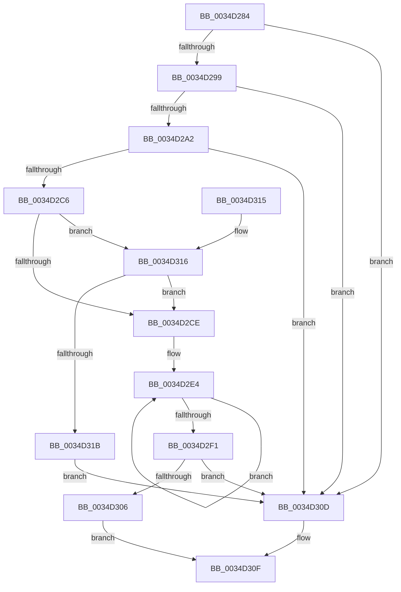

# MiUseLowIoPriorityForModifiedPages

- RVA: `0x0034D284`–`0x0034D31D` (길이 `153` bytes)
- VA: `0x000000014034D284`
- 실행 섹션: `.text`
- PDB 이름 있음: `예`; PDB Function 태그: `아니요`
- unwind 정보 RVA: `0x0005DAC8`
- 디코드: `44`개 명령, `153/153` bytes 표시
- 미해석 바이트: `0` (있으면 어셈블리에 `.byte`로 보존)

> 이 문서는 커널 이미지의 기계어와 PDB 기호를 분석해 생성했습니다. 4번과 5번은 함수 원형과 자료형을 바이너리 사용 방식에서 추정한 C 해석이며 원본 소스 복구 결과는 아닙니다.

## 1. Dependencies

- 직접 호출 지점: **1**; 고유 호출 대상: **1**
- 직접 호출자로 확인된 함수: **3**
- RIP 상대 이미지 참조: **0**

### Outgoing calls
- `0x0034D2AD` → [MiGetAvailablePagesBelowPriority](MiGetAvailablePagesBelowPriority_function_0034D340.md) (function, `0x0034D340`)

### Direct callers
- [MiAdjustModifiedPageLoad](../2D/MiAdjustModifiedPageLoad_function_002DC07C.md) at `0x002DC29A`
- [MiStoreUpdateMemoryConditions](MiStoreUpdateMemoryConditions_function_0034CF3C.md) at `0x0034CF7D`
- [MiModifiedPageWriter](../47/MiModifiedPageWriter_function_0047E5F0.md) at `0x0047E834`

### Static image references
- 디코드된 RIP-relative 메모리 참조가 없습니다.

## 2. Other-region calls and transfers

- 다른 실행 섹션으로 향하는 call: **0**
- 별도 외부 분기/꼬리 이동을 확인하지 못했습니다.

## 3. Assembly (complete function range)

```asm
0034D284  40 53                           push rbx
0034D286  48 83 EC 20                     sub rsp, 0x20
0034D28A  45 33 D2                        xor r10d, r10d
0034D28D  4C 8B C9                        mov r9, rcx
0034D290  44 39 91 40 03 00 00            cmp dword ptr [rcx + 0x340], r10d
0034D297  75 74                           jne 0x14034d30d
0034D299  44 39 91 B0 04 00 00            cmp dword ptr [rcx + 0x4b0], r10d
0034D2A0  75 6B                           jne 0x14034d30d
0034D2A2  48 8B 99 50 48 00 00            mov rbx, qword ptr [rcx + 0x4850]
0034D2A9  41 8D 52 06                     lea edx, [r10 + 6]
0034D2AD  E8 8E 00 00 00                  call 0x14034d340
0034D2B2  48 C1 EB 02                     shr rbx, 2
0034D2B6  4C 8B D8                        mov r11, rax
0034D2B9  48 8D 0C 5B                     lea rcx, [rbx + rbx*2]
0034D2BD  49 39 89 A0 4C 00 00            cmp qword ptr [r9 + 0x4ca0], rcx
0034D2C4  73 47                           jae 0x14034d30d
0034D2C6  48 3D 00 00 04 00               cmp rax, 0x40000
0034D2CC  76 48                           jbe 0x14034d316
0034D2CE  49 8B 81 C0 44 00 00            mov rax, qword ptr [r9 + 0x44c0]
0034D2D5  49 81 C1 24 1C 00 00            add r9, 0x1c24
0034D2DC  8B 48 2C                        mov ecx, dword ptr [rax + 0x2c]
0034D2DF  B8 07 00 00 00                  mov eax, 7
0034D2E4  45 03 11                        add r10d, dword ptr [r9]
0034D2E7  4D 8D 49 04                     lea r9, [r9 + 4]
0034D2EB  48 83 E8 01                     sub rax, 1
0034D2EF  75 F3                           jne 0x14034d2e4
0034D2F1  41 8B D2                        mov edx, r10d
0034D2F4  2B D1                           sub edx, ecx
0034D2F6  41 3B CA                        cmp ecx, r10d
0034D2F9  1B C9                           sbb ecx, ecx
0034D2FB  49 C1 EB 02                     shr r11, 2
0034D2FF  23 D1                           and edx, ecx
0034D301  49 3B D3                        cmp rdx, r11
0034D304  73 07                           jae 0x14034d30d
0034D306  B8 01 00 00 00                  mov eax, 1
0034D30B  EB 02                           jmp 0x14034d30f
0034D30D  33 C0                           xor eax, eax
0034D30F  48 83 C4 20                     add rsp, 0x20
0034D313  5B                              pop rbx
0034D314  C3                              ret
0034D315  CC                              int3
0034D316  4C 3B DB                        cmp r11, rbx
0034D319  77 B3                           ja 0x14034d2ce
0034D31B  EB F0                           jmp 0x14034d30d
```

## 4. C-style interpretation (structured pseudocode)

```c
__int64 __fastcall MiUseLowIoPriorityForModifiedPages(__int64 a1)
{
    __int64 result;
    __int64 v_r10;
    __int64 v_r11;
    __int64 v_rbx;
    __int64 v_rsp;

    v_rsp = (v_rsp) - (32);
    v_r10 = 0;
    if ((*(unsigned int *)(a1 + 832)) != 0) goto loc_0034D30D;
    if ((*(unsigned int *)(a1 + 1200)) != 0) goto loc_0034D30D;
    result = MiGetAvailablePagesBelowPriority(a1, v_r10 + 6, a3, a1);
    v_rbx = (*(unsigned __int64 *)(a1 + 18512)) >> (2);
    if ((*(unsigned __int64 *)(a1 + 19616)) >= (v_rbx + v_rbx * 2)) goto loc_0034D30D;
    if (result <= 0x40000ULL) goto loc_0034D316;
loc_0034D2CE:
    a4 = (a1) + (0x1C24ULL);
loc_0034D2E4:
    v_r10 = (unsigned int)((v_r10) + (*(unsigned int *)(a4)));
    result = (7) - (1);
    if (condition_is_not_equal) goto loc_0034D2E4;
    a2 = (unsigned int)(((unsigned int)((unsigned int)(v_r10))) - ((unsigned int)((unsigned int)(*(unsigned int *)(*(unsigned __int64 *)(a1 + 17600) + 44)))));
    v_r11 = (result) >> (2);
    a2 = (unsigned int)((a2) & ((unsigned int)((unsigned int)(*(unsigned int *)(*(unsigned __int64 *)(a1 + 17600) + 44)))));
    if (a2 >= v_r11) goto loc_0034D30D;
    goto loc_0034D30F;
loc_0034D30D:
    result = 0;
loc_0034D30F:
    v_rsp = (v_rsp) + (32);
    return result;
loc_0034D316:
    if (v_r11 > v_rbx) goto loc_0034D2CE;
    goto loc_0034D30D;
}
```

## 5. (Beta) C Style

```c
int64_t MiUseLowIoPriorityForModifiedPages(void *Arg1)
{
    uint8_t *arg1 = (uint8_t *)Arg1;

    int64_t result;
    int64_t local_r10;
    int64_t local_r11;
    int64_t local_rbx;
    int64_t local_rsp;

    local_rsp = (local_rsp) - (32);
    local_r10 = 0;
    if ((*(uint32_t *)(arg1 + 0x340)) != 0) goto loc_0034D30D;
    if ((*(uint32_t *)(arg1 + 0x4B0)) != 0) goto loc_0034D30D;
    result = MiGetAvailablePagesBelowPriority(Arg1, local_r10 + 6, a3, Arg1);
    local_rbx = (*(uint64_t *)(arg1 + 0x4850)) >> (2);
    if ((*(uint64_t *)(arg1 + 0x4CA0)) >= (local_rbx + local_rbx * 2)) goto loc_0034D30D;
    if (result <= 0x40000ULL) goto loc_0034D316;
loc_0034D2CE:
    a4 = (Arg1) + (0x1C24ULL);
loc_0034D2E4:
    local_r10 = (uint32_t)((local_r10) + (*(uint32_t *)(a4)));
    result = (7) - (1);
    if (condition_is_not_equal) goto loc_0034D2E4;
    a2 = (uint32_t)(((uint32_t)((uint32_t)(local_r10))) - ((uint32_t)((uint32_t)(*(uint32_t *)(*(uint64_t *)(arg1 + 0x44C0) + 0x2C)))));
    local_r11 = (result) >> (2);
    a2 = (uint32_t)((a2) & ((uint32_t)((uint32_t)(*(uint32_t *)(*(uint64_t *)(arg1 + 0x44C0) + 0x2C)))));
    if (a2 >= local_r11) goto loc_0034D30D;
    goto loc_0034D30F;
loc_0034D30D:
    result = 0;
loc_0034D30F:
    local_rsp = (local_rsp) + (32);
    return result;
loc_0034D316:
    if (local_r11 > local_rbx) goto loc_0034D2CE;
    goto loc_0034D30D;
}
```

### 관측된 메모리 오프셋

구조체 형식이 확인되지 않은 접근은 인자 기준의 오프셋으로만 기록했습니다.

| 기준 인자 | 오프셋 표현 | 폭 (bit) | 접근 |
|---|---:|---:|---|
| `Arg1` | `+ 0x340` | `32` | `R` |
| `Arg1` | `+ 0x4B0` | `32` | `R` |
| `Arg1` | `+ 0x4850` | `64` | `R` |

## 6. Execution-region graph

[열기: 2D/3D 그래프와 함수 탐색 컨트롤 패널](../../../control-panel.html?section=text&rva=0x0034D284&view=graph)

- 2D 그래프는 위에서 아래로 흐르고, 3D 그래프는 빈 공간을 드래그해 회전합니다. Shift+드래그는 이동, 휠은 확대·축소, 함수 노드 선택은 대상 보고서 이동입니다.

### Static fallback


