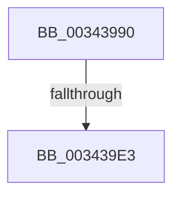

# NtReleaseWorkerFactoryWorker

- RVA: `0x00343990`–`0x003439EB` (길이 `91` bytes)
- VA: `0x0000000140343990`
- 실행 섹션: `.text`
- PDB 이름 있음: `예`; PDB Function 태그: `아니요`
- unwind 정보 RVA: `0x00077B3C`
- 디코드: `20`개 명령, `91/91` bytes 표시
- 미해석 바이트: `0` (있으면 어셈블리에 `.byte`로 보존)

> 이 문서는 커널 이미지의 기계어와 PDB 기호를 분석해 생성했습니다. 4번과 5번은 함수 원형과 자료형을 바이너리 사용 방식에서 추정한 C 해석이며 원본 소스 복구 결과는 아닙니다.

## 1. Dependencies

- 직접 호출 지점: **1**; 고유 호출 대상: **1**
- 직접 호출자로 확인된 함수: **0**
- RIP 상대 이미지 참조: **1**

### Outgoing calls
- `0x003439D6` → [ObReferenceObjectByHandle](../../page/86/ObReferenceObjectByHandle_function_00868DB0.md) (function, `0x00868DB0`)

### Direct callers
- 이 함수 시작 RVA로 연결되는 직접 call은 확인되지 않았습니다. 간접 호출은 완전히 역산할 수 없습니다.

### Static image references
- `0x003439BB` → RVA `0x00FC51E0` (`ALMOSTRO`; read)

## 2. Other-region calls and transfers

- 다른 실행 섹션으로 향하는 call: **1**
  - `0x003439D6` → [ObReferenceObjectByHandle](../../page/86/ObReferenceObjectByHandle_function_00868DB0.md) (`.text` → `PAGE`)
- call이 아닌 외부 분기/꼬리 이동: **1**
  - `0x003439DD` → [sub_00343BF7](Unknown_function_00343BF7.md) (`tail-transfer`)

## 3. Assembly (complete function range)

```asm
00343990  4C 8B DC                        mov r11, rsp
00343993  41 55                           push r13
00343995  48 83 EC 70                     sub rsp, 0x70
00343999  33 C0                           xor eax, eax
0034399B  45 33 ED                        xor r13d, r13d
0034399E  0F 57 C0                        xorps xmm0, xmm0
003439A1  4D 89 6B B0                     mov qword ptr [r11 - 0x50], r13
003439A5  0F 11 44 24 30                  movups xmmword ptr [rsp + 0x30], xmm0
003439AA  49 89 43 C8                     mov qword ptr [r11 - 0x38], rax
003439AE  65 48 8B 04 25 88 01 00 00      mov rax, qword ptr gs:[0x188]
003439B7  41 8D 55 01                     lea edx, [r13 + 1]
003439BB  4C 8B 05 1E 18 C8 00            mov r8, qword ptr [rip + 0xc8181e]
003439C2  4D 89 6B 10                     mov qword ptr [r11 + 0x10], r13
003439C6  44 0F B6 88 32 02 00 00         movzx r9d, byte ptr [rax + 0x232]
003439CE  49 8D 43 10                     lea rax, [r11 + 0x10]
003439D2  49 89 43 A8                     mov qword ptr [r11 - 0x58], rax
003439D6  E8 D5 53 52 00                  call 0x140868db0
003439DB  85 C0                           test eax, eax
003439DD  0F 88 14 02 00 00               js 0x140343bf7
003439E3  48 8B 84 24 88 00 00 00         mov rax, qword ptr [rsp + 0x88]
```

## 4. C-style interpretation (structured pseudocode)

```c
__int64 __fastcall NtReleaseWorkerFactoryWorker(void)
{
    __int64 result;
    __int64 v_r13;
    __int64 v_rsp;
    unsigned __int64 v_stack_m48;
    unsigned __int64 v_stack_p10;

    v_rsp = (v_rsp) - (112);
    result = 0;
    v_r13 = 0;
    *(unsigned __int64 *)(v_rsp - 80) = 0;
    v_stack_m48 = v_xmm0;
    *(unsigned __int64 *)(v_rsp - 56) = 0;
    *(unsigned __int64 *)(v_rsp + 16) = 0;
    *(unsigned __int64 *)(v_rsp - 88) = v_rsp + 16;
    result = ObReferenceObjectByHandle(a1, v_r13 + 1, *(unsigned __int64 *)(v_rip + 13113374), *(unsigned __int8 *)(*(unsigned __int64 *)(gs_base + (0 + 392)) + 562));
    return v_stack_p10;
}
```

## 5. (Beta) C Style

```c
void NtReleaseWorkerFactoryWorker(void)
{
    int64_t result;
    int64_t local_r13;
    int64_t local_rsp;
    uint64_t v_stack_m48;
    uint64_t v_stack_p10;

    local_rsp = (local_rsp) - (112);
    result = 0;
    local_r13 = 0;
    *(uint64_t *)(local_rsp - 0x50) = 0;
    v_stack_m48 = v_xmm0;
    *(uint64_t *)(local_rsp - 0x38) = 0;
    *(uint64_t *)(local_rsp + 0x10) = 0;
    *(uint64_t *)(local_rsp - 0x58) = local_rsp + 16;
    result = ObReferenceObjectByHandle(a1, local_r13 + 1, *(uint64_t *)(v_rip + 0xC8181E), *(uint8_t *)(*(uint64_t *)(gs_base + (0 + 0x188)) + 0x232));
    return v_stack_p10;
}
```

## 6. Execution-region graph

[열기: 2D/3D 그래프와 함수 탐색 컨트롤 패널](../../../control-panel.html?section=text&rva=0x00343990&view=graph)

- 2D 그래프는 위에서 아래로 흐르고, 3D 그래프는 빈 공간을 드래그해 회전합니다. Shift+드래그는 이동, 휠은 확대·축소, 함수 노드 선택은 대상 보고서 이동입니다.

### Static fallback


