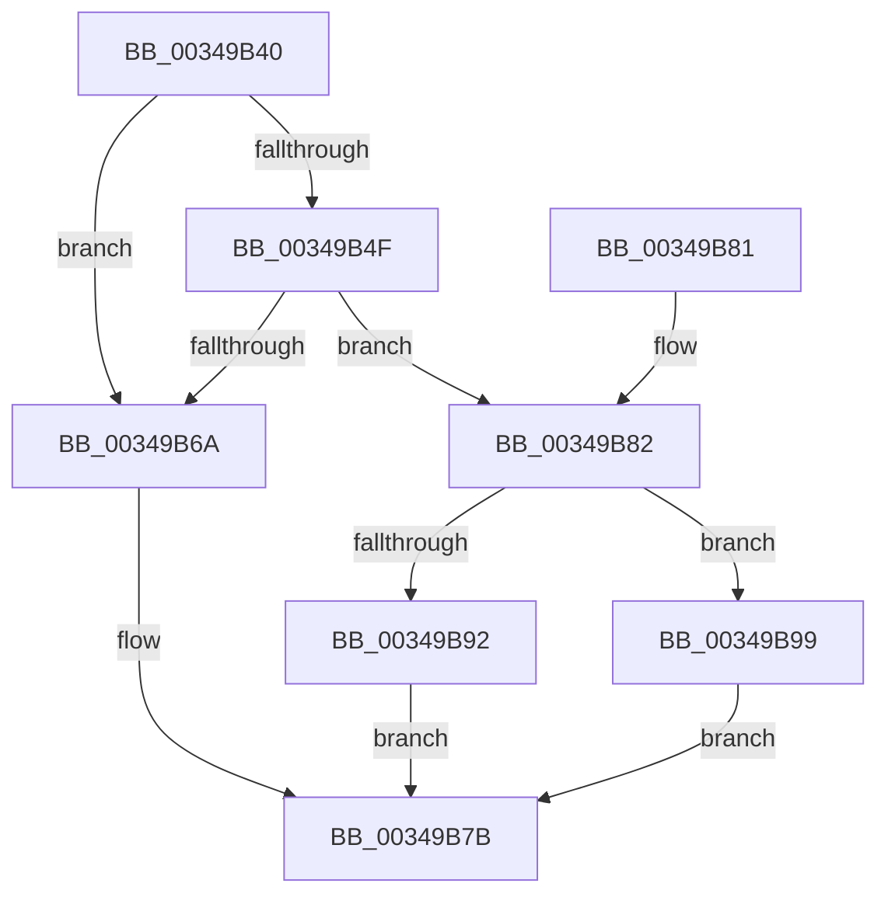

# PfFbLogEntryComplete

- RVA: `0x00349B40`–`0x00349BA0` (길이 `96` bytes)
- VA: `0x0000000140349B40`
- 실행 섹션: `.text`
- PDB 이름 있음: `예`; PDB Function 태그: `아니요`
- unwind 정보 RVA: `0x000783D8`
- 디코드: `29`개 명령, `96/96` bytes 표시
- 미해석 바이트: `0` (있으면 어셈블리에 `.byte`로 보존)

> 이 문서는 커널 이미지의 기계어와 PDB 기호를 분석해 생성했습니다. 4번과 5번은 함수 원형과 자료형을 바이너리 사용 방식에서 추정한 C 해석이며 원본 소스 복구 결과는 아닙니다.

## 1. Dependencies

- 직접 호출 지점: **4**; 고유 호출 대상: **4**
- 직접 호출자로 확인된 함수: **3**
- RIP 상대 이미지 참조: **1**

### Outgoing calls
- `0x00349B6E` → [ExpInterlockedPushEntrySList](../6B/ExpInterlockedPushEntrySList_function_006BA5B0.md) (function, `0x006BA5B0`)
- `0x00349B76` → [ExReleaseRundownProtection](ExReleaseRundownProtection_function_00349E80.md) (function, `0x00349E80`)
- `0x00349B92` → [PfpEventHandleFullBuffer](PfpEventHandleFullBuffer_function_0034A640.md) (function, `0x0034A640`)
- `0x00349B99` → [guard_dispatch_icall](../6B/guard_dispatch_icall_function_006BAAD0.md) (function, `0x006BAAD0`)

### Direct callers
- [PfTFiNotifyVolumeCreateCallback](../45/PfTFiNotifyVolumeCreateCallback_function_0045ED30.md) at `0x0045EE7D`
- [PfTFiNotifyVolumeCreateCallback](../45/PfTFiNotifyVolumeCreateCallback_function_0045ED30.md) at `0x0045EE90`
- [PfTFiNotifyFileStreamCreateCallback](../45/PfTFiNotifyFileStreamCreateCallback_function_0045EEB0.md) at `0x0045EFEC`
- [PfTFiNotifyFileStreamCreateCallback](../45/PfTFiNotifyFileStreamCreateCallback_function_0045EEB0.md) at `0x0045F026`
- [PfTFiNotifyFileInfoDeleteCallback](../45/PfTFiNotifyFileInfoDeleteCallback_function_0045F040.md) at `0x0045F11C`
- [PfTFiNotifyFileInfoDeleteCallback](../45/PfTFiNotifyFileInfoDeleteCallback_function_0045F040.md) at `0x0045F14E`

### Static image references
- `0x00349B86` → RVA `0x0034A640` (`PfpEventHandleFullBuffer`; read)

## 2. Other-region calls and transfers

- 다른 실행 섹션으로 향하는 call: **0**
- 별도 외부 분기/꼬리 이동을 확인하지 못했습니다.

## 3. Assembly (complete function range)

```asm
00349B40  40 53                           push rbx
00349B42  48 83 EC 20                     sub rsp, 0x20
00349B46  48 8B 5A 10                     mov rbx, qword ptr [rdx + 0x10]
00349B4A  45 85 C9                        test r9d, r9d
00349B4D  74 1B                           je 0x140349b6a
00349B4F  FF 42 28                        inc dword ptr [rdx + 0x28]
00349B52  4C 8B 42 20                     mov r8, qword ptr [rdx + 0x20]
00349B56  41 8B C1                        mov eax, r9d
00349B59  48 01 42 18                     add qword ptr [rdx + 0x18], rax
00349B5D  4C 2B 42 18                     sub r8, qword ptr [rdx + 0x18]
00349B61  48 63 43 54                     movsxd rax, dword ptr [rbx + 0x54]
00349B65  4C 3B C0                        cmp r8, rax
00349B68  7C 18                           jl 0x140349b82
00349B6A  48 8D 4B 20                     lea rcx, [rbx + 0x20]
00349B6E  E8 3D 0A 37 00                  call 0x1406ba5b0
00349B73  48 8B CB                        mov rcx, rbx
00349B76  E8 05 03 00 00                  call 0x140349e80
00349B7B  48 83 C4 20                     add rsp, 0x20
00349B7F  5B                              pop rbx
00349B80  C3                              ret
00349B81  CC                              int3
00349B82  48 8B 43 68                     mov rax, qword ptr [rbx + 0x68]
00349B86  4C 8D 05 B3 0A 00 00            lea r8, [rip + 0xab3]
00349B8D  49 3B C0                        cmp rax, r8
00349B90  75 07                           jne 0x140349b99
00349B92  E8 A9 0A 00 00                  call 0x14034a640
00349B97  EB E2                           jmp 0x140349b7b
00349B99  E8 32 0F 37 00                  call 0x1406baad0
00349B9E  EB DB                           jmp 0x140349b7b
```

## 4. C-style interpretation (structured pseudocode)

```c
__int64 __fastcall PfFbLogEntryComplete(__int64 a1, __int64 a2, __int64 a3, int a4)
{
    __int64 result;
    __int64 v_rsp;

    v_rsp = (v_rsp) - (32);
    if (a4 == 0) goto loc_00349B6A;
    a3 = (*(unsigned __int64 *)(a2 + 32)) - (*(unsigned __int64 *)(a2 + 24));
    if (a3 < ((int)(*(unsigned int *)(*(unsigned __int64 *)(a2 + 16) + 84)))) goto loc_00349B82;
loc_00349B6A:
    result = ExpInterlockedPushEntrySList(*(unsigned __int64 *)(a2 + 16) + 32, a2, a3, a4);
    result = ExReleaseRundownProtection(*(unsigned __int64 *)(a2 + 16), a2, a3, a4);
loc_00349B7B:
    v_rsp = (v_rsp) + (32);
    return result;
loc_00349B82:
    if ((*(unsigned __int64 *)(*(unsigned __int64 *)(a2 + 16) + 104)) != (v_rip + 2739)) goto loc_00349B99;
    result = PfpEventHandleFullBuffer(*(unsigned __int64 *)(a2 + 16), a2, v_rip + 2739, a4);
    goto loc_00349B7B;
loc_00349B99:
    result = guard_dispatch_icall(*(unsigned __int64 *)(a2 + 16), a2, v_rip + 2739, a4);
    goto loc_00349B7B;
}
```

## 5. (Beta) C Style

```c
int64_t PfFbLogEntryComplete(int64_t Arg1, void *Arg2, int64_t Arg3, int32_t Arg4)
{
    uint8_t *arg2 = (uint8_t *)Arg2;

    int64_t result;
    int64_t local_rsp;

    local_rsp = (local_rsp) - (32);
    if (Arg4 == 0) goto loc_00349B6A;
    Arg3 = (*(uint64_t *)(arg2 + 0x20)) - (*(uint64_t *)(arg2 + 0x18));
    if (Arg3 < ((int32_t)(*(uint32_t *)(*(uint64_t *)(arg2 + 0x10) + 0x54)))) goto loc_00349B82;
loc_00349B6A:
    result = ExpInterlockedPushEntrySList(*(uint64_t *)(arg2 + 0x10) + 32, Arg2, Arg3, Arg4);
    result = ExReleaseRundownProtection(*(uint64_t *)(arg2 + 0x10), Arg2, Arg3, Arg4);
loc_00349B7B:
    local_rsp = (local_rsp) + (32);
    return result;
loc_00349B82:
    if ((*(uint64_t *)(*(uint64_t *)(arg2 + 0x10) + 0x68)) != (v_rip + 2739)) goto loc_00349B99;
    result = PfpEventHandleFullBuffer(*(uint64_t *)(arg2 + 0x10), Arg2, v_rip + 2739, Arg4);
    goto loc_00349B7B;
loc_00349B99:
    result = guard_dispatch_icall(*(uint64_t *)(arg2 + 0x10), Arg2, v_rip + 2739, Arg4);
    goto loc_00349B7B;
}
```

### 관측된 메모리 오프셋

구조체 형식이 확인되지 않은 접근은 인자 기준의 오프셋으로만 기록했습니다.

| 기준 인자 | 오프셋 표현 | 폭 (bit) | 접근 |
|---|---:|---:|---|
| `Arg2` | `+ 0x10` | `64` | `R` |
| `Arg2` | `+ 0x18` | `64` | `R` |
| `Arg2` | `+ 0x18` | `64` | `R/W` |
| `Arg2` | `+ 0x20` | `64` | `R` |
| `Arg2` | `+ 0x28` | `32` | `R/W` |

## 6. Execution-region graph

[열기: 2D/3D 그래프와 함수 탐색 컨트롤 패널](../../../control-panel.html?section=text&rva=0x00349B40&view=graph)

- 2D 그래프는 위에서 아래로 흐르고, 3D 그래프는 빈 공간을 드래그해 회전합니다. Shift+드래그는 이동, 휠은 확대·축소, 함수 노드 선택은 대상 보고서 이동입니다.

### Static fallback


