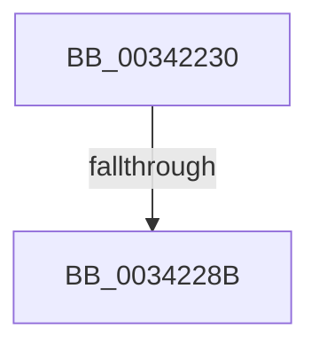

# PfFileInfoNotify

- RVA: `0x00342230`–`0x0034228E` (길이 `94` bytes)
- VA: `0x0000000140342230`
- 실행 섹션: `.text`
- PDB 이름 있음: `예`; PDB Function 태그: `아니요`
- unwind 정보 RVA: `0x0007779C`
- 디코드: `25`개 명령, `94/94` bytes 표시
- 미해석 바이트: `0` (있으면 어셈블리에 `.byte`로 보존)

> 이 문서는 커널 이미지의 기계어와 PDB 기호를 분석해 생성했습니다. 4번과 5번은 함수 원형과 자료형을 바이너리 사용 방식에서 추정한 C 해석이며 원본 소스 복구 결과는 아닙니다.

## 1. Dependencies

- 직접 호출 지점: **0**; 고유 호출 대상: **0**
- 직접 호출자로 확인된 함수: **0**
- RIP 상대 이미지 참조: **1**

### Outgoing calls
- 직접 디코드된 call 명령이 없습니다.

### Direct callers
- 이 함수 시작 RVA로 연결되는 직접 call은 확인되지 않았습니다. 간접 호출은 완전히 역산할 수 없습니다.

### Static image references
- `0x00342240` → RVA `0x00E0A740` (`.data`; read)

## 2. Other-region calls and transfers

- 다른 실행 섹션으로 향하는 call: **0**
- call이 아닌 외부 분기/꼬리 이동: **1**
  - `0x00342285` → [sub_00342B25](Unknown_function_00342B25.md) (`tail-transfer`)

## 3. Assembly (complete function range)

```asm
00342230  4C 8B DC                        mov r11, rsp
00342233  55                              push rbp
00342234  57                              push rdi
00342235  49 8D 6B D8                     lea rbp, [r11 - 0x28]
00342239  48 81 EC 18 01 00 00            sub rsp, 0x118
00342240  48 8B 05 F9 84 AC 00            mov rax, qword ptr [rip + 0xac84f9]
00342247  48 33 C4                        xor rax, rsp
0034224A  48 89 45 F8                     mov qword ptr [rbp - 8], rax
0034224E  33 C0                           xor eax, eax
00342250  48 89 4C 24 58                  mov qword ptr [rsp + 0x58], rcx
00342255  83 39 0F                        cmp dword ptr [rcx], 0xf
00342258  0F 57 C0                        xorps xmm0, xmm0
0034225B  0F 57 C9                        xorps xmm1, xmm1
0034225E  89 45 D8                        mov dword ptr [rbp - 0x28], eax
00342261  48 8B F9                        mov rdi, rcx
00342264  48 89 45 F0                     mov qword ptr [rbp - 0x10], rax
00342268  0F 11 45 C8                     movups xmmword ptr [rbp - 0x38], xmm0
0034226C  48 89 45 B8                     mov qword ptr [rbp - 0x48], rax
00342270  0F 11 4D E0                     movups xmmword ptr [rbp - 0x20], xmm1
00342274  89 45 C0                        mov dword ptr [rbp - 0x40], eax
00342277  0F 11 45 A8                     movups xmmword ptr [rbp - 0x58], xmm0
0034227B  48 89 44 24 48                  mov qword ptr [rsp + 0x48], rax
00342280  0F 11 44 24 38                  movups xmmword ptr [rsp + 0x38], xmm0
00342285  0F 85 9A 08 00 00               jne 0x140342b25
0034228B  8B 41 08                        mov eax, dword ptr [rcx + 8]
```

## 4. C-style interpretation (structured pseudocode)

```c
__int64 __fastcall PfFileInfoNotify(__int64 a1)
{
    __int64 result;
    __int64 v_rsp;
    unsigned __int64 v_stack_mD0;
    unsigned __int64 v_stack_mE0;
    unsigned __int64 v_stack_mF0;

    v_rsp = (v_rsp) - (280);
    result = (*(unsigned __int64 *)(v_rip + 11306233)) ^ (v_rsp);
    *(unsigned __int64 *)(v_rsp - 40 - 8) = result;
    result = 0;
    v_stack_mD0 = a1;
    *(unsigned int *)(v_rsp - 40 - 40) = 0;
    *(unsigned __int64 *)(v_rsp - 40 - 16) = 0;
    *(unsigned __int64 *)(v_rsp - 40 - 56) = v_xmm0;
    *(unsigned __int64 *)(v_rsp - 40 - 72) = 0;
    *(unsigned __int64 *)(v_rsp - 40 - 32) = v_xmm1;
    *(unsigned int *)(v_rsp - 40 - 64) = 0;
    *(unsigned __int64 *)(v_rsp - 40 - 88) = v_xmm0;
    v_stack_mE0 = 0;
    v_stack_mF0 = v_xmm0;
    return (unsigned int)(*(unsigned int *)(a1 + 8));
}
```

## 5. (Beta) C Style

```c
int64_t PfFileInfoNotify(void *Arg1)
{
    uint8_t *arg1 = (uint8_t *)Arg1;

    int64_t result;
    int64_t local_rsp;
    uint64_t v_stack_mD0;
    uint64_t v_stack_mE0;
    uint64_t v_stack_mF0;

    local_rsp = (local_rsp) - (280);
    result = (*(uint64_t *)(v_rip + 0xAC84F9)) ^ (local_rsp);
    *(uint64_t *)(local_rsp - 0x28 - 0x8) = result;
    result = 0;
    v_stack_mD0 = Arg1;
    *(uint32_t *)(local_rsp - 0x28 - 0x28) = 0;
    *(uint64_t *)(local_rsp - 0x28 - 0x10) = 0;
    *(uint64_t *)(local_rsp - 0x28 - 0x38) = v_xmm0;
    *(uint64_t *)(local_rsp - 0x28 - 0x48) = 0;
    *(uint64_t *)(local_rsp - 0x28 - 0x20) = v_xmm1;
    *(uint32_t *)(local_rsp - 0x28 - 0x40) = 0;
    *(uint64_t *)(local_rsp - 0x28 - 0x58) = v_xmm0;
    v_stack_mE0 = 0;
    v_stack_mF0 = v_xmm0;
    return (uint32_t)(*(uint32_t *)(arg1 + 0x8));
}
```

### 관측된 메모리 오프셋

구조체 형식이 확인되지 않은 접근은 인자 기준의 오프셋으로만 기록했습니다.

| 기준 인자 | 오프셋 표현 | 폭 (bit) | 접근 |
|---|---:|---:|---|
| `Arg1` | `+ 0x0` | `32` | `R` |
| `Arg1` | `+ 0x8` | `32` | `R` |

## 6. Execution-region graph

[열기: 2D/3D 그래프와 함수 탐색 컨트롤 패널](../../../control-panel.html?section=text&rva=0x00342230&view=graph)

- 2D 그래프는 위에서 아래로 흐르고, 3D 그래프는 빈 공간을 드래그해 회전합니다. Shift+드래그는 이동, 휠은 확대·축소, 함수 노드 선택은 대상 보고서 이동입니다.

### Static fallback


