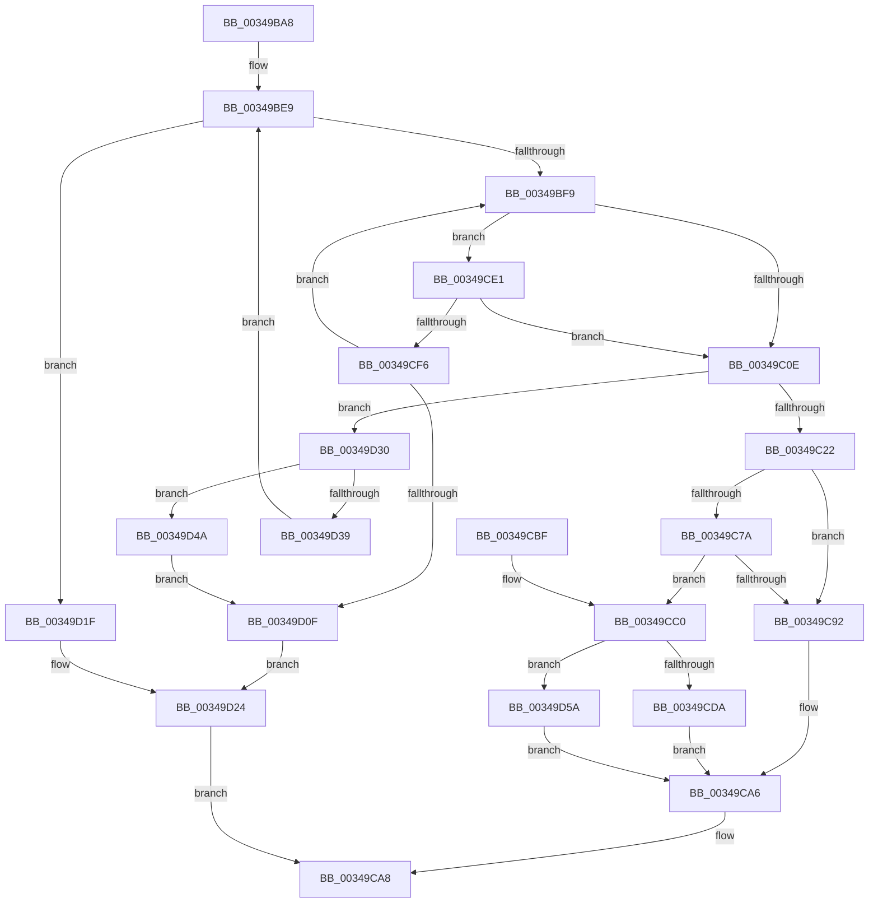

# PfLogEvent

- RVA: `0x00349BA8`–`0x00349D64` (길이 `444` bytes)
- VA: `0x0000000140349BA8`
- 실행 섹션: `.text`
- PDB 이름 있음: `예`; PDB Function 태그: `아니요`
- unwind 정보 RVA: `0x000783E4`
- 디코드: `122`개 명령, `444/444` bytes 표시
- 미해석 바이트: `0` (있으면 어셈블리에 `.byte`로 보존)

> 이 문서는 커널 이미지의 기계어와 PDB 기호를 분석해 생성했습니다. 4번과 5번은 함수 원형과 자료형을 바이너리 사용 방식에서 추정한 C 해석이며 원본 소스 복구 결과는 아닙니다.

## 1. Dependencies

- 직접 호출 지점: **12**; 고유 호출 대상: **7**
- 직접 호출자로 확인된 함수: **10**
- RIP 상대 이미지 참조: **1**

### Outgoing calls
- `0x00349BEC` → [ExAcquireRundownProtection](../21/ExAcquireRundownProtection_function_00216620.md) (function, `0x00216620`)
- `0x00349BFD` → [ExpInterlockedPopEntrySList](../6B/ExpInterlockedPopEntrySList_function_006BA570.md) (function, `0x006BA570`)
- `0x00349C6D` → [memcpy](../6C/memcpy_function_006C6840.md) (function, `0x006C6840`)
- `0x00349C99` → [ExpInterlockedPushEntrySList](../6B/ExpInterlockedPushEntrySList_function_006BA5B0.md) (function, `0x006BA5B0`)
- `0x00349CA1` → [ExReleaseRundownProtection](ExReleaseRundownProtection_function_00349E80.md) (function, `0x00349E80`)
- `0x00349CDA` → [PfpEventHandleFullBuffer](PfpEventHandleFullBuffer_function_0034A640.md) (function, `0x0034A640`)
- `0x00349CE5` → [ExpInterlockedPopEntrySList](../6B/ExpInterlockedPopEntrySList_function_006BA570.md) (function, `0x006BA570`)
- `0x00349D00` → [guard_dispatch_icall](../6B/guard_dispatch_icall_function_006BAAD0.md) (function, `0x006BAAD0`)
- `0x00349D18` → [ExReleaseRundownProtection](ExReleaseRundownProtection_function_00349E80.md) (function, `0x00349E80`)
- `0x00349D40` → [guard_dispatch_icall](../6B/guard_dispatch_icall_function_006BAAD0.md) (function, `0x006BAAD0`)
- `0x00349D4E` → [ExpInterlockedPushEntrySList](../6B/ExpInterlockedPushEntrySList_function_006BA5B0.md) (function, `0x006BA5B0`)
- `0x00349D5A` → [guard_dispatch_icall](../6B/guard_dispatch_icall_function_006BAAD0.md) (function, `0x006BAAD0`)

### Direct callers
- [PfLogFileDataAccess](PfLogFileDataAccess_function_00342090.md) at `0x003421FC`
- [sub_003425E5](Unknown_function_003425E5.md) at `0x003426AC`
- [PfHardFaultLog](../38/PfHardFaultLog_function_003810C0.md) at `0x00381225`
- [PfpLogApplicationEvent](../3B/PfpLogApplicationEvent_function_003BA3A0.md) at `0x003BA576`
- [PfLogForegroundProcess](../3B/PfLogForegroundProcess_function_003BA5CC.md) at `0x003BA69A`
- [PfpRpLogDeprioEvent](../48/PfpRpLogDeprioEvent_function_0048D1C4.md) at `0x0048D240`
- [PfpPartitionLogEventCallback](../4A/PfpPartitionLogEventCallback_function_004A82B0.md) at `0x004A82C5`
- [PfpLogScenarioEventCallback](../../page/75/PfpLogScenarioEventCallback_function_007507B0.md) at `0x00750893`
- [PfpLogEventRequest](../../page/AC/PfpLogEventRequest_function_00AC1278.md) at `0x00AC1380`
- [PfpPowerActionStartScenarioTracingCallback](../../pagelk/B6/PfpPowerActionStartScenarioTracingCallback_function_00B6B2E0.md) at `0x00B6B396`

### Static image references
- `0x00349CC4` → RVA `0x0034A640` (`PfpEventHandleFullBuffer`; read)

## 2. Other-region calls and transfers

- 다른 실행 섹션으로 향하는 call: **0**
- 별도 외부 분기/꼬리 이동을 확인하지 못했습니다.

## 3. Assembly (complete function range)

```asm
00349BA8  48 8B C4                        mov rax, rsp
00349BAB  48 89 58 08                     mov qword ptr [rax + 8], rbx
00349BAF  4C 89 48 20                     mov qword ptr [rax + 0x20], r9
00349BB3  44 89 40 18                     mov dword ptr [rax + 0x18], r8d
00349BB7  89 50 10                        mov dword ptr [rax + 0x10], edx
00349BBA  55                              push rbp
00349BBB  56                              push rsi
00349BBC  57                              push rdi
00349BBD  41 54                           push r12
00349BBF  41 55                           push r13
00349BC1  41 56                           push r14
00349BC3  41 57                           push r15
00349BC5  48 83 EC 20                     sub rsp, 0x20
00349BC9  44 8B AC 24 80 00 00 00         mov r13d, dword ptr [rsp + 0x80]
00349BD1  48 8D B9 A0 01 00 00            lea rdi, [rcx + 0x1a0]
00349BD8  48 8B F1                        mov rsi, rcx
00349BDB  41 8D 6D 10                     lea ebp, [r13 + 0x10]
00349BDF  48 83 C5 0F                     add rbp, 0xf
00349BE3  83 E5 F0                        and ebp, 0xfffffff0
00349BE6  44 8B FD                        mov r15d, ebp
00349BE9  48 8B CF                        mov rcx, rdi
00349BEC  E8 2F CA EC FF                  call 0x140216620
00349BF1  84 C0                           test al, al
00349BF3  0F 84 26 01 00 00               je 0x140349d1f
00349BF9  48 8D 4F 20                     lea rcx, [rdi + 0x20]
00349BFD  E8 6E 09 37 00                  call 0x1406ba570
00349C02  48 8B D8                        mov rbx, rax
00349C05  48 85 C0                        test rax, rax
00349C08  0F 84 D3 00 00 00               je 0x140349ce1
00349C0E  4C 8B 4B 18                     mov r9, qword ptr [rbx + 0x18]
00349C12  48 8B 43 20                     mov rax, qword ptr [rbx + 0x20]
00349C16  49 2B C1                        sub rax, r9
00349C19  4C 3B F8                        cmp r15, rax
00349C1C  0F 8F 0E 01 00 00               jg 0x140349d30
00349C22  8B 4C 24 70                     mov ecx, dword ptr [rsp + 0x70]
00349C26  49 8B C7                        mov rax, r15
00349C29  48 63 54 24 68                  movsxd rdx, dword ptr [rsp + 0x68]
00349C2E  4D 8B C5                        mov r8, r13
00349C31  41 89 49 08                     mov dword ptr [r9 + 8], ecx
00349C35  49 8B 09                        mov rcx, qword ptr [r9]
00349C38  48 81 E1 03 00 FE FF            and rcx, 0xfffffffffffe0003
00349C3F  48 C1 E2 0C                     shl rdx, 0xc
00349C43  48 83 C9 03                     or rcx, 3
00349C47  48 C1 E8 02                     shr rax, 2
00349C4B  81 E2 00 F0 01 00               and edx, 0x1f000
00349C51  25 FC 0F 00 00                  and eax, 0xffc
00349C56  48 33 C8                        xor rcx, rax
00349C59  48 0F BA E9 11                  bts rcx, 0x11
00349C5E  48 33 CA                        xor rcx, rdx
00349C61  48 8B 54 24 78                  mov rdx, qword ptr [rsp + 0x78]
00349C66  49 89 09                        mov qword ptr [r9], rcx
00349C69  49 8D 49 10                     lea rcx, [r9 + 0x10]
00349C6D  E8 CE CB 37 00                  call 0x1406c6840
00349C72  48 8B 7B 10                     mov rdi, qword ptr [rbx + 0x10]
00349C76  85 ED                           test ebp, ebp
00349C78  74 18                           je 0x140349c92
00349C7A  4C 01 7B 18                     add qword ptr [rbx + 0x18], r15
00349C7E  FF 43 28                        inc dword ptr [rbx + 0x28]
00349C81  48 8B 4B 20                     mov rcx, qword ptr [rbx + 0x20]
00349C85  48 2B 4B 18                     sub rcx, qword ptr [rbx + 0x18]
00349C89  48 63 47 54                     movsxd rax, dword ptr [rdi + 0x54]
00349C8D  48 3B C8                        cmp rcx, rax
00349C90  7C 2E                           jl 0x140349cc0
00349C92  48 8D 4F 20                     lea rcx, [rdi + 0x20]
00349C96  48 8B D3                        mov rdx, rbx
00349C99  E8 12 09 37 00                  call 0x1406ba5b0
00349C9E  48 8B CF                        mov rcx, rdi
00349CA1  E8 DA 01 00 00                  call 0x140349e80
00349CA6  33 DB                           xor ebx, ebx
00349CA8  8B C3                           mov eax, ebx
00349CAA  48 8B 5C 24 60                  mov rbx, qword ptr [rsp + 0x60]
00349CAF  48 83 C4 20                     add rsp, 0x20
00349CB3  41 5F                           pop r15
00349CB5  41 5E                           pop r14
00349CB7  41 5D                           pop r13
00349CB9  41 5C                           pop r12
00349CBB  5F                              pop rdi
00349CBC  5E                              pop rsi
00349CBD  5D                              pop rbp
00349CBE  C3                              ret
00349CBF  CC                              int3
00349CC0  48 8B 47 68                     mov rax, qword ptr [rdi + 0x68]
00349CC4  48 8D 0D 75 09 00 00            lea rcx, [rip + 0x975]
00349CCB  48 3B C1                        cmp rax, rcx
00349CCE  48 8B D3                        mov rdx, rbx
00349CD1  48 8B CE                        mov rcx, rsi
00349CD4  0F 85 80 00 00 00               jne 0x140349d5a
00349CDA  E8 61 09 00 00                  call 0x14034a640
00349CDF  EB C5                           jmp 0x140349ca6
00349CE1  48 8D 4F 10                     lea rcx, [rdi + 0x10]
00349CE5  E8 86 08 37 00                  call 0x1406ba570
00349CEA  48 8B D8                        mov rbx, rax
00349CED  48 85 C0                        test rax, rax
00349CF0  0F 85 18 FF FF FF               jne 0x140349c0e
00349CF6  48 8B 47 60                     mov rax, qword ptr [rdi + 0x60]
00349CFA  48 8B D7                        mov rdx, rdi
00349CFD  48 8B CE                        mov rcx, rsi
00349D00  E8 CB 0D 37 00                  call 0x1406baad0
00349D05  8B D8                           mov ebx, eax
00349D07  85 C0                           test eax, eax
00349D09  0F 89 EA FE FF FF               jns 0x140349bf9
00349D0F  FF 47 74                        inc dword ptr [rdi + 0x74]
00349D12  01 6F 78                        add dword ptr [rdi + 0x78], ebp
00349D15  48 8B CF                        mov rcx, rdi
00349D18  E8 63 01 00 00                  call 0x140349e80
00349D1D  EB 05                           jmp 0x140349d24
00349D1F  BB 89 01 00 C0                  mov ebx, 0xc0000189
00349D24  F0 FF 86 B4 02 00 00            lock inc dword ptr [rsi + 0x2b4]
00349D2B  E9 78 FF FF FF                  jmp 0x140349ca8
00349D30  83 7B 28 00                     cmp dword ptr [rbx + 0x28], 0
00349D34  48 8B D3                        mov rdx, rbx
00349D37  74 11                           je 0x140349d4a
00349D39  48 8B 47 68                     mov rax, qword ptr [rdi + 0x68]
00349D3D  48 8B CE                        mov rcx, rsi
00349D40  E8 8B 0D 37 00                  call 0x1406baad0
00349D45  E9 9F FE FF FF                  jmp 0x140349be9
00349D4A  48 8D 4F 10                     lea rcx, [rdi + 0x10]
00349D4E  E8 5D 08 37 00                  call 0x1406ba5b0
00349D53  BB 23 00 00 C0                  mov ebx, 0xc0000023
00349D58  EB B5                           jmp 0x140349d0f
00349D5A  E8 71 0D 37 00                  call 0x1406baad0
00349D5F  E9 42 FF FF FF                  jmp 0x140349ca6
```

## 4. C-style interpretation (structured pseudocode)

```c
__int64 __fastcall PfLogEvent(__int64 a1, int a2, int a3, __int64 a4, unsigned int a5)
{
    __int64 result;
    __int64 v_rbp;
    __int64 v_rbx;
    __int64 v_rsp;
    unsigned int v_stack_p10;
    unsigned int v_stack_p18;
    unsigned __int64 v_stack_p20;
    unsigned __int64 v_stack_p8;

    *(unsigned __int64 *)(v_rsp + 8) = v_rbx;
    *(unsigned __int64 *)(v_rsp + 32) = a4;
    *(unsigned int *)(v_rsp + 24) = a3;
    *(unsigned int *)(v_rsp + 16) = a2;
    v_rsp = (v_rsp) - (32);
    v_rbp = ((unsigned int)(a5) + 16) + (15);
    v_rbp = (unsigned int)((v_rbp) & (0xFFFFFFF0ULL));
loc_00349BE9:
    result = ExAcquireRundownProtection(a1 + 416, a2, a3, a4);
    if ((unsigned __int8)(result) == 0) goto loc_00349D1F;
loc_00349BF9:
    result = ExpInterlockedPopEntrySList(a1 + 416 + 32, a2, a3, a4);
    if (result == 0) goto loc_00349CE1;
loc_00349C0E:
    result = (*(unsigned __int64 *)(result + 32)) - (*(unsigned __int64 *)(result + 24));
    if (((unsigned int)((unsigned int)(v_rbp))) > result) goto loc_00349D30;
    *(unsigned int *)(*(unsigned __int64 *)(result + 24) + 8) = (unsigned int)((unsigned int)(v_stack_p18));
    a1 = (*(unsigned __int64 *)(*(unsigned __int64 *)(result + 24))) & (0xFFFFFFFFFFFE0003ULL);
    a2 = ((int)(v_stack_p10)) << (12);
    a1 = (a1) | (3);
    result = ((unsigned int)((unsigned int)(v_rbp))) >> (2);
    a2 = (unsigned int)((a2) & (0x1F000ULL));
    result = (unsigned int)((result) & (0xFFCULL));
    a1 = (a1) ^ (result);
    a1 = (a1) ^ (a2);
    *(unsigned __int64 *)(*(unsigned __int64 *)(result + 24)) = a1;
    result = memcpy(*(unsigned __int64 *)(result + 24) + 16, v_stack_p20, (unsigned int)(a5), *(unsigned __int64 *)(result + 24));
    if ((unsigned int)(v_rbp) == 0) goto loc_00349C92;
    a1 = (*(unsigned __int64 *)(result + 32)) - (*(unsigned __int64 *)(result + 24));
    if (a1 < ((int)(*(unsigned int *)(*(unsigned __int64 *)(result + 16) + 84)))) goto loc_00349CC0;
loc_00349C92:
    result = ExpInterlockedPushEntrySList(*(unsigned __int64 *)(result + 16) + 32, result, (unsigned int)(a5), *(unsigned __int64 *)(result + 24));
    result = ExReleaseRundownProtection(*(unsigned __int64 *)(result + 16), result, (unsigned int)(a5), *(unsigned __int64 *)(result + 24));
loc_00349CA6:
    v_rbx = 0;
loc_00349CA8:
    v_rsp = (v_rsp) + (32);
    return 0;
loc_00349CC0:
    if ((*(unsigned __int64 *)(*(unsigned __int64 *)(result + 16) + 104)) != (v_rip + 2421)) goto loc_00349D5A;
    result = PfpEventHandleFullBuffer(a1, v_stack_p8, (unsigned int)(a5), *(unsigned __int64 *)(result + 24));
    goto loc_00349CA6;
loc_00349CE1:
    result = ExpInterlockedPopEntrySList(*(unsigned __int64 *)(result + 16) + 16, v_stack_p8, (unsigned int)(a5), *(unsigned __int64 *)(result + 24));
    if (result != 0) goto loc_00349C0E;
    result = guard_dispatch_icall(a1, *(unsigned __int64 *)(result + 16), (unsigned int)(a5), *(unsigned __int64 *)(result + 24));
    if (!sign_flag) goto loc_00349BF9;
loc_00349D0F:
    result = ExReleaseRundownProtection(*(unsigned __int64 *)(result + 16), *(unsigned __int64 *)(result + 16), (unsigned int)(a5), *(unsigned __int64 *)(result + 24));
    goto loc_00349D24;
loc_00349D1F:
loc_00349D24:
    goto loc_00349CA8;
loc_00349D30:
    if ((*(unsigned int *)((unsigned int)(0xC0000189ULL) + 40)) == 0) goto loc_00349D4A;
    result = guard_dispatch_icall(a1, (unsigned int)(0xC0000189ULL), (unsigned int)(a5), *(unsigned __int64 *)(result + 24));
    goto loc_00349BE9;
loc_00349D4A:
    result = ExpInterlockedPushEntrySList(*(unsigned __int64 *)(result + 16) + 16, (unsigned int)(0xC0000189ULL), (unsigned int)(a5), *(unsigned __int64 *)(result + 24));
    goto loc_00349D0F;
loc_00349D5A:
    result = guard_dispatch_icall(*(unsigned __int64 *)(result + 16) + 16, (unsigned int)(0xC0000189ULL), (unsigned int)(a5), *(unsigned __int64 *)(result + 24));
    goto loc_00349CA6;
}
```

## 5. (Beta) C Style

```c
int64_t PfLogEvent(void *Arg1, int32_t Arg2, int32_t Arg3, int64_t Arg4, void *Arg5)
{
    uint8_t *arg1 = (uint8_t *)Arg1;
    uint8_t *arg5 = (uint8_t *)Arg5;

    int64_t result;
    int64_t local_rbp;
    int64_t local_rbx;
    int64_t local_rsp;
    uint32_t v_stack_p10;
    uint32_t v_stack_p18;
    uint64_t v_stack_p20;
    uint64_t v_stack_p8;

    *(uint64_t *)(local_rsp + 0x8) = local_rbx;
    *(uint64_t *)(local_rsp + 0x20) = Arg4;
    *(uint32_t *)(local_rsp + 0x18) = Arg3;
    *(uint32_t *)(local_rsp + 0x10) = Arg2;
    local_rsp = (local_rsp) - (32);
    local_rbp = ((uint32_t)(Arg5) + 16) + (15);
    local_rbp = (uint32_t)((local_rbp) & (0xFFFFFFF0ULL));
loc_00349BE9:
    result = ExAcquireRundownProtection(Arg1 + 416, Arg2, Arg3, Arg4);
    if ((uint8_t)(result) == 0) goto loc_00349D1F;
loc_00349BF9:
    result = ExpInterlockedPopEntrySList(Arg1 + 416 + 32, Arg2, Arg3, Arg4);
    if (result == 0) goto loc_00349CE1;
loc_00349C0E:
    result = (*(uint64_t *)(result + 0x20)) - (*(uint64_t *)(result + 0x18));
    if (((uint32_t)((uint32_t)(local_rbp))) > result) goto loc_00349D30;
    *(uint32_t *)(*(uint64_t *)(result + 0x18) + 0x8) = (uint32_t)((uint32_t)(v_stack_p18));
    Arg1 = (*(uint64_t *)(*(uint64_t *)(result + 0x18))) & (0xFFFFFFFFFFFE0003ULL);
    Arg2 = ((int32_t)(v_stack_p10)) << (12);
    Arg1 = (Arg1) | (3);
    result = ((uint32_t)((uint32_t)(local_rbp))) >> (2);
    Arg2 = (uint32_t)((Arg2) & (0x1F000ULL));
    result = (uint32_t)((result) & (0xFFCULL));
    Arg1 = (Arg1) ^ (result);
    Arg1 = (Arg1) ^ (Arg2);
    *(void **)(*(uint64_t *)(result + 0x18)) = Arg1;
    result = memcpy(*(uint64_t *)(result + 0x18) + 16, v_stack_p20, (uint32_t)(Arg5), *(uint64_t *)(result + 0x18));
    if ((uint32_t)(local_rbp) == 0) goto loc_00349C92;
    Arg1 = (*(uint64_t *)(result + 0x20)) - (*(uint64_t *)(result + 0x18));
    if (Arg1 < ((int32_t)(*(uint32_t *)(*(uint64_t *)(result + 0x10) + 0x54)))) goto loc_00349CC0;
loc_00349C92:
    result = ExpInterlockedPushEntrySList(*(uint64_t *)(result + 0x10) + 32, result, (uint32_t)(Arg5), *(uint64_t *)(result + 0x18));
    result = ExReleaseRundownProtection(*(uint64_t *)(result + 0x10), result, (uint32_t)(Arg5), *(uint64_t *)(result + 0x18));
loc_00349CA6:
    local_rbx = 0;
loc_00349CA8:
    local_rsp = (local_rsp) + (32);
    return 0;
loc_00349CC0:
    if ((*(uint64_t *)(*(uint64_t *)(result + 0x10) + 0x68)) != (v_rip + 2421)) goto loc_00349D5A;
    result = PfpEventHandleFullBuffer(Arg1, v_stack_p8, (uint32_t)(Arg5), *(uint64_t *)(result + 0x18));
    goto loc_00349CA6;
loc_00349CE1:
    result = ExpInterlockedPopEntrySList(*(uint64_t *)(result + 0x10) + 16, v_stack_p8, (uint32_t)(Arg5), *(uint64_t *)(result + 0x18));
    if (result != 0) goto loc_00349C0E;
    result = guard_dispatch_icall(Arg1, *(uint64_t *)(result + 0x10), (uint32_t)(Arg5), *(uint64_t *)(result + 0x18));
    if (!sign_flag) goto loc_00349BF9;
loc_00349D0F:
    result = ExReleaseRundownProtection(*(uint64_t *)(result + 0x10), *(uint64_t *)(result + 0x10), (uint32_t)(Arg5), *(uint64_t *)(result + 0x18));
    goto loc_00349D24;
loc_00349D1F:
loc_00349D24:
    goto loc_00349CA8;
loc_00349D30:
    if ((*(uint32_t *)((uint32_t)(0xC0000189ULL) + 0x28)) == 0) goto loc_00349D4A;
    result = guard_dispatch_icall(Arg1, (uint32_t)(0xC0000189ULL), (uint32_t)(Arg5), *(uint64_t *)(result + 0x18));
    goto loc_00349BE9;
loc_00349D4A:
    result = ExpInterlockedPushEntrySList(*(uint64_t *)(result + 0x10) + 16, (uint32_t)(0xC0000189ULL), (uint32_t)(Arg5), *(uint64_t *)(result + 0x18));
    goto loc_00349D0F;
loc_00349D5A:
    result = guard_dispatch_icall(*(uint64_t *)(result + 0x10) + 16, (uint32_t)(0xC0000189ULL), (uint32_t)(Arg5), *(uint64_t *)(result + 0x18));
    goto loc_00349CA6;
}
```

### 관측된 메모리 오프셋

구조체 형식이 확인되지 않은 접근은 인자 기준의 오프셋으로만 기록했습니다.

| 기준 인자 | 오프셋 표현 | 폭 (bit) | 접근 |
|---|---:|---:|---|
| `Arg1` | `+ 0x10` | `64` | `R` |
| `Arg1` | `+ 0x20` | `64` | `R` |
| `Arg1` | `+ 0x60` | `64` | `R` |
| `Arg1` | `+ 0x68` | `64` | `R` |
| `Arg1` | `+ 0x74` | `32` | `R/W` |
| `Arg1` | `+ 0x78` | `32` | `R/W` |
| `Arg1` | `+ 0x1A0` | `64` | `R` |
| `Arg1` | `+ 0x2B4` | `32` | `R/W` |
| `Arg5` | `+ 0x10` | `32` | `R` |

## 6. Execution-region graph

[열기: 2D/3D 그래프와 함수 탐색 컨트롤 패널](../../../control-panel.html?section=text&rva=0x00349BA8&view=graph)

- 2D 그래프는 위에서 아래로 흐르고, 3D 그래프는 빈 공간을 드래그해 회전합니다. Shift+드래그는 이동, 휠은 확대·축소, 함수 노드 선택은 대상 보고서 이동입니다.

### Static fallback


