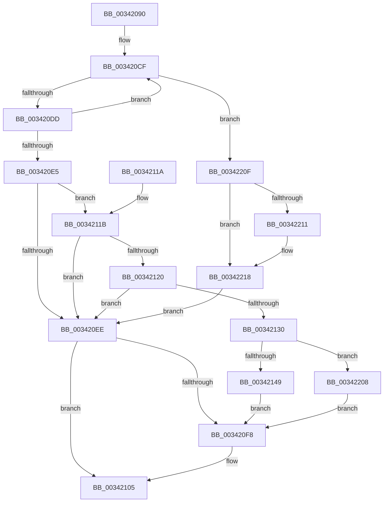

# PfLogFileDataAccess

- RVA: `0x00342090`–`0x00342221` (길이 `401` bytes)
- VA: `0x0000000140342090`
- 실행 섹션: `.text`
- PDB 이름 있음: `예`; PDB Function 태그: `아니요`
- unwind 정보 RVA: `0x00077788`
- 디코드: `93`개 명령, `401/401` bytes 표시
- 미해석 바이트: `0` (있으면 어셈블리에 `.byte`로 보존)

> 이 문서는 커널 이미지의 기계어와 PDB 기호를 분석해 생성했습니다. 4번과 5번은 함수 원형과 자료형을 바이너리 사용 방식에서 추정한 C 해석이며 원본 소스 복구 결과는 아닙니다.

## 1. Dependencies

- 직접 호출 지점: **3**; 고유 호출 대상: **3**
- 직접 호출자로 확인된 함수: **1**
- RIP 상대 이미지 참조: **2**

### Outgoing calls
- `0x00342100` → [PsDereferencePartition](PsDereferencePartition_function_00342E70.md) (function, `0x00342E70`)
- `0x0034213C` → [PsGetPagePriorityThread](../3C/PsGetPagePriorityThread_function_003C3E80.md) (function, `0x003C3E80`)
- `0x003421FC` → [PfLogEvent](PfLogEvent_function_00349BA8.md) (function, `0x00349BA8`)

### Direct callers
- [MiLogRelocationRva](../../page/94/MiLogRelocationRva_function_009420DC.md) at `0x00942188`

### Static image references
- `0x003421A9` → RVA `0x00F0F228` (`.data`; read)
- `0x003421F5` → RVA `0x00E670CC` (`.data`; read)

## 2. Other-region calls and transfers

- 다른 실행 섹션으로 향하는 call: **0**
- 별도 외부 분기/꼬리 이동을 확인하지 못했습니다.

## 3. Assembly (complete function range)

```asm
00342090  48 89 5C 24 08                  mov qword ptr [rsp + 8], rbx
00342095  48 89 74 24 18                  mov qword ptr [rsp + 0x18], rsi
0034209A  57                              push rdi
0034209B  48 83 EC 60                     sub rsp, 0x60
0034209F  48 8B BA 20 02 00 00            mov rdi, qword ptr [rdx + 0x220]
003420A6  0F 57 C0                        xorps xmm0, xmm0
003420A9  33 C0                           xor eax, eax
003420AB  4C 8B DA                        mov r11, rdx
003420AE  48 8B F1                        mov rsi, rcx
003420B1  48 89 44 24 50                  mov qword ptr [rsp + 0x50], rax
003420B6  0F 11 44 24 30                  movups xmmword ptr [rsp + 0x30], xmm0
003420BB  48 8B 9F 58 07 00 00            mov rbx, qword ptr [rdi + 0x758]
003420C2  0F 11 44 24 40                  movups xmmword ptr [rsp + 0x40], xmm0
003420C7  0F 0D 4B 28                     prefetchw byte ptr [rbx + 0x28]
003420CB  48 8B 43 28                     mov rax, qword ptr [rbx + 0x28]
003420CF  48 8D 48 01                     lea rcx, [rax + 1]
003420D3  48 83 F9 01                     cmp rcx, 1
003420D7  0F 86 32 01 00 00               jbe 0x14034220f
003420DD  F0 48 0F B1 4B 28               lock cmpxchg qword ptr [rbx + 0x28], rcx
003420E3  75 EA                           jne 0x1403420cf
003420E5  4C 8B 53 20                     mov r10, qword ptr [rbx + 0x20]
003420E9  48 85 DB                        test rbx, rbx
003420EC  75 2D                           jne 0x14034211b
003420EE  BF BB 00 00 C0                  mov edi, 0xc00000bb
003420F3  48 85 DB                        test rbx, rbx
003420F6  74 0D                           je 0x140342105
003420F8  BA 50 66 50 74                  mov edx, 0x74506650
003420FD  48 8B CB                        mov rcx, rbx
00342100  E8 6B 0D 00 00                  call 0x140342e70
00342105  48 8B 5C 24 70                  mov rbx, qword ptr [rsp + 0x70]
0034210A  8B C7                           mov eax, edi
0034210C  48 8B B4 24 80 00 00 00         mov rsi, qword ptr [rsp + 0x80]
00342114  48 83 C4 60                     add rsp, 0x60
00342118  5F                              pop rdi
00342119  C3                              ret
0034211A  CC                              int3
0034211B  4D 85 D2                        test r10, r10
0034211E  74 CE                           je 0x1403420ee
00342120  41 8B 82 64 02 00 00            mov eax, dword ptr [r10 + 0x264]
00342127  41 39 82 60 02 00 00            cmp dword ptr [r10 + 0x260], eax
0034212E  73 BE                           jae 0x1403420ee
00342130  48 8B 03                        mov rax, qword ptr [rbx]
00342133  49 8B CB                        mov rcx, r11
00342136  8B 90 30 44 00 00               mov edx, dword ptr [rax + 0x4430]
0034213C  E8 3F 1D 08 00                  call 0x1403c3e80
00342141  3B C2                           cmp eax, edx
00342143  0F 82 BF 00 00 00               jb 0x140342208
00342149  48 63 84 24 90 00 00 00         movsxd rax, dword ptr [rsp + 0x90]
00342151  48 B9 FF FF FF FF FF FF FF 7F   movabs rcx, 0x7fffffffffffffff
0034215B  48 C1 E0 3F                     shl rax, 0x3f
0034215F  4C 23 C9                        and r9, rcx
00342162  48 8B 8F D0 01 00 00            mov rcx, qword ptr [rdi + 0x1d0]
00342169  49 0B C1                        or rax, r9
0034216C  49 C1 E8 0C                     shr r8, 0xc
00342170  4C 8D 4C 24 30                  lea r9, [rsp + 0x30]
00342175  48 89 44 24 40                  mov qword ptr [rsp + 0x40], rax
0034217A  48 BA FF FF FF FF FF FF FF 1F   movabs rdx, 0x1fffffffffffffff
00342184  4C 89 44 24 38                  mov qword ptr [rsp + 0x38], r8
00342189  48 8B C1                        mov rax, rcx
0034218C  48 33 87 F8 01 00 00            xor rax, qword ptr [rdi + 0x1f8]
00342193  48 23 C2                        and rax, rdx
00342196  89 4C 24 54                     mov dword ptr [rsp + 0x54], ecx
0034219A  48 89 44 24 48                  mov qword ptr [rsp + 0x48], rax
0034219F  48 BA 20 03 00 00 80 F7 FF FF   movabs rdx, 0xfffff78000000320
003421A9  8B 05 79 D0 BC 00               mov eax, dword ptr [rip + 0xbcd079]
003421AF  49 8B CA                        mov rcx, r10
003421B2  89 44 24 50                     mov dword ptr [rsp + 0x50], eax
003421B6  48 B8 04 00 00 00 80 F7 FF FF   movabs rax, 0xfffff78000000004
003421C0  48 89 74 24 30                  mov qword ptr [rsp + 0x30], rsi
003421C5  48 8B 12                        mov rdx, qword ptr [rdx]
003421C8  44 8B C2                        mov r8d, edx
003421CB  8B 00                           mov eax, dword ptr [rax]
003421CD  4C 0F AF C0                     imul r8, rax
003421D1  48 C1 EA 20                     shr rdx, 0x20
003421D5  49 C1 E8 18                     shr r8, 0x18
003421D9  48 0F AF D0                     imul rdx, rax
003421DD  C7 44 24 20 28 00 00 00         mov dword ptr [rsp + 0x20], 0x28
003421E5  48 C1 E2 08                     shl rdx, 8
003421E9  4C 03 C2                        add r8, rdx
003421EC  BA 0A 00 00 00                  mov edx, 0xa
003421F1  49 C1 E8 0A                     shr r8, 0xa
003421F5  44 03 05 D0 4E B2 00            add r8d, dword ptr [rip + 0xb24ed0]
003421FC  E8 A7 79 00 00                  call 0x140349ba8
00342201  8B F8                           mov edi, eax
00342203  E9 F0 FE FF FF                  jmp 0x1403420f8
00342208  33 FF                           xor edi, edi
0034220A  E9 E9 FE FF FF                  jmp 0x1403420f8
0034220F  74 07                           je 0x140342218
00342211  B9 0E 00 00 00                  mov ecx, 0xe
00342216  CD 29                           int 0x29
00342218  33 FF                           xor edi, edi
0034221A  8B DF                           mov ebx, edi
0034221C  E9 CD FE FF FF                  jmp 0x1403420ee
```

## 4. C-style interpretation (structured pseudocode)

```c
__int64 __fastcall PfLogFileDataAccess(__int64 a1, __int64 a2, __int64 a3, __int64 a4, unsigned int a5)
{
    __int64 result;
    __int64 v_rdi;
    __int64 v_rsp;
    unsigned __int64 v_stack_m18;
    unsigned __int64 v_stack_m28;
    unsigned __int64 v_stack_m38;
    unsigned __int64 v_stack_p18;
    unsigned int v_stack_p20;
    unsigned __int64 v_stack_p30;
    unsigned __int64 v_stack_p38;
    unsigned __int64 v_stack_p40;
    unsigned __int64 v_stack_p48;
    unsigned int v_stack_p50;
    unsigned int v_stack_p54;
    unsigned __int64 v_stack_p8;

    v_stack_p8 = v_rbx;
    v_stack_p18 = v_rsi;
    v_rsp = (v_rsp) - (96);
    result = 0;
    v_stack_m18 = 0;
    v_stack_m38 = v_xmm0;
    v_stack_m28 = v_xmm0;
loc_003420CF:
    if ((*(unsigned __int64 *)(*(unsigned __int64 *)(*(unsigned __int64 *)(a2 + 544) + 1880) + 40) + 1) <= 1) goto loc_0034220F;
    if ((*(unsigned __int64 *)(*(unsigned __int64 *)(*(unsigned __int64 *)(a2 + 544) + 1880) + 40) + 1) != 1) goto loc_003420CF;
    if (*(unsigned __int64 *)(*(unsigned __int64 *)(a2 + 544) + 1880) != 0) goto loc_0034211B;
loc_003420EE:
    result = *(unsigned __int64 *)(*(unsigned __int64 *)(*(unsigned __int64 *)(a2 + 544) + 1880) + 40);
    if (*(unsigned __int64 *)(*(unsigned __int64 *)(a2 + 544) + 1880) != 0) {
        a2 = 0x74506650ULL;
        a1 = *(unsigned __int64 *)(*(unsigned __int64 *)(a2 + 544) + 1880);
        result = PsDereferencePartition(a1, a2, a3, a4);
    }
    v_rsp = (v_rsp) + (96);
    return (unsigned int)((unsigned int)((unsigned int)(0xC00000BBULL)));
loc_0034211B:
    if (*(unsigned __int64 *)(*(unsigned __int64 *)(*(unsigned __int64 *)(a2 + 544) + 1880) + 32) == 0) goto loc_003420EE;
    if ((*(unsigned int *)(*(unsigned __int64 *)(*(unsigned __int64 *)(*(unsigned __int64 *)(a2 + 544) + 1880) + 32) + 608)) >= ((unsigned int)((unsigned int)(*(unsigned int *)(*(unsigned __int64 *)(*(unsigned __int64 *)(*(unsigned __int64 *)(a2 + 544) + 1880) + 32) + 612))))) goto loc_003420EE;
    result = PsGetPagePriorityThread(a2, (unsigned int)(*(unsigned int *)(*(unsigned __int64 *)(v_stack_p8) + 17456)), a3, a4);
    if (((unsigned int)(result)) < ((unsigned int)((unsigned int)(*(unsigned int *)(*(unsigned __int64 *)(v_stack_p8) + 17456))))) goto loc_00342208;
    result = ((int)(a5)) << (63);
    a4 = (a4) & (a2);
    result = (result) | (a4);
    a3 = (a3) >> (12);
    v_stack_p40 = result;
    v_stack_p38 = a3;
    result = (*(unsigned __int64 *)((unsigned int)(0xC00000BBULL) + 464)) ^ (*(unsigned __int64 *)((unsigned int)(0xC00000BBULL) + 504));
    result = (result) & ((unsigned int)(*(unsigned int *)(*(unsigned __int64 *)(v_stack_p8) + 17456)));
    v_stack_p54 = (unsigned int)(*(unsigned __int64 *)((unsigned int)(0xC00000BBULL) + 464));
    v_stack_p48 = result;
    v_stack_p50 = (unsigned int)((unsigned int)(*(unsigned int *)(v_rip + 12374137)));
    v_stack_p30 = v_stack_p18;
    a3 = ((unsigned int)((unsigned int)(*(unsigned __int64 *)((unsigned int)(*(unsigned int *)(*(unsigned __int64 *)(v_stack_p8) + 17456)))))) * ((unsigned int)(*(unsigned int *)((unsigned int)(*(unsigned int *)(v_rip + 12374137)))));
    a2 = (*(unsigned __int64 *)((unsigned int)(*(unsigned int *)(*(unsigned __int64 *)(v_stack_p8) + 17456)))) >> (32);
    a3 = (a3) >> (24);
    a2 = (a2) * ((unsigned int)(*(unsigned int *)((unsigned int)(*(unsigned int *)(v_rip + 12374137)))));
    v_stack_p20 = 40;
    a2 = (a2) << (8);
    a3 = (a3) + (a2);
    a3 = (a3) >> (10);
    a3 = (unsigned int)((a3) + (*(unsigned int *)(v_rip + 11685584)));
    result = PfLogEvent(*(unsigned __int64 *)(*(unsigned __int64 *)(*(unsigned __int64 *)(a2 + 544) + 1880) + 32), 10, a3, v_stack_p30);
    goto loc_003420F8;
loc_00342208:
    v_rdi = 0;
    goto loc_003420F8;
loc_0034220F:
    if (!(condition_is_equal)) {
        a1 = 14;
    }
    v_rdi = 0;
    goto loc_003420EE;
}
```

## 5. (Beta) C Style

```c
int64_t PfLogFileDataAccess(int64_t Arg1, void *Arg2, int64_t Arg3, int64_t Arg4, uint32_t Arg5)
{
    uint8_t *arg2 = (uint8_t *)Arg2;

    int64_t result;
    int64_t local_rdi;
    int64_t local_rsp;
    uint64_t v_stack_m18;
    uint64_t v_stack_m28;
    uint64_t v_stack_m38;
    uint64_t v_stack_p18;
    uint32_t v_stack_p20;
    uint64_t v_stack_p30;
    uint64_t v_stack_p38;
    uint64_t v_stack_p40;
    uint64_t v_stack_p48;
    uint32_t v_stack_p50;
    uint32_t v_stack_p54;
    uint64_t v_stack_p8;

    v_stack_p8 = local_rbx;
    v_stack_p18 = local_rsi;
    local_rsp = (local_rsp) - (96);
    result = 0;
    v_stack_m18 = 0;
    v_stack_m38 = v_xmm0;
    v_stack_m28 = v_xmm0;
loc_003420CF:
    if ((*(uint64_t *)(*(uint64_t *)(*(uint64_t *)(arg2 + 0x220) + 0x758) + 0x28) + 1) <= 1) goto loc_0034220F;
    if ((*(uint64_t *)(*(uint64_t *)(*(uint64_t *)(arg2 + 0x220) + 0x758) + 0x28) + 1) != 1) goto loc_003420CF;
    if (*(uint64_t *)(*(uint64_t *)(arg2 + 0x220) + 0x758) != 0) goto loc_0034211B;
loc_003420EE:
    result = *(uint64_t *)(*(uint64_t *)(*(uint64_t *)(arg2 + 0x220) + 0x758) + 0x28);
    if (*(uint64_t *)(*(uint64_t *)(arg2 + 0x220) + 0x758) != 0) {
        Arg2 = 0x74506650ULL;
        Arg1 = *(uint64_t *)(*(uint64_t *)(arg2 + 0x220) + 0x758);
        result = PsDereferencePartition(Arg1, Arg2, Arg3, Arg4);
    }
    local_rsp = (local_rsp) + (96);
    return (uint32_t)((uint32_t)((uint32_t)(0xC00000BBULL)));
loc_0034211B:
    if (*(uint64_t *)(*(uint64_t *)(*(uint64_t *)(arg2 + 0x220) + 0x758) + 0x20) == 0) goto loc_003420EE;
    if ((*(uint32_t *)(*(uint64_t *)(*(uint64_t *)(*(uint64_t *)(arg2 + 0x220) + 0x758) + 0x20) + 0x260)) >= ((uint32_t)((uint32_t)(*(uint32_t *)(*(uint64_t *)(*(uint64_t *)(*(uint64_t *)(arg2 + 0x220) + 0x758) + 0x20) + 0x264))))) goto loc_003420EE;
    result = PsGetPagePriorityThread(Arg2, (uint32_t)(*(uint32_t *)(*(uint64_t *)(v_stack_p8) + 0x4430)), Arg3, Arg4);
    if (((uint32_t)(result)) < ((uint32_t)((uint32_t)(*(uint32_t *)(*(uint64_t *)(v_stack_p8) + 0x4430))))) goto loc_00342208;
    result = ((int32_t)(Arg5)) << (63);
    Arg4 = (Arg4) & (Arg2);
    result = (result) | (Arg4);
    Arg3 = (Arg3) >> (12);
    v_stack_p40 = result;
    v_stack_p38 = Arg3;
    result = (*(uint64_t *)((uint32_t)(0xC00000BBULL) + 0x1D0)) ^ (*(uint64_t *)((uint32_t)(0xC00000BBULL) + 0x1F8));
    result = (result) & ((uint32_t)(*(uint32_t *)(*(uint64_t *)(v_stack_p8) + 0x4430)));
    v_stack_p54 = (uint32_t)(*(uint64_t *)((uint32_t)(0xC00000BBULL) + 0x1D0));
    v_stack_p48 = result;
    v_stack_p50 = (uint32_t)((uint32_t)(*(uint32_t *)(v_rip + 0xBCD079)));
    v_stack_p30 = v_stack_p18;
    Arg3 = ((uint32_t)((uint32_t)(*(uint64_t *)((uint32_t)(*(uint32_t *)(*(uint64_t *)(v_stack_p8) + 0x4430)))))) * ((uint32_t)(*(uint32_t *)((uint32_t)(*(uint32_t *)(v_rip + 0xBCD079)))));
    Arg2 = (*(uint64_t *)((uint32_t)(*(uint32_t *)(*(uint64_t *)(v_stack_p8) + 0x4430)))) >> (32);
    Arg3 = (Arg3) >> (24);
    Arg2 = (Arg2) * ((uint32_t)(*(uint32_t *)((uint32_t)(*(uint32_t *)(v_rip + 0xBCD079)))));
    v_stack_p20 = 40;
    Arg2 = (Arg2) << (8);
    Arg3 = (Arg3) + (Arg2);
    Arg3 = (Arg3) >> (10);
    Arg3 = (uint32_t)((Arg3) + (*(uint32_t *)(v_rip + 0xB24ED0)));
    result = PfLogEvent(*(uint64_t *)(*(uint64_t *)(*(uint64_t *)(arg2 + 0x220) + 0x758) + 0x20), 10, Arg3, v_stack_p30);
    goto loc_003420F8;
loc_00342208:
    local_rdi = 0;
    goto loc_003420F8;
loc_0034220F:
    if (!(condition_is_equal)) {
        Arg1 = 14;
    }
    local_rdi = 0;
    goto loc_003420EE;
}
```

### 관측된 메모리 오프셋

구조체 형식이 확인되지 않은 접근은 인자 기준의 오프셋으로만 기록했습니다.

| 기준 인자 | 오프셋 표현 | 폭 (bit) | 접근 |
|---|---:|---:|---|
| `Arg2` | `+ 0x220` | `64` | `R` |

## 6. Execution-region graph

[열기: 2D/3D 그래프와 함수 탐색 컨트롤 패널](../../../control-panel.html?section=text&rva=0x00342090&view=graph)

- 2D 그래프는 위에서 아래로 흐르고, 3D 그래프는 빈 공간을 드래그해 회전합니다. Shift+드래그는 이동, 휠은 확대·축소, 함수 노드 선택은 대상 보고서 이동입니다.

### Static fallback


