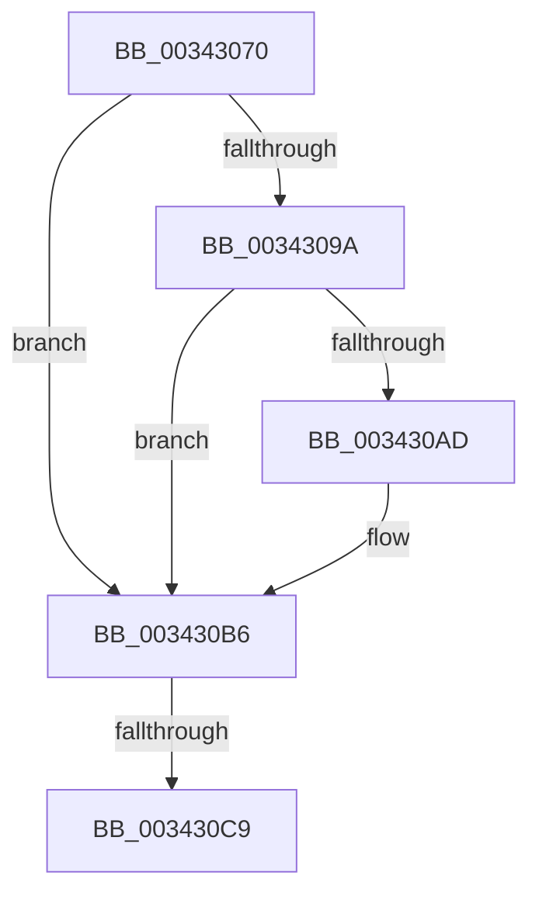

# PfSnLogPageFaultCommon

- RVA: `0x00343070`–`0x003430D1` (길이 `97` bytes)
- VA: `0x0000000140343070`
- 실행 섹션: `.text`
- PDB 이름 있음: `예`; PDB Function 태그: `아니요`
- unwind 정보 RVA: `0x00077A54`
- 디코드: `23`개 명령, `97/97` bytes 표시
- 미해석 바이트: `0` (있으면 어셈블리에 `.byte`로 보존)

> 이 문서는 커널 이미지의 기계어와 PDB 기호를 분석해 생성했습니다. 4번과 5번은 함수 원형과 자료형을 바이너리 사용 방식에서 추정한 C 해석이며 원본 소스 복구 결과는 아닙니다.

## 1. Dependencies

- 직접 호출 지점: **1**; 고유 호출 대상: **1**
- 직접 호출자로 확인된 함수: **3**
- RIP 상대 이미지 참조: **0**

### Outgoing calls
- `0x0034308C` → [PfSnGetFileInformation](PfSnGetFileInformation_function_00343210.md) (function, `0x00343210`)

### Direct callers
- [sub_003422B4](Unknown_function_003422B4.md) at `0x00342491`
- [sub_003449AA](Unknown_function_003449AA.md) at `0x00344A03`
- [MiCompleteProtoPteFault](MiCompleteProtoPteFault_function_00345710.md) at `0x003467B8`

### Static image references
- 디코드된 RIP-relative 메모리 참조가 없습니다.

## 2. Other-region calls and transfers

- 다른 실행 섹션으로 향하는 call: **0**
- call이 아닌 외부 분기/꼬리 이동: **1**
  - `0x003430C3` → [sub_003431A4](Unknown_function_003431A4.md) (`tail-transfer`)

## 3. Assembly (complete function range)

```asm
00343070  40 53                           push rbx
00343072  57                              push rdi
00343073  41 56                           push r14
00343075  41 57                           push r15
00343077  48 83 EC 28                     sub rsp, 0x28
0034307B  45 33 FF                        xor r15d, r15d
0034307E  49 8B F9                        mov rdi, r9
00343081  4C 89 7C 24 50                  mov qword ptr [rsp + 0x50], r15
00343086  4D 8B F0                        mov r14, r8
00343089  48 8B D9                        mov rbx, rcx
0034308C  E8 7F 01 00 00                  call 0x140343210
00343091  F6 83 E4 01 00 00 01            test byte ptr [rbx + 0x1e4], 1
00343098  75 1C                           jne 0x1403430b6
0034309A  48 8B 83 60 01 00 00            mov rax, qword ptr [rbx + 0x160]
003430A1  0F B6 88 BA 04 00 00            movzx ecx, byte ptr [rax + 0x4ba]
003430A8  80 F9 02                        cmp cl, 2
003430AB  75 09                           jne 0x1403430b6
003430AD  66 F0 83 8B E4 01 00 00 01      lock or word ptr [rbx + 0x1e4], 1
003430B6  48 B8 00 00 00 00 00 02 00 00   movabs rax, 0x20000000000
003430C0  48 3B F8                        cmp rdi, rax
003430C3  0F 83 DB 00 00 00               jae 0x1403431a4
003430C9  8B 44 24 70                     mov eax, dword ptr [rsp + 0x70]
003430CD  48 C1 EF 09                     shr rdi, 9
```

## 4. C-style interpretation (structured pseudocode)

```c
__int64 __fastcall PfSnLogPageFaultCommon(__int64 a1, __int64 a2, __int64 a3, __int64 a4, unsigned int a5)
{
    __int64 result;
    __int64 v_r15;
    __int64 v_rdi;
    __int64 v_rsp;
    unsigned __int64 v_stack_p8;

    v_rsp = (v_rsp) - (40);
    v_r15 = 0;
    v_stack_p8 = 0;
    result = PfSnGetFileInformation(a1, a2, a3, a4);
    if (((*(unsigned __int8 *)(a1 + 484)) & (1)) != 0) goto loc_003430B6;
    if (((unsigned __int8)(*(unsigned __int8 *)(*(unsigned __int64 *)(a1 + 352) + 1210))) == 2) {
    }
    v_rdi = (a4) >> (9);
    return (unsigned int)(a5);
}
```

## 5. (Beta) C Style

```c
int64_t PfSnLogPageFaultCommon(void *Arg1, int64_t Arg2, int64_t Arg3, int64_t Arg4, uint32_t Arg5)
{
    uint8_t *arg1 = (uint8_t *)Arg1;

    int64_t result;
    int64_t local_r15;
    int64_t local_rdi;
    int64_t local_rsp;
    uint64_t v_stack_p8;

    local_rsp = (local_rsp) - (40);
    local_r15 = 0;
    v_stack_p8 = 0;
    result = PfSnGetFileInformation(Arg1, Arg2, Arg3, Arg4);
    if (((*(uint8_t *)(arg1 + 0x1E4)) & (1)) != 0) goto loc_003430B6;
    if (((uint8_t)(*(uint8_t *)(*(uint64_t *)(arg1 + 0x160) + 0x4BA))) == 2) {
    }
    local_rdi = (Arg4) >> (9);
    return (uint32_t)(Arg5);
}
```

### 관측된 메모리 오프셋

구조체 형식이 확인되지 않은 접근은 인자 기준의 오프셋으로만 기록했습니다.

| 기준 인자 | 오프셋 표현 | 폭 (bit) | 접근 |
|---|---:|---:|---|
| `Arg1` | `+ 0x160` | `64` | `R` |
| `Arg1` | `+ 0x1E4` | `8` | `R` |
| `Arg1` | `+ 0x1E4` | `16` | `R/W` |

## 6. Execution-region graph

[열기: 2D/3D 그래프와 함수 탐색 컨트롤 패널](../../../control-panel.html?section=text&rva=0x00343070&view=graph)

- 2D 그래프는 위에서 아래로 흐르고, 3D 그래프는 빈 공간을 드래그해 회전합니다. Shift+드래그는 이동, 휠은 확대·축소, 함수 노드 선택은 대상 보고서 이동입니다.

### Static fallback


