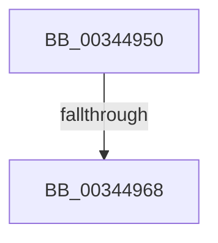

# PfSnLogPageFault

- RVA: `0x00344950`–`0x0034496F` (길이 `31` bytes)
- VA: `0x0000000140344950`
- 실행 섹션: `.text`
- PDB 이름 있음: `예`; PDB Function 태그: `아니요`
- unwind 정보 RVA: `0x00077D64`
- 디코드: `11`개 명령, `31/31` bytes 표시
- 미해석 바이트: `0` (있으면 어셈블리에 `.byte`로 보존)

> 이 문서는 커널 이미지의 기계어와 PDB 기호를 분석해 생성했습니다. 4번과 5번은 함수 원형과 자료형을 바이너리 사용 방식에서 추정한 C 해석이며 원본 소스 복구 결과는 아닙니다.

## 1. Dependencies

- 직접 호출 지점: **0**; 고유 호출 대상: **0**
- 직접 호출자로 확인된 함수: **4**
- RIP 상대 이미지 참조: **0**

### Outgoing calls
- 직접 디코드된 call 명령이 없습니다.

### Direct callers
- [MiMakeSystemCachePteValid](../2A/MiMakeSystemCachePteValid_function_002A35D8.md) at `0x002A37BA`
- [MiCompleteRestrictedImageFault](../2C/MiCompleteRestrictedImageFault_function_002C60D4.md) at `0x002C6252`
- [sub_0034753C](Unknown_function_0034753C.md) at `0x00347595`
- [MiLogRelocationRva](../../page/94/MiLogRelocationRva_function_009420DC.md) at `0x009421CB`

### Static image references
- 디코드된 RIP-relative 메모리 참조가 없습니다.

## 2. Other-region calls and transfers

- 다른 실행 섹션으로 향하는 call: **0**
- call이 아닌 외부 분기/꼬리 이동: **2**
  - `0x00344966` → [sub_0034496F](Unknown_function_0034496F.md) (`tail-transfer`)
  - `0x0034496D` → [sub_003449A0](Unknown_function_003449A0.md) (`tail-transfer`)

## 3. Assembly (complete function range)

```asm
00344950  40 55                           push rbp
00344952  57                              push rdi
00344953  41 56                           push r14
00344955  48 83 EC 30                     sub rsp, 0x30
00344959  41 8B E8                        mov ebp, r8d
0034495C  4C 8B F2                        mov r14, rdx
0034495F  48 8B F9                        mov rdi, rcx
00344962  41 F6 C0 04                     test r8b, 4
00344966  74 07                           je 0x14034496f
00344968  48 83 79 20 00                  cmp qword ptr [rcx + 0x20], 0
0034496D  75 31                           jne 0x1403449a0
```

## 4. C-style interpretation (structured pseudocode)

```c
void __fastcall PfSnLogPageFault(__int64 a1, __int64 a2, int a3)
{
    __int64 v_rsp;

    v_rsp = (v_rsp) - (48);
}
```

## 5. (Beta) C Style

```c
void PfSnLogPageFault(void *Arg1, int64_t Arg2, int32_t Arg3)
{
    uint8_t *arg1 = (uint8_t *)Arg1;

    int64_t local_rsp;

    local_rsp = (local_rsp) - (48);
}
```

### 관측된 메모리 오프셋

구조체 형식이 확인되지 않은 접근은 인자 기준의 오프셋으로만 기록했습니다.

| 기준 인자 | 오프셋 표현 | 폭 (bit) | 접근 |
|---|---:|---:|---|
| `Arg1` | `+ 0x20` | `64` | `R` |

## 6. Execution-region graph

[열기: 2D/3D 그래프와 함수 탐색 컨트롤 패널](../../../control-panel.html?section=text&rva=0x00344950&view=graph)

- 2D 그래프는 위에서 아래로 흐르고, 3D 그래프는 빈 공간을 드래그해 회전합니다. Shift+드래그는 이동, 휠은 확대·축소, 함수 노드 선택은 대상 보고서 이동입니다.

### Static fallback


