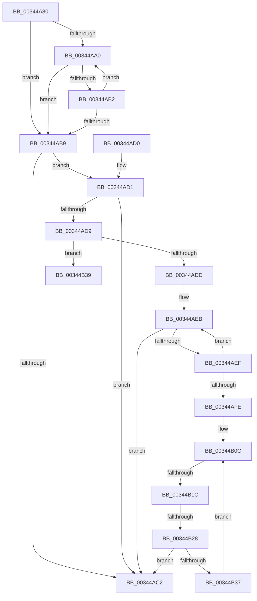

# PfSnReferenceProcessTrace

- RVA: `0x00344A80`–`0x00344B40` (길이 `192` bytes)
- VA: `0x0000000140344A80`
- 실행 섹션: `.text`
- PDB 이름 있음: `예`; PDB Function 태그: `아니요`
- unwind 정보 RVA: `0x00077DB4`
- 디코드: `52`개 명령, `192/192` bytes 표시
- 미해석 바이트: `0` (있으면 어셈블리에 `.byte`로 보존)

> 이 문서는 커널 이미지의 기계어와 PDB 기호를 분석해 생성했습니다. 4번과 5번은 함수 원형과 자료형을 바이너리 사용 방식에서 추정한 C 해석이며 원본 소스 복구 결과는 아닙니다.

## 1. Dependencies

- 직접 호출 지점: **0**; 고유 호출 대상: **0**
- 직접 호출자로 확인된 함수: **6**
- RIP 상대 이미지 참조: **1**

### Outgoing calls
- 직접 디코드된 call 명령이 없습니다.

### Direct callers
- [sub_0034496F](Unknown_function_0034496F.md) at `0x00344989`
- [MiCompleteProtoPteFault](MiCompleteProtoPteFault_function_00345710.md) at `0x00345D5B`
- [PfSnEndProcessTrace](../../page/90/PfSnEndProcessTrace_function_00903E04.md) at `0x00903E5A`
- [PfSnLogStreamCreate](../../page/96/PfSnLogStreamCreate_function_009605B0.md) at `0x0096060B`
- [PfSnLogHelper](../../page/96/PfSnLogHelper_function_00960C1C.md) at `0x00960C37`
- [PfSnAsyncContextInitialize](../../page/96/PfSnAsyncContextInitialize_function_00961168.md) at `0x009611C4`

### Static image references
- `0x00344B39` → RVA `0x00E67260` (`.data`; read)

## 2. Other-region calls and transfers

- 다른 실행 섹션으로 향하는 call: **0**
- call이 아닌 외부 분기/꼬리 이동: **2**
  - `0x00344B1A` → [sub_00344B95 + 0x1](Unknown_function_00344B95.md) (`tail-transfer`)
  - `0x00344B26` → [sub_00344B95 + 0x1](Unknown_function_00344B95.md) (`tail-transfer`)

## 3. Assembly (complete function range)

```asm
00344A80  48 89 5C 24 10                  mov qword ptr [rsp + 0x10], rbx
00344A85  57                              push rdi
00344A86  48 83 EC 20                     sub rsp, 0x20
00344A8A  48 8B D9                        mov rbx, rcx
00344A8D  0F 0D 89 90 03 00 00            prefetchw byte ptr [rcx + 0x390]
00344A94  48 8B 91 90 03 00 00            mov rdx, qword ptr [rcx + 0x390]
00344A9B  F6 C2 0F                        test dl, 0xf
00344A9E  74 19                           je 0x140344ab9
00344AA0  48 8D 4A FF                     lea rcx, [rdx - 1]
00344AA4  48 8B C2                        mov rax, rdx
00344AA7  F0 48 0F B1 8B 90 03 00 00      lock cmpxchg qword ptr [rbx + 0x390], rcx
00344AB0  74 07                           je 0x140344ab9
00344AB2  48 8B D0                        mov rdx, rax
00344AB5  A8 0F                           test al, 0xf
00344AB7  75 E7                           jne 0x140344aa0
00344AB9  48 8B FA                        mov rdi, rdx
00344ABC  48 83 E7 F0                     and rdi, 0xfffffffffffffff0
00344AC0  75 0F                           jne 0x140344ad1
00344AC2  48 8B C7                        mov rax, rdi
00344AC5  48 8B 5C 24 38                  mov rbx, qword ptr [rsp + 0x38]
00344ACA  48 83 C4 20                     add rsp, 0x20
00344ACE  5F                              pop rdi
00344ACF  C3                              ret
00344AD0  CC                              int3
00344AD1  83 E2 0F                        and edx, 0xf
00344AD4  83 FA 01                        cmp edx, 1
00344AD7  77 E9                           ja 0x140344ac2
00344AD9  85 D2                           test edx, edx
00344ADB  74 5C                           je 0x140344b39
00344ADD  0F 0D 8F 68 01 00 00            prefetchw byte ptr [rdi + 0x168]
00344AE4  48 8B 87 68 01 00 00            mov rax, qword ptr [rdi + 0x168]
00344AEB  A8 01                           test al, 1
00344AED  75 D3                           jne 0x140344ac2
00344AEF  48 8D 48 1E                     lea rcx, [rax + 0x1e]
00344AF3  F0 48 0F B1 8F 68 01 00 00      lock cmpxchg qword ptr [rdi + 0x168], rcx
00344AFC  75 ED                           jne 0x140344aeb
00344AFE  0F 0D 8B 90 03 00 00            prefetchw byte ptr [rbx + 0x390]
00344B05  48 8B 83 90 03 00 00            mov rax, qword ptr [rbx + 0x390]
00344B0C  48 8B C8                        mov rcx, rax
00344B0F  83 E1 0F                        and ecx, 0xf
00344B12  48 83 C1 0F                     add rcx, 0xf
00344B16  48 83 F9 0F                     cmp rcx, 0xf
00344B1A  77 7A                           ja 0x140344b96
00344B1C  48 8B C8                        mov rcx, rax
00344B1F  48 83 E1 F0                     and rcx, 0xfffffffffffffff0
00344B23  48 3B F9                        cmp rdi, rcx
00344B26  75 6E                           jne 0x140344b96
00344B28  48 8D 48 0F                     lea rcx, [rax + 0xf]
00344B2C  F0 48 0F B1 8B 90 03 00 00      lock cmpxchg qword ptr [rbx + 0x390], rcx
00344B35  74 8B                           je 0x140344ac2
00344B37  EB D3                           jmp 0x140344b0c
00344B39  48 8D 0D 20 27 B2 00            lea rcx, [rip + 0xb22720]
```

## 4. C-style interpretation (structured pseudocode)

```c
__int64 __fastcall PfSnReferenceProcessTrace(__int64 a1)
{
    __int64 v_rdi;
    __int64 v_rsp;
    unsigned __int64 v_stack_p10;

    v_stack_p10 = v_rbx;
    v_rsp = (v_rsp) - (32);
    if ((((unsigned __int8)(*(unsigned __int64 *)(a1 + 912))) & (15)) == 0) goto loc_00344AB9;
loc_00344AA0:
    if ((((unsigned __int8)(*(unsigned __int64 *)(a1 + 912))) & (15)) == 0) goto loc_00344AB9;
    if ((((unsigned __int8)(*(unsigned __int64 *)(a1 + 912))) & (15)) != 0) goto loc_00344AA0;
loc_00344AB9:
    v_rdi = (*(unsigned __int64 *)(a1 + 912)) & (-16);
    if (condition_is_not_equal) goto loc_00344AD1;
loc_00344AC2:
    v_rsp = (v_rsp) + (32);
    return v_rdi;
loc_00344AD1:
    a2 = (unsigned int)((*(unsigned __int64 *)(a1 + 912)) & (15));
    if (((unsigned int)(a2)) > 1) goto loc_00344AC2;
    if ((unsigned int)(a2) == 0) goto loc_00344B39;
loc_00344AEB:
    if ((((unsigned __int8)(*(unsigned __int64 *)(v_rdi + 360))) & (1)) != 0) goto loc_00344AC2;
    if ((((unsigned __int8)(*(unsigned __int64 *)(v_rdi + 360))) & (1)) != 0) goto loc_00344AEB;
loc_00344B0C:
    a1 = (unsigned int)((*(unsigned __int64 *)(v_stack_p10 + 912)) & (15));
    a1 = (a1) + (15);
    a1 = (*(unsigned __int64 *)(v_stack_p10 + 912)) & (-16);
    if (v_rdi == a1) goto loc_00344AC2;
    goto loc_00344B0C;
loc_00344B39:
    return *(unsigned __int64 *)(v_stack_p10 + 912);
}
```

## 5. (Beta) C Style

```c
int64_t PfSnReferenceProcessTrace(void *Arg1)
{
    uint8_t *arg1 = (uint8_t *)Arg1;

    int64_t local_rdi;
    int64_t local_rsp;
    uint64_t v_stack_p10;

    v_stack_p10 = local_rbx;
    local_rsp = (local_rsp) - (32);
    if ((((uint8_t)(*(uint64_t *)(arg1 + 0x390))) & (15)) == 0) goto loc_00344AB9;
loc_00344AA0:
    if ((((uint8_t)(*(uint64_t *)(arg1 + 0x390))) & (15)) == 0) goto loc_00344AB9;
    if ((((uint8_t)(*(uint64_t *)(arg1 + 0x390))) & (15)) != 0) goto loc_00344AA0;
loc_00344AB9:
    local_rdi = (*(uint64_t *)(arg1 + 0x390)) & (-16);
    if (condition_is_not_equal) goto loc_00344AD1;
loc_00344AC2:
    local_rsp = (local_rsp) + (32);
    return local_rdi;
loc_00344AD1:
    a2 = (uint32_t)((*(uint64_t *)(arg1 + 0x390)) & (15));
    if (((uint32_t)(a2)) > 1) goto loc_00344AC2;
    if ((uint32_t)(a2) == 0) goto loc_00344B39;
loc_00344AEB:
    if ((((uint8_t)(*(uint64_t *)(local_rdi + 0x168))) & (1)) != 0) goto loc_00344AC2;
    if ((((uint8_t)(*(uint64_t *)(local_rdi + 0x168))) & (1)) != 0) goto loc_00344AEB;
loc_00344B0C:
    Arg1 = (uint32_t)((*(uint64_t *)(v_stack_p10 + 0x390)) & (15));
    Arg1 = (Arg1) + (15);
    Arg1 = (*(uint64_t *)(v_stack_p10 + 0x390)) & (-16);
    if (local_rdi == Arg1) goto loc_00344AC2;
    goto loc_00344B0C;
loc_00344B39:
    return *(uint64_t *)(v_stack_p10 + 0x390);
}
```

### 관측된 메모리 오프셋

구조체 형식이 확인되지 않은 접근은 인자 기준의 오프셋으로만 기록했습니다.

| 기준 인자 | 오프셋 표현 | 폭 (bit) | 접근 |
|---|---:|---:|---|
| `Arg1` | `+ 0x390` | `8` | `R` |
| `Arg1` | `+ 0x390` | `64` | `R` |

## 6. Execution-region graph

[열기: 2D/3D 그래프와 함수 탐색 컨트롤 패널](../../../control-panel.html?section=text&rva=0x00344A80&view=graph)

- 2D 그래프는 위에서 아래로 흐르고, 3D 그래프는 빈 공간을 드래그해 회전합니다. Shift+드래그는 이동, 휠은 확대·축소, 함수 노드 선택은 대상 보고서 이동입니다.

### Static fallback


