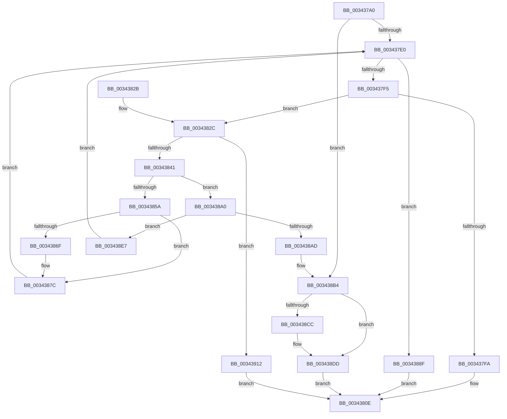

# PfSnTraceGetLogEntry

- RVA: `0x003437A0`–`0x00343923` (길이 `387` bytes)
- VA: `0x00000001403437A0`
- 실행 섹션: `.text`
- PDB 이름 있음: `예`; PDB Function 태그: `아니요`
- unwind 정보 RVA: `0x00077B1C`
- 디코드: `100`개 명령, `387/387` bytes 표시
- 미해석 바이트: `0` (있으면 어셈블리에 `.byte`로 보존)

> 이 문서는 커널 이미지의 기계어와 PDB 기호를 분석해 생성했습니다. 4번과 5번은 함수 원형과 자료형을 바이너리 사용 방식에서 추정한 C 해석이며 원본 소스 복구 결과는 아닙니다.

## 1. Dependencies

- 직접 호출 지점: **7**; 고유 호출 대상: **7**
- 직접 호출자로 확인된 함수: **8**
- RIP 상대 이미지 참조: **1**

### Outgoing calls
- `0x00343830` → [PfSnTraceBufferAllocate](../49/PfSnTraceBufferAllocate_function_0049E594.md) (function, `0x0049E594`)
- `0x00343848` → [KeAcquireSpinLockRaiseToDpc](../20/KeAcquireSpinLockRaiseToDpc_function_00208470.md) (function, `0x00208470`)
- `0x00343861` → [KxReleaseSpinLock](../20/KxReleaseSpinLock_function_00206670.md) (function, `0x00206670`)
- `0x00343877` → [KiLowerIrqlProcessIrqlFlags](../4F/KiLowerIrqlProcessIrqlFlags_function_004F5698.md) (function, `0x004F5698`)
- `0x00343885` → [ExFreePoolWithTag](../../poolcode/B8/ExFreePoolWithTag_function_00B82870.md) (function, `0x00B82870`)
- `0x003438D8` → [ExQueueWorkItem](../2F/ExQueueWorkItem_function_002F9520.md) (function, `0x002F9520`)
- `0x00343908` → [KeReleaseSpinLock](../39/KeReleaseSpinLock_function_00392BA0.md) (function, `0x00392BA0`)

### Direct callers
- [sub_0034310B](Unknown_function_0034310B.md) at `0x00343118`
- [sub_003431B5](Unknown_function_003431B5.md) at `0x003431C2`
- [PfSnTraceTimerRoutine](../48/PfSnTraceTimerRoutine_function_0048AEC0.md) at `0x0048AF30`
- [PfSnLogScenarioMeasures](../4A/PfSnLogScenarioMeasures_function_004A8794.md) at `0x004A87AD`
- [PfSnLogStreamCreate](../../page/96/PfSnLogStreamCreate_function_009605B0.md) at `0x00960625`
- [PfSnLogHelper](../../page/96/PfSnLogHelper_function_00960C1C.md) at `0x00960C4C`
- [PfSnNameRemoveAll](../../page/96/PfSnNameRemoveAll_function_00960C90.md) at `0x00960CC4`
- [PfSnLogIdentifier](../../page/A7/PfSnLogIdentifier_function_00A7AAC8.md) at `0x00A7AAEF`

### Static image references
- `0x00343866` → RVA `0x00FC6D20` (`ALMOSTRO`; read)

## 2. Other-region calls and transfers

- 다른 실행 섹션으로 향하는 call: **1**
  - `0x00343885` → [ExFreePoolWithTag](../../poolcode/B8/ExFreePoolWithTag_function_00B82870.md) (`.text` → `POOLCODE`)
- 별도 외부 분기/꼬리 이동을 확인하지 못했습니다.

## 3. Assembly (complete function range)

```asm
003437A0  48 89 5C 24 08                  mov qword ptr [rsp + 8], rbx
003437A5  48 89 6C 24 10                  mov qword ptr [rsp + 0x10], rbp
003437AA  48 89 74 24 18                  mov qword ptr [rsp + 0x18], rsi
003437AF  57                              push rdi
003437B0  41 54                           push r12
003437B2  41 55                           push r13
003437B4  41 56                           push r14
003437B6  41 57                           push r15
003437B8  48 83 EC 20                     sub rsp, 0x20
003437BC  4D 8B F0                        mov r14, r8
003437BF  8B DA                           mov ebx, edx
003437C1  48 8B F1                        mov rsi, rcx
003437C4  8B C2                           mov eax, edx
003437C6  F0 0F C1 81 58 01 00 00         lock xadd dword ptr [rcx + 0x158], eax
003437CE  8B EA                           mov ebp, edx
003437D0  03 C2                           add eax, edx
003437D2  F7 DD                           neg ebp
003437D4  3B 81 54 01 00 00               cmp eax, dword ptr [rcx + 0x154]
003437DA  0F 8F D4 00 00 00               jg 0x1403438b4
003437E0  48 8B 7E 60                     mov rdi, qword ptr [rsi + 0x60]
003437E4  8B C3                           mov eax, ebx
003437E6  F0 0F C1 47 10                  lock xadd dword ptr [rdi + 0x10], eax
003437EB  03 C3                           add eax, ebx
003437ED  85 C0                           test eax, eax
003437EF  0F 8E 9A 00 00 00               jle 0x14034388f
003437F5  3B 47 14                        cmp eax, dword ptr [rdi + 0x14]
003437F8  7F 32                           jg 0x14034382c
003437FA  2B C3                           sub eax, ebx
003437FC  48 98                           cdqe
003437FE  48 C1 E0 04                     shl rax, 4
00343802  48 83 C0 18                     add rax, 0x18
00343806  48 03 C7                        add rax, rdi
00343809  49 89 06                        mov qword ptr [r14], rax
0034380C  33 C0                           xor eax, eax
0034380E  48 8B 5C 24 50                  mov rbx, qword ptr [rsp + 0x50]
00343813  48 8B 6C 24 58                  mov rbp, qword ptr [rsp + 0x58]
00343818  48 8B 74 24 60                  mov rsi, qword ptr [rsp + 0x60]
0034381D  48 83 C4 20                     add rsp, 0x20
00343821  41 5F                           pop r15
00343823  41 5E                           pop r14
00343825  41 5D                           pop r13
00343827  41 5C                           pop r12
00343829  5F                              pop rdi
0034382A  C3                              ret
0034382B  CC                              int3
0034382C  F0 01 6F 10                     lock add dword ptr [rdi + 0x10], ebp
00343830  E8 5F AD 15 00                  call 0x14049e594
00343835  4C 8B E8                        mov r13, rax
00343838  48 85 C0                        test rax, rax
0034383B  0F 84 D1 00 00 00               je 0x140343912
00343841  48 8D 8E 80 00 00 00            lea rcx, [rsi + 0x80]
00343848  E8 23 4C EC FF                  call 0x140208470
0034384D  48 8B 56 60                     mov rdx, qword ptr [rsi + 0x60]
00343851  44 0F B6 E0                     movzx r12d, al
00343855  48 3B D7                        cmp rdx, rdi
00343858  74 46                           je 0x1403438a0
0034385A  48 8D 8E 80 00 00 00            lea rcx, [rsi + 0x80]
00343861  E8 0A 2E EC FF                  call 0x140206670
00343866  83 3D B3 34 C8 00 00            cmp dword ptr [rip + 0xc834b3], 0
0034386D  74 0D                           je 0x14034387c
0034386F  44 0F 20 C1                     mov rcx, cr8
00343873  41 0F B6 D4                     movzx edx, r12b
00343877  E8 1C 1E 1B 00                  call 0x1404f5698
0034387C  45 0F 22 C4                     mov cr8, r12
00343880  33 D2                           xor edx, edx
00343882  49 8B CD                        mov rcx, r13
00343885  E8 E6 EF 83 00                  call 0x140b82870
0034388A  E9 51 FF FF FF                  jmp 0x1403437e0
0034388F  B8 95 00 00 C0                  mov eax, 0xc0000095
00343894  F0 01 AE 58 01 00 00            lock add dword ptr [rsi + 0x158], ebp
0034389B  E9 6E FF FF FF                  jmp 0x14034380e
003438A0  48 8B 4E 70                     mov rcx, qword ptr [rsi + 0x70]
003438A4  48 8D 46 68                     lea rax, [rsi + 0x68]
003438A8  48 39 01                        cmp qword ptr [rcx], rax
003438AB  74 3A                           je 0x1403438e7
003438AD  B9 03 00 00 00                  mov ecx, 3
003438B2  CD 29                           int 0x29
003438B4  F0 01 A9 58 01 00 00            lock add dword ptr [rcx + 0x158], ebp
003438BB  B9 03 00 00 00                  mov ecx, 3
003438C0  33 C0                           xor eax, eax
003438C2  F0 0F B1 8E 90 01 00 00         lock cmpxchg dword ptr [rsi + 0x190], ecx
003438CA  75 11                           jne 0x1403438dd
003438CC  48 8D 8E 70 01 00 00            lea rcx, [rsi + 0x170]
003438D3  BA 01 00 00 00                  mov edx, 1
003438D8  E8 43 5C FB FF                  call 0x1402f9520
003438DD  B8 89 01 00 C0                  mov eax, 0xc0000189
003438E2  E9 27 FF FF FF                  jmp 0x14034380e
003438E7  49 89 4D 08                     mov qword ptr [r13 + 8], rcx
003438EB  41 0F B6 D4                     movzx edx, r12b
003438EF  49 89 45 00                     mov qword ptr [r13], rax
003438F3  4C 89 29                        mov qword ptr [rcx], r13
003438F6  48 8D 8E 80 00 00 00            lea rcx, [rsi + 0x80]
003438FD  4C 89 68 08                     mov qword ptr [rax + 8], r13
00343901  FF 46 78                        inc dword ptr [rsi + 0x78]
00343904  4C 89 6E 60                     mov qword ptr [rsi + 0x60], r13
00343908  E8 93 F2 04 00                  call 0x140392ba0
0034390D  E9 CE FE FF FF                  jmp 0x1403437e0
00343912  B8 9A 00 00 C0                  mov eax, 0xc000009a
00343917  F0 01 AE 58 01 00 00            lock add dword ptr [rsi + 0x158], ebp
0034391E  E9 EB FE FF FF                  jmp 0x14034380e
```

## 4. C-style interpretation (structured pseudocode)

```c
__int64 __fastcall PfSnTraceGetLogEntry(__int64 a1, int a2, __int64 a3)
{
    __int64 result;
    __int64 v_rbp;
    __int64 v_rsp;
    unsigned __int64 v_stack_p10;
    unsigned __int64 v_stack_p18;
    unsigned __int64 v_stack_p8;

    v_stack_p8 = v_rbx;
    v_stack_p10 = v_rbp;
    v_stack_p18 = v_rsi;
    v_rsp = (v_rsp) - (32);
    result = (unsigned int)(((unsigned int)(a2)) + (a2));
    v_rbp = (unsigned int)(-((unsigned int)(a2)));
    if (((unsigned int)(result)) > (*(unsigned int *)(a1 + 340))) goto loc_003438B4;
loc_003437E0:
    result = (unsigned int)(((unsigned int)((unsigned int)((unsigned int)(a2)))) + ((unsigned int)((unsigned int)(a2))));
    if (condition_is_less_or_equal) goto loc_0034388F;
    if (((unsigned int)(result)) > (*(unsigned int *)(*(unsigned __int64 *)(a1 + 96) + 20))) goto loc_0034382C;
    result = (unsigned int)((result) - ((unsigned int)((unsigned int)(a2))));
    result = (result) << (4);
    result = (result) + (24);
    result = (result) + (*(unsigned __int64 *)(a1 + 96));
    *(unsigned __int64 *)(a3) = result;
    result = 0;
loc_0034380E:
    v_rsp = (v_rsp) + (32);
    return result;
loc_0034382C:
    result = PfSnTraceBufferAllocate(a1, a2, a3, a4);
    if (result == 0) goto loc_00343912;
    result = KeAcquireSpinLockRaiseToDpc(v_stack_p18 + 128, a2, a3, a4);
    if ((*(unsigned __int64 *)(v_stack_p18 + 96)) == (*(unsigned __int64 *)(a1 + 96))) goto loc_003438A0;
    result = KxReleaseSpinLock(v_stack_p18 + 128, *(unsigned __int64 *)(v_stack_p18 + 96), a3, a4);
    if ((*(unsigned int *)(v_rip + 13120691)) != 0) {
        a1 = v_cr8;
        a2 = (unsigned __int8)((unsigned __int8)(result));
        result = KiLowerIrqlProcessIrqlFlags(a1, a2, a3, a4);
    }
    a2 = 0;
    result = ExFreePoolWithTag(result, a2, a3, a4);
    goto loc_003437E0;
loc_0034388F:
    goto loc_0034380E;
loc_003438A0:
    if ((*(unsigned __int64 *)(*(unsigned __int64 *)(v_stack_p18 + 112))) == (v_stack_p18 + 104)) goto loc_003438E7;
loc_003438B4:
    result = 0;
    if (!(condition_is_not_equal)) {
        a1 = v_stack_p18 + 368;
        a2 = 1;
        result = ExQueueWorkItem(a1, a2, a3, a4);
    }
    goto loc_0034380E;
loc_003438E7:
    *(unsigned __int64 *)(result + 8) = a1;
    *(unsigned __int64 *)(result) = (unsigned int)(0xC0000189ULL);
    *(unsigned __int64 *)(a1) = result;
    *(unsigned __int64 *)((unsigned int)(0xC0000189ULL) + 8) = result;
    *(unsigned __int64 *)(v_stack_p18 + 96) = result;
    result = KeReleaseSpinLock(v_stack_p18 + 128, (unsigned __int8)((unsigned __int8)(result)), a3, a4);
    goto loc_003437E0;
loc_00343912:
    goto loc_0034380E;
}
```

## 5. (Beta) C Style

```c
int64_t PfSnTraceGetLogEntry(void *Arg1, int32_t Arg2, void *Arg3)
{
    uint8_t *arg1 = (uint8_t *)Arg1;
    uint8_t *arg3 = (uint8_t *)Arg3;

    int64_t result;
    int64_t local_rbp;
    int64_t local_rsp;
    uint64_t v_stack_p10;
    uint64_t v_stack_p18;
    uint64_t v_stack_p8;

    v_stack_p8 = local_rbx;
    v_stack_p10 = local_rbp;
    v_stack_p18 = local_rsi;
    local_rsp = (local_rsp) - (32);
    result = (uint32_t)(((uint32_t)(Arg2)) + (Arg2));
    local_rbp = (uint32_t)(-((uint32_t)(Arg2)));
    if (((uint32_t)(result)) > (*(uint32_t *)(arg1 + 0x154))) goto loc_003438B4;
loc_003437E0:
    result = (uint32_t)(((uint32_t)((uint32_t)((uint32_t)(Arg2)))) + ((uint32_t)((uint32_t)(Arg2))));
    if (condition_is_less_or_equal) goto loc_0034388F;
    if (((uint32_t)(result)) > (*(uint32_t *)(*(uint64_t *)(arg1 + 0x60) + 0x14))) goto loc_0034382C;
    result = (uint32_t)((result) - ((uint32_t)((uint32_t)(Arg2))));
    result = (result) << (4);
    result = (result) + (24);
    result = (result) + (*(uint64_t *)(arg1 + 0x60));
    *(uint64_t *)(arg3) = result;
    result = 0;
loc_0034380E:
    local_rsp = (local_rsp) + (32);
    return result;
loc_0034382C:
    result = PfSnTraceBufferAllocate(Arg1, Arg2, Arg3, a4);
    if (result == 0) goto loc_00343912;
    result = KeAcquireSpinLockRaiseToDpc(v_stack_p18 + 128, Arg2, Arg3, a4);
    if ((*(uint64_t *)(v_stack_p18 + 0x60)) == (*(uint64_t *)(arg1 + 0x60))) goto loc_003438A0;
    result = KxReleaseSpinLock(v_stack_p18 + 128, *(uint64_t *)(v_stack_p18 + 0x60), Arg3, a4);
    if ((*(uint32_t *)(v_rip + 0xC834B3)) != 0) {
        Arg1 = v_cr8;
        Arg2 = (uint8_t)((uint8_t)(result));
        result = KiLowerIrqlProcessIrqlFlags(Arg1, Arg2, Arg3, a4);
    }
    Arg2 = 0;
    result = ExFreePoolWithTag(result, Arg2, Arg3, a4);
    goto loc_003437E0;
loc_0034388F:
    goto loc_0034380E;
loc_003438A0:
    if ((*(uint64_t *)(*(uint64_t *)(v_stack_p18 + 0x70))) == (v_stack_p18 + 104)) goto loc_003438E7;
loc_003438B4:
    result = 0;
    if (!(condition_is_not_equal)) {
        Arg1 = v_stack_p18 + 368;
        Arg2 = 1;
        result = ExQueueWorkItem(Arg1, Arg2, Arg3, a4);
    }
    goto loc_0034380E;
loc_003438E7:
    *(void **)(result + 0x8) = Arg1;
    *(uint64_t *)(result) = (uint32_t)(0xC0000189ULL);
    *(uint64_t *)(arg1) = result;
    *(uint64_t *)((uint32_t)(0xC0000189ULL) + 0x8) = result;
    *(uint64_t *)(v_stack_p18 + 0x60) = result;
    result = KeReleaseSpinLock(v_stack_p18 + 128, (uint8_t)((uint8_t)(result)), Arg3, a4);
    goto loc_003437E0;
loc_00343912:
    goto loc_0034380E;
}
```

### 관측된 메모리 오프셋

구조체 형식이 확인되지 않은 접근은 인자 기준의 오프셋으로만 기록했습니다.

| 기준 인자 | 오프셋 표현 | 폭 (bit) | 접근 |
|---|---:|---:|---|
| `Arg1` | `+ 0x8` | `64` | `W` |
| `Arg1` | `+ 0x60` | `64` | `R` |
| `Arg1` | `+ 0x60` | `64` | `W` |
| `Arg1` | `+ 0x68` | `64` | `R` |
| `Arg1` | `+ 0x70` | `64` | `R` |
| `Arg1` | `+ 0x78` | `32` | `R/W` |
| `Arg1` | `+ 0x80` | `64` | `R` |
| `Arg1` | `+ 0x154` | `32` | `R` |
| `Arg1` | `+ 0x158` | `32` | `R/W` |
| `Arg1` | `+ 0x170` | `64` | `R` |
| `Arg1` | `+ 0x190` | `32` | `R` |
| `Arg3` | `+ 0x0` | `64` | `W` |

## 6. Execution-region graph

[열기: 2D/3D 그래프와 함수 탐색 컨트롤 패널](../../../control-panel.html?section=text&rva=0x003437A0&view=graph)

- 2D 그래프는 위에서 아래로 흐르고, 3D 그래프는 빈 공간을 드래그해 회전합니다. Shift+드래그는 이동, 휠은 확대·축소, 함수 노드 선택은 대상 보고서 이동입니다.

### Static fallback


