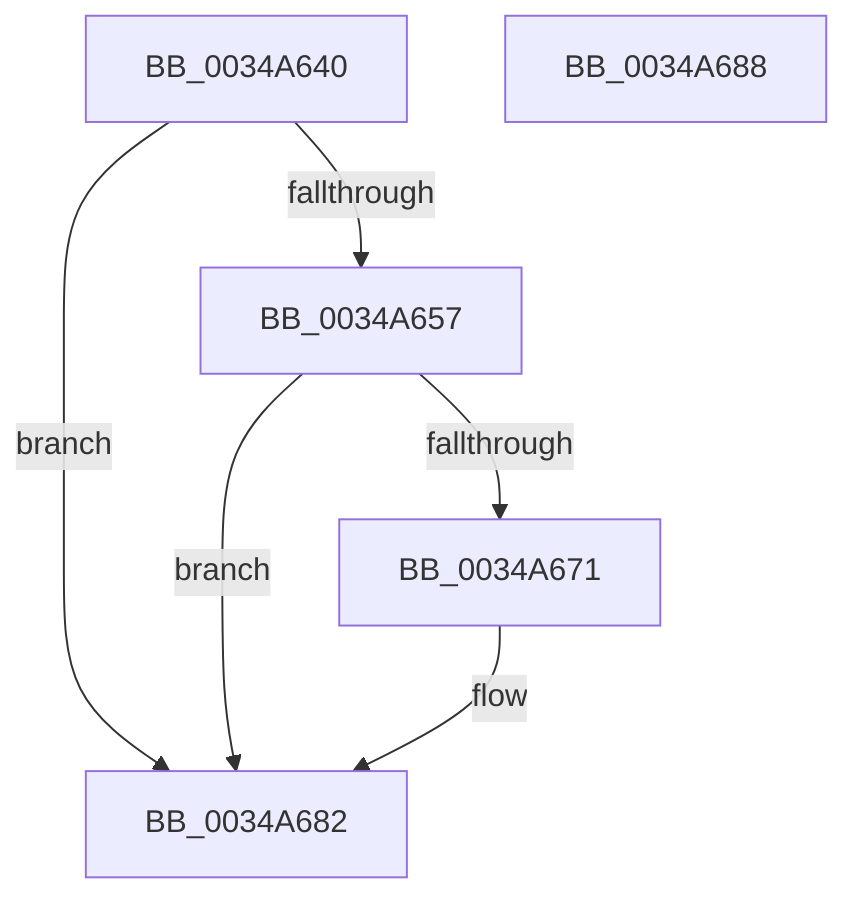

# PfpEventHandleFullBuffer

- RVA: `0x0034A640`–`0x0034A689` (길이 `73` bytes)
- VA: `0x000000014034A640`
- 실행 섹션: `.text`
- PDB 이름 있음: `예`; PDB Function 태그: `아니요`
- unwind 정보 RVA: `0x0005CF00`
- 디코드: `20`개 명령, `73/73` bytes 표시
- 미해석 바이트: `0` (있으면 어셈블리에 `.byte`로 보존)

> 이 문서는 커널 이미지의 기계어와 PDB 기호를 분석해 생성했습니다. 4번과 5번은 함수 원형과 자료형을 바이너리 사용 방식에서 추정한 C 해석이며 원본 소스 복구 결과는 아닙니다.

## 1. Dependencies

- 직접 호출 지점: **2**; 고유 호출 대상: **2**
- 직접 호출자로 확인된 함수: **2**
- RIP 상대 이미지 참조: **1**

### Outgoing calls
- `0x0034A649` → [PfTFullEventListAdd](../49/PfTFullEventListAdd_function_00494B50.md) (function, `0x00494B50`)
- `0x0034A67D` → [KeSetEvent](../33/KeSetEvent_function_0033F310.md) (function, `0x0033F310`)

### Direct callers
- [PfFbLogEntryComplete](PfFbLogEntryComplete_function_00349B40.md) at `0x00349B92`
- [PfLogEvent](PfLogEvent_function_00349BA8.md) at `0x00349CDA`

### Static image references
- `0x0034A657` → RVA `0x00FC6A80` (`ALMOSTRO`; read)

## 2. Other-region calls and transfers

- 다른 실행 섹션으로 향하는 call: **0**
- 별도 외부 분기/꼬리 이동을 확인하지 못했습니다.

## 3. Assembly (complete function range)

```asm
0034A640  40 53                           push rbx
0034A642  48 83 EC 20                     sub rsp, 0x20
0034A646  48 8B D9                        mov rbx, rcx
0034A649  E8 02 A5 14 00                  call 0x140494b50
0034A64E  83 BB E4 02 00 00 00            cmp dword ptr [rbx + 0x2e4], 0
0034A655  75 2B                           jne 0x14034a682
0034A657  8B 05 23 C4 C7 00               mov eax, dword ptr [rip + 0xc7c423]
0034A65D  8D 14 45 04 00 00 00            lea edx, [rax*2 + 4]
0034A664  0F B7 83 20 02 00 00            movzx eax, word ptr [rbx + 0x220]
0034A66B  D1 EA                           shr edx, 1
0034A66D  3B C2                           cmp eax, edx
0034A66F  72 11                           jb 0x14034a682
0034A671  48 8D 8B E0 02 00 00            lea rcx, [rbx + 0x2e0]
0034A678  45 33 C0                        xor r8d, r8d
0034A67B  33 D2                           xor edx, edx
0034A67D  E8 8E 4C FF FF                  call 0x14033f310
0034A682  48 83 C4 20                     add rsp, 0x20
0034A686  5B                              pop rbx
0034A687  C3                              ret
0034A688  CC                              int3
```

## 4. C-style interpretation (structured pseudocode)

```c
__int64 __fastcall PfpEventHandleFullBuffer(__int64 a1, __int64 a2, int a3)
{
    __int64 result;
    __int64 v_rsp;

    v_rsp = (v_rsp) - (32);
    result = PfTFullEventListAdd(a1, a2, a3, a4);
    if ((*(unsigned int *)(a1 + 740)) != 0) goto loc_0034A682;
    a2 = (unsigned int)(((unsigned int)(*(unsigned int *)(v_rip + 13091875)) * 2 + 4) >> (1));
    result = *(unsigned __int16 *)(a1 + 544);
    if (((unsigned int)(*(unsigned __int16 *)(a1 + 544))) >= ((unsigned int)(a2))) {
        a1 = a1 + 736;
        a3 = 0;
        a2 = 0;
        result = KeSetEvent(a1, a2, a3, a4);
    }
    v_rsp = (v_rsp) + (32);
    return result;
}
```

## 5. (Beta) C Style

```c
int64_t PfpEventHandleFullBuffer(void *Arg1, int64_t Arg2, int32_t Arg3)
{
    uint8_t *arg1 = (uint8_t *)Arg1;

    int64_t result;
    int64_t local_rsp;

    local_rsp = (local_rsp) - (32);
    result = PfTFullEventListAdd(Arg1, Arg2, Arg3, a4);
    if ((*(uint32_t *)(arg1 + 0x2E4)) != 0) goto loc_0034A682;
    Arg2 = (uint32_t)(((uint32_t)(*(uint32_t *)(v_rip + 0xC7C423)) * 2 + 4) >> (1));
    result = *(uint16_t *)(arg1 + 0x220);
    if (((uint32_t)(*(uint16_t *)(arg1 + 0x220))) >= ((uint32_t)(Arg2))) {
        Arg1 = Arg1 + 736;
        Arg3 = 0;
        Arg2 = 0;
        result = KeSetEvent(Arg1, Arg2, Arg3, a4);
    }
    local_rsp = (local_rsp) + (32);
    return result;
}
```

### 관측된 메모리 오프셋

구조체 형식이 확인되지 않은 접근은 인자 기준의 오프셋으로만 기록했습니다.

| 기준 인자 | 오프셋 표현 | 폭 (bit) | 접근 |
|---|---:|---:|---|
| `Arg1` | `+ 0x220` | `16` | `R` |
| `Arg1` | `+ 0x2E0` | `64` | `R` |
| `Arg1` | `+ 0x2E4` | `32` | `R` |

## 6. Execution-region graph

[열기: 2D/3D 그래프와 함수 탐색 컨트롤 패널](../../../control-panel.html?section=text&rva=0x0034A640&view=graph)

- 2D 그래프는 위에서 아래로 흐르고, 3D 그래프는 빈 공간을 드래그해 회전합니다. Shift+드래그는 이동, 휠은 확대·축소, 함수 노드 선택은 대상 보고서 이동입니다.

### Static fallback


