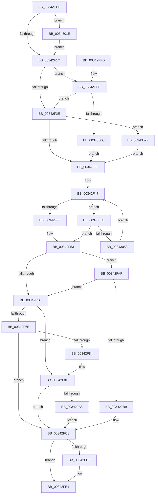

# PfpPartitionGetFirst

- RVA: `0x00342ED0`–`0x0034305B` (길이 `395` bytes)
- VA: `0x0000000140342ED0`
- 실행 섹션: `.text`
- PDB 이름 있음: `예`; PDB Function 태그: `아니요`
- unwind 정보 RVA: `0x00077A3C`
- 디코드: `97`개 명령, `395/395` bytes 표시
- 미해석 바이트: `0` (있으면 어셈블리에 `.byte`로 보존)

> 이 문서는 커널 이미지의 기계어와 PDB 기호를 분석해 생성했습니다. 4번과 5번은 함수 원형과 자료형을 바이너리 사용 방식에서 추정한 C 해석이며 원본 소스 복구 결과는 아닙니다.

## 1. Dependencies

- 직접 호출 지점: **8**; 고유 호출 대상: **8**
- 직접 호출자로 확인된 함수: **2**
- RIP 상대 이미지 참조: **3**

### Outgoing calls
- `0x00342F89` → [KxWaitForLockChainValid](../21/KxWaitForLockChainValid_function_00217AA0.md) (function, `0x00217AA0`)
- `0x00342FA8` → [KeWakeAddressAll](../21/KeWakeAddressAll_function_00217C20.md) (function, `0x00217C20`)
- `0x00342FC3` → [KiReleaseQueuedSpinLockInstrumented](../21/KiReleaseQueuedSpinLockInstrumented_function_002179F0.md) (function, `0x002179F0`)
- `0x00342FDC` → [KiLowerIrqlProcessIrqlFlags](../4F/KiLowerIrqlProcessIrqlFlags_function_004F5698.md) (function, `0x004F5698`)
- `0x00343014` → [KiAcquireQueuedSpinLockInstrumented](../27/KiAcquireQueuedSpinLockInstrumented_function_00275850.md) (function, `0x00275850`)
- `0x00343025` → [KiRaiseIrqlProcessIrqlFlags](../4F/KiRaiseIrqlProcessIrqlFlags_function_004F56FC.md) (function, `0x004F56FC`)
- `0x00343034` → [KxWaitForLockOwnerShip](../25/KxWaitForLockOwnerShip_function_00257EB0.md) (function, `0x00257EB0`)
- `0x00343046` → [ExAcquireRundownProtectionCacheAware](../23/ExAcquireRundownProtectionCacheAware_function_0023D110.md) (function, `0x0023D110`)

### Direct callers
- [PfpPartitionIterate](PfpPartitionIterate_function_00341D00.md) at `0x00341D28`
- [sub_003422B4](Unknown_function_003422B4.md) at `0x003422E0`

### Static image references
- `0x00342F10` → RVA `0x00FC6D20` (`ALMOSTRO`; read)
- `0x00342F1C` → RVA `0x00FC6B06` (`ALMOSTRO`; read)
- `0x00342FAF` → RVA `0x00F0DE58` (`.data`; read)

## 2. Other-region calls and transfers

- 다른 실행 섹션으로 향하는 call: **0**
- 별도 외부 분기/꼬리 이동을 확인하지 못했습니다.

## 3. Assembly (complete function range)

```asm
00342ED0  48 89 5C 24 08                  mov qword ptr [rsp + 8], rbx
00342ED5  48 89 6C 24 10                  mov qword ptr [rsp + 0x10], rbp
00342EDA  48 89 74 24 18                  mov qword ptr [rsp + 0x18], rsi
00342EDF  57                              push rdi
00342EE0  48 83 EC 40                     sub rsp, 0x40
00342EE4  33 C0                           xor eax, eax
00342EE6  0F 57 C0                        xorps xmm0, xmm0
00342EE9  0F 11 44 24 20                  movups xmmword ptr [rsp + 0x20], xmm0
00342EEE  33 ED                           xor ebp, ebp
00342EF0  48 89 44 24 30                  mov qword ptr [rsp + 0x30], rax
00342EF5  48 89 6C 24 20                  mov qword ptr [rsp + 0x20], rbp
00342EFA  48 8B D9                        mov rbx, rcx
00342EFD  48 89 4C 24 28                  mov qword ptr [rsp + 0x28], rcx
00342F02  90                              nop
00342F03  44 0F 20 C7                     mov rdi, cr8
00342F07  B8 02 00 00 00                  mov eax, 2
00342F0C  44 0F 22 C0                     mov cr8, rax
00342F10  39 2D 0A 3E C8 00               cmp dword ptr [rip + 0xc83e0a], ebp
00342F16  0F 85 02 01 00 00               jne 0x14034301e
00342F1C  F6 05 E3 3B C8 00 21            test byte ptr [rip + 0xc83be3], 0x21
00342F23  40 88 7C 24 30                  mov byte ptr [rsp + 0x30], dil
00342F28  0F 85 D0 00 00 00               jne 0x140342ffe
00342F2E  48 8D 54 24 20                  lea rdx, [rsp + 0x20]
00342F33  48 87 13                        xchg qword ptr [rbx], rdx
00342F36  48 85 D2                        test rdx, rdx
00342F39  0F 85 F0 00 00 00               jne 0x14034302f
00342F3F  48 8B 7B 08                     mov rdi, qword ptr [rbx + 8]
00342F43  48 83 C3 08                     add rbx, 8
00342F47  48 3B FB                        cmp rdi, rbx
00342F4A  0F 85 EE 00 00 00               jne 0x14034303e
00342F50  48 8B F5                        mov rsi, rbp
00342F53  F6 05 AC 3B C8 00 01            test byte ptr [rip + 0xc83bac], 1
00342F5A  75 53                           jne 0x140342faf
00342F5C  0F 0D 4C 24 20                  prefetchw byte ptr [rsp + 0x20]
00342F61  48 8B 44 24 20                  mov rax, qword ptr [rsp + 0x20]
00342F66  48 85 C0                        test rax, rax
00342F69  75 23                           jne 0x140342f8e
00342F6B  48 8B 4C 24 28                  mov rcx, qword ptr [rsp + 0x28]
00342F70  48 8D 44 24 20                  lea rax, [rsp + 0x20]
00342F75  F0 48 0F B1 29                  lock cmpxchg qword ptr [rcx], rbp
00342F7A  48 8D 4C 24 20                  lea rcx, [rsp + 0x20]
00342F7F  48 3B C1                        cmp rax, rcx
00342F82  74 44                           je 0x140342fc8
00342F84  48 8D 4C 24 20                  lea rcx, [rsp + 0x20]
00342F89  E8 12 4B ED FF                  call 0x140217aa0
00342F8E  48 8D 48 08                     lea rcx, [rax + 8]
00342F92  48 89 6C 24 20                  mov qword ptr [rsp + 0x20], rbp
00342F97  48 8B 54 24 28                  mov rdx, qword ptr [rsp + 0x28]
00342F9C  48 8B C2                        mov rax, rdx
00342F9F  48 87 01                        xchg qword ptr [rcx], rax
00342FA2  32 C2                           xor al, dl
00342FA4  A8 04                           test al, 4
00342FA6  74 20                           je 0x140342fc8
00342FA8  E8 73 4C ED FF                  call 0x140217c20
00342FAD  EB 19                           jmp 0x140342fc8
00342FAF  8B 05 A3 AE BC 00               mov eax, dword ptr [rip + 0xbcaea3]
00342FB5  85 C0                           test eax, eax
00342FB7  75 A3                           jne 0x140342f5c
00342FB9  48 8B 54 24 48                  mov rdx, qword ptr [rsp + 0x48]
00342FBE  48 8D 4C 24 20                  lea rcx, [rsp + 0x20]
00342FC3  E8 28 4A ED FF                  call 0x1402179f0
00342FC8  39 2D 52 3D C8 00               cmp dword ptr [rip + 0xc83d52], ebp
00342FCE  0F B6 5C 24 30                  movzx ebx, byte ptr [rsp + 0x30]
00342FD3  74 0C                           je 0x140342fe1
00342FD5  44 0F 20 C1                     mov rcx, cr8
00342FD9  0F B6 D3                        movzx edx, bl
00342FDC  E8 B7 26 1B 00                  call 0x1404f5698
00342FE1  44 0F 22 C3                     mov cr8, rbx
00342FE5  48 8B 5C 24 50                  mov rbx, qword ptr [rsp + 0x50]
00342FEA  48 8B C6                        mov rax, rsi
00342FED  48 8B 74 24 60                  mov rsi, qword ptr [rsp + 0x60]
00342FF2  48 8B 6C 24 58                  mov rbp, qword ptr [rsp + 0x58]
00342FF7  48 83 C4 40                     add rsp, 0x40
00342FFB  5F                              pop rdi
00342FFC  C3                              ret
00342FFD  CC                              int3
00342FFE  8B 05 54 AE BC 00               mov eax, dword ptr [rip + 0xbcae54]
00343004  85 C0                           test eax, eax
00343006  0F 85 22 FF FF FF               jne 0x140342f2e
0034300C  48 8B D3                        mov rdx, rbx
0034300F  48 8D 4C 24 20                  lea rcx, [rsp + 0x20]
00343014  E8 37 28 F3 FF                  call 0x140275850
00343019  E9 21 FF FF FF                  jmp 0x140342f3f
0034301E  0F B6 D0                        movzx edx, al
00343021  40 0F B6 CF                     movzx ecx, dil
00343025  E8 D2 26 1B 00                  call 0x1404f56fc
0034302A  E9 ED FE FF FF                  jmp 0x140342f1c
0034302F  48 8D 4C 24 20                  lea rcx, [rsp + 0x20]
00343034  E8 77 4E F1 FF                  call 0x140257eb0
00343039  E9 01 FF FF FF                  jmp 0x140342f3f
0034303E  48 8B 4F F8                     mov rcx, qword ptr [rdi - 8]
00343042  48 8D 77 E8                     lea rsi, [rdi - 0x18]
00343046  E8 C5 A0 EF FF                  call 0x14023d110
0034304B  84 C0                           test al, al
0034304D  0F 85 00 FF FF FF               jne 0x140342f53
00343053  48 8B 3F                        mov rdi, qword ptr [rdi]
00343056  E9 EC FE FF FF                  jmp 0x140342f47
```

## 4. C-style interpretation (structured pseudocode)

```c
__int64 __fastcall PfpPartitionGetFirst(__int64 a1)
{
    __int64 result;
    __int64 v_rbp;
    __int64 v_rbx;
    __int64 v_rsp;
    unsigned __int64 v_stack_m18;
    unsigned __int64 v_stack_m20;
    unsigned __int64 v_stack_m28;
    unsigned __int64 v_stack_p0;
    unsigned __int64 v_stack_p10;
    unsigned __int64 v_stack_p18;
    unsigned __int64 v_stack_p20;
    unsigned __int64 v_stack_p8;

    v_stack_p8 = v_rbx;
    v_stack_p10 = v_rbp;
    v_stack_p18 = v_rsi;
    v_rsp = (v_rsp) - (64);
    result = 0;
    v_stack_m28 = v_xmm0;
    v_rbp = 0;
    v_stack_m18 = 0;
    v_stack_m28 = 0;
    v_stack_m20 = a1;
    if ((*(unsigned int *)(v_rip + 13123082)) != 0) goto loc_0034301E;
loc_00342F1C:
    v_stack_m18 = (unsigned __int8)(v_cr8);
    if (((*(unsigned __int8 *)(v_rip + 13122531)) & (33)) != 0) goto loc_00342FFE;
loc_00342F2E:
    if (v_stack_m28 != 0) goto loc_0034302F;
loc_00342F3F:
    v_rbx = (a1) + (8);
loc_00342F47:
    if ((*(unsigned __int64 *)(a1 + 8)) != v_rbx) goto loc_0034303E;
loc_00342F53:
    if (((*(unsigned __int8 *)(v_rip + 13122476)) & (1)) != 0) goto loc_00342FAF;
loc_00342F5C:
    if (v_stack_m28 != 0) goto loc_00342F8E;
    if (v_stack_m28 == v_stack_m28) goto loc_00342FC8;
    result = KxWaitForLockChainValid(v_stack_m28, v_stack_m28, a3, a4);
loc_00342F8E:
    v_stack_m28 = 0;
    result = (unsigned __int8)((v_stack_m20) ^ ((unsigned __int8)(v_stack_m20)));
    if ((((unsigned __int8)(result)) & (4)) == 0) goto loc_00342FC8;
    result = KeWakeAddressAll(result + 8, v_stack_m20, a3, a4);
    goto loc_00342FC8;
loc_00342FAF:
    if ((unsigned int)((unsigned int)(*(unsigned int *)(v_rip + 12365475))) != 0) goto loc_00342F5C;
    result = KiReleaseQueuedSpinLockInstrumented(v_stack_m28, v_stack_p0, a3, a4);
loc_00342FC8:
    if ((*(unsigned int *)(v_rip + 13122898)) != 0) {
        a1 = 2;
        a2 = (unsigned __int8)(v_stack_m18);
        result = KiLowerIrqlProcessIrqlFlags(a1, a2, a3, a4);
    }
    v_rsp = (v_rsp) + (64);
    return 0;
loc_00342FFE:
    if ((unsigned int)((unsigned int)(*(unsigned int *)(v_rip + 12365396))) != 0) goto loc_00342F2E;
    result = KiAcquireQueuedSpinLockInstrumented(v_stack_p20, v_stack_p8, a3, a4);
    goto loc_00342F3F;
loc_0034301E:
    result = KiRaiseIrqlProcessIrqlFlags((unsigned __int8)(*(unsigned __int64 *)(a1 + 8)), (unsigned __int8)(result), a3, a4);
    goto loc_00342F1C;
loc_0034302F:
    result = KxWaitForLockOwnerShip(v_stack_p20, (unsigned __int8)(result), a3, a4);
    goto loc_00342F3F;
loc_0034303E:
    result = ExAcquireRundownProtectionCacheAware(*(unsigned __int64 *)(*(unsigned __int64 *)(a1 + 8) - 8), (unsigned __int8)(result), a3, a4);
    if ((unsigned __int8)(result) != 0) goto loc_00342F53;
    goto loc_00342F47;
}
```

## 5. (Beta) C Style

```c
int64_t PfpPartitionGetFirst(void *Arg1)
{
    uint8_t *arg1 = (uint8_t *)Arg1;

    int64_t result;
    int64_t local_rbp;
    int64_t local_rbx;
    int64_t local_rsp;
    uint64_t v_stack_m18;
    uint64_t v_stack_m20;
    uint64_t v_stack_m28;
    uint64_t v_stack_p0;
    uint64_t v_stack_p10;
    uint64_t v_stack_p18;
    uint64_t v_stack_p20;
    uint64_t v_stack_p8;

    v_stack_p8 = local_rbx;
    v_stack_p10 = local_rbp;
    v_stack_p18 = local_rsi;
    local_rsp = (local_rsp) - (64);
    result = 0;
    v_stack_m28 = v_xmm0;
    local_rbp = 0;
    v_stack_m18 = 0;
    v_stack_m28 = 0;
    v_stack_m20 = Arg1;
    if ((*(uint32_t *)(v_rip + 0xC83E0A)) != 0) goto loc_0034301E;
loc_00342F1C:
    v_stack_m18 = (uint8_t)(v_cr8);
    if (((*(uint8_t *)(v_rip + 0xC83BE3)) & (33)) != 0) goto loc_00342FFE;
loc_00342F2E:
    if (v_stack_m28 != 0) goto loc_0034302F;
loc_00342F3F:
    local_rbx = (Arg1) + (8);
loc_00342F47:
    if ((*(uint64_t *)(arg1 + 0x8)) != local_rbx) goto loc_0034303E;
loc_00342F53:
    if (((*(uint8_t *)(v_rip + 0xC83BAC)) & (1)) != 0) goto loc_00342FAF;
loc_00342F5C:
    if (v_stack_m28 != 0) goto loc_00342F8E;
    if (v_stack_m28 == v_stack_m28) goto loc_00342FC8;
    result = KxWaitForLockChainValid(v_stack_m28, v_stack_m28, a3, a4);
loc_00342F8E:
    v_stack_m28 = 0;
    result = (uint8_t)((v_stack_m20) ^ ((uint8_t)(v_stack_m20)));
    if ((((uint8_t)(result)) & (4)) == 0) goto loc_00342FC8;
    result = KeWakeAddressAll(result + 8, v_stack_m20, a3, a4);
    goto loc_00342FC8;
loc_00342FAF:
    if ((uint32_t)((uint32_t)(*(uint32_t *)(v_rip + 0xBCAEA3))) != 0) goto loc_00342F5C;
    result = KiReleaseQueuedSpinLockInstrumented(v_stack_m28, v_stack_p0, a3, a4);
loc_00342FC8:
    if ((*(uint32_t *)(v_rip + 0xC83D52)) != 0) {
        Arg1 = 2;
        a2 = (uint8_t)(v_stack_m18);
        result = KiLowerIrqlProcessIrqlFlags(Arg1, a2, a3, a4);
    }
    local_rsp = (local_rsp) + (64);
    return 0;
loc_00342FFE:
    if ((uint32_t)((uint32_t)(*(uint32_t *)(v_rip + 0xBCAE54))) != 0) goto loc_00342F2E;
    result = KiAcquireQueuedSpinLockInstrumented(v_stack_p20, v_stack_p8, a3, a4);
    goto loc_00342F3F;
loc_0034301E:
    result = KiRaiseIrqlProcessIrqlFlags((uint8_t)(*(uint64_t *)(arg1 + 0x8)), (uint8_t)(result), a3, a4);
    goto loc_00342F1C;
loc_0034302F:
    result = KxWaitForLockOwnerShip(v_stack_p20, (uint8_t)(result), a3, a4);
    goto loc_00342F3F;
loc_0034303E:
    result = ExAcquireRundownProtectionCacheAware(*(uint64_t *)(*(uint64_t *)(arg1 + 0x8) - 0x8), (uint8_t)(result), a3, a4);
    if ((uint8_t)(result) != 0) goto loc_00342F53;
    goto loc_00342F47;
}
```

### 관측된 메모리 오프셋

구조체 형식이 확인되지 않은 접근은 인자 기준의 오프셋으로만 기록했습니다.

| 기준 인자 | 오프셋 표현 | 폭 (bit) | 접근 |
|---|---:|---:|---|
| `Arg1` | `+ 0x0` | `64` | `R/W` |
| `Arg1` | `+ 0x8` | `64` | `R` |

## 6. Execution-region graph

[열기: 2D/3D 그래프와 함수 탐색 컨트롤 패널](../../../control-panel.html?section=text&rva=0x00342ED0&view=graph)

- 2D 그래프는 위에서 아래로 흐르고, 3D 그래프는 빈 공간을 드래그해 회전합니다. Shift+드래그는 이동, 휠은 확대·축소, 함수 노드 선택은 대상 보고서 이동입니다.

### Static fallback


