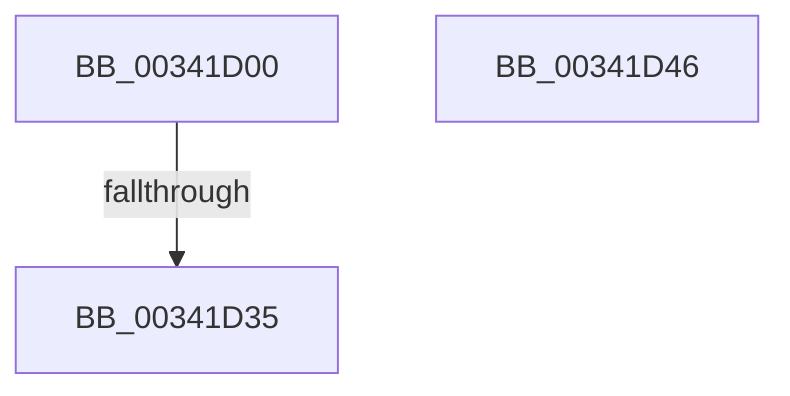

# PfpPartitionIterate

- RVA: `0x00341D00`–`0x00341D47` (길이 `71` bytes)
- VA: `0x0000000140341D00`
- 실행 섹션: `.text`
- PDB 이름 있음: `예`; PDB Function 태그: `아니요`
- unwind 정보 RVA: `0x00077714`
- 디코드: `28`개 명령, `71/71` bytes 표시
- 미해석 바이트: `0` (있으면 어셈블리에 `.byte`로 보존)

> 이 문서는 커널 이미지의 기계어와 PDB 기호를 분석해 생성했습니다. 4번과 5번은 함수 원형과 자료형을 바이너리 사용 방식에서 추정한 C 해석이며 원본 소스 복구 결과는 아닙니다.

## 1. Dependencies

- 직접 호출 지점: **1**; 고유 호출 대상: **1**
- 직접 호출자로 확인된 함수: **7**
- RIP 상대 이미지 참조: **1**

### Outgoing calls
- `0x00341D28` → [PfpPartitionGetFirst](PfpPartitionGetFirst_function_00342ED0.md) (function, `0x00342ED0`)

### Direct callers
- [sub_00342822](Unknown_function_00342822.md) at `0x003428AD`
- [sub_00342822](Unknown_function_00342822.md) at `0x003428EA`
- [sub_00342AF8](Unknown_function_00342AF8.md) at `0x00342B07`
- [sub_00342BC8](Unknown_function_00342BC8.md) at `0x00342BF7`
- [PfpPartitionIterateAndCheckCanAnyDoAccessLogging](../5C/PfpPartitionIterateAndCheckCanAnyDoAccessLogging_function_005CE0EC.md) at `0x005CE106`
- [sub_00B47AE6](../../page/B4/Unknown_function_00B47AE6.md) at `0x00B47B50`
- [sub_00B47AE6](../../page/B4/Unknown_function_00B47AE6.md) at `0x00B47BBB`
- [PfPowerActionNotify](../../pagelk/B7/PfPowerActionNotify_function_00B7AC98.md) at `0x00B7ADA6`
- [PfPowerActionNotify](../../pagelk/B7/PfPowerActionNotify_function_00B7AC98.md) at `0x00B7AE00`
- [PfPowerActionNotify](../../pagelk/B7/PfPowerActionNotify_function_00B7AC98.md) at `0x00B7AE1D`
- [sub_00B80CFE](../../pagelk/B8/Unknown_function_00B80CFE.md) at `0x00B80D6A`

### Static image references
- `0x00341D18` → RVA `0x00E67228` (`.data`; read)

## 2. Other-region calls and transfers

- 다른 실행 섹션으로 향하는 call: **0**
- call이 아닌 외부 분기/꼬리 이동: **1**
  - `0x00341D33` → [sub_00341DB3](Unknown_function_00341DB3.md) (`tail-transfer`)

## 3. Assembly (complete function range)

```asm
00341D00  4C 89 44 24 18                  mov qword ptr [rsp + 0x18], r8
00341D05  53                              push rbx
00341D06  55                              push rbp
00341D07  56                              push rsi
00341D08  41 54                           push r12
00341D0A  41 55                           push r13
00341D0C  41 56                           push r14
00341D0E  48 83 EC 48                     sub rsp, 0x48
00341D12  4C 8B E9                        mov r13, rcx
00341D15  45 33 F6                        xor r14d, r14d
00341D18  48 8D 0D 09 55 B2 00            lea rcx, [rip + 0xb25509]
00341D1F  41 8B F6                        mov esi, r14d
00341D22  49 8B E8                        mov rbp, r8
00341D25  44 8B E2                        mov r12d, edx
00341D28  E8 A3 11 00 00                  call 0x140342ed0
00341D2D  48 8B D8                        mov rbx, rax
00341D30  48 85 C0                        test rax, rax
00341D33  75 7E                           jne 0x140341db3
00341D35  41 8B C6                        mov eax, r14d
00341D38  48 83 C4 48                     add rsp, 0x48
00341D3C  41 5E                           pop r14
00341D3E  41 5D                           pop r13
00341D40  41 5C                           pop r12
00341D42  5E                              pop rsi
00341D43  5D                              pop rbp
00341D44  5B                              pop rbx
00341D45  C3                              ret
00341D46  CC                              int3
```

## 4. C-style interpretation (structured pseudocode)

```c
__int64 __fastcall PfpPartitionIterate(__int64 a1, int a2, __int64 a3)
{
    __int64 result;
    __int64 v_r14;
    __int64 v_rsp;
    unsigned __int64 v_stack_p18;

    v_stack_p18 = a3;
    v_rsp = (v_rsp) - (72);
    v_r14 = 0;
    result = PfpPartitionGetFirst(v_rip + 11687177, a2, a3, a4);
    v_rsp = (v_rsp) + (72);
    return 0;
}
```

## 5. (Beta) C Style

```c
int64_t PfpPartitionIterate(int64_t Arg1, int32_t Arg2, int64_t Arg3)
{
    int64_t result;
    int64_t local_r14;
    int64_t local_rsp;
    uint64_t v_stack_p18;

    v_stack_p18 = Arg3;
    local_rsp = (local_rsp) - (72);
    local_r14 = 0;
    result = PfpPartitionGetFirst(v_rip + 11687177, Arg2, Arg3, a4);
    local_rsp = (local_rsp) + (72);
    return 0;
}
```

## 6. Execution-region graph

[열기: 2D/3D 그래프와 함수 탐색 컨트롤 패널](../../../control-panel.html?section=text&rva=0x00341D00&view=graph)

- 2D 그래프는 위에서 아래로 흐르고, 3D 그래프는 빈 공간을 드래그해 회전합니다. Shift+드래그는 이동, 휠은 확대·축소, 함수 노드 선택은 대상 보고서 이동입니다.

### Static fallback


