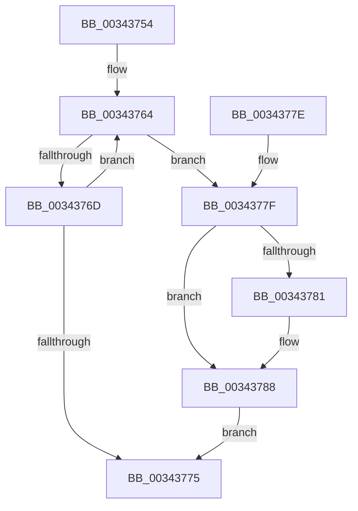

# PfpPartitionReferenceParentSafe

- RVA: `0x00343754`–`0x0034378C` (길이 `56` bytes)
- VA: `0x0000000140343754`
- 실행 섹션: `.text`
- PDB 이름 있음: `예`; PDB Function 태그: `아니요`
- unwind 정보 RVA: `0x000DB714`
- 디코드: `19`개 명령, `56/56` bytes 표시
- 미해석 바이트: `0` (있으면 어셈블리에 `.byte`로 보존)

> 이 문서는 커널 이미지의 기계어와 PDB 기호를 분석해 생성했습니다. 4번과 5번은 함수 원형과 자료형을 바이너리 사용 방식에서 추정한 C 해석이며 원본 소스 복구 결과는 아닙니다.

## 1. Dependencies

- 직접 호출 지점: **0**; 고유 호출 대상: **0**
- 직접 호출자로 확인된 함수: **4**
- RIP 상대 이미지 참조: **0**

### Outgoing calls
- 직접 디코드된 call 명령이 없습니다.

### Direct callers
- [sub_00341DB3](Unknown_function_00341DB3.md) at `0x00341F32`
- [sub_003422B4](Unknown_function_003422B4.md) at `0x00342309`
- [PfTTraceListAdd](../../page/A6/PfTTraceListAdd_function_00A60E00.md) at `0x00A60EDF`
- [PfTAccessTracingCleanup](../../pagelk/B6/PfTAccessTracingCleanup_function_00B6B8AC.md) at `0x00B6B8D3`

### Static image references
- 디코드된 RIP-relative 메모리 참조가 없습니다.

## 2. Other-region calls and transfers

- 다른 실행 섹션으로 향하는 call: **0**
- 별도 외부 분기/꼬리 이동을 확인하지 못했습니다.

## 3. Assembly (complete function range)

```asm
00343754  48 8B 11                        mov rdx, qword ptr [rcx]
00343757  0F 0D 4A 28                     prefetchw byte ptr [rdx + 0x28]
0034375B  48 8B 42 28                     mov rax, qword ptr [rdx + 0x28]
0034375F  B9 01 00 00 00                  mov ecx, 1
00343764  4C 8D 40 01                     lea r8, [rax + 1]
00343768  4C 3B C1                        cmp r8, rcx
0034376B  76 12                           jbe 0x14034377f
0034376D  F0 4C 0F B1 42 28               lock cmpxchg qword ptr [rdx + 0x28], r8
00343773  75 EF                           jne 0x140343764
00343775  F6 D9                           neg cl
00343777  48 1B C0                        sbb rax, rax
0034377A  48 23 C2                        and rax, rdx
0034377D  C3                              ret
0034377E  CC                              int3
0034377F  74 07                           je 0x140343788
00343781  B9 0E 00 00 00                  mov ecx, 0xe
00343786  CD 29                           int 0x29
00343788  32 C9                           xor cl, cl
0034378A  EB E9                           jmp 0x140343775
```

## 4. C-style interpretation (structured pseudocode)

```c
__int64 __fastcall PfpPartitionReferenceParentSafe(__int64 a1)
{
    __int64 result;

loc_00343764:
    if ((*(unsigned __int64 *)(*(unsigned __int64 *)(a1) + 40) + 1) <= 1) goto loc_0034377F;
    if ((*(unsigned __int64 *)(*(unsigned __int64 *)(a1) + 40) + 1) != 1) goto loc_00343764;
loc_00343775:
    a1 = (unsigned __int8)(-(1));
    result = (*(unsigned __int64 *)(*(unsigned __int64 *)(a1) + 40)) & (*(unsigned __int64 *)(a1));
    return result;
loc_0034377F:
    if (!(condition_is_equal)) {
        a1 = 14;
    }
    a1 = 0;
    goto loc_00343775;
}
```

## 5. (Beta) C Style

```c
int64_t PfpPartitionReferenceParentSafe(void *Arg1)
{
    uint8_t *arg1 = (uint8_t *)Arg1;

    int64_t result;

loc_00343764:
    if ((*(uint64_t *)(*(uint64_t *)(arg1) + 0x28) + 1) <= 1) goto loc_0034377F;
    if ((*(uint64_t *)(*(uint64_t *)(arg1) + 0x28) + 1) != 1) goto loc_00343764;
loc_00343775:
    Arg1 = (uint8_t)(-(1));
    result = (*(uint64_t *)(*(uint64_t *)(arg1) + 0x28)) & (*(uint64_t *)(arg1));
    return result;
loc_0034377F:
    if (!(condition_is_equal)) {
        Arg1 = 14;
    }
    Arg1 = 0;
    goto loc_00343775;
}
```

### 관측된 메모리 오프셋

구조체 형식이 확인되지 않은 접근은 인자 기준의 오프셋으로만 기록했습니다.

| 기준 인자 | 오프셋 표현 | 폭 (bit) | 접근 |
|---|---:|---:|---|
| `Arg1` | `+ 0x0` | `64` | `R` |

## 6. Execution-region graph

[열기: 2D/3D 그래프와 함수 탐색 컨트롤 패널](../../../control-panel.html?section=text&rva=0x00343754&view=graph)

- 2D 그래프는 위에서 아래로 흐르고, 3D 그래프는 빈 공간을 드래그해 회전합니다. Shift+드래그는 이동, 휠은 확대·축소, 함수 노드 선택은 대상 보고서 이동입니다.

### Static fallback


