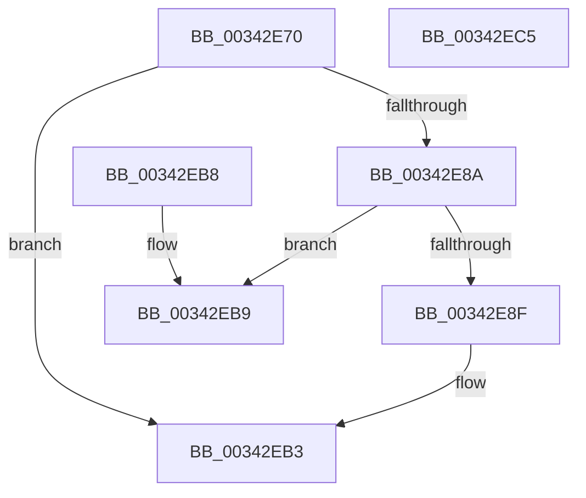

# PsDereferencePartition

- RVA: `0x00342E70`–`0x00342EC6` (길이 `86` bytes)
- VA: `0x0000000140342E70`
- 실행 섹션: `.text`
- PDB 이름 있음: `예`; PDB Function 태그: `아니요`
- unwind 정보 RVA: `0x00077A2C`
- 디코드: `23`개 명령, `86/86` bytes 표시
- 미해석 바이트: `0` (있으면 어셈블리에 `.byte`로 보존)

> 이 문서는 커널 이미지의 기계어와 PDB 기호를 분석해 생성했습니다. 4번과 5번은 함수 원형과 자료형을 바이너리 사용 방식에서 추정한 C 해석이며 원본 소스 복구 결과는 아닙니다.

## 1. Dependencies

- 직접 호출 지점: **1**; 고유 호출 대상: **1**
- 직접 호출자로 확인된 함수: **72**
- RIP 상대 이미지 참조: **1**

### Outgoing calls
- `0x00342EAE` → [ExQueueWorkItem](../2F/ExQueueWorkItem_function_002F9520.md) (function, `0x002F9520`)

### Direct callers
- [MiTrimUnusedPageFileRegionsWorker](../2A/MiTrimUnusedPageFileRegionsWorker_function_002AA320.md) at `0x002AA492`
- [MiFinishHardFault](../2B/MiFinishHardFault_function_002B6F10.md) at `0x002B77F7`
- [MiRevertProcessorMove](../2C/MiRevertProcessorMove_function_002C7420.md) at `0x002C747C`
- [MmAllocateNonChargedSecurePages](../2C/MmAllocateNonChargedSecurePages_function_002C886C.md) at `0x002C8AFE`
- [MiCommitExistingVad](../32/MiCommitExistingVad_function_0032A860.md) at `0x0032B51E`
- [MiQueryAddressState](../32/MiQueryAddressState_function_0032C380.md) at `0x0032CB0C`
- [PfpPartitionDereferenceParent](PfpPartitionDereferenceParent_function_00341CDC.md) at `0x00341CE5`
- [sub_00341DB3](Unknown_function_00341DB3.md) at `0x00341F99`
- [PfLogFileDataAccess](PfLogFileDataAccess_function_00342090.md) at `0x00342100`
- [sub_003422B4](Unknown_function_003422B4.md) at `0x00342597`
- [sub_003425E5](Unknown_function_003425E5.md) at `0x0034271B`
- [MiResolvePageFileFault](../36/MiResolvePageFileFault_function_0036D968.md) at `0x0036F053`
- [MiCreateSlabEntry](../37/MiCreateSlabEntry_function_00374DEC.md) at `0x00375523`
- [MiCreateSlabEntry](../37/MiCreateSlabEntry_function_00374DEC.md) at `0x0037557E`
- [PfHardFaultLog](../38/PfHardFaultLog_function_003810C0.md) at `0x00381189`
- [PsGetNextPartition](../3B/PsGetNextPartition_function_003B9D5C.md) at `0x003B9D85`
- [MmQueryMemoryListInformation](../3B/MmQueryMemoryListInformation_function_003B9EDC.md) at `0x003BA0FE`
- [PfpLogApplicationEvent](../3B/PfpLogApplicationEvent_function_003BA3A0.md) at `0x003BA414`
- [PfLogForegroundProcess](../3B/PfLogForegroundProcess_function_003BA5CC.md) at `0x003BA610`
- [MiRebuildLargePages](../3B/MiRebuildLargePages_function_003BA700.md) at `0x003BA825`
- [MiObtainFreePages](../3B/MiObtainFreePages_function_003BB724.md) at `0x003BB781`
- [MiRebalanceZeroFreeLists](../3B/MiRebalanceZeroFreeLists_function_003BB9B0.md) at `0x003BBA3B`
- [MmFreeNonChargedSecurePages](../3E/MmFreeNonChargedSecurePages_function_003E9218.md) at `0x003E9383`
- [MmAllocateContiguousMemoryEx](../3E/MmAllocateContiguousMemoryEx_function_003E9B80.md) at `0x003E9CEE`
- [MmAllocatePartitionNodePagesForMdlEx](../3E/MmAllocatePartitionNodePagesForMdlEx_function_003EA960.md) at `0x003EAABF`
- [EtwpClearPartitionContext](../4C/EtwpClearPartitionContext_function_004C4208.md) at `0x004C4227`
- [MmGetNodeFastLargePageCounts](../4D/MmGetNodeFastLargePageCounts_function_004DB24C.md) at `0x004DB332`
- [SmFirstTimeInit](../4E/SmFirstTimeInit_function_004EA944.md) at `0x004EAB1D`
- [PsQuitNextPartition](../5E/PsQuitNextPartition_function_005E4AFC.md) at `0x005E4B05`
- [EtwpSetPartitionContext](../65/EtwpSetPartitionContext_function_00652C3C.md) at `0x00652C61`
- [MmMarkPhysicalMemoryAsBad](../67/MmMarkPhysicalMemoryAsBad_function_0067AA50.md) at `0x0067AC22`
- [MmMarkPhysicalMemoryAsBad](../67/MmMarkPhysicalMemoryAsBad_function_0067AA50.md) at `0x0067AC7F`
- [MmMarkPhysicalMemoryAsBad](../67/MmMarkPhysicalMemoryAsBad_function_0067AA50.md) at `0x0067ACEB`
- [MmMarkPhysicalMemoryAsBad](../67/MmMarkPhysicalMemoryAsBad_function_0067AA50.md) at `0x0067AF19`
- [MmMarkPhysicalMemoryAsBad](../67/MmMarkPhysicalMemoryAsBad_function_0067AA50.md) at `0x0067AF5F`
- [MiEmptyAccessLogs](../68/MiEmptyAccessLogs_function_00689FF0.md) at `0x0068A14B`
- [MiContractWsSwapPageFileWorker](../68/MiContractWsSwapPageFileWorker_function_0068B860.md) at `0x0068B923`
- [MmAllocateSecureKernelPages](../68/MmAllocateSecureKernelPages_function_0068F394.md) at `0x0068F723`
- [sub_006E8790](../6E/Unknown_function_006E8790.md) at `0x006E87F4`
- [IopSetFileMemoryPartitionInformation](../../page/71/IopSetFileMemoryPartitionInformation_function_0071E414.md) at `0x0071E4CD`
- [PspSetJobMemoryPartition](../../page/78/PspSetJobMemoryPartition_function_00785574.md) at `0x007856EB`
- [PsCreatePartition](../../page/78/PsCreatePartition_function_00787EB0.md) at `0x00787FB9`
- [PsCreatePartition](../../page/78/PsCreatePartition_function_00787EB0.md) at `0x00787FFC`
- [PspAllocatePartition](../../page/78/PspAllocatePartition_function_0078802C.md) at `0x0078828B`
- [PspClosePartitionHandle](../../page/78/PspClosePartitionHandle_function_007882C0.md) at `0x007882E5`
- [PspTeardownPartition](../../page/78/PspTeardownPartition_function_00788480.md) at `0x007885BC`
- [SmProcessCompressionAcceleratorRequest](../../page/7A/SmProcessCompressionAcceleratorRequest_function_007A5EEC.md) at `0x007A606B`
- [SmProcessCompressionReadStatsRequest](../../page/7A/SmProcessCompressionReadStatsRequest_function_007A6090.md) at `0x007A62AF`
- [SmProcessConfigRequest](../../page/7A/SmProcessConfigRequest_function_007A62E4.md) at `0x007A66F1`
- [SmProcessListRequest](../../page/7A/SmProcessListRequest_function_007A67A8.md) at `0x007A69FF`
- [SmProcessStatsRequest](../../page/7A/SmProcessStatsRequest_function_007A6E68.md) at `0x007A716A`
- [MmRemovePhysicalMemory](../../page/7F/MmRemovePhysicalMemory_function_007FB560.md) at `0x007FB720`
- [MmAllocateMemoryRanges](../../page/7F/MmAllocateMemoryRanges_function_007FC0C0.md) at `0x007FC2BB`
- [MmQueryMemoryRanges](../../page/7F/MmQueryMemoryRanges_function_007FC3A0.md) at `0x007FC511`
- [MiScanPagefileSpace](../../page/80/MiScanPagefileSpace_function_00800440.md) at `0x00800658`
- [MmManagePartitionMoveMemory](../../page/80/MmManagePartitionMoveMemory_function_0080E1F4.md) at `0x0080E47B`
- [MiFindSpecialPurposeMemoryTypeByPartition](../../page/80/MiFindSpecialPurposeMemoryTypeByPartition_function_0080F5D8.md) at `0x0080F6D5`
- [MiInitializePartitionSpecialPurposeMemory](../../page/80/MiInitializePartitionSpecialPurposeMemory_function_0080F704.md) at `0x0080F9EF`
- [MiSpecialPurposeMemoryRemoved](../../page/80/MiSpecialPurposeMemoryRemoved_function_0080FFD8.md) at `0x00810113`
- [MiSpecialPurposeMemoryTypeDereference](../../page/81/MiSpecialPurposeMemoryTypeDereference_function_00810154.md) at `0x00810249`
- [MiUpdateSpecialPurposeMemoryCacheEligibility](../../page/81/MiUpdateSpecialPurposeMemoryCacheEligibility_function_00810270.md) at `0x00810354`
- [MmAllocateUserStack](../../page/88/MmAllocateUserStack_function_00882B30.md) at `0x00882D12`
- [NtAllocateVirtualMemory](../../page/88/NtAllocateVirtualMemory_function_00882D20.md) at `0x00882FE6`
- [MiAllocateVirtualMemoryCommon](../../page/88/MiAllocateVirtualMemoryCommon_function_00883000.md) at `0x00883205`
- [NtManagePartition](../../page/90/NtManagePartition_function_00902FC0.md) at `0x009031BC`
- [NtManagePartition](../../page/90/NtManagePartition_function_00902FC0.md) at `0x00903369`
- [PspProcessDelete](../../page/90/PspProcessDelete_function_00907B90.md) at `0x00907E38`
- [MmCreateSectionEx](../../page/98/MmCreateSectionEx_function_009839CC.md) at `0x00983C9C`
- [MmCreateSectionEx](../../page/98/MmCreateSectionEx_function_009839CC.md) at `0x00983CA8`
- [MmCreateCacheManagerSection](../../page/98/MmCreateCacheManagerSection_function_00983CB8.md) at `0x00983E99`
- [MmCreateCacheManagerSection](../../page/98/MmCreateCacheManagerSection_function_00983CB8.md) at `0x00983EA5`
- [MiCreateSection](../../page/98/MiCreateSection_function_00983EC0.md) at `0x00984117`
- [MiCreateSection](../../page/98/MiCreateSection_function_00983EC0.md) at `0x00984123`
- [MiInitializeCreateSectionPacket](../../page/98/MiInitializeCreateSectionPacket_function_00984130.md) at `0x009843E8`
- [MmQueryVirtualMemory](../../page/9D/MmQueryVirtualMemory_function_009D9280.md) at `0x009DA04D`
- [MmBuildLargePages](../../page/9F/MmBuildLargePages_function_009FFB08.md) at `0x009FFBA7`
- [SmProcessCompressionInfoRequest](../../page/A0/SmProcessCompressionInfoRequest_function_00A0E980.md) at `0x00A0EDC3`
- [MmGetPageFileInformation](../../page/A7/MmGetPageFileInformation_function_00A73F64.md) at `0x00A741ED`
- [SmProcessSystemStoreTrimRequest](../../page/A7/SmProcessSystemStoreTrimRequest_function_00A784E0.md) at `0x00A787B3`
- [MmIdentifyPhysicalMemory](../../page/AA/MmIdentifyPhysicalMemory_function_00AAD05C.md) at `0x00AAD19E`
- [MmIdentifyPhysicalMemory](../../page/AA/MmIdentifyPhysicalMemory_function_00AAD05C.md) at `0x00AAD331`
- [MmGetPhysicalMemoryRangesEx2](../../page/AC/MmGetPhysicalMemoryRangesEx2_function_00AC3870.md) at `0x00AC38C7`
- [MmPerformMemoryListCommand](../../pagelk/B7/MmPerformMemoryListCommand_function_00B7D730.md) at `0x00B7D7D0`

### Static image references
- `0x00342E93` → RVA `0x00788480` (`PspTeardownPartition`; read)

## 2. Other-region calls and transfers

- 다른 실행 섹션으로 향하는 call: **0**
- 별도 외부 분기/꼬리 이동을 확인하지 못했습니다.

## 3. Assembly (complete function range)

```asm
00342E70  48 83 EC 28                     sub rsp, 0x28
00342E74  48 8B D1                        mov rdx, rcx
00342E77  48 C7 C0 FF FF FF FF            mov rax, 0xffffffffffffffff
00342E7E  F0 48 0F C1 41 28               lock xadd qword ptr [rcx + 0x28], rax
00342E84  48 83 E8 01                     sub rax, 1
00342E88  7F 29                           jg 0x140342eb3
00342E8A  48 85 C0                        test rax, rax
00342E8D  75 2A                           jne 0x140342eb9
00342E8F  48 83 C1 50                     add rcx, 0x50
00342E93  48 8D 05 E6 55 44 00            lea rax, [rip + 0x4455e6]
00342E9A  48 89 51 18                     mov qword ptr [rcx + 0x18], rdx
00342E9E  BA 01 00 00 00                  mov edx, 1
00342EA3  48 89 41 10                     mov qword ptr [rcx + 0x10], rax
00342EA7  48 C7 01 00 00 00 00            mov qword ptr [rcx], 0
00342EAE  E8 6D 66 FB FF                  call 0x1402f9520
00342EB3  48 83 C4 28                     add rsp, 0x28
00342EB7  C3                              ret
00342EB8  CC                              int3
00342EB9  B9 0E 00 00 00                  mov ecx, 0xe
00342EBE  CD 29                           int 0x29
00342EC0  48 83 C4 28                     add rsp, 0x28
00342EC4  C3                              ret
00342EC5  CC                              int3
```

## 4. C-style interpretation (structured pseudocode)

```c
__int64 __fastcall PsDereferencePartition(__int64 a1)
{
    __int64 result;
    __int64 v_rsp;

    v_rsp = (v_rsp) - (40);
    result = (-1) - (1);
    if (condition_is_greater) goto loc_00342EB3;
    if (result != 0) goto loc_00342EB9;
    a1 = (a1) + (80);
    *(unsigned __int64 *)(a1 + 24) = a1;
    *(unsigned __int64 *)(a1 + 16) = v_rip + 4478438;
    *(unsigned __int64 *)(a1) = 0;
    result = ExQueueWorkItem(a1, 1, a3, a4);
loc_00342EB3:
    v_rsp = (v_rsp) + (40);
    return result;
loc_00342EB9:
    v_rsp = (v_rsp) + (40);
    return result;
}
```

## 5. (Beta) C Style

```c
int64_t PsDereferencePartition(void *Arg1)
{
    uint8_t *arg1 = (uint8_t *)Arg1;

    int64_t result;
    int64_t local_rsp;

    local_rsp = (local_rsp) - (40);
    result = (-1) - (1);
    if (condition_is_greater) goto loc_00342EB3;
    if (result != 0) goto loc_00342EB9;
    Arg1 = (Arg1) + (80);
    *(void **)(arg1 + 0x18) = Arg1;
    *(uint64_t *)(arg1 + 0x10) = v_rip + 4478438;
    *(uint64_t *)(arg1) = 0;
    result = ExQueueWorkItem(Arg1, 1, a3, a4);
loc_00342EB3:
    local_rsp = (local_rsp) + (40);
    return result;
loc_00342EB9:
    local_rsp = (local_rsp) + (40);
    return result;
}
```

### 관측된 메모리 오프셋

구조체 형식이 확인되지 않은 접근은 인자 기준의 오프셋으로만 기록했습니다.

| 기준 인자 | 오프셋 표현 | 폭 (bit) | 접근 |
|---|---:|---:|---|
| `Arg1` | `+ 0x0` | `64` | `W` |
| `Arg1` | `+ 0x10` | `64` | `W` |
| `Arg1` | `+ 0x18` | `64` | `W` |
| `Arg1` | `+ 0x28` | `64` | `R/W` |

## 6. Execution-region graph

[열기: 2D/3D 그래프와 함수 탐색 컨트롤 패널](../../../control-panel.html?section=text&rva=0x00342E70&view=graph)

- 2D 그래프는 위에서 아래로 흐르고, 3D 그래프는 빈 공간을 드래그해 회전합니다. Shift+드래그는 이동, 휠은 확대·축소, 함수 노드 선택은 대상 보고서 이동입니다.

### Static fallback


