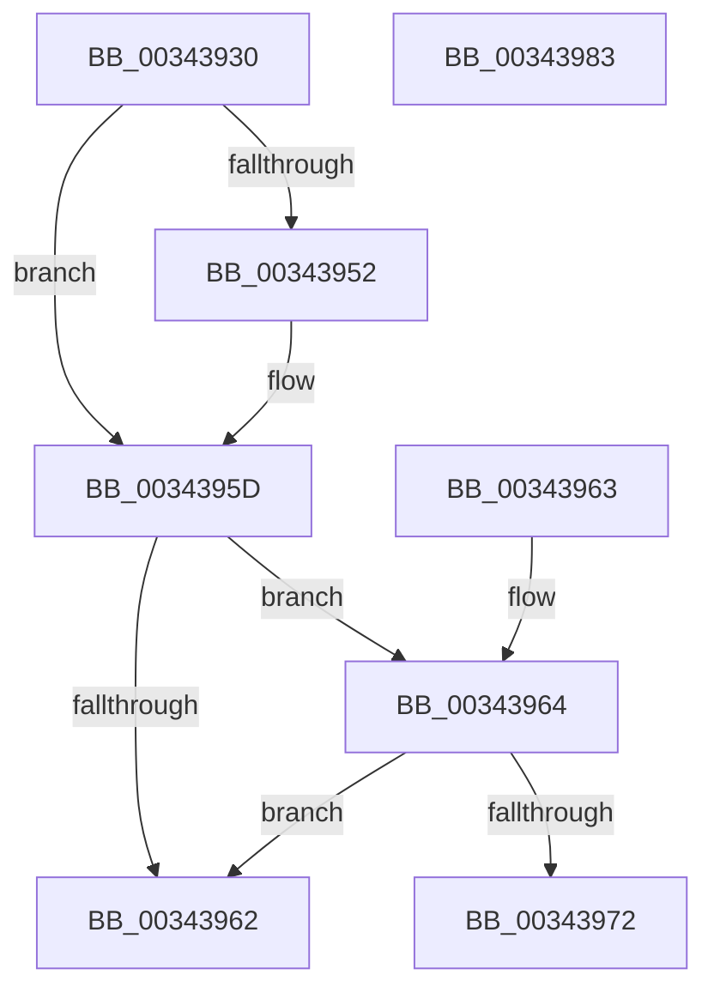

# PsGetIoPriorityThread

- RVA: `0x00343930`–`0x00343984` (길이 `84` bytes)
- VA: `0x0000000140343930`
- 실행 섹션: `.text`
- PDB 이름 있음: `예`; PDB Function 태그: `아니요`
- unwind 정보 RVA: `0x000DB714`
- 디코드: `23`개 명령, `84/84` bytes 표시
- 미해석 바이트: `0` (있으면 어셈블리에 `.byte`로 보존)

> 이 문서는 커널 이미지의 기계어와 PDB 기호를 분석해 생성했습니다. 4번과 5번은 함수 원형과 자료형을 바이너리 사용 방식에서 추정한 C 해석이며 원본 소스 복구 결과는 아닙니다.

## 1. Dependencies

- 직접 호출 지점: **0**; 고유 호출 대상: **0**
- 직접 호출자로 확인된 함수: **27**
- RIP 상대 이미지 참조: **0**

### Outgoing calls
- 직접 디코드된 call 명령이 없습니다.

### Direct callers
- [sub_00221FB6](../22/Unknown_function_00221FB6.md) at `0x002225DA`
- [sub_00221FB6](../22/Unknown_function_00221FB6.md) at `0x00222A96`
- [IopBuildAsynchronousFsdRequest](../29/IopBuildAsynchronousFsdRequest_function_0029DD40.md) at `0x0029DDC9`
- [MiFinishMdlForMappedFileFault](../2A/MiFinishMdlForMappedFileFault_function_002AC974.md) at `0x002ACAE5`
- [sub_003176F1](../31/Unknown_function_003176F1.md) at `0x003177FD`
- [sub_003422B4](Unknown_function_003422B4.md) at `0x00342448`
- [CcAsyncCopyRead](../35/CcAsyncCopyRead_function_00358880.md) at `0x003588AB`
- [MiPfPutPagesInTransition](../36/MiPfPutPagesInTransition_function_003640EC.md) at `0x003641AF`
- [MiIssueFlowThroughFault](../36/MiIssueFlowThroughFault_function_00369D64.md) at `0x00369EA8`
- [MiCopyFileOnlyGlobalSubsectionPage](../36/MiCopyFileOnlyGlobalSubsectionPage_function_0036A9EC.md) at `0x0036AC63`
- [MiResolvePageFileFault](../36/MiResolvePageFileFault_function_0036D968.md) at `0x0036E11E`
- [CcCopyWriteWontFlush](../38/CcCopyWriteWontFlush_function_00386E40.md) at `0x00386E65`
- [CcScheduleReadAheadNuma](../38/CcScheduleReadAheadNuma_function_0038883C.md) at `0x003888C1`
- [EtwpTraceThreadRundown](../3C/EtwpTraceThreadRundown_function_003C370C.md) at `0x003C3828`
- [CcCopyWriteEx](../3C/CcCopyWriteEx_function_003CA4F0.md) at `0x003CA53C`
- [PspNotifyProcessEffectiveIoLimitChanged](../3E/PspNotifyProcessEffectiveIoLimitChanged_function_003EC9C0.md) at `0x003ECAA5`
- [PspNotifyProcessEffectiveIoLimitChanged](../3E/PspNotifyProcessEffectiveIoLimitChanged_function_003EC9C0.md) at `0x003ECAF7`
- [MiFlushSection](../40/MiFlushSection_function_004036B0.md) at `0x004037E5`
- [FsRtlpWaitForIoAtEof](../41/FsRtlpWaitForIoAtEof_function_00415298.md) at `0x004152D9`
- [FsRtlpWaitForIoAtEof](../41/FsRtlpWaitForIoAtEof_function_00415298.md) at `0x004152FB`
- [IoRetrievePriorityInfo](../41/IoRetrievePriorityInfo_function_00416D30.md) at `0x00416E4C`
- [CcCopyReadEx](../45/CcCopyReadEx_function_0045E160.md) at `0x0045E196`
- [ExpWorkerThread](../4E/ExpWorkerThread_function_004ECAF0.md) at `0x004ED0CC`
- [CcBoostLowPriorityWorkerThread](../57/CcBoostLowPriorityWorkerThread_function_0057B704.md) at `0x0057B797`
- [EtwTraceThread](../../page/90/EtwTraceThread_function_00905700.md) at `0x00905800`
- [MmPrefetchVirtualAddresses](../../page/93/MmPrefetchVirtualAddresses_function_0093A5E0.md) at `0x0093A630`
- [MiLogRelocationRva](../../page/94/MiLogRelocationRva_function_009420DC.md) at `0x00942138`
- [PfSnBeginScenario](../../page/95/PfSnBeginScenario_function_0095EFC0.md) at `0x0095F02F`
- [NtSetInformationVirtualMemory](../../page/9F/NtSetInformationVirtualMemory_function_009F4580.md) at `0x009F4A21`
- [NtQueryInformationThread](../../page/AE/NtQueryInformationThread_function_00AE3760.md) at `0x00AE4122`

### Static image references
- 디코드된 RIP-relative 메모리 참조가 없습니다.

## 2. Other-region calls and transfers

- 다른 실행 섹션으로 향하는 call: **0**
- 별도 외부 분기/꼬리 이동을 확인하지 못했습니다.

## 3. Assembly (complete function range)

```asm
00343930  48 8B 91 20 02 00 00            mov rdx, qword ptr [rcx + 0x220]
00343937  4C 8B C1                        mov r8, rcx
0034393A  8B 81 A0 05 00 00               mov eax, dword ptr [rcx + 0x5a0]
00343940  C1 E8 09                        shr eax, 9
00343943  83 E0 07                        and eax, 7
00343946  48 8B 92 A0 02 00 00            mov rdx, qword ptr [rdx + 0x2a0]
0034394D  48 85 D2                        test rdx, rdx
00343950  74 0B                           je 0x14034395d
00343952  8B 92 3C 04 00 00               mov edx, dword ptr [rdx + 0x43c]
00343958  3B C2                           cmp eax, edx
0034395A  0F 4D C2                        cmovge eax, edx
0034395D  83 F8 02                        cmp eax, 2
00343960  7C 02                           jl 0x140343964
00343962  C3                              ret
00343963  CC                              int3
00343964  65 48 8B 0C 25 88 01 00 00      mov rcx, qword ptr gs:[0x188]
0034396D  4C 3B C1                        cmp r8, rcx
00343970  75 F0                           jne 0x140343962
00343972  41 83 B8 E0 05 00 00 00         cmp dword ptr [r8 + 0x5e0], 0
0034397A  B9 02 00 00 00                  mov ecx, 2
0034397F  0F 45 C1                        cmovne eax, ecx
00343982  C3                              ret
00343983  CC                              int3
```

## 4. C-style interpretation (structured pseudocode)

```c
__int64 __fastcall PsGetIoPriorityThread(__int64 a1)
{
    __int64 result;

    result = (unsigned int)(((unsigned int)(*(unsigned int *)(a1 + 1440))) >> (9));
    result = (unsigned int)((result) & (7));
    if (*(unsigned __int64 *)(*(unsigned __int64 *)(a1 + 544) + 672) != 0) {
        a2 = *(unsigned int *)(*(unsigned __int64 *)(*(unsigned __int64 *)(a1 + 544) + 672) + 1084);
        if (((unsigned int)(result)) >= ((unsigned int)(a2))) { result = (unsigned int)(a2); }
    }
    if (((unsigned int)(result)) < 2) goto loc_00343964;
loc_00343962:
    return result;
loc_00343964:
    if (a1 != (*(unsigned __int64 *)(gs_base + (0 + 392)))) goto loc_00343962;
    if ((*(unsigned int *)(a1 + 1504)) != 0) { result = 2; }
    return result;
}
```

## 5. (Beta) C Style

```c
int64_t PsGetIoPriorityThread(void *Arg1)
{
    uint8_t *arg1 = (uint8_t *)Arg1;

    int64_t result;

    result = (uint32_t)(((uint32_t)(*(uint32_t *)(arg1 + 0x5A0))) >> (9));
    result = (uint32_t)((result) & (7));
    if (*(uint64_t *)(*(uint64_t *)(arg1 + 0x220) + 0x2A0) != 0) {
        a2 = *(uint32_t *)(*(uint64_t *)(*(uint64_t *)(arg1 + 0x220) + 0x2A0) + 0x43C);
        if (((uint32_t)(result)) >= ((uint32_t)(a2))) { result = (uint32_t)(a2); }
    }
    if (((uint32_t)(result)) < 2) goto loc_00343964;
loc_00343962:
    return result;
loc_00343964:
    if (Arg1 != (*(uint64_t *)(gs_base + (0 + 0x188)))) goto loc_00343962;
    if ((*(uint32_t *)(arg1 + 0x5E0)) != 0) { result = 2; }
    return result;
}
```

### 관측된 메모리 오프셋

구조체 형식이 확인되지 않은 접근은 인자 기준의 오프셋으로만 기록했습니다.

| 기준 인자 | 오프셋 표현 | 폭 (bit) | 접근 |
|---|---:|---:|---|
| `Arg1` | `+ 0x220` | `64` | `R` |
| `Arg1` | `+ 0x5A0` | `32` | `R` |

## 6. Execution-region graph

[열기: 2D/3D 그래프와 함수 탐색 컨트롤 패널](../../../control-panel.html?section=text&rva=0x00343930&view=graph)

- 2D 그래프는 위에서 아래로 흐르고, 3D 그래프는 빈 공간을 드래그해 회전합니다. Shift+드래그는 이동, 휠은 확대·축소, 함수 노드 선택은 대상 보고서 이동입니다.

### Static fallback


