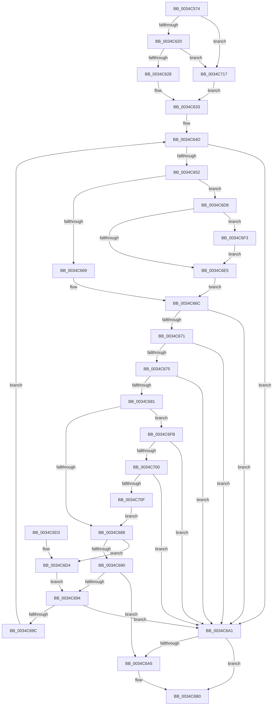

# SMKM_STORE_MGR&lt;SM_TRAITS&gt;::SmFeCheckPresent

- RVA: `0x0034C574`–`0x0034C721` (길이 `429` bytes)
- VA: `0x000000014034C574`
- 실행 섹션: `.text`
- PDB 이름 있음: `예`; PDB Function 태그: `아니요`
- unwind 정보 RVA: `0x00078724`
- 디코드: `127`개 명령, `429/429` bytes 표시
- 미해석 바이트: `0` (있으면 어셈블리에 `.byte`로 보존)

> 이 문서는 커널 이미지의 기계어와 PDB 기호를 분석해 생성했습니다. 4번과 5번은 함수 원형과 자료형을 바이너리 사용 방식에서 추정한 C 해석이며 원본 소스 복구 결과는 아닙니다.

## 1. Dependencies

- 직접 호출 지점: **3**; 고유 호출 대상: **3**
- 직접 호출자로 확인된 함수: **1**
- RIP 상대 이미지 참조: **1**

### Outgoing calls
- `0x0034C5B5` → [memset](../6C/memset_function_006C6C40.md) (function, `0x006C6C40`)
- `0x0034C60E` → [B_TREE<_SM_PAGE_KEY,SMKM_STORE_MGR<SM_TRAITS>::SMKM_FRONTEND_ENTRY,4096,B_TREE_DUMMY_NODE_POOL,B_TREE_KEY_COMPARATOR<_SM_PAGE_KEY> >::BTreeSearchKey](../26/B_TREE__SM_PAGE_KEY_SMKM_STORE_MGR_SM_TRAITS_SMKM_FRONTEND_ENTRY_4096_B_TREE_DUMMY_NODE_POOL_B_TREE__function_00266E10.md) (function, `0x00266E10`)
- `0x0034C6BA` → [_security_check_cookie](../6A/_security_check_cookie_function_006AC640.md) (function, `0x006AC640`)

### Direct callers
- [SMKM_STORE_MGR&lt;SM_TRAITS&gt;::SmReadPickStore](SMKM_STORE_MGR_SM_TRAITS_SmReadPickStore_function_0034C494.md) at `0x0034C4E1`

### Static image references
- `0x0034C58D` → RVA `0x00E0A740` (`.data`; read)

## 2. Other-region calls and transfers

- 다른 실행 섹션으로 향하는 call: **0**
- 별도 외부 분기/꼬리 이동을 확인하지 못했습니다.

## 3. Assembly (complete function range)

```asm
0034C574  40 55                           push rbp
0034C576  53                              push rbx
0034C577  56                              push rsi
0034C578  57                              push rdi
0034C579  41 54                           push r12
0034C57B  41 55                           push r13
0034C57D  41 56                           push r14
0034C57F  41 57                           push r15
0034C581  48 8D 6C 24 F8                  lea rbp, [rsp - 8]
0034C586  48 81 EC 08 01 00 00            sub rsp, 0x108
0034C58D  48 8B 05 AC E1 AB 00            mov rax, qword ptr [rip + 0xabe1ac]
0034C594  48 33 C4                        xor rax, rsp
0034C597  48 89 45 F0                     mov qword ptr [rbp - 0x10], rax
0034C59B  8B 1A                           mov ebx, dword ptr [rdx]
0034C59D  4D 8B E0                        mov r12, r8
0034C5A0  48 89 4C 24 28                  mov qword ptr [rsp + 0x28], rcx
0034C5A5  33 D2                           xor edx, edx
0034C5A7  41 B8 80 00 00 00               mov r8d, 0x80
0034C5AD  48 8D 4C 24 68                  lea rcx, [rsp + 0x68]
0034C5B2  4D 8B E9                        mov r13, r9
0034C5B5  E8 86 A6 37 00                  call 0x1406c6c40
0034C5BA  33 C9                           xor ecx, ecx
0034C5BC  48 C7 44 24 60 01 00 00 00      mov qword ptr [rsp + 0x60], 1
0034C5C5  48 89 4C 24 48                  mov qword ptr [rsp + 0x48], rcx
0034C5CA  48 8D 44 24 68                  lea rax, [rsp + 0x68]
0034C5CF  48 89 4C 24 50                  mov qword ptr [rsp + 0x50], rcx
0034C5D4  4C 8D 44 24 40                  lea r8, [rsp + 0x40]
0034C5D9  89 4C 24 58                     mov dword ptr [rsp + 0x58], ecx
0034C5DD  8B F9                           mov edi, ecx
0034C5DF  44 8B F9                        mov r15d, ecx
0034C5E2  48 89 44 24 40                  mov qword ptr [rsp + 0x40], rax
0034C5E7  41 8B 04 24                     mov eax, dword ptr [r12]
0034C5EB  41 BE 00 04 00 00               mov r14d, 0x400
0034C5F1  48 8B 4C 24 28                  mov rcx, qword ptr [rsp + 0x28]
0034C5F6  8B D3                           mov edx, ebx
0034C5F8  48 81 C1 C0 01 00 00            add rcx, 0x1c0
0034C5FF  C7 44 24 5C 08 00 00 00         mov dword ptr [rsp + 0x5c], 8
0034C607  89 44 24 20                     mov dword ptr [rsp + 0x20], eax
0034C60B  41 8B F6                        mov esi, r14d
0034C60E  E8 FD A7 F1 FF                  call 0x140266e10
0034C613  8B 44 24 58                     mov eax, dword ptr [rsp + 0x58]
0034C617  83 F8 FF                        cmp eax, -1
0034C61A  0F 84 F7 00 00 00               je 0x14034c717
0034C620  85 C0                           test eax, eax
0034C622  0F 84 EF 00 00 00               je 0x14034c717
0034C628  FF C8                           dec eax
0034C62A  48 C1 E0 04                     shl rax, 4
0034C62E  48 03 44 24 40                  add rax, qword ptr [rsp + 0x40]
0034C633  0F 10 00                        movups xmm0, xmmword ptr [rax]
0034C636  48 8B 50 08                     mov rdx, qword ptr [rax + 8]
0034C63A  44 8B 54 24 20                  mov r10d, dword ptr [rsp + 0x20]
0034C63F  48 83 EA 08                     sub rdx, 8
0034C643  0F 11 44 24 30                  movups xmmword ptr [rsp + 0x30], xmm0
0034C648  4C 8B 4C 24 30                  mov r9, qword ptr [rsp + 0x30]
0034C64D  4D 85 C9                        test r9, r9
0034C650  74 4F                           je 0x14034c6a1
0034C652  41 8B 01                        mov eax, dword ptr [r9]
0034C655  48 83 C2 08                     add rdx, 8
0034C659  0F B7 C0                        movzx eax, ax
0034C65C  48 83 C0 02                     add rax, 2
0034C660  49 8D 04 C1                     lea rax, [r9 + rax*8]
0034C664  48 3B D0                        cmp rdx, rax
0034C667  73 6F                           jae 0x14034c6d8
0034C669  48 8B CA                        mov rcx, rdx
0034C66C  48 85 C9                        test rcx, rcx
0034C66F  74 30                           je 0x14034c6a1
0034C671  3B 19                           cmp ebx, dword ptr [rcx]
0034C673  72 2C                           jb 0x14034c6a1
0034C675  41 B8 01 00 00 00               mov r8d, 1
0034C67B  44 84 41 07                     test byte ptr [rcx + 7], r8b
0034C67F  75 20                           jne 0x14034c6a1
0034C681  8A 41 06                        mov al, byte ptr [rcx + 6]
0034C684  3C 03                           cmp al, 3
0034C686  75 73                           jne 0x14034c6fb
0034C688  0F B7 41 04                     movzx eax, word ptr [rcx + 4]
0034C68C  85 FF                           test edi, edi
0034C68E  74 44                           je 0x14034c6d4
0034C690  3B F0                           cmp esi, eax
0034C692  75 11                           jne 0x14034c6a5
0034C694  41 03 F8                        add edi, r8d
0034C697  41 3B FA                        cmp edi, r10d
0034C69A  73 05                           jae 0x14034c6a1
0034C69C  41 03 D8                        add ebx, r8d
0034C69F  EB AC                           jmp 0x14034c64d
0034C6A1  85 FF                           test edi, edi
0034C6A3  74 0B                           je 0x14034c6b0
0034C6A5  41 89 3C 24                     mov dword ptr [r12], edi
0034C6A9  44 8B F6                        mov r14d, esi
0034C6AC  45 89 7D 00                     mov dword ptr [r13], r15d
0034C6B0  41 8B C6                        mov eax, r14d
0034C6B3  48 8B 4D F0                     mov rcx, qword ptr [rbp - 0x10]
0034C6B7  48 33 CC                        xor rcx, rsp
0034C6BA  E8 81 FF 35 00                  call 0x1406ac640
0034C6BF  48 81 C4 08 01 00 00            add rsp, 0x108
0034C6C6  41 5F                           pop r15
0034C6C8  41 5E                           pop r14
0034C6CA  41 5D                           pop r13
0034C6CC  41 5C                           pop r12
0034C6CE  5F                              pop rdi
0034C6CF  5E                              pop rsi
0034C6D0  5B                              pop rbx
0034C6D1  5D                              pop rbp
0034C6D2  C3                              ret
0034C6D3  CC                              int3
0034C6D4  8B F0                           mov esi, eax
0034C6D6  EB BC                           jmp 0x14034c694
0034C6D8  49 8B 41 08                     mov rax, qword ptr [r9 + 8]
0034C6DC  4C 8D 40 10                     lea r8, [rax + 0x10]
0034C6E0  48 85 C0                        test rax, rax
0034C6E3  75 0E                           jne 0x14034c6f3
0034C6E5  48 F7 D8                        neg rax
0034C6E8  48 1B C9                        sbb rcx, rcx
0034C6EB  49 23 C8                        and rcx, r8
0034C6EE  E9 79 FF FF FF                  jmp 0x14034c66c
0034C6F3  4C 8B C8                        mov r9, rax
0034C6F6  49 8B D0                        mov rdx, r8
0034C6F9  EB EA                           jmp 0x14034c6e5
0034C6FB  41 3A C0                        cmp al, r8b
0034C6FE  75 A1                           jne 0x14034c6a1
0034C700  48 8B 44 24 28                  mov rax, qword ptr [rsp + 0x28]
0034C705  8B 80 D0 07 00 00               mov eax, dword ptr [rax + 0x7d0]
0034C70B  A8 04                           test al, 4
0034C70D  74 92                           je 0x14034c6a1
0034C70F  45 8B F8                        mov r15d, r8d
0034C712  E9 71 FF FF FF                  jmp 0x14034c688
0034C717  48 8D 44 24 48                  lea rax, [rsp + 0x48]
0034C71C  E9 12 FF FF FF                  jmp 0x14034c633
```

## 4. C-style interpretation (structured pseudocode)

```c
__int64 __fastcall SMKM_STORE_MGR_SM_TRAITS___SmFeCheckPresent(__int64 a1, __int64 a2, __int64 a3, __int64 a4)
{
    __int64 result;
    __int64 v_r14;
    __int64 v_rbx;
    __int64 v_rdi;
    __int64 v_rsp;
    unsigned __int64 v_stack_m100;
    unsigned __int64 v_stack_m108;
    unsigned __int64 v_stack_m118;
    unsigned __int64 v_stack_m120;
    unsigned int v_stack_m128;
    unsigned __int64 v_stack_m48;
    unsigned __int64 v_stack_m58;
    unsigned __int64 v_stack_mE0;
    unsigned __int64 v_stack_mE8;
    unsigned int v_stack_mEC;
    unsigned int v_stack_mF0;
    unsigned __int64 v_stack_mF8;
    unsigned __int64 v_stack_p28;
    unsigned __int64 v_stack_p48;

    v_rsp = (v_rsp) - (264);
    result = (*(unsigned __int64 *)(v_rip + 11264428)) ^ (v_rsp);
    v_stack_m58 = result;
    v_stack_m120 = a1;
    a2 = 0;
    result = memset(v_stack_mE0, a2, 128, a4);
    a1 = 0;
    v_stack_mE8 = 1;
    v_stack_m100 = 0;
    v_stack_mF8 = 0;
    v_stack_mF0 = 0;
    v_stack_m108 = v_stack_mE0;
    a1 = (v_stack_m120) + (448);
    v_stack_mEC = 8;
    v_stack_m128 = (unsigned int)((unsigned int)(*(unsigned int *)(a3)));
    result = B_TREE__SM_PAGE_KEY_SMKM_STORE_MGR_SM_TRAITS___SMKM_FRONTEND_ENTRY_4096_B_TREE_DUMMY_NODE_POOL_B_TRE(a1, (unsigned int)((unsigned int)((unsigned int)(*(unsigned int *)(a2)))), v_stack_m108, a4);
    if (((unsigned int)((unsigned int)(v_stack_mF0))) == -1) goto loc_0034C717;
    if ((unsigned int)((unsigned int)(v_stack_mF0)) == 0) goto loc_0034C717;
    result = (unsigned int)(((unsigned int)(v_stack_mF0)) - 1);
    result = (result) << (4);
    result = (result) + (v_stack_m108);
loc_0034C633:
    a2 = (*(unsigned __int64 *)(result + 8)) - (8);
    v_stack_m118 = v_xmm0;
loc_0034C64D:
    if (v_stack_m118 == 0) goto loc_0034C6A1;
    a2 = (a2) + (8);
    result = ((unsigned __int16)((unsigned int)(*(unsigned int *)(v_stack_m118)))) + (2);
    if (a2 >= (v_stack_m118 + result * 8)) goto loc_0034C6D8;
loc_0034C66C:
    if (a2 == 0) goto loc_0034C6A1;
    if (((unsigned int)((unsigned int)(*(unsigned int *)(a2)))) < (*(unsigned int *)(a2))) goto loc_0034C6A1;
    if (((*(unsigned __int8 *)(a2 + 7)) & (1)) != 0) goto loc_0034C6A1;
    if (((unsigned __int8)(*(unsigned __int8 *)(a2 + 6))) != 3) goto loc_0034C6FB;
loc_0034C688:
    if (0 == 0) goto loc_0034C6D4;
    if (((unsigned int)((unsigned int)((unsigned int)((unsigned int)(0x400ULL))))) != ((unsigned int)(*(unsigned __int16 *)(a2 + 4)))) goto loc_0034C6A5;
loc_0034C694:
    v_rdi = (unsigned int)((0) + (1));
    if (((unsigned int)(v_rdi)) >= ((unsigned int)((unsigned int)(v_stack_m128)))) goto loc_0034C6A1;
    v_rbx = (unsigned int)(((unsigned int)(*(unsigned int *)(a2))) + (1));
    goto loc_0034C64D;
loc_0034C6A1:
    v_r14 = (unsigned int)(0x400ULL);
    if ((unsigned int)(v_rdi) != 0) {
        *(unsigned int *)(a3) = (unsigned int)(v_rdi);
        v_r14 = (unsigned int)((unsigned int)((unsigned int)((unsigned int)(0x400ULL))));
        *(unsigned int *)(a4) = 0;
    }
    a1 = (v_stack_m58) ^ (v_rsp);
    result = _security_check_cookie(a1, a2, 1, v_stack_m118);
    v_rsp = (v_rsp) + (264);
    return result;
loc_0034C6D4:
    goto loc_0034C694;
loc_0034C6D8:
    if (*(unsigned __int64 *)(v_stack_m118 + 8) != 0) goto loc_0034C6F3;
loc_0034C6E5:
    result = -(*(unsigned __int64 *)(v_stack_m118 + 8));
    a1 = (a1) & (*(unsigned __int64 *)(v_stack_m118 + 8) + 16);
    goto loc_0034C66C;
loc_0034C6F3:
    goto loc_0034C6E5;
loc_0034C6FB:
    if (((unsigned __int8)(result)) != ((unsigned __int8)(*(unsigned __int64 *)(v_stack_m118 + 8) + 16))) goto loc_0034C6A1;
    if ((((unsigned __int8)((unsigned int)(*(unsigned int *)(v_stack_p28 + 2000)))) & (4)) == 0) goto loc_0034C6A1;
    goto loc_0034C688;
loc_0034C717:
    goto loc_0034C633;
}
```

## 5. (Beta) C Style

```c
int64_t SMKM_STORE_MGR_SM_TRAITS___SmFeCheckPresent(int64_t Arg1, void *Arg2, void *Arg3, void *Arg4)
{
    uint8_t *arg2 = (uint8_t *)Arg2;
    uint8_t *arg3 = (uint8_t *)Arg3;
    uint8_t *arg4 = (uint8_t *)Arg4;

    int64_t result;
    int64_t local_r14;
    int64_t local_rbx;
    int64_t local_rdi;
    int64_t local_rsp;
    uint64_t v_stack_m100;
    uint64_t v_stack_m108;
    uint64_t v_stack_m118;
    uint64_t v_stack_m120;
    uint32_t v_stack_m128;
    uint64_t v_stack_m48;
    uint64_t v_stack_m58;
    uint64_t v_stack_mE0;
    uint64_t v_stack_mE8;
    uint32_t v_stack_mEC;
    uint32_t v_stack_mF0;
    uint64_t v_stack_mF8;
    uint64_t v_stack_p28;
    uint64_t v_stack_p48;

    local_rsp = (local_rsp) - (264);
    result = (*(uint64_t *)(v_rip + 0xABE1AC)) ^ (local_rsp);
    v_stack_m58 = result;
    v_stack_m120 = Arg1;
    Arg2 = 0;
    result = memset(v_stack_mE0, Arg2, 128, Arg4);
    Arg1 = 0;
    v_stack_mE8 = 1;
    v_stack_m100 = 0;
    v_stack_mF8 = 0;
    v_stack_mF0 = 0;
    v_stack_m108 = v_stack_mE0;
    Arg1 = (v_stack_m120) + (448);
    v_stack_mEC = 8;
    v_stack_m128 = (uint32_t)((uint32_t)(*(uint32_t *)(arg3)));
    result = B_TREE__SM_PAGE_KEY_SMKM_STORE_MGR_SM_TRAITS___SMKM_FRONTEND_ENTRY_4096_B_TREE_DUMMY_NODE_POOL_B_TRE(Arg1, (uint32_t)((uint32_t)((uint32_t)(*(uint32_t *)(arg2)))), v_stack_m108, Arg4);
    if (((uint32_t)((uint32_t)(v_stack_mF0))) == -1) goto loc_0034C717;
    if ((uint32_t)((uint32_t)(v_stack_mF0)) == 0) goto loc_0034C717;
    result = (uint32_t)(((uint32_t)(v_stack_mF0)) - 1);
    result = (result) << (4);
    result = (result) + (v_stack_m108);
loc_0034C633:
    Arg2 = (*(uint64_t *)(result + 0x8)) - (8);
    v_stack_m118 = v_xmm0;
loc_0034C64D:
    if (v_stack_m118 == 0) goto loc_0034C6A1;
    Arg2 = (Arg2) + (8);
    result = ((uint16_t)((uint32_t)(*(uint32_t *)(v_stack_m118)))) + (2);
    if (Arg2 >= (v_stack_m118 + result * 8)) goto loc_0034C6D8;
loc_0034C66C:
    if (Arg2 == NULL) goto loc_0034C6A1;
    if (((uint32_t)((uint32_t)(*(uint32_t *)(arg2)))) < (*(uint32_t *)(arg2))) goto loc_0034C6A1;
    if (((*(uint8_t *)(arg2 + 0x7)) & (1)) != 0) goto loc_0034C6A1;
    if (((uint8_t)(*(uint8_t *)(arg2 + 0x6))) != 3) goto loc_0034C6FB;
loc_0034C688:
    if (0 == 0) goto loc_0034C6D4;
    if (((uint32_t)((uint32_t)((uint32_t)((uint32_t)(0x400ULL))))) != ((uint32_t)(*(uint16_t *)(arg2 + 0x4)))) goto loc_0034C6A5;
loc_0034C694:
    local_rdi = (uint32_t)((0) + (1));
    if (((uint32_t)(local_rdi)) >= ((uint32_t)((uint32_t)(v_stack_m128)))) goto loc_0034C6A1;
    local_rbx = (uint32_t)(((uint32_t)(*(uint32_t *)(arg2))) + (1));
    goto loc_0034C64D;
loc_0034C6A1:
    local_r14 = (uint32_t)(0x400ULL);
    if ((uint32_t)(local_rdi) != 0) {
        *(uint32_t *)(arg3) = (uint32_t)(local_rdi);
        local_r14 = (uint32_t)((uint32_t)((uint32_t)((uint32_t)(0x400ULL))));
        *(uint32_t *)(arg4) = 0;
    }
    Arg1 = (v_stack_m58) ^ (local_rsp);
    result = _security_check_cookie(Arg1, Arg2, 1, v_stack_m118);
    local_rsp = (local_rsp) + (264);
    return result;
loc_0034C6D4:
    goto loc_0034C694;
loc_0034C6D8:
    if (*(uint64_t *)(v_stack_m118 + 0x8) != 0) goto loc_0034C6F3;
loc_0034C6E5:
    result = -(*(uint64_t *)(v_stack_m118 + 0x8));
    Arg1 = (Arg1) & (*(uint64_t *)(v_stack_m118 + 0x8) + 16);
    goto loc_0034C66C;
loc_0034C6F3:
    goto loc_0034C6E5;
loc_0034C6FB:
    if (((uint8_t)(result)) != ((uint8_t)(*(uint64_t *)(v_stack_m118 + 0x8) + 16))) goto loc_0034C6A1;
    if ((((uint8_t)((uint32_t)(*(uint32_t *)(v_stack_p28 + 0x7D0)))) & (4)) == 0) goto loc_0034C6A1;
    goto loc_0034C688;
loc_0034C717:
    goto loc_0034C633;
}
```

### 관측된 메모리 오프셋

구조체 형식이 확인되지 않은 접근은 인자 기준의 오프셋으로만 기록했습니다.

| 기준 인자 | 오프셋 표현 | 폭 (bit) | 접근 |
|---|---:|---:|---|
| `Arg2` | `+ 0x0` | `32` | `R` |
| `Arg3` | `+ 0x0` | `32` | `R` |
| `Arg3` | `+ 0x0` | `32` | `W` |
| `Arg4` | `+ 0x0` | `32` | `W` |

## 6. Execution-region graph

[열기: 2D/3D 그래프와 함수 탐색 컨트롤 패널](../../../control-panel.html?section=text&rva=0x0034C574&view=graph)

- 2D 그래프는 위에서 아래로 흐르고, 3D 그래프는 빈 공간을 드래그해 회전합니다. Shift+드래그는 이동, 휠은 확대·축소, 함수 노드 선택은 대상 보고서 이동입니다.

### Static fallback


