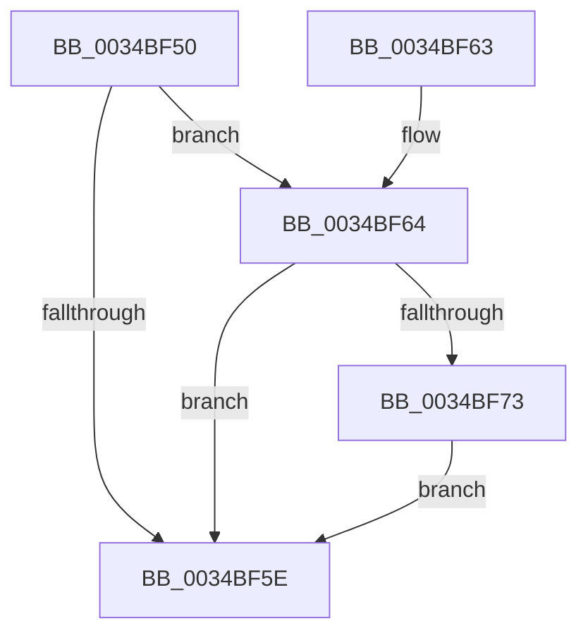

# SMKM_STORE_MGR&lt;SM_TRAITS&gt;::SmHighMemPriorityTimerStart

- RVA: `0x0034BF50`–`0x0034BFA2` (길이 `82` bytes)
- VA: `0x000000014034BF50`
- 실행 섹션: `.text`
- PDB 이름 있음: `예`; PDB Function 태그: `아니요`
- unwind 정보 RVA: `0x000786AC`
- 디코드: `19`개 명령, `82/82` bytes 표시
- 미해석 바이트: `0` (있으면 어셈블리에 `.byte`로 보존)

> 이 문서는 커널 이미지의 기계어와 PDB 기호를 분석해 생성했습니다. 4번과 5번은 함수 원형과 자료형을 바이너리 사용 방식에서 추정한 C 해석이며 원본 소스 복구 결과는 아닙니다.

## 1. Dependencies

- 직접 호출 지점: **1**; 고유 호출 대상: **1**
- 직접 호출자로 확인된 함수: **1**
- RIP 상대 이미지 참조: **0**

### Outgoing calls
- `0x0034BF9B` → [KeSetTimer2](../3A/KeSetTimer2_function_003A08E0.md) (function, `0x003A08E0`)

### Direct callers
- [SMKM_STORE_MGR&lt;SM_TRAITS&gt;::SmPageWrite](SMKM_STORE_MGR_SM_TRAITS_SmPageWrite_function_0034BA54.md) at `0x0034BC40`

### Static image references
- 디코드된 RIP-relative 메모리 참조가 없습니다.

## 2. Other-region calls and transfers

- 다른 실행 섹션으로 향하는 call: **0**
- 별도 외부 분기/꼬리 이동을 확인하지 못했습니다.

## 3. Assembly (complete function range)

```asm
0034BF50  48 83 EC 38                     sub rsp, 0x38
0034BF54  8B 81 C8 07 00 00               mov eax, dword ptr [rcx + 0x7c8]
0034BF5A  85 C0                           test eax, eax
0034BF5C  74 06                           je 0x14034bf64
0034BF5E  48 83 C4 38                     add rsp, 0x38
0034BF62  C3                              ret
0034BF63  CC                              int3
0034BF64  B8 01 00 00 00                  mov eax, 1
0034BF69  87 81 C8 07 00 00               xchg dword ptr [rcx + 0x7c8], eax
0034BF6F  85 C0                           test eax, eax
0034BF71  75 EB                           jne 0x14034bf5e
0034BF73  48 83 64 24 20 00               and qword ptr [rsp + 0x20], 0
0034BF79  4C 8D 4C 24 20                  lea r9, [rsp + 0x20]
0034BF7E  48 83 4C 24 28 FF               or qword ptr [rsp + 0x28], 0xffffffffffffffff
0034BF84  48 81 C1 20 07 00 00            add rcx, 0x720
0034BF8B  48 BA 00 A2 2F 4D FF FF FF FF   movabs rdx, 0xffffffff4d2fa200
0034BF95  41 B8 00 5E D0 B2               mov r8d, 0xb2d05e00
0034BF9B  E8 40 49 05 00                  call 0x1403a08e0
0034BFA0  EB BC                           jmp 0x14034bf5e
```

## 4. C-style interpretation (structured pseudocode)

```c
__int64 __fastcall SMKM_STORE_MGR_SM_TRAITS___SmHighMemPriorityTimerStart(__int64 a1)
{
    __int64 result;
    __int64 v_rsp;
    unsigned __int64 v_stack_p20;
    unsigned __int64 v_stack_p28;

    v_rsp = (v_rsp) - (56);
    if ((unsigned int)((unsigned int)(*(unsigned int *)(a1 + 1992))) == 0) goto loc_0034BF64;
loc_0034BF5E:
    v_rsp = (v_rsp) + (56);
    return (unsigned int)(*(unsigned int *)(a1 + 1992));
loc_0034BF64:
    if (1 != 0) goto loc_0034BF5E;
    a1 = (a1) + (0x720ULL);
    result = KeSetTimer2(a1, a2, (unsigned int)(0xB2D05E00ULL), v_stack_p20);
    goto loc_0034BF5E;
}
```

## 5. (Beta) C Style

```c
int64_t SMKM_STORE_MGR_SM_TRAITS___SmHighMemPriorityTimerStart(void *Arg1)
{
    uint8_t *arg1 = (uint8_t *)Arg1;

    int64_t result;
    int64_t local_rsp;
    uint64_t v_stack_p20;
    uint64_t v_stack_p28;

    local_rsp = (local_rsp) - (56);
    if ((uint32_t)((uint32_t)(*(uint32_t *)(arg1 + 0x7C8))) == 0) goto loc_0034BF64;
loc_0034BF5E:
    local_rsp = (local_rsp) + (56);
    return (uint32_t)(*(uint32_t *)(arg1 + 0x7C8));
loc_0034BF64:
    if (1 != 0) goto loc_0034BF5E;
    Arg1 = (Arg1) + (0x720ULL);
    result = KeSetTimer2(Arg1, a2, (uint32_t)(0xB2D05E00ULL), v_stack_p20);
    goto loc_0034BF5E;
}
```

### 관측된 메모리 오프셋

구조체 형식이 확인되지 않은 접근은 인자 기준의 오프셋으로만 기록했습니다.

| 기준 인자 | 오프셋 표현 | 폭 (bit) | 접근 |
|---|---:|---:|---|
| `Arg1` | `+ 0x7C8` | `32` | `R` |
| `Arg1` | `+ 0x7C8` | `32` | `R/W` |

## 6. Execution-region graph

[열기: 2D/3D 그래프와 함수 탐색 컨트롤 패널](../../../control-panel.html?section=text&rva=0x0034BF50&view=graph)

- 2D 그래프는 위에서 아래로 흐르고, 3D 그래프는 빈 공간을 드래그해 회전합니다. Shift+드래그는 이동, 휠은 확대·축소, 함수 노드 선택은 대상 보고서 이동입니다.

### Static fallback


