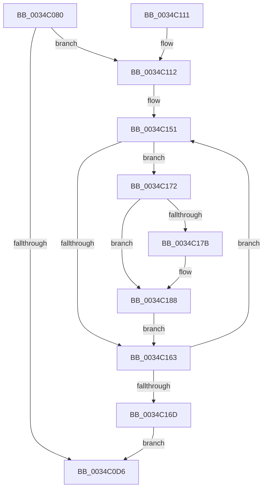

# SMKM_STORE_MGR&lt;SM_TRAITS&gt;::SmHighMemPriorityWatchdogWorker

- RVA: `0x0034C080`–`0x0034C198` (길이 `280` bytes)
- VA: `0x000000014034C080`
- 실행 섹션: `.text`
- PDB 이름 있음: `예`; PDB Function 태그: `아니요`
- unwind 정보 RVA: `0x000786CC`
- 디코드: `74`개 명령, `280/280` bytes 표시
- 미해석 바이트: `0` (있으면 어셈블리에 `.byte`로 보존)

> 이 문서는 커널 이미지의 기계어와 PDB 기호를 분석해 생성했습니다. 4번과 5번은 함수 원형과 자료형을 바이너리 사용 방식에서 추정한 C 해석이며 원본 소스 복구 결과는 아닙니다.

## 1. Dependencies

- 직접 호출 지점: **6**; 고유 호출 대상: **6**
- 직접 호출자로 확인된 함수: **0**
- RIP 상대 이미지 참조: **1**

### Outgoing calls
- `0x0034C0CB` → [SmQuerySystemInformation](../3B/SmQuerySystemInformation_function_003B29F8.md) (function, `0x003B29F8`)
- `0x0034C0EA` → [guard_dispatch_icall](../6B/guard_dispatch_icall_function_006BAAD0.md) (function, `0x006BAAD0`)
- `0x0034C0F7` → [_security_check_cookie](../6A/_security_check_cookie_function_006AC640.md) (function, `0x006AC640`)
- `0x0034C156` → [SmKmStoreReferenceEx](SmKmStoreReferenceEx_function_0034BDF0.md) (function, `0x0034BDF0`)
- `0x0034C183` → [SMKM_STORE<SM_TRAITS>::SmStPrioritizeRegionsStore](SMKM_STORE_SM_TRAITS_SmStPrioritizeRegionsStore_function_0034DE28.md) (function, `0x0034DE28`)
- `0x0034C191` → [SmKmStoreDereference](../20/SmKmStoreDereference_function_00206574.md) (function, `0x00206574`)

### Direct callers
- 이 함수 시작 RVA로 연결되는 직접 call은 확인되지 않았습니다. 간접 호출은 완전히 역산할 수 없습니다.

### Static image references
- `0x0034C093` → RVA `0x00E0A740` (`.data`; read)

## 2. Other-region calls and transfers

- 다른 실행 섹션으로 향하는 call: **0**
- 별도 외부 분기/꼬리 이동을 확인하지 못했습니다.

## 3. Assembly (complete function range)

```asm
0034C080  4C 8B DC                        mov r11, rsp
0034C083  49 89 5B 10                     mov qword ptr [r11 + 0x10], rbx
0034C087  49 89 6B 18                     mov qword ptr [r11 + 0x18], rbp
0034C08B  56                              push rsi
0034C08C  57                              push rdi
0034C08D  41 56                           push r14
0034C08F  48 83 EC 70                     sub rsp, 0x70
0034C093  48 8B 05 A6 E6 AB 00            mov rax, qword ptr [rip + 0xabe6a6]
0034C09A  48 33 C4                        xor rax, rsp
0034C09D  48 89 44 24 60                  mov qword ptr [rsp + 0x60], rax
0034C0A2  0F 57 C0                        xorps xmm0, xmm0
0034C0A5  48 8D B9 58 F8 FF FF            lea rdi, [rcx - 0x7a8]
0034C0AC  4C 8B F1                        mov r14, rcx
0034C0AF  4D 8D 43 A0                     lea r8, [r11 - 0x60]
0034C0B3  33 C0                           xor eax, eax
0034C0B5  48 8B CF                        mov rcx, rdi
0034C0B8  0F 11 44 24 28                  movups xmmword ptr [rsp + 0x28], xmm0
0034C0BD  0F 11 44 24 38                  movups xmmword ptr [rsp + 0x38], xmm0
0034C0C2  0F 11 44 24 48                  movups xmmword ptr [rsp + 0x48], xmm0
0034C0C7  49 89 43 D0                     mov qword ptr [r11 - 0x30], rax
0034C0CB  E8 28 69 06 00                  call 0x1403b29f8
0034C0D0  33 ED                           xor ebp, ebp
0034C0D2  85 C0                           test eax, eax
0034C0D4  79 3C                           jns 0x14034c112
0034C0D6  49 87 6E 18                     xchg qword ptr [r14 + 0x18], rbp
0034C0DA  48 8B 87 D8 07 00 00            mov rax, qword ptr [rdi + 0x7d8]
0034C0E1  33 D2                           xor edx, edx
0034C0E3  48 8B CF                        mov rcx, rdi
0034C0E6  44 8D 42 09                     lea r8d, [rdx + 9]
0034C0EA  E8 E1 E9 36 00                  call 0x1406baad0
0034C0EF  48 8B 4C 24 60                  mov rcx, qword ptr [rsp + 0x60]
0034C0F4  48 33 CC                        xor rcx, rsp
0034C0F7  E8 44 05 36 00                  call 0x1406ac640
0034C0FC  4C 8D 5C 24 70                  lea r11, [rsp + 0x70]
0034C101  49 8B 5B 28                     mov rbx, qword ptr [r11 + 0x28]
0034C105  49 8B 6B 30                     mov rbp, qword ptr [r11 + 0x30]
0034C109  49 8B E3                        mov rsp, r11
0034C10C  41 5E                           pop r14
0034C10E  5F                              pop rdi
0034C10F  5E                              pop rsi
0034C110  C3                              ret
0034C111  CC                              int3
0034C112  48 81 7C 24 28 00 00 40 51      cmp qword ptr [rsp + 0x28], 0x51400000
0034C11B  B8 00 3C 00 00                  mov eax, 0x3c00
0034C120  B9 00 F4 01 00                  mov ecx, 0x1f400
0034C125  8B F5                           mov esi, ebp
0034C127  0F 46 C8                        cmovbe ecx, eax
0034C12A  48 B8 CD CC CC CC CC CC CC CC   movabs rax, 0xcccccccccccccccd
0034C134  48 F7 64 24 28                  mul qword ptr [rsp + 0x28]
0034C139  48 C1 EA 04                     shr rdx, 4
0034C13D  48 C1 EA 0C                     shr rdx, 0xc
0034C141  48 8D 04 52                     lea rax, [rdx + rdx*2]
0034C145  48 3B C1                        cmp rax, rcx
0034C148  48 0F 43 C1                     cmovae rax, rcx
0034C14C  48 89 44 24 20                  mov qword ptr [rsp + 0x20], rax
0034C151  8B D6                           mov edx, esi
0034C153  48 8B CF                        mov rcx, rdi
0034C156  E8 95 FC FF FF                  call 0x14034bdf0
0034C15B  48 8B D8                        mov rbx, rax
0034C15E  48 85 C0                        test rax, rax
0034C161  75 0F                           jne 0x14034c172
0034C163  FF C6                           inc esi
0034C165  81 FE 00 04 00 00               cmp esi, 0x400
0034C16B  72 E4                           jb 0x14034c151
0034C16D  E9 64 FF FF FF                  jmp 0x14034c0d6
0034C172  80 B8 97 1A 00 00 01            cmp byte ptr [rax + 0x1a97], 1
0034C179  74 0D                           je 0x14034c188
0034C17B  48 8D 54 24 20                  lea rdx, [rsp + 0x20]
0034C180  48 8B CB                        mov rcx, rbx
0034C183  E8 A0 1C 00 00                  call 0x14034de28
0034C188  8B 93 90 1A 00 00               mov edx, dword ptr [rbx + 0x1a90]
0034C18E  48 8B CF                        mov rcx, rdi
0034C191  E8 DE A3 EB FF                  call 0x140206574
0034C196  EB CB                           jmp 0x14034c163
```

## 4. C-style interpretation (structured pseudocode)

```c
__int64 __fastcall SMKM_STORE_MGR_SM_TRAITS___SmHighMemPriorityWatchdogWorker(__int64 a1, int a2)
{
    __int64 result;
    __int64 v_rbp;
    __int64 v_rsi;
    __int64 v_rsp;
    unsigned __int64 v_stack_m18;
    unsigned __int64 v_stack_m28;
    unsigned __int64 v_stack_m40;
    unsigned __int64 v_stack_m48;
    unsigned __int64 v_stack_m50;
    unsigned __int64 v_stack_m60;

    *(unsigned __int64 *)(v_rsp + 16) = v_rbx;
    *(unsigned __int64 *)(v_rsp + 24) = v_rbp;
    v_rsp = (v_rsp) - (112);
    result = (*(unsigned __int64 *)(v_rip + 11265702)) ^ (v_rsp);
    v_stack_m28 = result;
    result = 0;
    v_stack_m60 = v_xmm0;
    v_stack_m50 = v_xmm0;
    v_stack_m40 = v_xmm0;
    *(unsigned __int64 *)(v_rsp - 48) = 0;
    result = SmQuerySystemInformation(a1 - 1960, a2, v_rsp - 96, a4);
    v_rbp = 0;
    if (!sign_flag) goto loc_0034C112;
loc_0034C0D6:
    a2 = 0;
    result = guard_dispatch_icall(a1 - 1960, a2, a2 + 9, a4);
    a1 = (v_stack_m28) ^ (v_rsp);
    result = _security_check_cookie(a1, a2, a2 + 9, a4);
    return result;
loc_0034C112:
    a1 = (unsigned int)(0x1F400ULL);
    if (v_stack_m48 <= 0x51400000ULL) { a1 = (unsigned int)((unsigned int)(0x3C00ULL)); }
    a2 = (a2) >> (4);
    a2 = (a2) >> (12);
    result = a2 + a2 * 2;
    if ((a2 + a2 * 2) >= a1) { result = a1; }
    v_stack_m50 = result;
loc_0034C151:
    result = SmKmStoreReferenceEx(a1 - 1960, (unsigned int)((unsigned int)((unsigned int)((unsigned int)(*(unsigned __int64 *)(v_stack_m18 + 48))))), a2 + 9, a4);
    if (result != 0) goto loc_0034C172;
loc_0034C163:
    v_rsi = (unsigned int)(((unsigned int)((unsigned int)(*(unsigned __int64 *)(v_stack_m18 + 48)))) + 1);
    if (((unsigned int)(v_rsi)) < 0x400ULL) goto loc_0034C151;
    goto loc_0034C0D6;
loc_0034C172:
    if ((*(unsigned __int8 *)(result + 6807)) != 1) {
        a2 = v_stack_m50;
        a1 = result;
        result = SMKM_STORE_SM_TRAITS___SmStPrioritizeRegionsStore(a1, a2, a2 + 9, a4);
    }
    result = SmKmStoreDereference(a1 - 1960, (unsigned int)(*(unsigned int *)(result + 6800)), a2 + 9, a4);
    goto loc_0034C163;
}
```

## 5. (Beta) C Style

```c
int64_t SMKM_STORE_MGR_SM_TRAITS___SmHighMemPriorityWatchdogWorker(void *Arg1, int32_t Arg2)
{
    uint8_t *arg1 = (uint8_t *)Arg1;

    int64_t result;
    int64_t local_rbp;
    int64_t local_rsi;
    int64_t local_rsp;
    uint64_t v_stack_m18;
    uint64_t v_stack_m28;
    uint64_t v_stack_m40;
    uint64_t v_stack_m48;
    uint64_t v_stack_m50;
    uint64_t v_stack_m60;

    *(uint64_t *)(local_rsp + 0x10) = local_rbx;
    *(uint64_t *)(local_rsp + 0x18) = local_rbp;
    local_rsp = (local_rsp) - (112);
    result = (*(uint64_t *)(v_rip + 0xABE6A6)) ^ (local_rsp);
    v_stack_m28 = result;
    result = 0;
    v_stack_m60 = v_xmm0;
    v_stack_m50 = v_xmm0;
    v_stack_m40 = v_xmm0;
    *(uint64_t *)(local_rsp - 0x30) = 0;
    result = SmQuerySystemInformation(Arg1 - 1960, Arg2, local_rsp - 96, a4);
    local_rbp = 0;
    if (!sign_flag) goto loc_0034C112;
loc_0034C0D6:
    Arg2 = 0;
    result = guard_dispatch_icall(Arg1 - 1960, Arg2, Arg2 + 9, a4);
    Arg1 = (v_stack_m28) ^ (local_rsp);
    result = _security_check_cookie(Arg1, Arg2, Arg2 + 9, a4);
    return result;
loc_0034C112:
    Arg1 = (uint32_t)(0x1F400ULL);
    if (v_stack_m48 <= 0x51400000ULL) { Arg1 = (uint32_t)((uint32_t)(0x3C00ULL)); }
    Arg2 = (Arg2) >> (4);
    Arg2 = (Arg2) >> (12);
    result = Arg2 + Arg2 * 2;
    if ((Arg2 + Arg2 * 2) >= Arg1) { result = Arg1; }
    v_stack_m50 = result;
loc_0034C151:
    result = SmKmStoreReferenceEx(Arg1 - 1960, (uint32_t)((uint32_t)((uint32_t)((uint32_t)(*(uint64_t *)(v_stack_m18 + 0x30))))), Arg2 + 9, a4);
    if (result != 0) goto loc_0034C172;
loc_0034C163:
    local_rsi = (uint32_t)(((uint32_t)((uint32_t)(*(uint64_t *)(v_stack_m18 + 0x30)))) + 1);
    if (((uint32_t)(local_rsi)) < 0x400ULL) goto loc_0034C151;
    goto loc_0034C0D6;
loc_0034C172:
    if ((*(uint8_t *)(result + 0x1A97)) != 1) {
        Arg2 = v_stack_m50;
        Arg1 = result;
        result = SMKM_STORE_SM_TRAITS___SmStPrioritizeRegionsStore(Arg1, Arg2, Arg2 + 9, a4);
    }
    result = SmKmStoreDereference(Arg1 - 1960, (uint32_t)(*(uint32_t *)(result + 0x1A90)), Arg2 + 9, a4);
    goto loc_0034C163;
}
```

### 관측된 메모리 오프셋

구조체 형식이 확인되지 않은 접근은 인자 기준의 오프셋으로만 기록했습니다.

| 기준 인자 | 오프셋 표현 | 폭 (bit) | 접근 |
|---|---:|---:|---|
| `Arg1` | `- 0x7A8` | `64` | `R` |
| `Arg1` | `+ 0x18` | `64` | `R/W` |
| `Arg1` | `+ 0x7D8` | `64` | `R` |

## 6. Execution-region graph

[열기: 2D/3D 그래프와 함수 탐색 컨트롤 패널](../../../control-panel.html?section=text&rva=0x0034C080&view=graph)

- 2D 그래프는 위에서 아래로 흐르고, 3D 그래프는 빈 공간을 드래그해 회전합니다. Shift+드래그는 이동, 휠은 확대·축소, 함수 노드 선택은 대상 보고서 이동입니다.

### Static fallback


